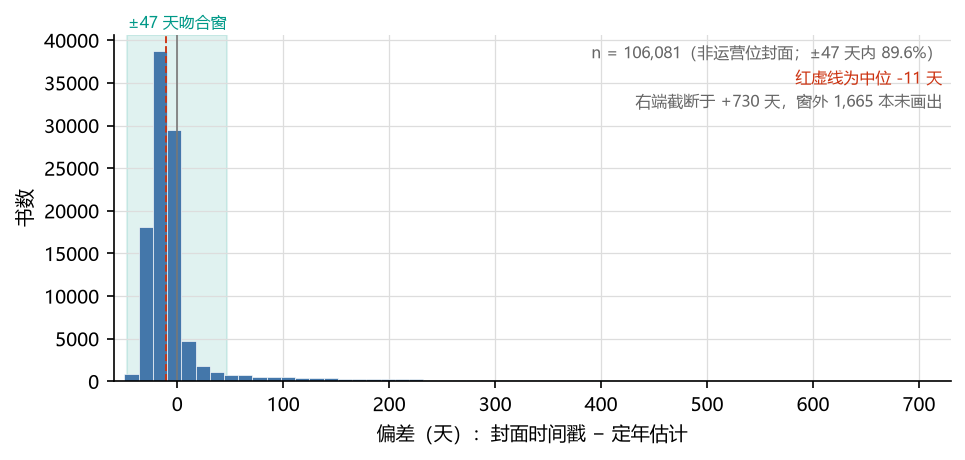
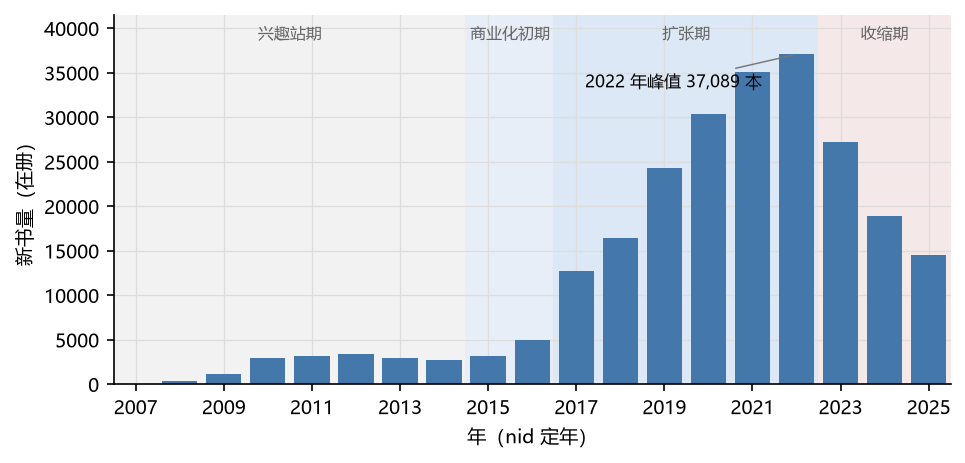
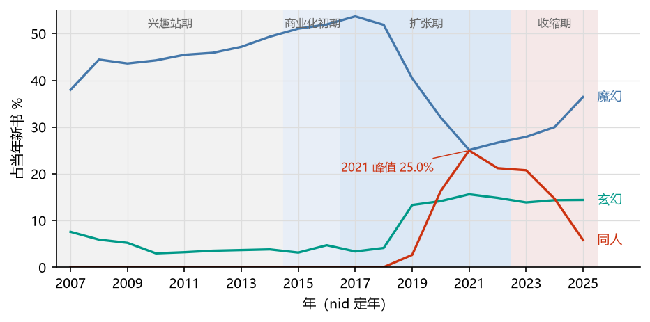
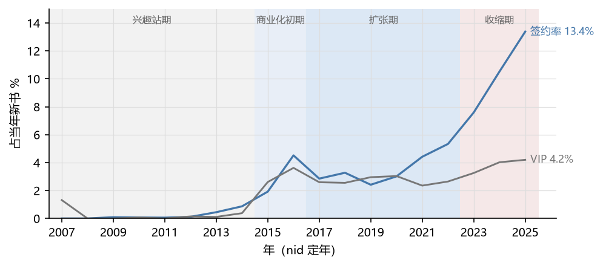
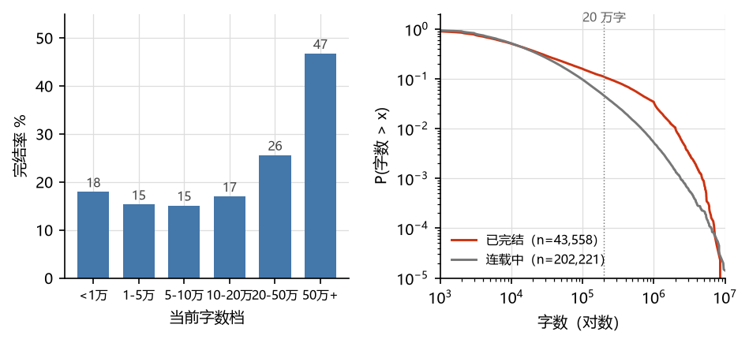

# 01 · 市场结构：供给、题材与完结形态

> 口径声明：
> 1. 数据源 `analysis/out/novels.csv`，245,779 行，当前在册作品。已剔除下架、
>    空状态、无文字书名且无内容、正版日轻等六类行（判据见 `analysis/config.py`），
>    年度量因此是存活口径，历史真实供给高于此值。
> 2. 年份由 nid 定年（`analysis/eras.py`），不是 `updated_at`；方法、误差与
>    API 锚点 / 封面时间戳 / 外部史料 / 精确创建时间四条证据链见 §1。
>    封面验证已剔除运营位书（平台同步换封面，非创建时间）。
> 3. 快照采集于 2026-06-13，且 2026-05 之后新书在快照中的可见性骤降
>    （nid 流速不变、成书率降至约 1/14），**年度序列止于 2025**。
> 4. 完结率含右删失：世代越新，完结概率越被低估，跨世代比较只对
>    存活 4 年以上的世代有效。
> 5. **正版日轻（版权方账号 47 行）整行剔除**：站点早期存在大量盗版日轻，
>    正版授权版复用了同标题盗版条目的旧 id，其 nid 不遵守 id 递增，会污染
>    定年、世代与商业化统计；授权到期亦可使在册状态失效。该批全部为 VIP、
>    全部在运营位，剔除后 2006 世代为空、早期年份的 VIP 占比回落。

---

## 0. 结论

1. **供给是单峰曲线**：2017 年供给跳至 2.6 倍进入扩张期，2022 年达峰
   37,089 本，2025 年降至 14,569 本（−61%）。
   扩张期六年贡献全库 64%。
2. **题材结构两次位移**：魔幻 46% → 31%（日式奇幻收缩），玄幻 3.6% → 14.2%
   （网文品类扩张）；同人 2019 年起放量，2021 年峰值占 25.0%，收缩先于总供给。
3. **收缩期商业化反而加深**：签约率从 0.3% 升至 2025 世代的 13.4%，
   VIP 份额 20 年恒定约 3%。同人签约率仅 2.2%（非同人 6.3%），版权归属
   将该品类排除在付费体系之外。
4. **完结是长篇的属性**：总完结率 17.7%，50 万字以上作品 46.7% 完结，
   完结作品 P90 字数是连载作品的 2.4 倍。

---

## 1. 定年方法与误差

`updated_at` 是最后更新时间，老书的一次编辑可晚于创建十年以上，不能作时间轴。
本报告的年份由 `analysis/eras.py` 定年：91 个 API 实测锚点（作品创建时间
`addTime`，2006-08 至 2026-06），在 log(nid) 空间分段线性插值——nid 增速
20 年间增长约 180 倍，log 空间更接近匀速。

锚点插值误差用留一法实测（留出单元为同秒时间戳整组锚点，防双胞胎泄漏）：

| 情形 | 锚点数 | \|误差\| 中位（天） | P90 | P99 |
|---|---:|---:|---:|---:|
| 锚点间插值 | 88 | 0 | 0 | 74 |
| 边界外推 | 3 | — | — | 最大 482 |

本数据集 id 全部落在锚点区间内（无外推）。置信度分布：high 57.5%、
mid 33.1%、low 9.4%。低置信集中在 2007–2016
（锚点稀疏年代），该区间的年份误差可达数月，年表中的行量与份额以下限可靠性解读。

最低端的 3 个锚点（nid 2242/2243/2347）对应的作品是本口径剔除的正版日轻：
站点早期挂载盗版日轻，后出的正版授权版复用了旧 id。锚点记录的是 **nid 本身**
的创建时刻，对其他书的 id→日期映射仍然有效，故保留；失效的只是「书与其 id
同时出生」这一假设，即那 47 行不入分析。

### 封面时间戳交叉验证

`cover_url` 保留着封面文件的上传时间（路径 `YYYY/MM`），构成与 API 锚点
相互独立的**第二条证据链**。封面更换会换新文件，时间戳记录最后一次上传，
一般不早于创建时间。爬虫缺陷产生的共用封面（组内 id 最大者为属主，其余为错值）
已在构建时清洗，余下均为属主封面。

**运营位书必须剔除**：`featured=1` 的非日轻由平台在 banner 更新后一段时间
同步更换封面，操作方是平台而非作者，其时间戳记录的是运营操作、不是作品创建。
实测 71 本有封面的运营位书偏差中位 +338 天、
±47 天窗口内 0 本；剔除后验证样本为 106,081 本：

| 指标 | 值 |
|---|---|
| 偏差（封面时间戳 − 定年估计）中位 | -11 天 |
| P5 / P95 | -29 / +231 天 |
| 落在 ±47 天内（双侧吻合） | 88.9% |
| 早于估计 31 天以上（草稿期提前量） | 2,476 本（2.33%），最大提前 47 天 |
| 晚于估计 365 天以上（后续换封面） | 3.44% |
| 提前量分层 | high 1.36% · mid 4.05% |

偏差中位为负、88.9% 落在 ±47 天内，与「草稿阶段先传封面、后正式上架」
的流程一致。右侧 11.1% 晚于 47 天、其中 3.44% 晚于一年，
属后续换封面（含 banner 已撤下但封面未回退的书），不构成反证——时间戳记的是
最后一次上传，只能给出创建的弱下界，不可逐本反推上架日。需注意
「封面未早于估计 31 天以上」占 97.7%，只约束提前方向，
与双侧 ±47 天吻合率 88.9% 不是同一指标。
low 区间（2007–2016）封面多被更换，验证在该区间失效而非通过。

### 外部史料交叉验证

API 锚点是定年曲线的输入，留一法误差只度量插值内洽性；封面时间戳虽独立观测，
仍来自站点自身数据。二者都无法排除曲线整体年代偏移。第三条证据链完全独立于
本数据集：北京大学网络文学研究团队《中国网络文学编年简史》（邵燕君、李强主编，
北京大学出版社，2023）的 SF轻小说词条与简史，给出 2004–2018 逐条纪事及代表作
年份（`analysis/references/sfacg-pku-chronicle.md`）。下列 7 部作品以
「书名 + 作者」双条件定位，取同作者下最小 nid 的条目：

| 作品 | 史料年份 | nid 定年 | 偏差（年） | 置信 |
|---|---|---|---|---|
| 《英雄？我早就不当了》 | 2016 | 2016（2016-02-04） | 0 | low |
| 《我是我妻》 | 2015 | 2015（2015-04-07） | 0 | low |
| 《我是高富帅》 | 2012 | 2013（2013-01-09） | +1 | low |
| 《请别告诉我这是三国正史》 | 2012 | 2012（2012-09-06） | 0 | low |
| 《史上最强BOSS就是本大爷》 | 2012 | 2012（2012-12-07） | 0 | low |
| 《因为我是开武器店的大叔》 | 2015 | 2015（2015-08-01） | 0 | low |
| 《变身之后，我与她的狂想曲》 | 2015 | 2015（2015-06-29） | 0 | low |

6/7 部定年与史料年份一致；唯一偏差为《我是高富帅》
（史料 2012、定年 2013-01）。外部另给出该书创建日 2012-12-12（误差 <7 天），
与定年仅差 28 天——**所谓「+1 年」是年粒度比较在跨年边界上放大的
表观偏差，不是年量级误差**，真实误差属 low 段（插值间隔 668 天）的月级量级。
该检验不依赖任何站点统计字段，是对定年曲线**绝对年代位置**的独立校准。需注意这
7 部作品全部集中在 2012–2016，即 low 置信段：它校准的正是锚点稀疏的早期区间。
high/mid 段的绝对位置此前仅由密集 API 锚点保证，下节的精确创建时间校验补上这一空白；
再下一节把 low 段误差从定性变为定量。

站点级事件亦吻合：文学频道 2006-08-23 上线，最早 API 锚点为 2006-08-26，
相差 3 天；2010-04-05 改版将既有作品分为 15 类（含「冒险类」「爱情类」），
解释了数据集中 2 行无法归入现行 9 类的记录属旧分类未迁移、而非站点错误，
并说明「同人类」自 2010 年即存在；2012-08-28 应版权方要求下架《刀剑神域》《加速世界》
等日轻，与早期搬运书下架、正版授权版复用旧 id 的现象同源。
商业化节点的精确日期（2014-12-04 iOS 客户端、2015-01-27 奥飞天使轮、
2015-05-07 VIP 付费、2015-09-01 安卓客户端、2016-01-13 自动签约通道）
为 §2 的分期提供依据。

### 精确创建时间校验

第四条证据链是外部核实的作品创建时间（`analysis/anchors/verified_dates.jsonl`，
9 条，`bound_type=exact`）。它是等式约束，强于网络时光机快照只能给出的上界，
且独立于 91 个 API 锚点；**不参与插值**，仅用于回测曲线的绝对年代位置：

| nid | 作品 | 精确创建时间 | nid 定年 | 偏差（天） | 置信 |
|---|---|---|---|---|---|
| 26697 | 《史上最强BOSS就是本大爷》 | 2012-10-18 | 2012-12-07 | -50 | low |
| 40723 | 《我是我妻》 | 2015-04-20 | 2015-04-07 | +13 | low |
| 42229 | 《变身之后，我与她的狂想曲》 | 2015-07-17 | 2015-06-29 | +18 | low |
| 42842 | 《因为我是开武器店的大叔》 | 2015-08-06 | 2015-08-01 | +5 | low |
| 55564 | 《武林之王的退隐生活》 | 2016-09-09 | 2016-08-04 | +36 | low |
| 619932 | 《被偏执精灵女王变成了她妹妹》 | 2023-01-28 | 2023-01-28 | 0 | high |
| 666497 | 《闭嘴恶龙我不想再跟你带孩子了》 | 2023-09-20 | 2023-09-23 | -3 | high |
| 677177 | 《她们认清感情，骑士却已转生幼狐》 | 2023-12-29 | 2023-12-05 | +24 | mid |
| 730611 | 《恶役少爷怎么可能会是圣女？》 | 2024-12-27 | 2024-12-28 | -1 | mid |

偏差 -50 / +13 / +18 / +5 / +36 / 0 / -3 / +24 / -1 天（插值间隔依次 668 天 / 870 天 / 870 天 / 870 天 / 478 天 / 67 天 / 84 天 / 105 天 / 149 天），分两段解读。2023–2024 段 4 条
（high 2、mid 2）：high 段最大偏差绝对值 3 天、mid 段 24 天，
均在同一月份内且方向不一致，未显示该区间存在系统性年份偏移；这 4 条首次把
等式级独立校准覆盖到 high/mid 段（此前史料代表作全部落在 low 段）。
low 段 5 条偏差 -50 / +13 / +18 / +5 / +36 天，方向呈现系统性模式，与下节粗略日期合并分析。

其中 666497 与 low 段 5 条独立给出；2023–2024 段其余三条同作者、同征文系列
且需配对判定；n=9 不构成统计样本，只用于绝对日期校验。配对依据、
来源边界与量化影响见 `analysis/references/verified-dates.md`。校验集不并入
插值锚点：并入实测将改动全库 32,181 行（13.1%）定年、其中 1,965 行跨年度
边界，并改变留一法误差口径；low 段虽测出段内方向一致的系统性偏差（见下节），
但其量级仅一至两个半月、证据未附可复核来源，默认不并入，重标定与否待定。

### low 段误差实测（精确 + 粗略合并）

low 置信段现有 8 个外部校验点：5 条精确创建时间（上表 low 行）与 3 条粗略
参考日期（`analysis/anchors/approximate_dates.jsonl`，误差小于 7 天、约 80%
即为准确创建日，可作等式级回测而非月级软约束）：

| nid | 作品 | 参考日期（±7 天） | nid 定年 | 偏差（天） | 置信 |
|---|---|---|---|---|---|
| 24719 | 《请别告诉我这是三国正史！》 | 2012-07-11 | 2012-09-06 | -57 | low |
| 27454 | 《我是高富帅》 | 2012-12-12 | 2013-01-09 | -28 | low |
| 48704 | 《英雄再临(英雄？我早就不当了)》 | 2016-04-20 | 2016-02-04 | +76 | low |

8 点全部落在锚点稀疏区间（插值间隔 478–870 天），按相邻锚点区间
分组后偏差方向完全一致：

| 锚点区间 | 校验点 | 偏差（天） | 方向 |
|---|---|---|---|
| 2012 段（锚点 nid 16,871 → 29,547，间隔 668 天） | 3 | −57 / −50 / −28 | 全负：定年偏晚 1–2 个月 |
| 2015–16 段（锚点 nid 29,547 → 61,157，间隔 870 / 478 天） | 5 | +5 / +13 / +18 / +36 / +76 | 全正：定年偏早 1–2.5 个月 |

这是 low 段定年误差的首个定量实测，且已从随机误差升级为**段内方向一致的
系统性模式**：参考日误差不超过 7 天，偏差只能来自插值本身，提示该段
log(nid) 插值的局部斜率存在可修正偏差（2012 段定年偏晚、2015–16 段偏早）。
但修正影响面大——并入实测将改动 32,181 行（13.1%）定年、1,965 行跨年度
边界——且证据未附可复核来源，默认不并入曲线；若确认重标定，将连带改变
三份报告的年度统计。残差量级与「年份误差可达数月」的声明一致；年粒度
比较在跨年边界放大小误差的现象不变（《我是高富帅》为一例）。

---

## 2. 供给年表与分期

新书量指「该年创建、快照时仍在册」的作品，是存活口径的下界：已下架作品
（含早期引进清理）不在数据集内，早期年份的绝对量被低估，方向不可归因。

| 年 | 新书 | 完结率% | 签约% | VIP% | 字数中位 | 存活年数 |
|---|---|---|---|---|---|---|
| 2007 | 76 | 13.2 | 0.0 | 1.3 | 12,428 | 19 |
| 2008 | 404 | 12.9 | 0.0 | 0.0 | 10,526 | 18 |
| 2009 | 1,126 | 14.6 | 0.1 | 0.0 | 12,724 | 17 |
| 2010 | 2,947 | 10.8 | 0.1 | 0.1 | 9,981 | 16 |
| 2011 | 3,193 | 11.5 | 0.0 | 0.0 | 12,182 | 15 |
| 2012 | 3,412 | 10.9 | 0.1 | 0.1 | 16,109 | 14 |
| 2013 | 2,983 | 11.0 | 0.4 | 0.1 | 12,463 | 13 |
| 2014 | 2,691 | 13.6 | 0.9 | 0.4 | 13,508 | 12 |
| 2015 | 3,176 | 14.4 | 2.6 | 2.8 | 19,386 | 11 |
| 2016 | 4,995 | 13.2 | 4.4 | 3.7 | 19,091 | 10 |
| 2017 | 12,759 | 10.9 | 2.9 | 2.6 | 14,843 | 9 |
| 2018 | 16,469 | 12.4 | 3.3 | 2.6 | 12,443 | 8 |
| 2019 | 24,263 | 17.5 | 2.4 | 3.0 | 10,541 | 7 |
| 2020 | 30,372 | 24.4 | 3.0 | 3.0 | 10,826 | 6 |
| 2021 | 35,156 | 23.8 | 4.4 | 2.4 | 7,860 | 5 |
| 2022 | 37,089 | 18.8 | 5.3 | 2.6 | 7,781 | 4 |
| 2023 | 27,207 | 16.7 | 7.7 | 3.3 | 8,380 | 3 |
| 2024 | 18,871 | 16.4 | 10.5 | 4.0 | 9,883 | 2 |
| 2025 | 14,569 | 13.9 | 13.4 | 4.2 | 16,743 | 1 |

（2006 世代的 3 本引进书已按口径整行剔除，年表自 2007 起；理由见口径声明 5。）

分期依据供给曲线的形态断点，与平台事件互证：

| 分期 | 书量 | 依据 |
|---|---:|---|
| 2006-2014 兴趣站期 | 16,832 | 年供给 76–3,412 本；2014 年商业化转型（百科词条） |
| 2015-2016 商业化初期 | 8,171 | 2015 年 APP 上线；供给仍在 3–5 千本 |
| 2017-2022 扩张期 | 156,108 | 2017 年供给跳至 2.6 倍；2018 A 轮、2022 B 轮 |
| 2023-2026 收缩期 | 64,668 | 供给自峰值连续三年回落 |

供给侧的核心事实是**扩张期占全库 64%**：
2017–2022 六年贡献了约 15.6 万本，其中 2022 年 37,089 本为峰值，
至 2025 年降至 14,569 本（−61%）。

「存活年数」列提示两处口径陷阱：完结率随世代变新而下降（§5），
字数中位随世代变新而偏低（连载作品仍在累积），两者都不是行为变化的充分证据。
但 2023–2025 字数中位回升（8,380 → 9,883 → 16,743）与删失方向相反——
新世代累积时间更短、中位反而更高，说明收缩期作品向长篇集中。

---

## 3. 题材结构变迁

各期题材份额（占该期新书 %）：

| 期 | 魔幻 | 玄幻 | 古风 | 科幻 | 校园 | 都市 | 游戏 | 同人 | 悬疑 |
|---|---|---|---|---|---|---|---|---|---|
| 2006-14 | 46.1 | 3.6 | 2.2 | 9.6 | 20.2 | 12.9 | 1.2 | 0.0 | 4.1 |
| 2015-16 | 51.6 | 4.1 | 2.6 | 9.2 | 15.7 | 10.7 | 2.3 | 0.0 | 3.8 |
| 2017-22 | 34.4 | 12.6 | 3.3 | 7.2 | 12.3 | 8.4 | 5.8 | 14.3 | 1.8 |
| 2023-26 | 31.0 | 14.2 | 3.9 | 5.8 | 11.9 | 11.4 | 5.1 | 14.5 | 2.1 |

两条结构性位移贯穿 20 年：

1. **魔幻收缩、玄幻扩张**。魔幻份额从兴趣站期的 46.1% 降至收缩期的 31.0%，
   玄幻同期从 3.6% 升至 14.2%。前者是日式奇幻（异世界、魔王勇者）的本土容器，
   后者是中式网文品类——位移方向即平台的去日轻化。
2. **同人是扩张期才出现的品类**。2018 年及以前累计仅 11 本，
   2019 年起放量：份额 2.7% → 25.0%（2021 峰值）
   → 5.8%（2025）。峰值一过即回落，回落幅度（−19.2 个百分点）
   与供给收缩同步。同人依赖在站 IP（鬼灭、Fate 等）的原生受众，其收缩先于
   总供给收缩发生。

各题材全库概况：

| 题材 | 书量 | 份额% | 完结率% | 字数中位 |
|---|---|---|---|---|
| 魔幻 | 85,696 | 34.9 | 14.7 | 13,804 |
| 玄幻 | 29,798 | 12.1 | 18.7 | 9,968 |
| 古风 | 8,258 | 3.4 | 18.1 | 11,957 |
| 科幻 | 17,366 | 7.1 | 17.4 | 10,670 |
| 校园 | 31,595 | 12.9 | 17.2 | 10,872 |
| 都市 | 23,450 | 9.5 | 18.8 | 9,412 |
| 游戏 | 12,782 | 5.2 | 20.0 | 8,596 |
| 同人 | 31,664 | 12.9 | 23.5 | 5,398 |
| 悬疑 | 5,170 | 2.1 | 20.5 | 8,452 |

古风的字数形态独立于其他品类：字数中位 11,957 不算突出，但 P90 达 228,425 字，
为九类最高——长篇集中于古风。

---

## 4. 商业化进程

| 期 | 免费% | 签约% | VIP% |
|---|---|---|---|
| 2006-2014 兴趣站期 | 99.6 | 0.3 | 0.1 |
| 2015-2016 商业化初期 | 93.0 | 3.7 | 3.3 |
| 2017-2022 扩张期 | 93.5 | 3.8 | 2.7 |
| 2023-2026 收缩期 | 86.0 | 10.2 | 3.7 |

签约率是唯一单调上行的时间序列：兴趣站期 0.3% → 收缩期 10.2%。
2025 年世代达 13.4%。**供给收缩与签约率上升同时发生**：平台在变少的供给中
提高了商业化密度。VIP 份额 20 年稳定在 3% 上下，付费模式未变。

但商业化对题材并非中性。扩张期以来（2017–2026）：

| | 签约率% | VIP% |
|---|---:|---:|
| 非同人 | 6.3 | 3.5 |
| 同人 | 2.2 | 0.1 |

同人签约率不足非同人的四成、VIP 近乎为零——二次创作的版权归属使其无法
进入付费体系，平台以征文（崩坏3、少女前线等联动）而非签约承接该品类。
分题材签约率从古风 9.5%（最高）到同人 2.2%（最低），
排序与 IP 依赖度反向。

---

## 5. 完结形态

全库完结率 17.7%。按当前字数分档：

| 字数档 | 书量 | 完结率% |
|---|---|---|
| <1万 | 119,636 | 17.9 |
| 1-5万 | 79,456 | 15.3 |
| 5-10万 | 19,953 | 15.1 |
| 10-20万 | 12,250 | 17.0 |
| 20-50万 | 8,318 | 25.6 |
| 50万+ | 5,671 | 46.7 |

完结率随字数先降后升：1–10 万字区间是低谷（约 15%），20 万字以上快速抬升，
50 万字以上达 46.7%。两端各有成因——短作品的完结态既可能是
完整的短篇，也可能是创建即弃；长作品能积累到 50 万字，本身就是作者投入度的
筛选，其高完结率部分是幸存者效应。

世代维度的完结率（见 §2 表）在 2020 世代达峰 24.4%，此后逐代下降；但世代越新
删失越重（存活年数列），2022 世代及以后的完结率不可比。可比较的区间内
（存活 ≥ 4 年，即 2022 及以前），2017 世代 10.9% → 2020 世代 24.4% 为真实上升：
扩张期进入的作者更倾向写完。

完结与连载作品的字数分布几乎重合（中位 10,216 对 10,459），
差异出现在长尾：完结作品 P90 达 231,365 字，连载作品仅 95,668 字——
**20 万字以上的长篇绝大多数以完结态存在，未完结的长篇是少数**。

---

## 6. 对找书 App 的含义

1. **库存的时代构成决定检索场景**：64% 的书创建于 2017–2022，
   找书需求的主战场是扩张期库存；兴趣站期 1.7 万本中魔幻占 46%，早期用户的
   怀旧检索是独立场景。
2. **完结筛选是刚需参数**：17.7% 的完结率意味着五分之四的库存处于连载态，
   「只看完结」会砍掉多数库存但显著提升单位阅读时长的确定性；
   20 万字以上的完结长篇（4.8 千本）是确定性最高的子集。
3. **同人是自带受众的独立货架**：扩张期以来同人收藏中位（51）约为非同人
   （6）的 8.5 倍，但不可签约、不可 VIP，商业化路径与原创完全不同，
   应作独立的浏览分区而非混入题材筛选。
4. **签约标记可作品质代理但偏置已知**：签约率随世代单调上升，判读作品
   是否签约时须同时看世代；同人的低签约率是版权结构而非质量信号。

---

*生成：`uv run python analysis/report_market.py`；本文件为生成物，勿手改。*
