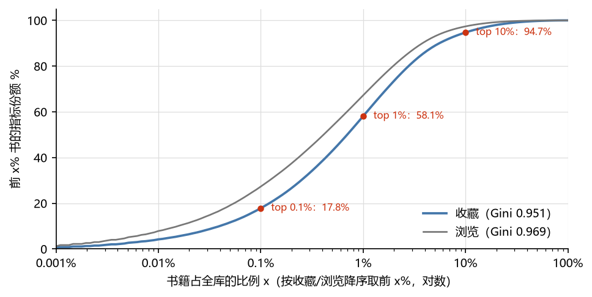
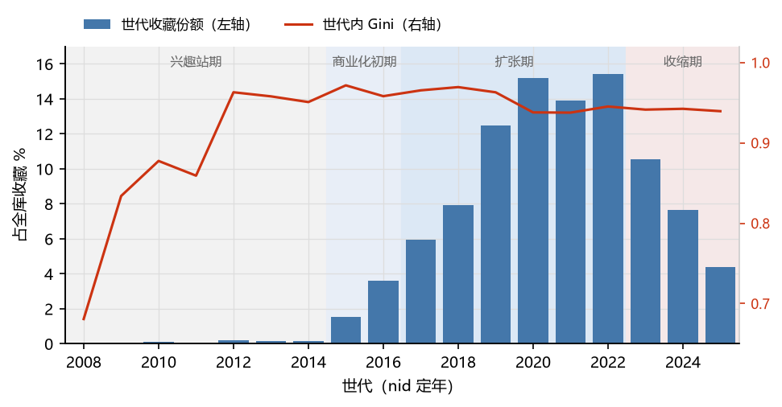
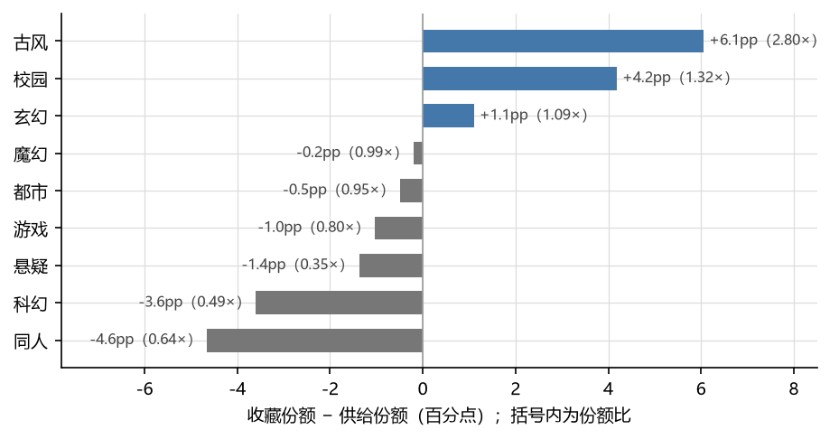
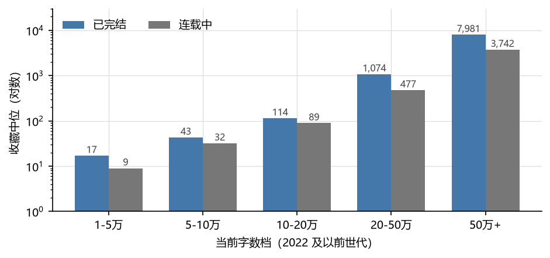

# 02 · 注意力集中度：收藏分布的头部结构与分层

> 口径声明：
> 1. 主指标为 favs（收藏）。clicks 是累计浏览，受上架时长与各年代站内流量规模
>    混杂，跨世代不可直接比；praises 仅作稳健性校验（§1）。
> 2. 收藏同为存量：世代越新累积时间越短，跨世代绝对量比较只采用世代内 Gini
>    与份额两种口径。
> 3. 数据源 `analysis/out/novels.csv`，245,779 行，快照 2026-06-13，
>    在册存活口径；年份由 nid 定年（报告 01 §1）。
> 4. featured 是快照时刻的运营位状态（当前态而非历史），因果方向见 §5。
> 5. 正版日轻（版权方账号 47 行，全部 VIP 且在运营位）已整行剔除：其 nid
>    复用同标题盗版条目的旧 id，不遵守 id 递增，见 `analysis/config.py`。
>    剔除后运营位降至 620 本，本报告所有统计均不含该批。

---

## 0. 结论

1. **分布极端右偏，头部集中接近理论上限**：Gini 0.95；top 0.1% 的书
   占 17.8% 收藏，top 1% 占 58.1%，top 10% 占 94.7%；
   中位 8 对均值 450。
2. **集中是结构常数**：各世代内 Gini 稳定在 0.83–0.97
   （2008 年世代 0.68 为 n=404 的小样本例外），
   20 年间不随平台规模、题材结构、商业化程度变化。
3. **注意力随平台周期移动**：45% 的收藏在 2020–2022 世代；
   若收藏仅随书龄累积应向早期世代倾斜，事实相反。
4. **题材存在注意力再分配**：古风超额（份额比 2.82），
   科幻/悬疑结构性欠额；同人是形态例外——份额比 0.64
   但收藏中位九类最高、Gini 九类最低，注意力按 IP 分散而非聚拢。
5. **字数是最强分层变量，完结档内溢价成立**：收藏中位跨字数档差三个数量级；
   控制世代与字数档后完结书溢价仍达 2.1–2.3 倍
   （20 万字以上两档）。
6. **运营位与头部重合**：top 1000 收藏书 44% 在 banner 位上，推荐位放大
   而非缓和集中。

---

## 1. 指标选择与稳健性

| 指标 | 零值% | P50 | P90 | P99 | 最大 | Gini | top1% 份额% |
|---|---|---|---|---|---|---|---|
| 收藏 | 12.2 | 8 | 280 | 10,371 | 353,958 | 0.951 | 58.1 |
| 浏览 | 1.8 | 411 | 32,076 | 1,590,220 | 118,520,000 | 0.969 | 67.2 |
| 赞 | 13.5 | 7 | 157 | 2,430 | 137,833 | 0.910 | 46.7 |

三个计数器度量同一注意力现象的不同深度：浏览（曝光）、收藏（承诺）、赞（轻互动）。
Spearman 秩相关：收藏–赞 0.90、收藏–浏览 0.89、
浏览–赞 0.86——排序高度一致，取任一为主指标结论方向不变。
本报告以**收藏**为主指标：它是三者的中间层（有曝光才可能收藏、收藏意味着超越点赞的
承诺），且不像浏览那样直接受上架时长拉动。浏览的集中度更高
（Gini 0.969 对 0.951，
top 1% 份额 67% 对 58%）：
曝光向头部收拢的力度强于收藏，读者在收藏环节比在浏览环节略微更愿意离开头部。

---

## 2. 全库头部结构

收藏分布的头部集中接近理论上限：top 0.1% 的书（245 本）占
17.8% 的总收藏，top 1% 占
58.1%，top 10% 占
94.7%。中位收藏 8 对均值
450（56 倍），
分布的均值完全由右尾定义。

| 收藏区间 | 书量 | 占全库% |
|---|---|---|
| 0 | 30,081 | 12.2 |
| 1–10 | 105,644 | 43.0 |
| 11–100 | 67,561 | 27.5 |
| 101–1,000 | 30,031 | 12.2 |
| 1,001–10,000 | 9,931 | 4.0 |
| 10,000+ | 2,531 | 1.0 |

「长尾是主体」：82.7% 的书收藏不超过 100，
12.2% 零收藏——在册不等于被读到。

头部书有清晰画像：top 100 的字数中位 2,711,697 字、
完结率 69%，题材上魔幻占
42%。**头部几乎完全是超长篇原创连载**，其快照收藏仍在
累积，头部排名具备时间上的自增强性。

头部与腰部的题材构成几乎互补：

| 题材 | 全库供给% | top 1000% | 腰部（101–10,000）% |
|---|---|---|---|
| 魔幻 | 34.9 | 34.4 | 27.2 |
| 玄幻 | 12.1 | 14.8 | 9.8 |
| 古风 | 3.4 | 12.5 | 4.0 |
| 科幻 | 7.1 | 3.4 | 4.2 |
| 校园 | 12.9 | 21.0 | 10.8 |
| 都市 | 9.5 | 8.8 | 7.8 |
| 游戏 | 5.2 | 4.1 | 6.2 |
| 同人 | 12.9 | 0.3 | 29.0 |
| 悬疑 | 2.1 | 0.7 | 0.9 |

top 1000 中同人仅 3.0‰，腰部却占
29%——
原创注意力聚拢于头部，同人注意力铺开在腰部（§4）。

---

## 3. 世代维度：集中是结构常数

各世代内部的 Gini 稳定在 0.83–0.97
（2008 年世代 0.68 为 n=404 的小样本例外，且经过 18 年存活筛选），
不随平台规模、题材结构、商业化程度变化。**头部集中是注意力的组织方式本身，
而非某个年代的现象**；全库 Gini 0.95 因此可以直接
解读为结构参数。

| 期 | 书量 | 供给份额% | 收藏份额% | 册均收藏 |
|---|---|---|---|---|
| 2006-14 | 16,750 | 6.8 | 0.7 | 47 |
| 2015-16 | 8,253 | 3.4 | 5.1 | 689 |
| 2017-22 | 156,107 | 63.5 | 71.0 | 503 |
| 2023-26 | 64,669 | 26.3 | 23.2 | 397 |

注意力的世代分配跟随平台规模周期而非书龄：45% 的收藏集中在
2020–2022 三年世代。若收藏仅随存活时长线性累积，份额应向早期世代倾斜
（存活的书籍中早期书上架更久）——事实相反，说明平台流量重心已整体移向
较新库存。册均收藏的例外是 2015–16 世代（689，
各期最高）：该世代基数小（8,253 本）且在册书
经过十年以上存活筛选，是幸存者偏差的典型读数，不代表该年代人均更受关注。

---

## 4. 题材：注意力的再分配

| 题材 | 书量 | 供给% | 收藏% | 份额比 | 收藏中位 | Gini |
|---|---|---|---|---|---|---|
| 魔幻 | 85,696 | 34.9 | 34.4 | 0.99 | 6 | 0.96 |
| 玄幻 | 29,798 | 12.1 | 13.3 | 1.10 | 5 | 0.96 |
| 古风 | 8,258 | 3.4 | 9.5 | 2.82 | 9 | 0.94 |
| 科幻 | 17,366 | 7.1 | 3.4 | 0.49 | 5 | 0.96 |
| 校园 | 31,595 | 12.9 | 17.1 | 1.33 | 6 | 0.96 |
| 都市 | 23,450 | 9.5 | 9.1 | 0.96 | 5 | 0.96 |
| 游戏 | 12,782 | 5.2 | 4.1 | 0.79 | 13 | 0.93 |
| 同人 | 31,664 | 12.9 | 8.3 | 0.64 | 51 | 0.80 |
| 悬疑 | 5,170 | 2.1 | 0.7 | 0.35 | 4 | 0.96 |

份额比（收藏份额 ÷ 供给份额）度量题材的注意力超额程度，三种形态：

1. **古风是唯一的强超额品类**（份额比 2.82，
   9.5% 的收藏对 3.4% 的供给）。
   与报告 01 的发现互证：古风长篇浓度最高（P90 字数 22.8 万），而长篇正是
   注意力的容器——超额来自形态而非题材标签本身。
2. **校园、玄幻、魔幻、都市大致持平**（份额比 0.95–1.32）。魔幻作为供给
   最大的品类与份额比 0.99 的中性表现，
   意味着其体量优势没有转化为注意力优势。
3. **科幻、悬疑结构性欠额**（0.49 与
   0.35）：供给占比高于注意力占比一倍以上，
   两个品类在站内均属小众供给且缺乏头部。

**同人是分布形态的例外而非总量例外**：份额比 0.64
（欠额），但收藏中位 51 为九类最高——中位数高而份额低
同时成立，因为其 Gini 仅 0.80（其余品类 0.93–0.96）。
同人受众按 IP 划分社群，注意力在社群内充分分布、不向头部聚拢：单本的中等
热度有保证，出圈爆款几乎不存在（top 1000 占比 0.3%）。

---

## 5. 字数、完结与运营位

字数是注意力的最强单变量分层：全库口径下收藏中位从 1 万字以下的
3 单调升至 50 万字以上的 5,209。
下表控制世代（2022 及以前，缓解删失）与字数档后，完结的溢价依然在每个档内成立：

| 字数档 | 完结收藏中位 | 连载收藏中位 | 完结溢价 |
|---|---|---|---|
| 1-5万 | 17 | 9 | 1.89 |
| 5-10万 | 43 | 32 | 1.34 |
| 10-20万 | 114 | 89 | 1.28 |
| 20-50万 | 1,074 | 477 | 2.25 |
| 50万+ | 7,981 | 3,742 | 2.13 |

完结溢价在两端最高（1–5 万档 1.9 倍、
20 万字以上约 2.1–2.3 倍）：完结既是内容确定性的信号，也筛选出投入度更高的作者，
两个机制同向。原始口径下完结书收藏更高（≤2022 世代中位
13 对 7），其中大部分水平差
由字数梯度贡献——完结书更长；但控制字数档后溢价依然保留（1.3–2.3 倍），
说明完结本身是独立于字数的注意力信号。

featured（运营位）共 620 本（0.25%），收藏中位
37,007，是全库中位（8）的
4,626 倍；top 1000 收藏书中有
44% 在运营位上。已剔除的 47 本正版日轻全部为运营位书，
因此此处统计不含授权内容。注意因果方向不可从快照判定：banner 是当前状态，
展示的更可能是已被市场验证的书。可以确定的是**运营位与头部高度重合**——
平台的推荐位在放大既有集中，而非制造长尾的可见性。

---

## 6. 对找书 App 的含义

1. **榜单必须分窗，全库热榜没有信息量**：top 100 由魔幻类超长篇垄断
   （字数中位 2,711,697，为全库中位的
   260 倍），按题材、字数分窗
   是榜单设计的前提而非优化。
2. **腰部是推荐的主力区间**：收藏 101–10,000 的 39,962 本
   （16.3%）构成「已被读者验证、但未被头部垄断」的
   区间，其中同人占 29%——
   腰部推荐必须区分原创与同人两个平行市场。
3. **收藏数作排序键须分世代校正**：世代内 Gini 恒定意味着「同世代内的相对位置」
   是可比的排名信号，原始收藏数不可跨世代直接比。
4. **完结 + 字数是最高确定性的组合过滤器**：20 万字以上完结书收藏中位
   4,159，且完结溢价不依赖幸存者解释的全部（档内仍 2 倍以上）。
5. **featured 不可作品质信号**：它与已验证头部重合，作为特征会放大流行度偏置。

---

*生成：`uv run python analysis/report_attention.py`；本文件为生成物，勿手改。*
