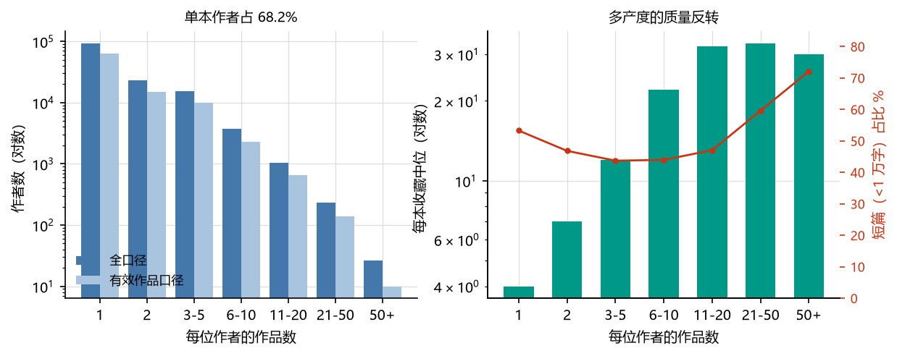
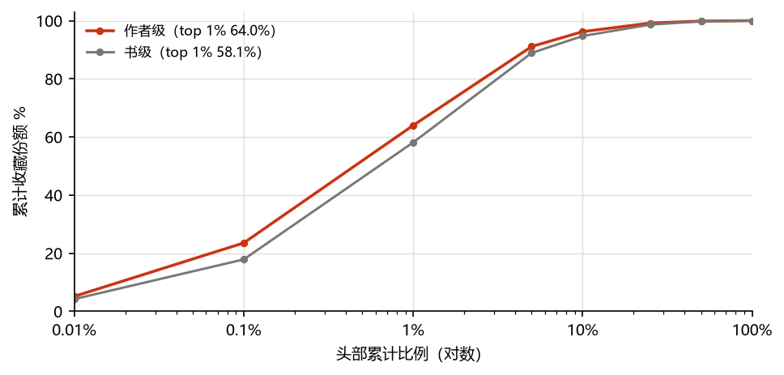
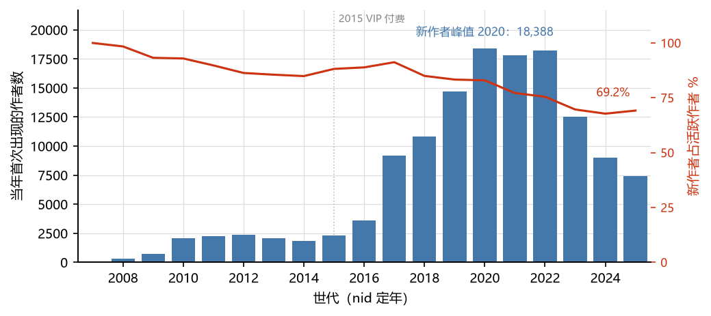
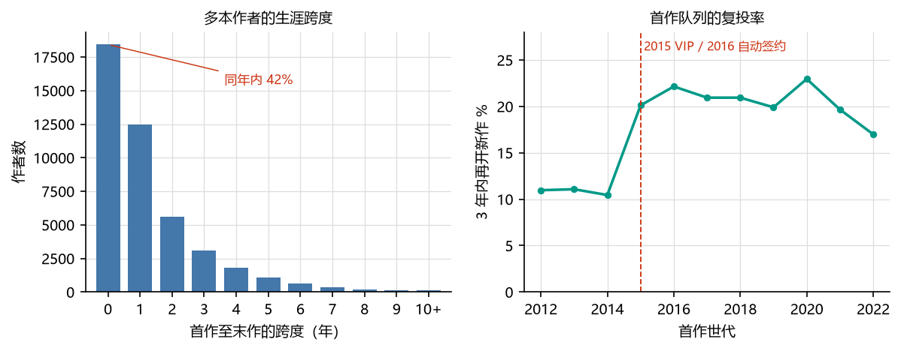
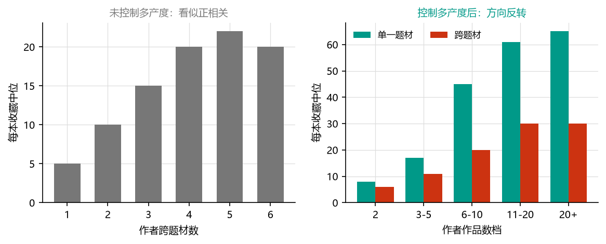

# 03 · 作者生态：供给主体、留存与职业化

> 口径声明：
> 1. 数据源 `analysis/out/novels.csv`，245,779 行、137,848 个作者名，
>    快照 2026-06-13，在册存活口径；年份由 nid 定年（报告 01 §1），非 `updated_at`。
> 2. `author` 是字符串身份键：改名、马甲、共用笔名无法合并，同一自然人可能被
>    拆成多个作者。因此作者数是上界，多产度、生涯长度与复投率是下界。
>    版权方账号（正版日轻 47 行）已整行剔除。
> 3. 存活口径下下架作品不在库，越早的队列其后续作品缺失越多；跨世代的
>    作者比较只作趋势方向解读（§3），不作水平差异的因果归因。
> 4. 主指标 favs（收藏）；clicks 跨世代不可比。收藏是存量，作者总收藏随生涯累积，
>    作者级与书级集中按同一总量对照（§2）。
> 5. 「签约」指 `price_type=签约`；含 VIP 的付费合并口径单独标注（§5）。
>    制度节点取自 `references/sfacg-pku-chronicle.md`（北大《中国网络文学编年简史》）。
> 6. 完结率含右删失；年度序列止于 2025（2026-05 后新书可见性骤降）。

---

## 0. 结论

1. **供给主体极度分散**：137,848 名作者对应 245,779 本书，人均
   1.78 本；68.2% 的作者只有一本作品。
2. **多产不等于有效供给**：按「≥ 10,000 字或 ≥ 10 收藏」过滤后
   仅剩 159,559 本（64.9%）；50+ 档作品的短篇占比
   72.2%，而收藏最高的作者只有 8 本。
3. **作者级集中高于书级**：作者 Gini 0.962（书级 0.951），
   top 1% 作者占 64.0% 收藏而仅
   4.3% 作品；
   但头部热度主要由单本爆款贡献，作者不是稳定的推荐单元。
4. **收缩以作者基数萎缩为主**：以 2022 供给峰值为基准，新作者
   −59.4%、活跃作者 −55.7%、
   人均新书仅 −11.4%；
   新作者数的绝对峰值在 2020 年，早于总量见顶两年。
5. **专精效应方向反转**：原始口径「跨题材更多收藏」是多产度共线造成的伪相关，
   控制作品数后专精作者的每本收藏中位是跨题材者的 1.3–2.2 倍。
6. **职业化是窄通道**：7.07% 的作者至少一本签约，
   20 本以上档的付费覆盖率停滞在 50.4%——制度按单本达标，
   不奖励累计开坑。

---

## 1. 供给主体：极度分散，且多产不等于有效供给

245,779 本在册作品分属 137,848 个作者名，人均 1.78 本。
68.2% 的作者只有一本作品，
这些书占全库 38.2%；反过来，作品数 ≥10 的
1,588 名作者（1.15%）覆盖了
10.4% 的库存。

| 作品数档 | 作者数 | 占作者 | 覆盖作品 | 占作品 | 每本收藏中位 | 短篇占比 | 完结率 |
|---|---|---|---|---|---|---|---|
| 1 | 93,979 | 68.2% | 93,979 | 38.2% | 4 | 53.3% | 11.4% |
| 2 | 23,297 | 16.9% | 46,594 | 19.0% | 7 | 46.9% | 16.9% |
| 3-5 | 15,567 | 11.3% | 55,774 | 22.7% | 12 | 43.8% | 21.3% |
| 6-10 | 3,718 | 2.7% | 26,950 | 11.0% | 22 | 44.0% | 25.8% |
| 11-20 | 1,027 | 0.7% | 14,051 | 5.7% | 32 | 47.1% | 28.3% |
| 21-50 | 234 | 0.2% | 6,681 | 2.7% | 33 | 59.6% | 28.4% |
| 50+ | 26 | 0.02% | 1,750 | 0.7% | 30 | 72.2% | 17.1% |

每本收藏中位随作者作品数上升（1 本档 4 → 11–20 本档
32），但到 50+ 本档回落至 30，
同期短篇占比升至 72.2%、完结率降至 17.1%。
作品数超过 50 本的 26 名作者，其 1,750 本作品里
72.2% 不足 1 万字（全库 48.9%），
呈高频开坑、少有推进的形态；收藏最高的作者「漢唐歸來」只有
8 本、总收藏 849,071，
与多产度榜首形成对照。

据此定义**分析用的有效作品**（≥ 10,000 字 或 ≥ 10 收藏，
全库收藏中位 8）：159,559 本，占 64.9%。
这是报告内的过滤口径，不改动数据集；在此口径下仍有
162 名作者拥有 20 本以上有效作品，
说明多产者中确有稳定产能，但作品数本身不能作为质量代理。

---

## 2. 作者级集中高于书级集中

按作者汇总收藏后的 Gini 为 0.962，高于书级的 0.951（报告 02）：
多产作者把多本高收藏作品聚合到同一主体，尾部则堆积大量零收藏的单本作者，
两个方向的效应叠加使分布在作者层面更陡。

| 头部比例（各自总体） | 作者数 | 作者级累计收藏 | 书级累计收藏 | 该批作者占作品 |
|---|---|---|---|---|
| 0.1% | 138 | 23.5% | 17.8% | 0.5% |
| 1% | 1,378 | 64.0% | 58.1% | 4.3% |
| 5% | 6,892 | 91.1% | 88.9% | 15.2% |
| 10% | 13,785 | 96.2% | 94.7% | 24.9% |

（两条序列的分母分别为作者数与书数，top f% 各自指本总体内的前 f%；比较的是
分布形状，不是同一阈值下的同一批作品。）

top 1% 作者（1,378 人）占有
64.0% 的收藏，却只产出
4.3% 的作品。
但**头部作者不是稳定产能**：收藏 top 100 作者中，最大单本作品占其总收藏的
中位为 42.3%，35 人超过一半、
12 人超过八成。作者级热度主要由单本爆款贡献，
按作者做推荐单元会反复指向同一本书。

---

## 3. 世代更替与留存

| 分期 | 新书数 | 活跃作者人次 | 新作者 | 新作者占活跃 | 人均新书 |
|---|---|---|---|---|---|
| 2007-2014 兴趣站期 | 16,832 | 13,243 | 11,717 | 88.5% | 1.27 |
| 2015-2016 商业化初期 | 8,171 | 6,709 | 5,944 | 88.6% | 1.22 |
| 2017-2022 扩张期 | 156,108 | 109,900 | 89,189 | 81.2% | 1.42 |
| 2023-2025 收缩期 | 60,647 | 41,942 | 28,917 | 68.9% | 1.45 |

（分期行是各年人次之和，同一作者跨年会被重复计入；「人均新书」为期内新书数
除以活跃作者人次，与下文按单年计算的年度人均不是同一口径，仅作结构比例对照。
本表止于 2025，不含 2026 的不完整可见行，故总量与报告 01 的 2023–2026 分期不同。）

以报告 01 的供给峰值年 2022 为统一基准：新作者
18,245 → 7,415
（−59.4%）、
新书 37,089 → 14,569
（−60.7%）、
活跃作者 24,175 → 10,719
（−55.7%）同步收缩，
而人均新书仅由 1.53 降至 1.36
（−11.4%）：
**收缩以作者基数萎缩为主，而非在册作者集体减产**。

新作者数的绝对峰值出现在 2020 年（18,388 人），
早于总供给峰值两年；2021–2022 的供给高位由人均新书抬升维持
（1.52 / 1.53，全期最高）。
新作者占活跃作者的比重总体由 2007 年的 100% 降至
69.2%，存量作者的相对贡献上升。

多本作者中 42% 的所有作品都落在同一年，
生涯跨度中位 1 年、P90 3 年。
以首作世代建队列，观察其后 3 年内是否再开新作：2012–2014 队列均值
10.8%，2015–2022 队列均值 20.5%，跳变发生在 2015 年
（20.1%），与 2015-05-07 VIP 付费、2016-01-13 自动签约
及全勤奖制度的启用同期（见 `references/sfacg-pku-chronicle.md`）。

各队列均有完整的 3 年观察窗口，但**存活口径使早期队列被系统性低估**：
下架作品不在数据集内，越早的队列其后续作品缺失越多。因此该跳变可作方向性
证据，幅度不可全部归因于制度。

---

## 4. 题材专精：一个方向反转的伪相关

78% 的作者只写一个题材；在作品数 ≥2 的作者中，
单一题材者仍占 31%。

| 跨题材数 | 作者数 | 占作者 | 覆盖作品 | 每本收藏中位 |
|---|---|---|---|---|
| 1 | 107,585 | 78.0% | 129,018 | 5 |
| 2 | 21,489 | 15.6% | 60,018 | 10 |
| 3 | 6,114 | 4.4% | 30,378 | 15 |
| 4 | 1,816 | 1.3% | 14,940 | 20 |
| 5 | 607 | 0.4% | 6,839 | 22 |
| 6 | 179 | 0.1% | 3,046 | 20 |

原始口径下每本收藏中位随跨题材数上升（1 类 5 →
5 类 22），容易读作「跨界带来更多读者」。
但跨题材数与作品数高度共线——写得越多自然覆盖越多分类。控制作者作品数后方向
**反转**：同一多产度档内，跨题材作者的每本收藏中位仅为单一题材作者的
0.44–0.75 倍（即专精者为 1.3–2.2 倍），
且差距随多产度扩大。这是辛普森效应：原始正相关完全由多产度混合驱动，
专精本身才与单本表现同向。跨题材作者在高档的样本量较小
（6–10 本档单一题材组 2,531 本），
该结论作方向性解读。

同人是这一结构最清晰的例外：15,080 名作者写过同人
（占全部作者 10.9%），其中 65% 只写同人。
与报告 02 观察到的「同人注意力按 IP 分散」一致，构成与原创并行的独立货架。

---

## 5. 职业化：按单本达标的窄通道

| 作品数档 | 作者数 | 至少一本签约 | 至少一本付费（含 VIP） | 作者总收藏中位 |
|---|---|---|---|---|
| 1 | 93,979 | 3.3% | 4.2% | 4 |
| 2 | 23,297 | 8.3% | 10.6% | 22 |
| 3-5 | 15,567 | 18.2% | 23.0% | 106 |
| 6-10 | 3,718 | 33.7% | 40.9% | 679 |
| 11-20 | 1,027 | 45.8% | 50.9% | 2,574 |
| 21-50 | 234 | 47.9% | 50.4% | 4,920 |
| 50+ | 26 | 50.0% | 50.0% | 12,642 |

全库 7.07% 的作者至少有一本签约作品
（9,752 人），含 VIP 的付费体系口径为
8.83%；对应的书级签约率为 5.25%。
两个口径随多产度同步上升，但在 20 本以上趋于平台：单独签约率
47.9% → 50.0%，
含 VIP 的付费覆盖率在 11-20 本档见顶 50.9%，
此后回落至 50.0%。50+ 档仅
26 名作者，高档间的百分点差异不具统计意义。

制度口径可解释这一形状：2016-01-13 启用的自动签约通道以**单本**为审核单位
（连载 > 5 万字、收藏 > 200、半个月内更新），全勤奖亦按作者逐月考核；
累计开坑数不构成资格条件。因此签约是「少数作品跨过门槛」的结果，
不是对高产账号的奖励；20 本以上各档签约率稳定在
46–50% 与此一致。
报告 01 观察到收缩期世代内签约率上行，但其口径为「当年新书中的签约份额」，
与本节「作者生涯内是否曾签约」不同，两者并置观察，不构成因果解释。

---

## 6. 对找书 App 的含义

1. **以书而非作者为推荐基本单元**：收藏 top 100 作者的最大单本占其总收藏中位
   42.3%，作者级榜单会重复指向同一作品；作者适合作为「同一作者的其他作品」
   的次级入口，而非主排序键。
2. **默认过滤碎片开坑条目**：有效作品口径保留 64.9% 库存，
   可显著降低搜索与首页噪声；该过滤只在应用层生效，数据层不删行，
   以便按「全部作品」切换时仍可追溯。
3. **作者特征须控制多产度**：跨题材数、生涯长度、作品数三个特征高度共线，
   直接入模会把自选择误读为质量信号；使用同世代内的相对位置更稳健。
4. **同人独立建架**：15,080 名同人作者中 65% 只写同人，
   与原创作者的题材迁移路径不同，混合推荐会稀释两边的相关性。
5. **签约不可作品质标签**：它只覆盖 7.07% 的作者，
   且门槛按单本达标，作为特征会放大商业化偏置；同人受版权归属排除在外
   （报告 01、02），此项对同人恒为假。

---

*生成：`uv run python analysis/report_author.py`；本文件为生成物，勿手改。*
