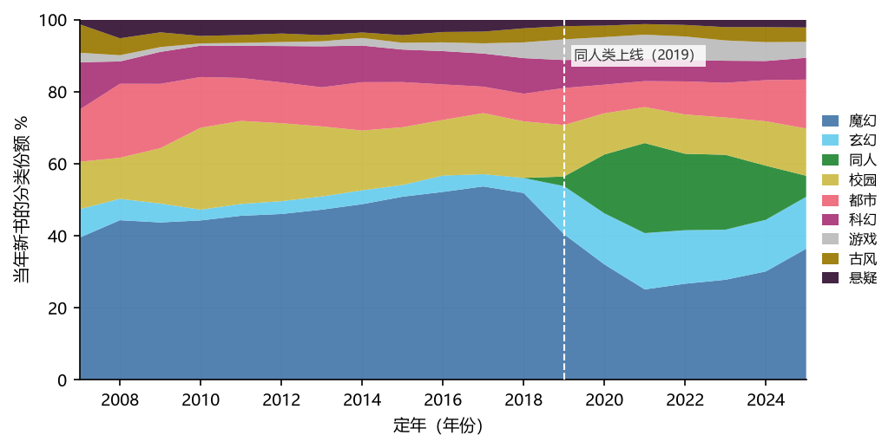
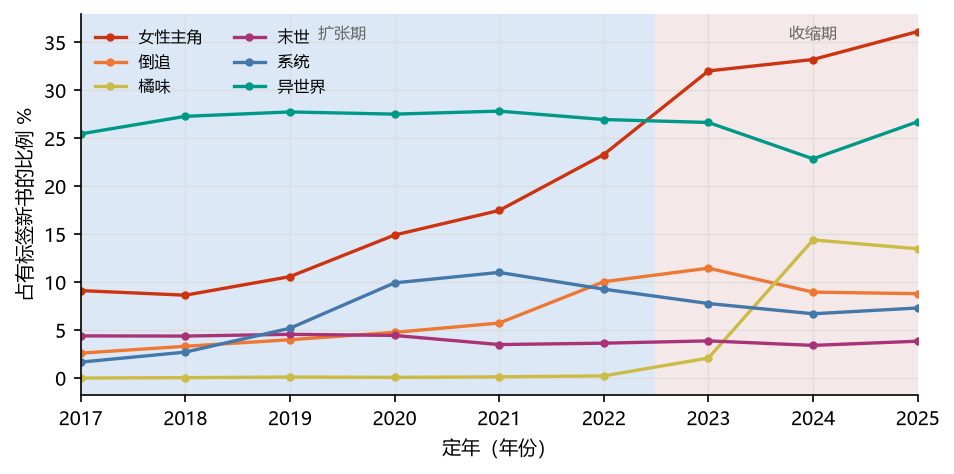

# 04 · 题材与标签：分类结构、受控词表与征文

> 口径声明：
> 1. 数据源 `analysis/out/novels.csv`，245,779 行，数据内容上界 2026-05-03，
>    在册存活口径；年份由 nid 定年（锚点插值，报告 01 §1），非 `updated_at`。
>    年度序列止于 2025（内容上界之后新书不在库内，定年落在 2026 的 4,021 行
>    不入年度统计）。
> 2. **genre 与 tags 是两套口径**：genre 是站点货架的单选分类（现行 9 类，
>    2010 年改版确立），决定作品出现在哪个入口；tags 是作者从站点受控词表
>    勾选的自述（全库 106 个唯一标签、每本最多 5 个）。分类不随时间迁移，
>    标签受词表扩充影响。
> 3. **标签体系约 2014 年前后上线**：2010-2013 年定年的书 50-60% 无标签，
>    2017 年起缺失率 <3%。因此跨世代的标签统计只对 2017 年及以后可靠，
>    更早年份的标签频次受体系上线时间混杂，不作世代比较。
> 4. **7 个「20XX萌神」标签（2018-2024）是运营荣誉，不是题材标签**（依据与
>    证据链见 `references/moebattle-tags.md`），已从 §1-§2 的标签统计中剔除，
>    §3 单列。13 本获奖作品的其余标签保留：荣誉挂在作品而非标签上。
> 5. **`末日` 与 `末世` 不合并**（2026-11-16 决定），§4 作独立标签分别统计。
> 6. 主指标 favs（收藏）：clicks 是累计浏览，受上架时长混杂，仅作对照；
>    累计指标跨时点不可比。完结率含右删失，跨世代比较只对早期世代有效。
> 7. 标签由作者勾选、征文参赛由作者报名，两者均为自选择本；与热度的关联
>    是相关而非因果，运营推荐位（featured）造成的反向因果已在 §3 单列处理。

---

## 0. 结论

1. **分类结构由「魔幻主导」转为「魔幻 + 同人 + 玄幻」三足**。魔幻份额从
   2017-2018 的 52.7% 降到 2019-2022 的 30.2%
   （同期同人类从 0 升至 17.5%），2023-2025 两类合计
   45.9%。同人类 2019 年上线，2008-2021 世代同人行 VIP 率
   0.0%、中位字数
   6,637 字（九类最短）、完结率
   30.7%（九类最高）——
   平台为二创内容单开的免费货架。
2. **标签是受控词表而非自由文本**：106 个唯一标签、每本 ≤5 个，词表随运营
   扩充（「橘味」2023 年前后入表，2024 年即占有标签新书 14.4%）。
   词表内**女性向标签持续扩张**：「女性主角」占有标签新书比例从 2017 年的
   9.1% 升至 2025 年的 36.1%，是十年间最稳定的结构性变化。
3. **标签与热度强相关**：`嫁人`（favs 中位 114）、`变身`
   （63）、`倒追`（57）远高于 2017-2025 新书整体
   （中位 9）；`系统`（16）、`无敌`（18）虽高频但热度
   平庸——高频标签与高热度标签是两个集合。此为相关，样本经作者自选择。
4. **`末世`（8,673 行）与 `末日`（464 行）
   是两个独立的标签**，相差 19 倍；`末日` 在 2023 年后停止使用，
   `末世` 自 2017 年持续扩张。按约定不合并。
5. **征文是供给的重要组成部分**：96 个征文活动、92,896 行
   （占在册 38.4%）。参赛书热度高于非参赛书
   （favs 中位 9 vs 7、P90 530 vs 204），
   但参赛是自选择 + 运营筛选的双重选择样本，不可作因果解读。

---

## 1. 分类：魔幻的长期主导与「同人」类的登场

各世代的新书分类份额（行合计 100）：

| 世代 | n | 魔幻 | 玄幻 | 同人 | 校园 | 都市 | 科幻 | 游戏 | 古风 | 悬疑 |
|---|---|---|---|---|---|---|---|---|---|---|
| 2007-2014 | 16,750 | 46.0 | 3.7 | 0.0 | 20.3 | 12.9 | 9.7 | 1.2 | 2.2 | 4.1 |
| 2015-2016 | 8,253 | 51.7 | 4.1 | 0.0 | 15.6 | 10.8 | 9.2 | 2.2 | 2.6 | 3.8 |
| 2017-2018 | 29,228 | 52.7 | 3.8 | 0.0 | 16.2 | 7.5 | 9.6 | 3.7 | 3.6 | 2.8 |
| 2019-2022 | 126,879 | 30.2 | 14.6 | 17.5 | 11.4 | 8.5 | 6.7 | 6.3 | 3.2 | 1.5 |
| 2023-2025 | 60,648 | 30.6 | 14.2 | 15.3 | 11.7 | 11.2 | 5.8 | 5.2 | 3.9 | 2.1 |

三点解读。其一，**魔幻是贯穿始终的第一大分类**，兴趣站期 46.0%、
2017-2018 52.7%；2019 年后其份额下降并非绝对供给萎缩，
而是同人类分流的相对稀释。其二，**同人类 2019 年上线**：2016-2018 年仅
11 本散点（早期遗留记录），2019 年即
644 本、2021 年峰值 8,786 本
（占当年 25.0%），此后随大盘收缩。其三，校园份额从兴趣站期 20.3% 持续下滑，
玄幻在 2019-2022 稳定于 14-16%，都市在收缩期回升（11.2%）。

同人类的平台定位可见于其经营特征（2008-2021 世代，与下表同口径）：
VIP 率 0.0%（≈零付费）、中位字数
6,637 字（九类最短）、完结率
30.7%（九类最高）——
免费、轻量、快完结的二创货架，与原创商业连载互不挤占。

> **口径注记（报告 22）**：「同人类兴起」的主体不是传统同人长篇，而是**对话/互动
> 小说产品线**——同人挂常规长篇无法进入 VIP 体系，故同人标签/类目高度集中在不走
> VIP 的对话/互动。本地按形态判据，同人类中 78.2% 为对话/互动形态
> （每章约 500 字、整本可长，不以字数判形态）。本报告的份额与序列不受影响，
> 受影响的是对「同人」的解读：这是产品线结构变化，不是题材口味变化。
> 详见报告 22。

各分类的供给份额与收藏份额错位（2007-2025 全口径）：

| 分类 | 供给份额 % | 收藏份额 % | 错位（百分点） |
|---|---|---|---|
| 魔幻 | 34.8 | 34.3 | -0.5 |
| 玄幻 | 12.1 | 13.3 | +1.3 |
| 同人 | 13.0 | 8.3 | -4.7 |
| 校园 | 12.8 | 17.1 | +4.3 |
| 都市 | 9.5 | 9.1 | -0.4 |
| 科幻 | 7.1 | 3.5 | -3.6 |
| 游戏 | 5.2 | 4.1 | -1.1 |
| 古风 | 3.4 | 9.5 | +6.2 |
| 悬疑 | 2.1 | 0.7 | -1.4 |

古风（+6.2 百分点）与校园（+4.3）
的收藏份额显著高于供给份额——两者的头部作品年代早、累积久；科幻
（-3.6）与同人类（-4.7）则相反，
供给大而收藏份额低。悬疑供给 2.1%、收藏份额仅
0.7%，是九类中最弱的货架。

各分类经营特征（2008-2021 世代，n=143,946；完结率含右删失，
早期世代删失较小）：

| 分类 | n | 字数中位 | 完结率 % | VIP 率 % |
|---|---|---|---|---|
| 魔幻 | 55,709 | 13,711 | 14.6 | 2.5 |
| 玄幻 | 15,089 | 9,683 | 21.5 | 3.0 |
| 同人 | 14,400 | 6,638 | 30.7 | 0.0 |
| 校园 | 19,870 | 11,228 | 16.9 | 3.4 |
| 都市 | 12,673 | 9,210 | 19.6 | 2.3 |
| 科幻 | 11,402 | 11,394 | 16.9 | 1.3 |
| 游戏 | 7,048 | 9,894 | 22.2 | 2.3 |
| 古风 | 4,529 | 11,139 | 18.0 | 7.7 |
| 悬疑 | 3,226 | 8,714 | 18.4 | 0.7 |

古风 VIP 率 7.7%
显著高于其余分类，与报告 01 的商业化观察一致：古风是 VIP 付费密度最高的分类；
同人类 VIP 率 ≈0%，完全游离于付费体系外。

---

## 2. 标签：受控词表与女性向转向

标签是**受控词表**：229,583 行有标签（占在册
95.0%），词表共 106 个唯一标签（含 7 个萌神
荣誉标签，题材词表 99 个），每本最多 5 个。频次 top 20：

| 标签 | n | 占有标签书比例 % |
|---|---|---|
| 战斗 | 64,602 | 28.1 |
| 日常 | 64,060 | 27.9 |
| 异世界 | 58,508 | 25.5 |
| 恋爱 | 57,727 | 25.1 |
| 女性主角 | 44,926 | 19.6 |
| 冒险 | 38,691 | 16.9 |
| 搞笑 | 34,296 | 14.9 |
| 无敌 | 28,949 | 12.6 |
| 脑洞 | 25,435 | 11.1 |
| 热血 | 24,967 | 10.9 |
| 治愈 | 21,535 | 9.4 |
| 同人 | 21,139 | 9.2 |
| 重生 | 20,219 | 8.8 |
| 系统 | 16,676 | 7.3 |
| 纯爱 | 16,604 | 7.2 |
| 倒追 | 15,133 | 6.6 |
| 现实 | 14,136 | 6.2 |
| 西幻 | 11,752 | 5.1 |
| 致郁 | 11,601 | 5.1 |
| 综漫 | 10,273 | 4.5 |

头部标签是网文类型的通用语法：`战斗` / `日常` / `异世界` / `恋爱` / `女性主角`
各覆盖约四分之一的有标签书。**词表随运营扩充且标签即时生效**，最明显的是
「橘味」：2022 年及以前累计仅 204 本，2023 年前后入表，
2024 年即占有标签新书 14.4%——
一条新词一年内重写四分之一的标签分布，故跨年标签比较必须考虑词表时点。
重点标签的世代演变（占有标签新书比例；2017 年起缺失率 <3%，口径可靠）：

| 标签 | 2017 % | 2019 % | 2021 % | 2023 % | 2025 % |
|---|---|---|---|---|---|
| 女性主角 | 9.1 | 10.6 | 17.5 | 32.0 | 36.1 |
| 倒追 | 2.6 | 4.0 | 5.8 | 11.5 | 8.8 |
| 橘味 | 0.0 | 0.1 | 0.1 | 2.1 | 13.5 |
| 末世 | 4.4 | 4.6 | 3.5 | 3.9 | 3.9 |
| 系统 | 1.7 | 5.2 | 11.0 | 7.8 | 7.3 |
| 异世界 | 25.5 | 27.8 | 27.8 | 26.7 | 26.7 |

「女性主角」从 2017 年的 9.1% 持续升至 2025 年的 36.1%，
是十年间最稳定的结构性变化；「倒追」「橘味」同向。与之互补，「异世界」稳定在
25-30% 的高频区间，「系统」在 2021 年见顶（11.0%）后回落，
「末世」稳定在 4-6%。（「百合」标签全库 0 行：相关内容在词表中由
「橘味」「纯爱」等词承载。）

标签与热度（2017-2025 新书，n≥1,000 的标签，按 favs 中位排序，展示头部与
尾部各若干；萌神 13 本整行剔除以防推荐位反向因果；对照：同年新书整体
favs 中位 9）：

| 标签 | n | favs 中位 |
|---|---|---|
| 嫁人 | 7,256 | 114 |
| 变身 | 5,943 | 63 |
| 倒追 | 15,083 | 57 |
| 橘味 | 5,604 | 48 |
| 分支小说 | 3,823 | 41 |
| 女性主角 | 44,634 | 37 |
| 运动 | 1,400 | 36 |
| 综漫 | 9,799 | 25 |
| 神话 | 3,862 | 4 |
| 历史 | 2,029 | 4 |
| 武侠 | 1,902 | 4 |
| 童话 | 1,235 | 3 |

高热度标签集中在女性向（`嫁人` 114、`变身`
63、`倒追` 57、`橘味`
48），尾部是 `现实` `推理` `历史` `神话` 等（中位 3-4）。
「系统」（16）「无敌」（18）
虽属高频标签，热度仅略高于整体中位 9——**高频不等于高效，
标签的选题价值需要分两个集合看**。此为相关而非因果：标签由作者勾选，
样本经自选择；亦未控制字数、分类与世代。

标签共现 top 10（全库口径，萌神标签剔除）：

| 标签对 | 共现 n |
|---|---|
| 恋爱 × 日常 | 21,480 |
| 异世界 × 战斗 | 20,175 |
| 冒险 × 异世界 | 17,151 |
| 冒险 × 战斗 | 16,265 |
| 搞笑 × 日常 | 14,862 |
| 战斗 × 日常 | 13,444 |
| 女性主角 × 日常 | 11,591 |
| 战斗 × 热血 | 10,638 |
| 女性主角 × 异世界 | 10,544 |
| 异世界 × 日常 | 10,296 |

共现结构呈两个聚合：男性向冒险轴（`异世界 × 战斗`、`冒险 × 异世界`、
`冒险 × 战斗`）与女性向恋爱轴（`恋爱 × 日常`、`女性主角 × 日常`、
`倒追 × 恋爱`），两轴经 `战斗 × 日常`（13,444）交汇。

---

## 3. 萌神标签：运营荣誉，单列处理

2018萌神 … 2024萌神 共 7 个标签、落在 13 本作品上
（《妖刀姬》两届夺冠，故 14 次标注）。
依据 `references/moebattle-tags.md`（2024 年度萌神大赛 H5 活动页规则原文）：

> 对于冠军角色所属的作品，在作品详情页中会展示萌神标签，持续一年。

即该标签由**运营方按赛事结果授予**：SF 年度萌神大赛男 / 女两组冠军作品，
每年 2 本。三个后果：标签年份是**届次年份，不是上架年份**，绝不可用于定年；
13 本全是极端头部（favs 中位 116,706，全库中位 8）且
获奖后获运营推荐位，纳入标签共现或标签→热度分析会引入反向因果——本报告
§2 的频次、共现与热度统计均已剔除该 7 个标签，13 本作品在
标签→热度表中整行剔除；数据集不删行，标签保留在 `tags` 字段原样。

13 本作品清单（定年为 nid 定年，年份仅供参照）：

| nid | 作品 | 作者 | 分类 | 萌神标签 | 定年 | favs | featured |
|---|---|---|---|---|---|---|---|
| 42229 | 《变身之后，我与她的狂想曲》 | 血烟天照 | 魔幻 | 2020萌神 | 2015 | 194,587 | 1 |
| 61423 | 《妖刀姬》 | 罗将神 | 魔幻 | 2018萌神、2021萌神 | 2016 | 127,283 | 1 |
| 70814 | 《圣女怎么可能是男孩子》 | 死神阿努比斯 | 魔幻 | 2018萌神 | 2017 | 73,311 | 1 |
| 115157 | 《天下第一帝后》 | 天地皆可陨落 | 玄幻 | 2019萌神 | 2017 | 57,787 | 1 |
| 169695 | 《转生成精灵的我不想当宠物》 | 孜然风 | 魔幻 | 2019萌神 | 2018 | 117,208 | 1 |
| 217202 | 《来自深渊的我今天也要拯救人类》 | 一簇西语 | 魔幻 | 2020萌神 | 2019 | 196,016 | 1 |
| 358526 | 《作为现充今天也毫无自觉》 | 北星 | 校园 | 2021萌神 | 2020 | 61,712 | 1 |
| 568750 | 《转生冰山大小姐也不要被她们贴》 | 北星 | 校园 | 2022萌神 | 2022 | 116,706 | 1 |
| 570628 | 《真人快打渣男，抢走病娇少女们》 | 金氏浪子 | 都市 | 2022萌神 | 2022 | 74,787 | 1 |
| 572669 | 《认清现实后，她们开始追夫火葬场》 | 闻香识狐 | 玄幻 | 2023萌神 | 2022 | 234,418 | 1 |
| 651213 | 《魔族王女战败被俘啦？抱歉我演的》 | 北星 | 魔幻 | 2023萌神 | 2023 | 87,207 | 1 |
| 657818 | 《战败圣女今天也在驯服邪神的路上》 | 墨莺儿 | 魔幻 | 2024萌神 | 2023 | 62,681 | 1 |
| 666497 | 《闭嘴恶龙我不想再跟你带孩子了》 | 奶昔尾尾酱 | 魔幻 | 2024萌神 | 2023 | 275,236 | 1 |

旁挂标签以题材词为主（`西幻` 6、`异世界` /
`女性主角` / `恋爱` 各 4），全部 13 本 featured=1，
与「获奖后获推荐位」的机制一致。

---

## 4. 末日 / 末世：独立统计（不合并）

`末日` 与 `末世` 是词表中并存的两个标签，语义相近但**全库 0 本同时挂二者**，
使用规模相差 19 倍。按 2026-11-16 决定，本报告不合并，分别统计：

| 标签 | n | 世代范围 | 2017-2022 n | favs 中位 | VIP 率 % | 完结率 % |
|---|---|---|---|---|---|---|
| 末日 | 464 | 2008–2023 | 449 | 8 | 0.2 | 19.4 |
| 末世 | 8,673 | 2009–2025 | 6,294 | 5 | 1.8 | 18.4 |

世代分布：`末世` 自 2017 年起持续扩张（2017 年 547 本
→ 2022 年 1,351 本，此后随大盘回落），`末日` 则集中在 2018-2022
（峰值 2021 年 120 本），**2023 年后基本停止使用**
（2023 年起合计 2 本）——两个标签不是同一概念的新旧写法，
而是规模悬殊、生命周期错位的两个独立标签；`末日` 疑似已退出使用（是否
从词表移除无法从快照判断），`末世` 仍是活跃标签。

口径边界：以上为**标签口径**。若按书名检索，含「末日」的书名 1,700 行、
含「末世」9,270 行——书名与标签是两套证据，本节只统计标签口径；
两口径的巨大落差（末日 1,700 书名 vs 464 标签）本身即说明标签受
5 个上限与词表扩充约束，不能当作题材全集。热度过低（favs 中位
8 / 5，低于 2017-2025
新书中位 9）与 VIP 率极低（0.2% / 1.8%），
符合该题材长尾供给的特征。

---

## 5. 征文：运营组织的供给

在册作品中 92,896 行（38.4%）带
`contest` 标注，覆盖 96 个征文活动。主要系列：**冬季征文**九届
（17,673 行）、**征长篇 / 对话小说**系列（一征至十三征及
对话小说分轨）、**春季征文**（2022-2025，7,191 行），
以及幻想小说征文、玄幻征文等单发活动。

冬季征文各届（contest 字段实测；定年允许早于届次启动——征文允许旧书参赛，
故 nid / 定年下限无届次意义，上限贴征文启动时间）：

| 届次 | n | 定年范围 | 定年中位 |
|---|---|---|---|
| 冬季征文 | 1,513 | 2018–2018 | 2018 |
| 第二届冬季征文 | 1,732 | 2019–2019 | 2019 |
| 第三届冬季征文 | 2,140 | 2019–2020 | 2019 |
| 第四届冬季征文 | 2,206 | 2019–2021 | 2021 |
| 第五届冬季征文 | 2,484 | 2017–2022 | 2022 |
| 第六届冬季征文 | 2,693 | 2016–2023 | 2023 |
| 第七届冬季征文 | 2,320 | 2023–2024 | 2024 |
| 第八届冬季征文 | 1,954 | 2024–2025 | 2025 |
| 第九届冬季征文 | 631 | 2025–2025 | 2025 |

届次 → 年份映射（用户核实）：第六届 2022 冬、第七届 2023 冬、
第八届 2024 冬、第九届 2025 冬；与上表定年中位逐年吻合。据此推定
无届次标注的「冬季征文」（1,513 行，
定年全部 2018）为第一届，
即该系列自 2018 冬起每年一届、从未中断。征文公告页 / 参赛列表同时是
批量获取精确创建时间的高效来源（报告 01 §1 第六届的核对即由此佐证）。

参赛 vs 未参赛（2007-2025 定年口径）：

| 分组 | n | favs 中位 | favs P90 | VIP 率 % | 完结率 % |
|---|---|---|---|---|---|
| 未参赛 | 148,862 | 7 | 204 | 1.1 | 17.8 |
| 参赛 | 92,896 | 9 | 530 | 5.5 | 18.0 |

参赛书的 favs 中位（9 vs 7）与 P90
（530 vs 204）均高于未参赛书，VIP 率
亦高（5.5% vs 1.1%）。**这一差距不可作因果解读**：
参赛是作者自选择（有存量的作者更倾向参赛），征文评审与推荐位又构成
运营侧二次筛选；报告 02 已证明头部集中度极高，P90 的差异主要由少量
头部参赛书贡献。无届次的证据只能支持「参赛书热度更高」这一相关描述。

---

*生成：`uv run python analysis/report_genre.py`；本文件为生成物，勿手改。*
