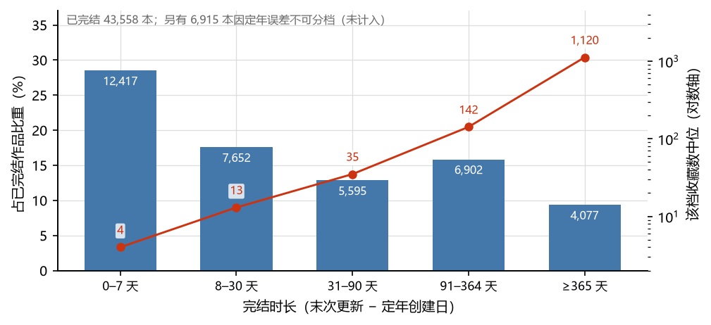
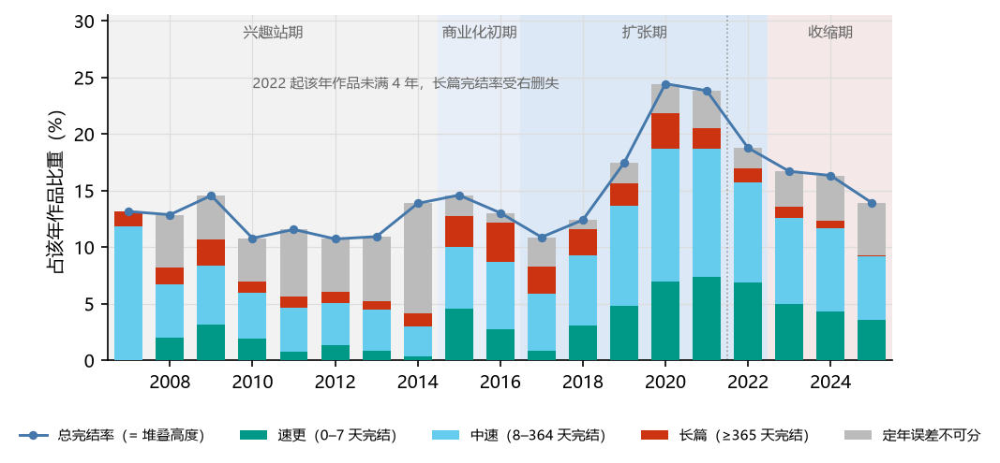
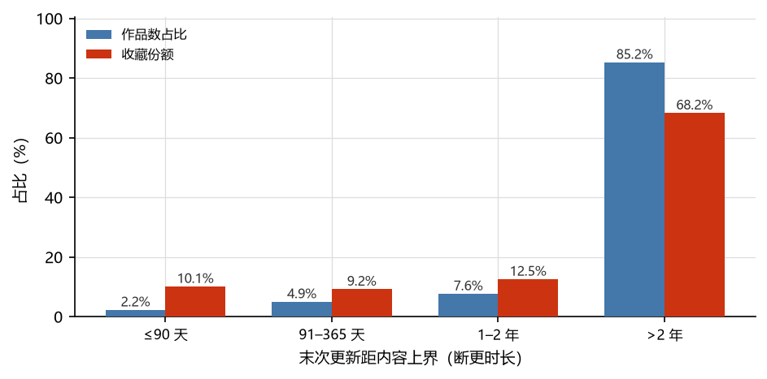

# 05 · 作品生命周期：完结的二元结构、断更存量与注意力固化

> 口径声明：
> 1. 数据源 `analysis/out/novels.csv`，245,779 行（原始 jsonl 的派生表），
>    数据内容上界 2026-05-03，在册存活口径；年份由 nid 定年（锚点插值，
>    报告 01 §1），非 `updated_at`。
> 2. **「连载中」不等于在更**：构建时把「断更」并入「连载中」（判据见
>    `analysis/config.py` 的 status 清洗规则），故状态字段不含任何活跃度信息。
>    本报告的活跃度一律由 `updated_at` 相对内容上界的间隔推导（断更时长），
>    不依赖定年，因而也不受定年误差影响。
> 3. **「已完结」是两种东西**：43,558 本已完结作品里，近三成在 7 天内完结、
>    字数中位仅四千余字——那是速更短篇，不是长篇连载的完成。故「完结率」不能
>    单读，必须与完结时长联读（§1、§2）。
> 4. 完结时长 = `updated_at` − nid 定年创建日。定年在 low 段有月级误差（报告 01 §1），
>    6,915 本已完结作品因
>    定年晚于其唯一一次更新时间而无法分档，本报告单列不并入任何档位。
> 5. 收藏是存量：跨时点不可比（报告 02 口径 2）。本报告只比较**同一存量结构内**
>    的份额，不作跨世代的水平比较，也不把相关性读作因果。
> 6. 分类与标签均为作者自选择（报告 04 口径 2、7）；运营位（featured）是当前态，
>    与热度的因果方向不可从快照判定。
> 7. 本报告不含任何读者侧推断：数据集只有书层字段，没有章节、评论或用户事件，
>    「注意力」一词仅指 `favs` / `clicks` / `praises` 三个计数器。

---

## 0. 结论

1. **「完结」是二元结构，完结率是混合量**。43,558 本已完结作品中，
   12,417 本（28.5%）在 7 天内完结、字数中位
   4,147 字、收藏中位
   4——这是速更短篇；
   真正连载一年以上才完结的只有 4,077 本（9.4%），
   字数中位 249,382 字、收藏中位
   1,120。另有 6,915 本同属「一次上传
   即定稿」形态、但因定年误差无法定档；若一并计入，速更形态合计占已完结作品
   44.4%。全库「完结率
   17.7%」若不拆开读，会把一次性投稿
   当成长篇完成度。
2. **2019–2021 完结率的抬升来自短周期完结，长篇完结率同期在可比队列里已下滑**。
   总完结率 12.4%（2018）→ 24.4%（2020）→ 23.8%（2021），
   两年增量 +12.0 个百分点中，一年内完结贡献
   +9.4（速更 +3.9、中速 +5.5），
   长篇完结率只贡献 +0.9；而长篇完结率从 2016 年峰值 3.4%
   降到 2021 年 1.9%。平台「完成度」指标的上升与长篇连载的推进不是同一件事。
3. **「连载中」名不副实**：202,221 本连载中作品里，186,897 本
   （92.4%）已断更超过一年，近 90 天仍有更新的只有
   4,967 本（2.5%）。全库层面，末次更新距内容上界
   不超过 90 天的作品仅 5,472 本（2.2%）。
4. **收藏是存量资产，且高度固化**：断更超过一年的 228,147 本作品
   （占 92.8%）持有全库
   80.7% 的收藏；近 90 天在更的
   5,472 本只占 10.1%。
   新书几乎撬不动存量——2025 年新建的 14,552 本
   仅占全库收藏的 4.4%。
5. **同人是「一次性投稿」货架**：该类近 90 天活跃率仅 0.79%
   （全库其余类别 2.44%），速更完结占比最高，收藏中位
   51 却远高于其余类别——热度来自集中爆发，而非持续连载。
6. **由此产生的读法修正**：报告 01 的完结率、报告 02 的收藏集中、报告 03 的
   作者留存，都应读作「存量书架的当前状态」，而不是「当年的创作表现」。

---

## 1. 「完结」是两种东西

状态字段的「已完结」不区分作品体量与连载时长。把已完结作品按**完结时长**
（末次更新 − nid 定年创建日）分档后，两类作品的画像几乎没有重叠：

| 完结时长 | 本数 | 占已完结% | 字数中位 | 收藏中位 | 浏览中位 |
|---|---|---|---|---|---|
| 0–7 天 | 12,417 | 28.5 | 4,147 | 4 | 146 |
| 8–30 天 | 7,652 | 17.6 | 11,770 | 13 | 824 |
| 31–90 天 | 5,595 | 12.8 | 23,853 | 35 | 3,049 |
| 91–364 天 | 6,902 | 15.8 | 52,751 | 142 | 17,080 |
| ≥365 天 | 4,077 | 9.4 | 249,382 | 1120 | 188,360 |

另有 6,915 本已完结作品的定年晚于其唯一一次更新时间（多为一次上传即定稿的
速更短篇，low 段月级定年误差足以翻转符号），无法分档，单列不并入。

- **速更档（0–7 天）**：12,417 本，字数中位 4,147 字、
  收藏中位 4、浏览中位 146。
  它们在平台上留下的痕迹接近「一条动态」，而不是一个可运营的内容资产。
- **长篇档（≥365 天）**：4,077 本，字数中位 249,382 字、
  收藏中位 1,120、浏览中位 188,360。

两档收藏中位相差约 280 倍。
因此「完结率 17.7%」这一全库指标，
若不同时给出完结时长分布，会把「一次性投稿」与「长篇写完」读成同一件事。

---

## 2. 完结率的结构性来源：短周期涌入，长篇停滞

按定年把完结按**完结时长**拆成四档后，「完结率」的走势可以被解释：

| 定年 | 作品数 | 总完结率% | 一年内完结% | 其中速更(0–7天)% | 中速(8–364天)% | 长篇(≥365天)% | 定年不可分% |
|---|---|---|---|---|---|---|---|
| 2007 | 76 | 13.2 | 11.8 | 0.0 | 11.8 | 1.3 | 0.0 |
| 2008 | 404 | 12.9 | 6.7 | 2.0 | 4.7 | 1.5 | 4.7 |
| 2009 | 1,126 | 14.6 | 8.3 | 3.2 | 5.2 | 2.3 | 3.9 |
| 2010 | 2,947 | 10.8 | 6.0 | 1.9 | 4.1 | 1.0 | 3.8 |
| 2011 | 3,441 | 11.6 | 4.7 | 0.7 | 4.0 | 0.9 | 6.0 |
| 2012 | 3,430 | 10.7 | 5.0 | 1.4 | 3.7 | 1.0 | 4.7 |
| 2013 | 2,680 | 10.9 | 4.5 | 0.8 | 3.7 | 0.7 | 5.7 |
| 2014 | 2,646 | 13.9 | 3.0 | 0.4 | 2.6 | 1.1 | 9.7 |
| 2015 | 2,760 | 14.6 | 10.0 | 4.6 | 5.4 | 2.7 | 1.9 |
| 2016 | 5,493 | 13.0 | 8.7 | 2.8 | 6.0 | 3.4 | 0.9 |
| 2017 | 12,759 | 10.9 | 5.9 | 0.8 | 5.1 | 2.4 | 2.6 |
| 2018 | 16,469 | 12.4 | 9.3 | 3.1 | 6.2 | 2.3 | 0.8 |
| 2019 | 24,263 | 17.5 | 13.6 | 4.8 | 8.8 | 2.0 | 1.8 |
| 2020 | 30,372 | 24.4 | 18.7 | 6.9 | 11.8 | 3.1 | 2.6 |
| 2021 | 35,156 | 23.8 | 18.7 | 7.4 | 11.3 | 1.9 | 3.3 |
| 2022 | 37,088 | 18.8 | 15.7 | 6.9 | 8.8 | 1.3 | 1.8 |
| 2023 | 26,021 | 16.7 | 12.6 | 5.0 | 7.6 | 1.0 | 3.1 |
| 2024 | 20,075 | 16.3 | 11.7 | 4.3 | 7.4 | 0.6 | 4.0 |
| 2025 | 14,552 | 13.9 | 9.2 | 3.6 | 5.7 | 0.1 | 4.6 |

- **总完结率**在 2018 年 12.4% → 2020 年 24.4%
  → 2021 年 23.8%，在扩张期达到高位。
- 2018→2020 的 +12.0 个百分点增量中，**一年内完结贡献
  +9.4（占 78%）**，其中速更 +3.9、
  中速 +5.5；长篇完结率只贡献 +0.9。
- 而在**可比队列**（2018 年及以前，均已满 4 年）里，长篇完结率从 2016 年峰值
  3.4% 降到 2017 年 2.4%、
  2018 年 2.3%，已在下滑；2021 年 1.9%
  同受右删失影响而不可直接比较。
- 2022 年起该年作品未满 4 年，长篇完结率被压低，与实际推进程度无关；
  跨世代比较只对 2018 年及以前的队列有效（口径 4）。

即：扩张期的「完成度上升」是**投稿结构变化**（短篇与同人向作品涌入），
不是**长篇连载能力提升**。两个变量在原始完结率里被合并，方向甚至相反。

---

## 3. 「连载中」不等于在更

构建时「断更」被并入「连载中」（状态清洗规则见 `analysis/config.py`），因此
状态字段不含活跃度信息。用 `updated_at` 相对内容上界重新度量：

| 断更时长 | 连载中本数 | 占连载中% | 已完结本数 | 占已完结% |
|---|---|---|---|---|
| ≤90 天 | 4,967 | 2.5 | 505 | 1.2 |
| 91–365 天 | 10,357 | 5.1 | 1,803 | 4.1 |
| 1–2 年 | 15,602 | 7.7 | 3,091 | 7.1 |
| >2 年 | 171,295 | 84.7 | 38,159 | 87.6 |

- **202,221 本「连载中」作品里，186,897 本（92.4%）
  已断更超过一年**，近 90 天仍有更新的只有 4,967 本（2.5%）。
- 全库层面，末次更新距内容上界 ≤90 天的作品只有 5,472 本
  （2.2%），却要承担 10.1%
  的收藏。
- 已完结作品里仍有 2,308 本在一年内被编辑过
  （5.3%）——完结并非不可动，
  修订与重上架仍在发生。

因此「连载中」应读作**未标记完结**，而不是「在更」。任何以状态字段为分母的
供给或留存指标，都需要先按断更时长重新切分。

---

## 4. 存量注意力固化：新书撬不动存量

收藏是累积量，作品一旦停止更新，其收藏就固化在快照里不再变化。于是存量书架
的注意力分布，与「当下谁在写」几乎脱钩：

| 断更时长 | 本数 | 作品占比% | 收藏份额% | 收藏中位 |
|---|---|---|---|---|
| ≤90 天 | 5,472 | 2.2 | 10.1 | 18 |
| 91–365 天 | 12,160 | 4.9 | 9.2 | 7 |
| 1–2 年 | 18,693 | 7.6 | 12.5 | 9 |
| >2 年 | 209,454 | 85.2 | 68.2 | 8 |

- **断更超过一年的 228,147 本作品（92.8%）
  持有全库 80.7% 的收藏**；
- 近 90 天在更的 5,472 本（2.2%）只占
  10.1%；
- **2025 年新建的 14,552 本只占全库收藏的
  4.4%**，而 2022 年新建的
  37,088 本已积累到 15.4%。

存量与增量之间的时间差是结构性的：收藏的复利来自「写得久」，而不是「写得多」。
这解释了报告 02 观察到的头部集中——头部的位置在几年内很难被新书替换；
也意味着任何以收藏为目标的运营动作，面对的是一块**几乎不再流动**的存量。

---

## 5. 九类的生命周期形态

| 分类 | 本数 | 近 90 天活跃% | 速更完结% | 长篇完结% | 收藏份额% | 收藏中位 | 字数中位 |
|---|---|---|---|---|---|---|---|
| 魔幻 | 85,696 | 2.4 | 4.0 | 1.5 | 34.4 | 6 | 13,804 |
| 校园 | 31,595 | 2.4 | 5.0 | 1.9 | 17.1 | 6 | 10,872 |
| 玄幻 | 29,798 | 2.6 | 5.8 | 1.5 | 13.3 | 5 | 9,968 |
| 古风 | 8,258 | 2.9 | 4.7 | 2.2 | 9.5 | 9 | 11,957 |
| 都市 | 23,450 | 3.1 | 5.8 | 1.3 | 9.1 | 5 | 9,412 |
| 同人 | 31,664 | 0.8 | 6.1 | 2.2 | 8.3 | 51 | 5,398 |
| 游戏 | 12,782 | 1.7 | 5.7 | 1.8 | 4.1 | 13 | 8,596 |
| 科幻 | 17,366 | 1.7 | 5.4 | 1.3 | 3.4 | 5 | 10,670 |
| 悬疑 | 5,170 | 2.2 | 7.0 | 1.0 | 0.7 | 4 | 8,452 |

- **同人**是极端的一次性货架：近 90 天活跃率 0.8%
  为九类最低（其余类别 2.4%），
  速更完结率 6.1% 偏高，而收藏中位
  51 远高于其余类别——一次性投稿 + 爆发式关注，
  与报告 04 的「免费二创货架」判断一致。
- **魔幻**同时是体量第一（85,696 本）与存量收藏第一
  （34.4%）的分类，
  活跃率 2.4% 属中游。
- **悬疑**体量最小（5,170 本）但速更完结率最高
  （7.0%），形态上偏短平快。
- 九类的近 90 天活跃率整体都极低（0.8%–3.1%）；
  分类之间的真正差异不在活跃度，而在**存量收藏的沉淀速度**——同人活跃率最低却
  收藏中位最高（51），悬疑两者皆低。

---

## 6. 口径边界

1. **无读者侧数据**：数据集只有书层字段（无章节、无评论、无用户事件），
   本报告的「注意力」仅指 `favs` / `clicks` / `praises` 三个计数器；
   断更时长反映的是作品侧行为，不是读者行为。
2. **断更时长不依赖定年**（只用 `updated_at` 与内容上界），故不受 low 段
   13,716 本月级定年误差影响；完结时长依赖定年，已完结作品中有
   6,915 本因符号翻转无法分档，
   已单列。分档结论按档位表述，不作精确天数推断。
3. **状态字段经过清洗**：断更并入连载中、空状态整行剔除（`analysis/config.py`），
   在册口径下架作品不在库，越早的队列缺失越多。
4. **收藏不可跨时点比**：本报告只比较存量结构内的份额，不比较世代绝对量。
5. **自选择**：分类、标签、征文均由作者自行选择；活跃度与收藏的关联是相关而非因果。
6. **未解问题**：`updated_at` 记录的是最后一次章节更新，无法区分「多次更新后停更」
   与「一次上传即定稿」——速更档与断更档在字段上同构，只能借字数与状态交叉推断。

---

*生成：`uv run python analysis/report_lifecycle.py`；本文件为生成物，勿手改。*
