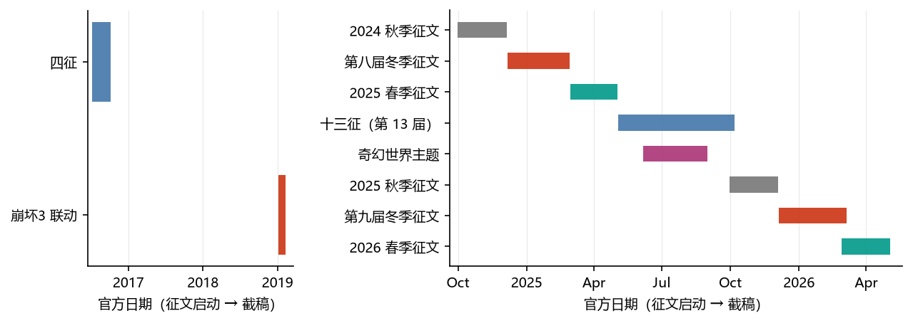
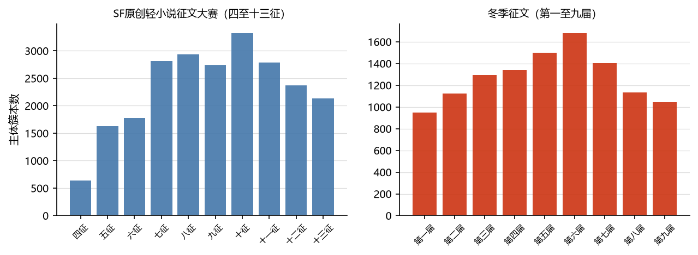
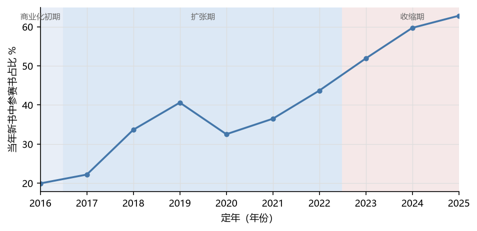
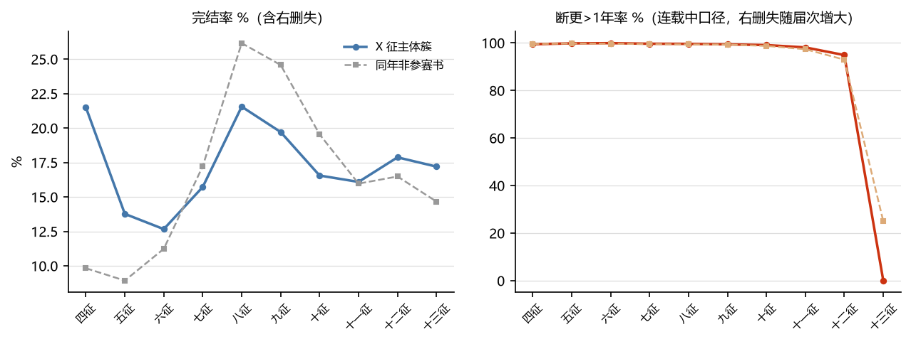

# 06 · 征文体系：平台运营节拍、参与规模与参与者画像

> 口径声明：
> 1. 数据源 `analysis/out/novels.csv`，245,779 行，数据内容上界 2026-05-03，
>    在册存活口径；年份由 nid 定年（104 锚点插值，报告 01 §1），非
>    `updated_at`。年度序列止于 2025。
> 2. **`contest` 是报名时点标记，不是创建时间标记**：参赛方式为「创建新书时
>    选择参赛组别」，但平台允许旧书参赛（八/九/十征的 nid 下限远老于主体簇，
>    最早散点定年可早至 2016）。因此一切 cohort 统计使用 **nid 25-75 分位
>    ±0.1×IQR 主体簇**剔除旧书长尾，nid 下限不具定年意义。
> 3. **官方日期引用** `references/contest-editions.md`：四征 2016-07-08
>    （官方规则页）、十二征 2024-05-04（页面 id）、十三征等 8 届（官方 App，
>    覆盖边界 2024-09-30）、崩坏3 联动 2019-01-04（官方通稿）。cohort 主体簇
>    下界定年一致晚于官方启动 9-20 天（投稿主体滞后 1-3 周进入），故
>    **cohort 下界不可作启动日点锚**，窗口约束（创建 ∈ [启动, 截止]）才是
>    正确用法。
> 4. **届次→年份映射**：X 征四至十三 = 2016-2025（四/五/六/十二/十三征有官方
>    证据，七至十一征按年度节奏推定并与主体簇定年窗逐年吻合）；冬征一至九届
>    = 2018 起每年一届（一/二/三/八/九届有官方证据）。
> 5. 主指标 favs（收藏）：clicks 是累计浏览、受上架时长混杂，仅作对照。
>    **完结率与断更率含右删失**：2023 年后各届的完结率大幅低估（作品仍在
>    连载），跨届比较只对早期届次有效；断更>1年率按「连载中」口径计算。
> 6. 参赛是作者自选择（有存量与准备的作者更倾向参赛），评奖与推荐位构成
>    运营侧二次筛选；征文书与非征书的全部差异均为**相关而非因果**。

---

## 0. 结论

1. **征文是平台的核心运营节拍，日历首尾相接**。官方核实日期显示：秋征
   9-30 启动 → 冬征 12 月上旬 → 春征 3 月初 → X 征 5 月 4 日 → 秋征，
   上一届截止到下一届启动仅差 0-1 天；近年 X 征固定 5 月 4 日启动
   （四征时代为 7 月，七征起定年窗显示启动已提前至 5 月下旬）。参赛书合计
   95,433 行（占在册 38.8%）。
2. **参与规模两波扩张**：X 征主体簇从四征 642 本增至十征
   3,323 本（峰值）后回落；冬征从第一届 947 本
   增至第六届 1,680 本后回落。2023 年后两系列同步收缩
   （十三征 2,134 本），与大盘供给收缩同步（报告 01）。
3. **征文书与非征书系统性不同**（2016-2025 主系列主体簇 n=45,079 vs
   非参赛 129,353）：参赛书字数中位 15,558 vs
   8,477、VIP 率 6.1% vs
   1.2%、favs P90
   526 vs 239
   （中位持平于 8 vs 8，
   差异全在分布尾部）——征文筛选的是**有准备、有体量、倾向商业化**的
   作者；此为自选择相关，不可作因果。
4. **「报名容易完赛难」是征文漏斗的主结构**：X 征长篇轨报名主体簇的字数
   中位仅 17,849 字，远低于 12 万字的官方参赛门槛（字数审核在征稿期
   结束当日进行）——大多数报名作品未达门槛即弃坑，与 §5 断更率互证。
5. **IP 联动征文是独立产品线**：崩坏3（主体簇 279 / 标注
   416 本）等游戏 IP 合作与点鸭/星穹等主题类活动构成
   第二梯队；对话小说征文是最大产品线（9,704 行，占参赛
   10.2%），与原创商业连载分轨。IP 类 VIP 率趋零，
   二创供给不进付费体系（与报告 04 互证）。
6. **崩坏3 是唯一窗口校验反常**（主体簇 n=279，窗内仅 32.6%，
   67.4% 定年早于官方启动日）：提示 nid ~178k 邻域 mid 段定年
   局部误差可达 ±10 天且方向不定，只记录、不改口径（报告 01 §1）。

---

## 1. 征文体系与全年日历

库内 `contest` 标注覆盖 96 个活动名，可归为六条产品线：**SF 原创轻小说征文
大赛**（「X 征」，四至十三届）、**冬季征文**（九届）、**春季 / 秋季征文**、
**对话小说征文**（X 征对话轨 + 独立活动）、**IP 联动与主题类**（崩坏3、
少女前线、星穹小说家、点鸭、怪谈异闻等）。

X 征各届（主体簇口径，官方启动日有证据处标注）：

| 届次 | 届次年份 | 标注 n | 主体簇 n | 主体簇定年窗 | 官方启动日 |
|---|---|---|---|---|---|
| 四征 | 2016 | 1,063 | 642 | 2016-07-08 ~ 2016-09-09 | 2016-07-08 |
| 五征 | 2017 | 2,664 | 1,627 | 2017-07-13 ~ 2017-09-26 | 2017（URL 年份） |
| 六征 | 2018 | 2,963 | 1,777 | 2018-07-04 ~ 2018-09-02 | 2018（URL 年份） |
| 七征 | 2019 | 4,673 | 2,818 | 2019-06-02 ~ 2019-08-18 | — |
| 八征 | 2020 | 4,790 | 2,933 | 2020-05-27 ~ 2020-08-26 | — |
| 九征 | 2021 | 4,510 | 2,740 | 2021-05-31 ~ 2021-08-30 | — |
| 十征 | 2022 | 5,574 | 3,323 | 2022-05-22 ~ 2022-08-21 | — |
| 十一征 | 2023 | 4,505 | 2,791 | 2023-05-18 ~ 2023-08-31 | — |
| 十二征 | 2024 | 3,831 | 2,367 | 2024-05-19 ~ 2024-08-30 | 2024-05-04 |
| 十三征 | 2025 | 3,385 | 2,134 | 2025-05-26 ~ 2025-09-11 | 2025-05-04 |

冬季征文各届（第一届无届次标注，官方页 djzw2018 实锤）：

| 冬征届次 | 主体簇 n | 标注 n | 主体簇定年窗 | 官方启动日 |
|---|---|---|---|---|
| 第一届 | 947 | 1,513 | 2018-02-03 ~ 2018-03-20 | — |
| 第二届 | 1,124 | 1,732 | 2019-01-16 ~ 2019-03-03 | — |
| 第三届 | 1,292 | 2,140 | 2019-12-04 ~ 2020-01-26 | — |
| 第四届 | 1,339 | 2,206 | 2020-12-13 ~ 2021-02-09 | — |
| 第五届 | 1,497 | 2,484 | 2021-12-10 ~ 2022-01-30 | — |
| 第六届 | 1,680 | 2,693 | 2022-12-12 ~ 2023-02-03 | — |
| 第七届 | 1,405 | 2,320 | 2024-01-01 ~ 2024-02-06 | — |
| 第八届 | 1,135 | 1,954 | 2024-12-19 ~ 2025-02-07 | 2024-12-06 |
| 第九届 | 1,045 | 1,773 | 2025-12-20 ~ 2026-02-06 | 2025-12-05 |

春季征文 5 届（2022-2026，
共 8,517 行）、秋季征文 2 届
（2024-2025，共 2,615 行）。

**日历首尾相接**是官方日期最醒目的结构（有官方起止日期的衔接）：

| 衔接 | 上届截止 | 下届启动 | 间隔 |
|---|---|---|---|
| 2024 秋 → 冬八 | 2024-12-05 | 2024-12-06 | +1 天 |
| 冬八 → 2025 春 | 2025-02-28 | 2025-03-01 | +1 天 |
| 2025 春 → 十三征 | 2025-05-03 | 2025-05-04 | +1 天 |
| 2025 秋 → 冬九 | 2025-12-04 | 2025-12-05 | +1 天 |
| 冬九 → 2026 春 | 2026-03-06 | 2026-02-27 | -8 天 |

上届截止与下届启动仅差 1 天（2026 春征与冬九截稿期重叠 8 天，是唯一的
例外）。平台把征文排成了一张近乎无缝的全年日历：对作者而言任何时点都有
一个进行中的征文可选；对平台而言征文成为**持续的新书供给泵**——每届
启动后 1-3 周即进入投稿主体期（各届主体簇下界定年一致晚于启动 9-20 天，
见口径声明 3）。

另一个可从定年窗读出的演变：**X 征的启动时点从夏季提前到了初夏**。
四至六征的主体簇定年窗始于 7 月上旬（与四征官方启动 2016-07-08 一致），
七征起定年窗提前到 5 月下旬至 6 月初——与十二/十三征官方启动日 5 月 4 日
的节奏吻合，即「五四启动」的惯例约自七征（2019）前后形成。

---

## 2. 参与规模：两波扩张与同步收缩

X 征主体簇规模（占当年新增比重的分母为该届次年份的全部新书）：

| 届次 | 年份 | 主体簇 n | 占当年新增 % | 主体簇定年窗 |
|---|---|---|---|---|
| 四征 | 2016 | 642 | 11.7 | 2016-07-08 ~ 2016-09-09 |
| 五征 | 2017 | 1,627 | 12.8 | 2017-07-13 ~ 2017-09-26 |
| 六征 | 2018 | 1,777 | 10.8 | 2018-07-04 ~ 2018-09-02 |
| 七征 | 2019 | 2,818 | 11.6 | 2019-06-02 ~ 2019-08-18 |
| 八征 | 2020 | 2,933 | 9.7 | 2020-05-27 ~ 2020-08-26 |
| 九征 | 2021 | 2,740 | 7.8 | 2021-05-31 ~ 2021-08-30 |
| 十征 | 2022 | 3,323 | 9.0 | 2022-05-22 ~ 2022-08-21 |
| 十一征 | 2023 | 2,791 | 10.7 | 2023-05-18 ~ 2023-08-31 |
| 十二征 | 2024 | 2,367 | 11.8 | 2024-05-19 ~ 2024-08-30 |
| 十三征 | 2025 | 2,134 | 14.7 | 2025-05-26 ~ 2025-09-11 |

三段结构。**第一波（2016-2018）**：X 征从四征到六征稳步放大；冬征 2018 年
上线后迅速成为第二大系列。**第二波（2019-2022 扩张期）**：X 征在十征
（2022）达到峰值，冬征在第六届（2022 冬）达到峰值。**收缩（2023-2025）**：
十一征、十二征、十三征主体簇逐届回落，与大盘新书供给收缩同步——征文
没有逆势扩张，它是供给的放大器而非引擎。值得注意的是**占比与规模的分化**：
十三征主体簇规模回落，占当年新增比重却是全序列最高（14.7%，八征时低至
9.7%）——大盘收缩快于征文收缩，征文在收缩期反而成为新书更重要的来源。

---

## 3. 征文书与非征书：自选择的结构差异

参赛书 vs 非参赛书（2016-2025 定年；参赛书分「主系列主体簇」与「含旧书
长尾全体」两行以显示长尾影响；完结率含右删失）：

| 分组 | n | 字数中位 | favs 中位 | favs P90 | VIP 率 % | 完结率 % | 断更>1年率 % |
|---|---|---|---|---|---|---|---|
| 主系列主体簇（X/冬/春秋） | 45,079 | 15,558 | 8 | 526 | 6.1 | 16.1 | 89.0 |
| 参赛书全体（含旧书长尾） | 92,895 | 12,843 | 9 | 530 | 5.5 | 18.0 | 91.0 |
| 非参赛书（同年对照） | 129,353 | 8,477 | 8 | 239 | 1.2 | 18.6 | 95.4 |

主体簇口径下，参赛书的画像是：**更长**（字数中位
15,558 vs 8,477）、
**更商业化**（VIP 率 6.1% vs
1.2%）、**尾部更厚**
（favs P90 526 vs
239）——但**热度中位持平**
（8 vs 8）：参赛带来的
不是整体更热，而是**头部率更高**。「参赛全体」行的 favs 中位
（9）反而高于主体簇行，因为旧书长尾累积收藏
更久——长尾不是低热度蹭活动者，而是**高累积的老书**；两种口径不可混用，
本报告一律用主体簇。

X 征长篇轨（官方门槛：12 万字以上连载，字数审核在征稿期结束当日进行）：

| 分组 | n | 字数中位 | favs 中位 | favs P90 | VIP 率 % | 完结率 % | 断更>1年率 % |
|---|---|---|---|---|---|---|---|
| X 征长篇主体簇（报名） | 16,881 | 17,849 | 10 | 756 | 7.0 | 14.1 | 89.1 |
| 非参赛 ≥12 万字（写完的长篇） | 8,486 | 236,844 | 396 | 7,684 | 18.8 | 25.5 | 85.2 |

**报名与完赛之间是征文漏斗的最大落差**：X 征长篇报名主体簇的字数中位仅
17,849 字——约为官方门槛的
14.9%。即大多数报名者创建新书、挂上参赛标注
后远未写到 12 万字便弃坑（与 §5 断更率互证）；真正写完 12 万字的
「非参赛 ≥12 万字」组（n=8,486，字数中位
236,843）才是长篇的完成体量。完成体量的组在各项
指标上都远高于报名组（favs 中位 396 vs
10、VIP 率 18.8% vs
7.0%）——**长篇的成功属于少数
写完的人，参赛标注本身不改变这个结构**。此为自选择相关：有完赛能力的
作者无论是否参赛都会写完。

---

## 4. IP 联动与产品线征文

IP 联动 / 主题类活动（主体簇口径；崩坏3 官方日期 2019-01-04 → 02-11）：

| 活动 | 标注 n | 主体簇 n | 主体簇定年窗 | favs 中位 | VIP 率 % |
|---|---|---|---|---|---|
| 崩坏3 × SF 同人征文（米哈游） | 416 | 279 | 2018-12-26 ~ 2019-01-16 | 8 | 1.8 |
| 少女前线 × SF 同人征文（散爆） | 335 | 228 | 2018-11-09 ~ 2018-11-25 | 5 | 0.4 |
| 星穹小说家征文（米哈游·星穹铁道） | 397 | 232 | 2023-03-29 ~ 2023-04-24 | 54 | 0.4 |
| 点鸭秋之偶像季 | 379 | 237 | 2023-09-11 ~ 2023-10-28 | 36 | 2.1 |
| 点鸭秋色回忆 | 221 | 133 | 2024-09-22 ~ 2024-10-22 | 18 | 0.0 |
| 龙之谷 × SF 同人征文 | 128 | 74 | 2019-09-24 ~ 2019-10-15 | 5 | 1.4 |
| 怪谈异闻主题征文（长篇轨） | 368 | 219 | 2023-11-20 ~ 2023-12-15 | 32 | 0.9 |
| 怪谈异闻主题征文（短篇轨） | 39 | 21 | 2023-11-27 ~ 2023-12-18 | 10 | 0.0 |
| 楚楚动仁同人征文 | 31 | 21 | 2016-06-17 ~ 2016-07-30 | 2 | 0.0 |

IP 联动征文的特点：**规模小（主体簇几十到三百余本）、热度低、VIP 率趋零**
——游戏 IP 同人写作的激励在 IP 侧（水晶、周边、代券）而非站内商业化，
与报告 04 的「同人类 2019 上线、VIP≈0%」互相印证：二创供给不进付费体系。

**对话小说征文是最大的产品线**：9,704 行（占参赛
10.2%、18 个活动名），
X 征对话轨主体簇 3,083 本（定年窗最早
2021-03-01），九征/十征对话轨单届即 1,900+/1,700+ 本——
对话小说是 2019 年后平台重点扶持的独立形态（报告 04 §1 同人类同年上线），
其征文轨与主系列并行而非混排。

**崩坏3 案例的两点价值**。其一，量级吻合：官方参与奖限量 500 份，
主体簇 279 本 + 总标注 416 本，规模一致。其二，**它是全部
10 个有官方日期的 cohort 中唯一窗口校验反常者**：定年落在官方窗
（2019-01-04 ~ 02-11）内仅 32.6%，67.4% 定年
早于启动日，主体簇下界 nid 178,074 定年 2018-12-26
（早于启动 9 天）。两种解释——nid ~178k 邻域 mid 段定年局部偏早 ≤11 天，
或活动页先于通稿上线、部分作者提前建书——现有证据无法区分；**处置为
只记录不改口径**，并作为「mid 段局部误差可达 ±10 天、方向不定」的实证
案例记入报告 01 §1。

---

## 5. 完赛与存活：截稿压力下的推进率

X 征各届主体簇的完赛指标（**完结率含右删失**：2023 年后各届大幅低估，
作品仍在连载；断更>1年率为「连载中」口径，衡量弃坑存量）：

| 届次 | 年份 | 主体簇 n | 完结率 % | 断更>1年率 % |
|---|---|---|---|---|
| 四征 | 2016 | 642 | 21.5 | 99.4 |
| 五征 | 2017 | 1,627 | 13.8 | 99.8 |
| 六征 | 2018 | 1,777 | 12.7 | 99.9 |
| 七征 | 2019 | 2,818 | 15.7 | 99.6 |
| 八征 | 2020 | 2,933 | 21.5 | 99.6 |
| 九征 | 2021 | 2,740 | 19.7 | 99.4 |
| 十征 | 2022 | 3,323 | 16.6 | 99.1 |
| 十一征 | 2023 | 2,791 | 16.1 | 98.1 |
| 十二征 | 2024 | 2,367 | 17.9 | 94.9 |
| 十三征 | 2025 | 2,134 | 17.2 | 0.0 |
| 非参赛对照 | 2016-25 | 129,353 | 18.6 | 95.4 |

可比口径（右删失较小的四至七征，2016-2019）完结率
15.9%，与同年非参赛对照（18.6%）相近甚至
略低——**征文的截稿压力与评奖激励并未转化为更高的完赛率**，「报名」
与「完赛」是两个环节：报名在启动后几周内完成，完赛要对抗 12 万字门槛
与数月连载周期（§3 的字数漏斗）。断更>1年率的读法与届次方向相反：
四征 99.4% 一路降到
十二征 94.9%、十三征
0.0%——这是**右删失**而非弃坑率改善：断更
满 1 年需要时间累积，越新的届次越「还没来得及断更」。与报告 05 的
「连载中 92.4% 已断更」口径一致，征文并不能豁免长尾断更——绝大多数
征文书同样一次投稿后沉寂。

---

## 6. 口径边界

1. **`contest` 为单值字段**：每本书至多一个活动标注，无法刻画一书多投；
   平台规则一人多稿（四征允许长篇两稿、中短篇一稿）在同一标注下不可见。
2. **旧书参赛长尾**：八/九/十征的 nid 下限远老于主体（最早散点 2016），
   说明 contest 标注可在建书很久后写入；本报告全部 cohort 统计已用主体簇
   剔除，但「参赛全体」口径的各项指标会被长尾拉低，两者不可混用。
3. **2024-09 之前的锚点空白**：官方 App 仅收录 2024-09-30 之后的活动，
   2017-2023 各届（五征、六征、冬征二至七届、校园都市征文等）的精确启动日
   仍缺官方证据，该段定年维持 mid 置信；征文公告页/参赛列表若能从其他
   渠道（官方微博、公众号存档）取得，可按 `contest-editions.md` 流程并入。
4. **右侧删失**：完结率对 2022 年后届次仅是下界；断更率对 2026 届（春征）
   无意义（主体簇定年窗晚于内容上界前夜）。
5. **因果边界**：参赛与热度/完赛/商业化的全部关联均为自选择相关；
   评奖与推荐位数据不在数据集内（`featured` 只有在架 banner 状态，无获奖
   标注），运营侧二次筛选不可观测。

---

*生成：`uv run python analysis/report_contest.py`；本文件为生成物，勿手改。*
