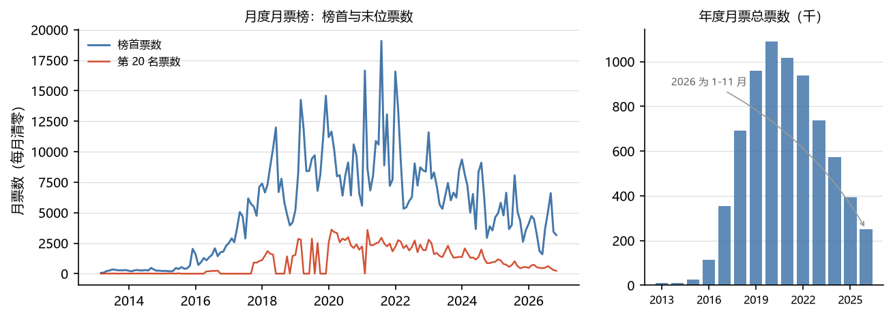
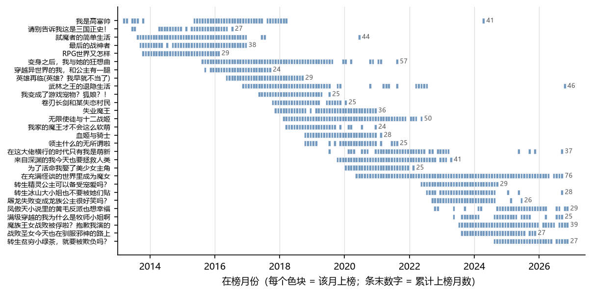
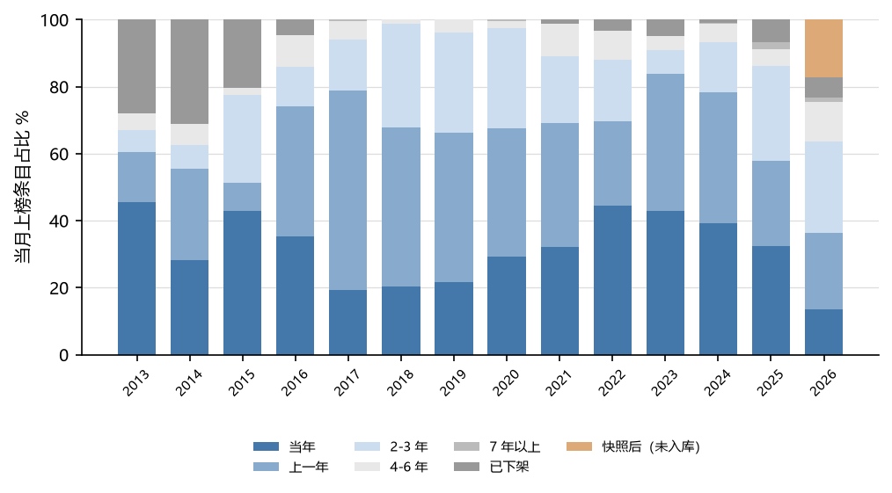
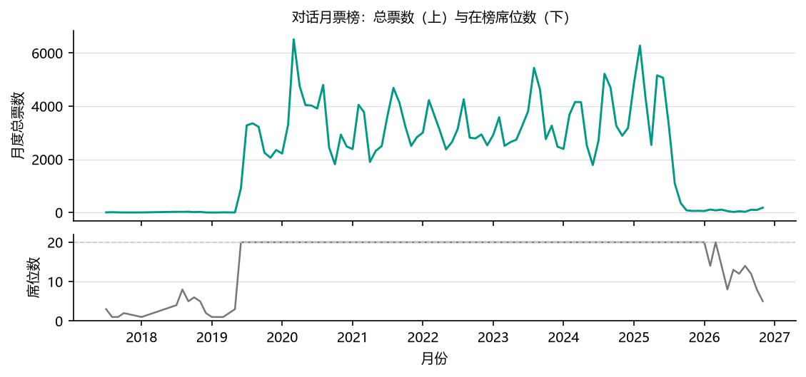

# 07 · 商业化：月票榜十六年，唯一公开的付费刻度

> 口径声明：
> 1. **数据源二元**。书目属性来自 `analysis/out/novels.csv`（245,779 行，数据
>    内容上界 2026-05-03，在册存活口径，年份由 nid 定年，104 锚点插值，
>    报告 01 §1）；付费信号来自 `analysis/out/monthly_ranks.jsonl`
>    （`MonthlyBoy.ashx` 月度榜，2013-03 至 2026-11，660 个请求全部成功，
>    抓取器 `fetch_monthly_ranks.py`，端点语义见
>    `references/sfacg-live-ranks.md`）。
> 2. **榜单是月度榜、每月清零、top20 右截断**：票数只在同月内可比，第 21 名
>    以下不可见。因此本报告只做「顶部结构」与「年度相对刻度」，不推算总量、
>    不做跨年精确回归。
> 3. **`price_type` 是 2026-05-03 快照状态，不是上榜时状态**。2013-2014 年
>    月票榜「商业化率」仅 41.0% / 47.9%，其中相当部分是当时未上架、后来才
>    签约或转 VIP 的书——这是状态滞后，不是早年榜上有免费书。
> 4. **榜单覆盖到 2026-11，超出数据内容上界**：2026-06 之后新创建的书
>    （nid > 774850）不在数据集内，属性不可得，一律单列
>    「库外」。同理，`nid` 在范围内但不在库内的条目为**已下架**书（历史上榜、
>    现已从站点移除），属性亦不可得。
> 5. 无营收、付费人数、订阅量数据。月票票数是唯一公开的付费强度信号，但含
>    运营活动加成（如双倍月票），只能作相对刻度。
> 6. 因果边界：上榜本身带来曝光，榜位与热度互为因果；本报告全部结论为结构
>    描述，不作因果推断。

---

## 0. 结论

1. **月票榜是这份数据集里唯一能外部校准的付费刻度**：165 个月
   连续、每月 20 席，合计 3,300 人次、仅 694 本不同的书。
   付费头部不是「一群人」而是**一份名单**——694 本书占满十六年全部席位。
2. **付费规模在 2019-2020 见顶，此后单向下行**：年度总票
   1,089,959（2020）→ 394,938（2025）
   → 250,637（2026 年 1-11 月，年化约
   273,422），为峰值的
   25%。榜首票数峰值
   19,088（2021-08），2026 年 1-11 月的月度榜首
   最高仅 6,601。
3. **月票榜的门槛不是成绩而是付费层**：在库上榜书 615 本中
   83.6% 为 VIP/签约，收藏中位 28,112——是全库收藏
   P99（10,371）的
   2.7 倍，字数中位
   1,202,213 字。反向看，全库收藏 ≥10 万的 38 本里
   37 本上过月票榜（97.4%）；
   而收藏 ≥1 万的 2,531 本里只有 17.6% 上过。
   **热度不是入榜的充分条件，付费转化才是。**
4. **长销是头部的主要形态，且以「长期连载」为主**：11 本书上榜 ≥36 个月
   （其中仍连载中的占多数），最长 76 个月；上榜 ≥12 个月的
   68 本（9.8%）贡献了
   48.4% 的人次。完结书则在另一条线上延续价值：
   热销榜 2016-2023 年已完结书长期占
   60.3%-77.6% 的席位。
   **商业价值有两种形态：连载中的持续订阅，与完结后的存量销售。**
5. **对话月票榜是独立赛道，且在 2025-10 断崖**：与主站月票榜**零重叠**
   （0 本共同书），年票数 40,657（2024）→
   33,199（2025）→ 890
   （2026 年 1-11 月）；2025-10 单月总票从 349 跌到 82（-76%），此后长期在
   20-180 区间，席位从 20 席跌到 5-14 席。这是报告 06 所记「对话线赛事收缩」的
   商业侧对应证据。

---

## 1. 刻度：四个月度榜的覆盖与边界

月度榜不记录「谁在赚钱」，只记录「谁本月在这个榜上」。四榜的可用区间
并不相同——这一点决定了后面每一节的样本范围：

| 榜单 | 月数 | 覆盖区间 | 上榜人次 | 独立书 | 每月席位 |
|---|---|---|---|---|---|
| 月票榜 | 165 | 2013-03 ~ 2026-11 | 3,300 | 694 | 20-20 |
| 新书榜 | 59 | 2022-01 ~ 2026-11 | 590 | 564 | 10-10 |
| 热销榜 | 139 | 2015-05 ~ 2026-11 | 2,720 | 393 | 4-20 |
| 对话月票榜 | 105 | 2017-07 ~ 2026-11 | 1,764 | 626 | 1-20 |

月票榜自 2013-03 起**每月恒为 20 席、无缺月**，是全库最长、
最完整的外部序列。需注意 2013-03 是**接口下界而非功能起点**
（2013-02 及更早返回空数组，与 novly 源码 `FIRST_MONTH=201303` 一致），
不能据此断言月票功能 2013 年 3 月上线；但当年榜首票数仅 53-346，可以确认
那时付费规模极小。热销榜 2015-05 起、对话月票榜
2017-07 起，新书榜仅 2022-01 起有数据。

### 1.1 榜单是「当期在架」的快照，会留下下架痕迹

3,017 人次可在数据集内匹配，
38 人次为数据内容上界之后创建（占 1.2%），
另有 245 人次（54 本独立书）的 nid
在范围内却**不在库存**——即曾上榜、现已下架的书。其年份分布并不均匀：

| 上榜年 | 当月条目中已下架占比 % |
|---|---|
| 2013 | 28.0 |
| 2014 | 31.2 |
| 2015 | 20.4 |
| 2016 | 4.6 |
| 2017 | 0.0 |
| 2018 | 0.0 |
| 2019 | 0.0 |
| 2020 | 0.0 |
| 2021 | 1.2 |
| 2022 | 3.3 |
| 2023 | 5.0 |
| 2024 | 0.8 |
| 2025 | 6.7 |
| 2026 | 5.9 |

2013-2014 年高达 28.0% / 31.2%，
2016 年之后降至个位数。这与站点早期存在大量未授权日轻、后期集中清理的历史
一致（参见报告 01 §1 的 `licensed_light_novel` 行级剔除口径及其成因）；也说明
**用长期榜单序列做面板时必须把「书已消失」这一删失单独标出**，否则会把下架
误读为「付费规模下降」。

---

## 2. 付费规模的兴衰：2019-2020 见顶，此后单向下行

*图 1｜左：月度榜首与第 20 名票数（每月清零，可直接比较月度强度）；右：年度总票数。*

| 年 | 人次 | 榜首票 | 末位票（月度中位） | 单条中位票 | 年度总票 |
|---|---|---|---|---|---|
| 2013 | 200 | 346 | 10 | 20 | 9,259 |
| 2014 | 240 | 474 | 9 | 21 | 10,873 |
| 2015 | 240 | 2,031 | 0 | 72 | 26,988 |
| 2016 | 240 | 2,271 | 0 | 368 | 112,741 |
| 2017 | 240 | 7,110 | 0 | 1,088 | 352,976 |
| 2018 | 240 | 11,986 | 1,264 | 2,434 | 691,175 |
| 2019 | 240 | 14,589 | 0 | 3,388 | 957,564 |
| 2020 | 240 | 11,651 | 2,656 | 4,080 | 1,089,959 |
| 2021 | 240 | 19,088 | 2,410 | 3,502 | 1,018,147 |
| 2022 | 240 | 16,578 | 2,189 | 3,342 | 936,444 |
| 2023 | 240 | 11,585 | 1,650 | 2,561 | 736,921 |
| 2024 | 240 | 9,359 | 1,318 | 1,906 | 573,518 |
| 2025 | 240 | 8,069 | 716 | 1,237 | 394,938 |
| 2026 | 220 | 6,601 | 479 | 738 | 250,637 |

四个阶段清晰可辨：

- **2013-2014 起步期**：榜首票数 53-474，单条中位仅 20 票左右，全站月均票量
  约 900——付费行为尚未形成规模。
- **2015-2019 成型期**：榜首从 2,031 涨到
  14,589，年度总票从 26,988
  涨到 957,564。但这一段**榜单仍常需「填满」20 席**：
  末位票数月度中位在 0-1,264 之间摇摆，零票条目占 2%-4%（2015-2019 各年
  3.8%/2.9%/3.8%/2.1%/2.9%）。票数集中在榜首少数书上，末位的书只是凑数。
- **2020-2022 平台期**：1,089,959（2020，峰值）/
  1,018,147 / 936,444。
  更关键的是**末位票数首次稳定在四位数**（2020 年 2,656、
  2022 年 2,189）——付费人群的厚度足以填满 20 席，
  这是「商业化闭环成型」在榜单结构上的直接证据。
- **2023-2026 收缩期**：年度总票从 736,921 降到
  394,938，2026 年 1-11 月仅
  250,637（年化 273,422）。

收缩的**形态**比幅度更值得注意：末位票数（月度中位）从 2020 年的
2,656 降至 2026 年的 479
（保留 18%），而榜首票数从
11,651 降至 6,601
（保留 57%）。榜首还能靠
少数重度用户撑住，末位则直接反映付费人群的厚度——**收缩主要发生在长尾付费者
身上，头部重度用户几乎没变**。

两种解释需要区分：可能是付费意愿下降，也可能是活跃用户基数收缩（报告 01 已证
新书供给自 2023 年同步收缩）。票数是「人数 × 人均」的乘积，本数据集无法拆开；
但末位保留率远低于榜首保留率这一点，指向「人数减少」而非「人均下降」。

---

## 3. 门槛：上榜即商业化，热度只是必要不充分条件

| 分组 | 本数 | favs 中位 | favs P90 | 字数中位 | VIP % | 签约 % |
|---|---|---|---|---|---|---|
| 月票榜上榜书（在库） | 615 | 28,112 | 81,018 | 1,202,213 | 78.0 | 5.5 |
| 全库 | 245,779 | 8 | 280 | 10,418 | 2.8 | 5.2 |

月票榜上榜书（去重 615 本）的画像与全库是两个物种：收藏中位
28,112（全库 8，差
3,514 倍）、字数中位
1,202,213（全库 10,418）——
百万字长篇是入榜的必要形态。

**入榜概率随收藏门槛的变化，揭示了门槛的真实位置**：

| 收藏门槛 | 全库本数 | 其中上过月票榜 | 占比 % |
|---|---|---|---|
| 1,000 | 12,465 | 511 | 4.1 |
| 5,000 | 4,709 | 480 | 10.2 |
| 10,000 | 2,531 | 445 | 17.6 |
| 50,000 | 229 | 168 | 73.4 |
| 100,000 | 38 | 37 | 97.4 |

收藏 ≥10 万的书几乎必然上榜（97.4%），
≥5 万时降到 73.4%，
≥1 万时只有 17.6%。也就是说：
**月票榜的边界大致落在收藏 5 万上下**，而不是「热度最高的 20 本」——榜单按当月
票数排序，而票需要付费购买，热度到票的转化本身就是筛子。

三种 `price_type` 的入选率进一步说明门槛的性质：

- **VIP**（6,905 本）：7.0% 上过月票榜，
  字数中位 583,039 字——付费上架书的主体形态；
- **签约**（12,903 本）：仅 0.3% 上过，
  字数中位 104,435 字、收藏中位
  284——签约但未进入付费体系，多为短篇或免费连载，
  **「签约」不等于「商业化」**；
- **免费**（225,971 本）：0.0% 上过。

书口径的 VIP/签约合计 83.6%，而**条目口径是
93.5%**（3,017 条可观测条目中
2,821 条）。
两者相差的 9.9 个百分点正是口径声明 3 所说的
**状态滞后**：一部分书当年在榜时是付费书，到 2026-05 快照时已转免费或退出
付费（完结后免费化是常见做法）。因此「上榜即付费」是关于
**上榜当时**的陈述，不能反过来用今天的 `price_type` 判定历史榜位。

所以月票榜测的不是「签约作者」，而是**「已上架并产生订阅的付费书」**。这也解释
了为什么全库 VIP 率只有 2.8%：
VIP 是平台侧的选择性上架，而非作者单方可得的身份。

---

## 4. 长销：11 本书撑起十六年的头部

*图 2｜上榜 ≥24 个月的 28 本书的逐月在榜情况（色块断开即未上榜的月份）；条末数字为累计上榜月数。*

上榜月数分布极度偏斜：仅 1 个月就消失的书 286 本
（41%），而 ≥12 个月的 68 本
（9.8%）贡献了 48.4% 的全部人次。前 12 名：

| 书名 | nid | 上榜月数 | 首次 | 末次 |
|---|---|---|---|---|
| 在充满怪谈的世界里成为魔女 | 292551 | 76 | 2020-05 | 2026-09 |
| 变身之后，我与她的狂想曲 | 42229 | 57 | 2015-08 | 2021-08 |
| 无限使徒与十二战姬 | 115625 | 50 | 2018-02 | 2022-05 |
| 武林之王的退隐生活 | 55564 | 46 | 2016-11 | 2026-10 |
| 弑魔者的简单生活 | 31548 | 44 | 2013-08 | 2020-06 |
| 来自深渊的我今天也要拯救人类 | 217202 | 41 | 2019-10 | 2023-04 |
| 我是高富帅 | 27454 | 41 | 2013-03 | 2024-04 |
| 魔族王女战败被俘啦？抱歉我演的 | 651213 | 39 | 2023-07 | 2026-11 |
| 最后的战神者 | 32308 | 38 | 2013-09 | 2016-12 |
| 在这大佬横行的时代只有我是萌新 | 148042 | 37 | 2019-07 | 2026-09 |
| 失业魔王 | 101382 | 36 | 2017-11 | 2020-12 |
| 英雄再临(英雄？我早就不当了) | 48704 | 29 | 2016-05 | 2018-09 |

两个细节值得注意：

1. **长青书的主体是「长期连载」，不是「完结书」**。≥36 个月的
   11 本中 7 本仍是**连载中**（4 本已完结）。
   《在充满怪谈的世界里成为魔女》（76 个月）
   自 2020-05 起几乎逐月在榜
   （77 个月里仅缺 2026-05 一个月）至
   2026-09，至今未完结；
   《武林之王的退隐生活》（46 个月）
   则是 2016-2019 年连续在榜、此后断续回榜至
   2026-10，同样是连载中。
   也就是说，长销的机制是**「持续更新 → 持续订阅」**，而不是「完结后靠存量吃老本」。
   这一点必须先讲清，否则容易把「老书还在榜」误读成「完结书仍有商业价值」。
2. **完结书的商业价值要另算，且确实没有清零**。热销榜（当期销量）中
   **已完结书**的占比在 2016-2023 年间稳定在
   60.3%-77.6%，2022-2023 年
   反而最高（73.5% / 77.6%）——完结两三年后仍占据
   当期销量的六至八成席位。这才是对「完结即失去商业价值」的有效反驳
   （`docs/data-findings.md` §7 的旧结论基于人气榜位快照，不适用于月度热销榜）。
   2024 年后该比例降到 59.9%（2024）/ 37.1%（2025）/
   8.1%（2026），但同期快照后新书大量挤占席位、其属性不可得，
   故这一段不可与前几年直接比较。

附注：月票榜在库 615 本中，连载中 295 本、已完结 320 本——付费头部既不偏爱新书，也不偏爱完结书，只偏爱「仍在产出或已成体系的作品」。

---

## 5. 世代换血：新书占比在 2023 年达峰后回落

*图 3｜每月上榜条目的世代构成（相对该书上榜年份的岁差）。*

| 上榜年 | 当年 | 上一年 | 2-3 年 | 4-6 年 | 7 年以上 | 已下架 | 快照后（未入库） |
|---|---|---|---|---|---|---|---|
| 2013 | 45.5 | 15.0 | 6.5 | 5.0 | 0.0 | 28.0 | 0.0 |
| 2014 | 28.3 | 27.1 | 7.1 | 6.2 | 0.0 | 31.2 | 0.0 |
| 2015 | 42.9 | 8.3 | 26.2 | 2.1 | 0.0 | 20.4 | 0.0 |
| 2016 | 35.4 | 38.8 | 11.7 | 9.6 | 0.0 | 4.6 | 0.0 |
| 2017 | 19.2 | 59.6 | 15.4 | 5.4 | 0.4 | 0.0 | 0.0 |
| 2018 | 20.4 | 47.5 | 30.8 | 1.2 | 0.0 | 0.0 | 0.0 |
| 2019 | 21.7 | 44.6 | 30.0 | 3.8 | 0.0 | 0.0 | 0.0 |
| 2020 | 29.2 | 38.3 | 30.0 | 2.1 | 0.4 | 0.0 | 0.0 |
| 2021 | 32.1 | 37.1 | 20.0 | 9.6 | 0.0 | 1.2 | 0.0 |
| 2022 | 44.6 | 25.0 | 18.3 | 8.8 | 0.0 | 3.3 | 0.0 |
| 2023 | 42.9 | 40.8 | 7.1 | 4.2 | 0.0 | 5.0 | 0.0 |
| 2024 | 39.2 | 39.2 | 15.0 | 5.4 | 0.4 | 0.8 | 0.0 |
| 2025 | 32.5 | 25.4 | 28.3 | 5.0 | 2.1 | 6.7 | 0.0 |
| 2026 | 13.6 | 22.7 | 27.3 | 11.8 | 1.4 | 5.9 | 17.3 |

「当年 + 上一年 + 快照后」的新书占比是换血速度的直接读法：

- 2013-2015 年在 51.2%-60.5%，
  但那时的「当年」本身票数极低，新书上榜更容易；
- 2016-2020 年稳定在 66.2%-78.8%，
  扩张期头部由「当期新书 + 前一年爆款」共同构成；
- **2023 年跳到 83.8%（峰值）**，与报告 01 的供给收缩起点、
  报告 06 的征文收缩起点同步——供给少了，榜位反而更集中地由新书占据；
- 2025-2026 年回落到 57.9% / 53.6%，
  其中 2026 年有 17.3%
  是数据不可见的快照后新书，故新书占比的真实值应更高（2026 年行不可与其他行
  直接比较）。

另一个角度是「老书是否被挤出」。把「4-6 年」与「7 年以上」合并为「6 年以上」，
其份额在 2017-2019 年只有 1.2%-5.8%
（那时平台本身才十来年，老书存量小），2021 年之后稳定上行，2026 年达到
17.2%。这不是「老书贬值」，而是**长销书在头部持续驻留**：
头部在换血，但换得比大盘慢——它们构成了换血过程的「底噪」。

---

## 6. 对话月票榜：独立赛道与 2025-10 的断崖

*图 4｜对话月票榜的月度总票（上）与在榜席位数（下）；虚线为 20 席上限。*

| 年 | 人次 | 月均席位 | 榜首票 | 年度总票 |
|---|---|---|---|---|
| 2017 | 7 | 1.8 | 12 | 24 |
| 2018 | 31 | 4.4 | 15 | 128 |
| 2019 | 146 | 13.3 | 1,603 | 17,444 |
| 2020 | 240 | 20.0 | 1,203 | 43,246 |
| 2021 | 240 | 20.0 | 1,074 | 37,991 |
| 2022 | 240 | 20.0 | 775 | 37,436 |
| 2023 | 240 | 20.0 | 1,419 | 40,038 |
| 2024 | 240 | 20.0 | 1,182 | 40,657 |
| 2025 | 240 | 20.0 | 1,808 | 33,199 |
| 2026 | 140 | 12.7 | 172 | 890 |

三个结构性事实：

1. **它是完全独立的赛道**。对话月票榜 626 本独立书与主站月票榜
   的交集是 **0 本**——对话小说不在主站付费
   体系内，有自己的票、自己的榜。这与报告 06 的分类一致（点鸭 = 对话小说平台，
   与主站分轨运营）。
2. **规模量级约为主站的 1/14**。2024 年对话月票总票 40,657，
   同期主站 573,518（7.1%）；榜首票
   1,182 vs 9,359。
   对话小说是流量产品，不是付费产品：对话月票榜上榜书仅
   6.3% 为 VIP，而主站月票榜上榜书为
   78.0%。
3. **2025-10 断崖**。月度总票 2025-09 尚有 349，
   2025-10 跌至 82（-77%），此后长期停在
   21-
   183 区间；进入 2026 年后
   **20 席开始填不满**（2026-02 14 席、05 月 8 席、11 月 5 席）。峰值月为
   2020-03（6,515）。

这是报告 06 §4「对话线赛事 2023 年后收缩」的商业侧对应：赛事收缩不是原因，
而是同一件事的另一面——**对话小说的付费侧在 2025 年秋停止运转**。由于票数
含运营活动加成，不能排除「停止投放月票活动」这一操作性解释；但席位数填不满
是比票数更硬的证据：它意味着当月产生任何票数的书已不足 20 本。

---

## 7. 四个榜是四个不同的「头部」

| 行 ∩ 列 | 月票榜 | 热销榜 | 新书榜 | 对话月票榜 |
|---|---|---|---|---|
| 月票榜（694） | 694 | 326 | 139 | 0 |
| 热销榜（393） | 326 | 393 | 116 | 0 |
| 新书榜（564） | 139 | 116 | 564 | 0 |
| 对话月票榜（626） | 0 | 0 | 0 | 626 |

并集 1,802 本，仅占在册书目的
0.73%；其中在库 1,609 本。四个榜的
分工由此清晰：

- **月票榜**（694 本）：付费投票 → 长销与忠实读者；
- **热销榜**（393 本）：当期销量 → 短周期变现，
  与月票榜重叠 83%（以热销为基）；
- **新书榜**（564 本）：新书期曝光，与月票榜仅重叠
  25%——**新书期上不了月票榜，
  月票榜的书也大多不在新书期**，两者几乎是前后接力关系；
- **对话月票榜**（626 本）：零重叠的独立产品线。

这一节的方法论意义大于结论本身：**任何单一榜单都只能看到头部的一个切面**。
若只用「当期人气」衡量商业价值，会系统性地看不见长销书；若只用月票，
会看不见新书的冷启动能力。数据集内部的 `favs` 同样是单一累计量，这正是
报告 02 反复强调「累计指标跨时点不可比」的同一个问题在商业化维度的重演。

---

## 8. 口径边界

1. **top20 右截断**：第 21 名以下不可见，因此无法推算「总付费规模」，只能看
   顶部结构。年度总票是**前 20 名之和**，不是全站票数之和。
2. **票数含运营加成**：平台存在双倍月票、活动票等机制（例：2021-08 榜首
   19,088 票，明显高于相邻月份），票数可作月度相对刻度，不可作精确的付费金额。
3. **`price_type` 是 2026-05-03 快照状态**：2013-2014 年商业化率 41%/48%
   是状态滞后（当时未上架、后转 VIP），不是早年榜上有免费书；2026 年的
   「商业化率」也包含上榜后转 VIP 的书。
4. **覆盖超出数据上界**：榜单到 2026-11，而书目属性止于
   2026-05-03。2026-06 之后的榜位大量为快照后新书（17.3%
   的 2026 年月票条目），属性不可得；故 2026 年的世代构成、完结率等指标
   只在「可观测子样本」内计算，不可与往年直接比较。
5. **已下架书的属性不可得**（月票榜 54 本），
   它们集中于 2013-2014 年，与本项目已知的早期未授权日轻清理历史一致。
6. **无收入数据**：月票票数是唯一公开的付费强度信号，平台的营收、订阅额、
   付费人数均不可得，`references/my2020-top10.md` 已论证 `fireMoney` 是按字数
   计的整本订阅定价、不是营收，本报告不引以为收入。
7. **因果边界**：上榜带来曝光，曝光又带来票数，榜位与热度互为因果；
   本报告全部结论为结构描述，不作因果推断。
8. **单月数据可能缺失运营含义**：对话月票榜 2026 年席位不足 20 席，究竟是
   付费者减少还是榜单规则调整（如只展示有票书），无法从数据侧区分，两种
   解释都已列入 §6。

---

*生成：`uv run python analysis/report_commercial.py`；本文件为生成物，勿手改。*
