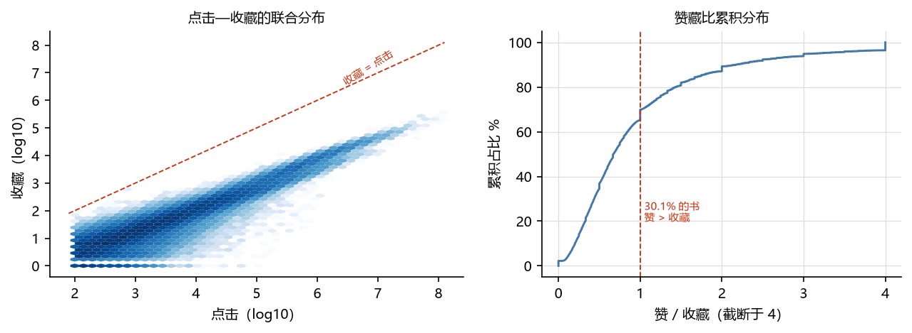
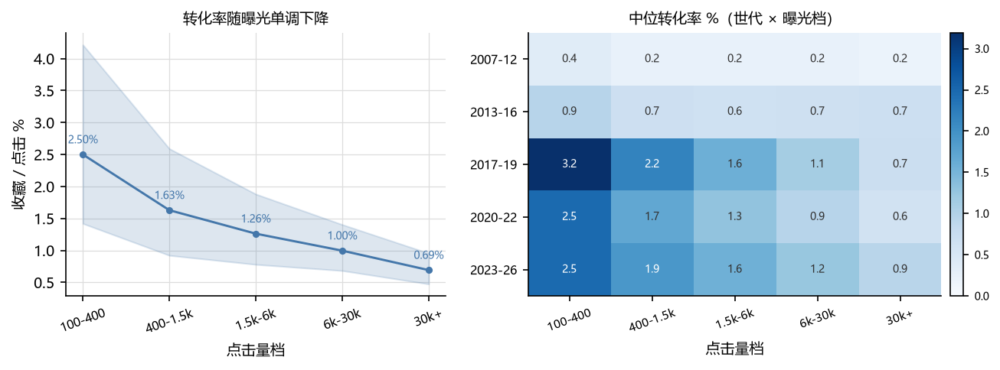
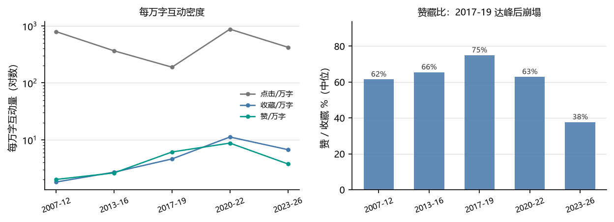
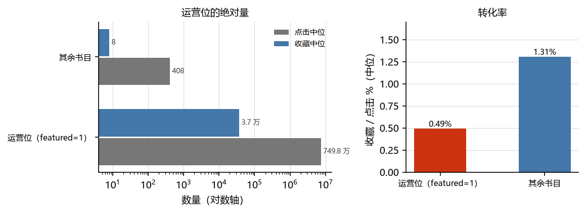

# 08 · 互动：曝光的稀释效应与赞藏比的兴衰

> 口径声明：
> 1. **数据源单一**：`analysis/out/novels.csv`（245,779 行，数据内容上界
>    2026-05-03，在册存活口径；正版日轻 47 行已在构建期行级剔除，不在本表内），
>    年份由 nid 定年（104 锚点，报告 01 §1）。三个计数器 `clicks` /
>    `favs` / `praises` 均为**快照累计值**，不区分来源。
> 2. **三者不是一条嵌套漏斗**（§1）：31.8%
>    的书 `praises > favs`、0.8% 的书
>    `favs > clicks`。本报告因此把「收藏/点击」定义为**转化率**（同一批读者里
>    有多少人留下），把「赞/收藏」定义为**赞藏比**（留下的人有多愿意表达），
>    两者不可连乘成漏斗。
> 3. **计数器的绝对量级不可跨世代比较**：每万字点击在 2007-12 与
>    2020-22 之间相差数倍（§3），这既可能是真实流量变化，也可能是统计口径
>    变化，本数据集无法区分。故跨期结论一律在「曝光档 × 世代」交叉表内比较，
>    或改用不依赖点击的比值。
> 4. **转化率样本**要求 `clicks ≥ 100` 且 `favs > 0`：全库 12.2% 的书
>    收藏为 0，分母过小时比值无意义。该筛选保留
>    163,380 行（占 66.5%），
>    对 `favs > clicks` 的 1973 行（几乎全部
>    为 `clicks < 10`）同时起到清理作用。
> 5. **`featured = 1` 的 620 本是运营位**（banner），其曝光
>    由平台决定，与内容质量无关；§6 单独处理。其余各节的主表**含**这批书
>    （占 0.25%，对中位数影响可忽略），但凡涉及因果的表述
>    一律不涉及它们。
> 6. 因果边界：点击、收藏、赞互为因果（收藏本身会提高曝光），本报告只作结构
>    描述与同期比较，不推断「什么内容更吸引人」。

---

## 0. 结论

1. **曝光规模是转化率的第一解释变量，而且方向单一**：同一个世代内，点击越多、
   转化率越低。按点击五档，中位转化率从 2.50% 降到 0.69%
   （跨档 3.6 倍），log-log 斜率
   -0.18；当代样本（2023-26 新书）同样从 2.47%
   降到 0.92%。含义很朴素：**头部书的点击里
   路人比例高，长尾书的点击里熟人与作者圈子比例高**。因此「转化率高」不等于
   「书好」，只等于「看得人少而准」。
2. **2017-2019 是互动质量的峰值，2020-2022 是流量峰值的错位**：固定小曝光档
   （100-400 点击）后，中位转化率 2007-12 为 0.36%
   → 2017-19 为 3.19%（近 9 倍）→ 之后稳定在
   2.5% 上下。而每万字点击在 2017-19 最低（189）、
   2020-22 最高（878）——**流量扩张期恰是转化率被稀释的
   时期**，两者在数据里是同一件事的两面（§3）。
3. **2023 年之后，收藏还在，点赞撤了**：赞藏比中位从 2017-19 的
   75% 跌到 2023-26 的 38%，而同期
   转化率仍维持在 2.47%（小曝光档）。**互动从
   「深度表达」退化为「轻量收藏」**——这是本报告最值得追问的一条，但受限于快照
   数据，无法区分是读者行为变化还是赞的计数口径变化（§5）。
4. **内容属性只解释很小一部分**：固定在同一曝光档（400-1.5k 点击）内，题材之间
   的转化率差距仅 1.41%–2.07%
   （1.5 倍），完结与否几乎无差别
   （§4）。相比之下曝光跨档差 3.6 倍。**互动效率的方差
   主要来自「谁点开了你」，不是「你写了什么」**。
5. **运营位买的是规模，不是效率**：620 本 `featured=1` 的书点击中位
   749.8 万（其余书目 408
   的 18,377 倍）、收藏中位
   3.7 万（4,626 倍），
   但转化率只有 0.49%，是其余书目（1.31%）的
   0.38 倍。**曝光放大约一万八千倍，转化率掉三分之二**——
   这是「分母效应」在平台运营尺度上的极端案例（§6）。

---

## 1. 三个计数器，不是一条漏斗

把「点击 → 收藏 → 赞」当成漏斗是最自然的读法，数据不支持：

| 计数器 | 中位 | P99 | 零值占比 % |
|---|---|---|---|
| clicks（点击） | 411 | 159.0 万 | 1.8 |
| favs（收藏） | 8 | 1.0 万 | 12.2 |
| praises（赞） | 7 | 2,430 | 13.5 |

两个反例足以否掉漏斗假设：

- **1,973 行**（0.8%）的收藏数
  大于点击数，其中 1423 行是
  「点击为 0 却有收藏」。这在逻辑上只能说明**两个计数器统计的不是同一批事件**
  （例如点击按章节计、收藏按人计，或存在从书架直接收藏而不计点击的路径）。
- **78,065 行**（全库 31.8%；可算样本内
  30.1%，见图 1 右）的赞数
  大于收藏数。赞显然不是「收藏之后再点赞」，而是**章节点赞**——读到哪一章觉得好
  就在那里点，与是否收藏无关。

*图 1｜左：点击与收藏的联合分布（对数轴，虚线为二者相等）；右：赞藏比的累积分布。*

所以本报告只使用两个**比值**，各自回答一个问题：

- **转化率 = 收藏 / 点击**：「点开的人里有多少留下」。同量纲、同批次，是最接近
  「内容—读者匹配度」的可观测指标。
- **赞藏比 = 赞 / 收藏**：「留下的人有多愿意表达」。它与曝光规模弱相关（头部书
  的赞藏比更低，见 §5 的分档表），因此必须分档看。

两者不能连乘。把「赞/点击」当作漏斗末端会系统性偏大，因为分母不是同一群人。

---

## 2. 曝光的分母效应

*图 2｜左：各点击档的中位转化率（阴影为四分位区间）；右：世代 × 点击档的转化率热力图。*

按曝光量分档，转化率**单调下降且幅度很大**：

| 点击档 | 本数 | 中位转化率 % | 四分位区间 % |
|---|---|---|---|
| 100-400 | 4.1 万 | 2.50 | 1.42–4.22 |
| 400-1.5k | 4.0 万 | 1.63 | 0.92–2.59 |
| 1.5k-6k | 3.3 万 | 1.26 | 0.78–1.88 |
| 6k-30k | 2.4 万 | 1.00 | 0.68–1.40 |
| 30k+ | 2.5 万 | 0.69 | 0.47–0.96 |

从 100-400 档的 2.50% 到 30k+ 档的 0.69%，
差 3.6 倍；log-log 斜率 -0.18（曝光每增 10 倍，转化率约降
18%）。四分位区间随曝光增大而收窄——大曝光书的转化率彼此更接近，
小曝光书的离散度更高（样本小、噪声大）。

控制世代之后这个关系依然成立，而且**在年轻世代里更陡**：

| 世代 | 100-400 | 400-1.5k | 1.5k-6k | 6k-30k | 30k+ |
|---|---|---|---|---|---|
| 2007-12 | 0.36 | 0.25 | 0.24 | 0.23 | 0.19 |
| 2013-16 | 0.94 | 0.68 | 0.64 | 0.65 | 0.69 |
| 2017-19 | 3.19 | 2.17 | 1.58 | 1.13 | 0.72 |
| 2020-22 | 2.47 | 1.69 | 1.29 | 0.95 | 0.60 |
| 2023-26 | 2.47 | 1.91 | 1.57 | 1.24 | 0.92 |

也就是说，**「转化率高」在很大程度上是「曝光小」的同义词**。这解释了一个常见的
误读：如果只看一个全库中位数（1.30%），会以为「转化率」是作品的固有属性；实际是同一批书在
不同曝光位置上呈现的不同侧面——小书的点击来自作者自己的圈子与站内搜索，
大书的点击来自首页、榜单、外部导入的路人。

这条效应的现实含义是：**任何用「收藏/点击」评价内容优劣的排行榜都会被分母污染**，
必须分曝光档比较，本报告后面各节均遵循此规则。

---

## 3. 世代：流量峰与质量峰错位

*图 3｜左：每万字互动密度（对数轴）；右：赞藏比中位按世代。*

用「每万字」消除篇幅差异后，三个计数器给出的世代曲线并不相同：

| 世代 | 点击/万字 | 收藏/万字 | 赞/万字 |
|---|---|---|---|
| 2007-12 | 795 | 1.8 | 2.0 |
| 2013-16 | 366 | 2.7 | 2.6 |
| 2017-19 | 189 | 4.6 | 6.1 |
| 2020-22 | 878 | 11.2 | 8.8 |
| 2023-26 | 423 | 6.7 | 3.8 |

- **点击密度的峰值在 2020-22**（878/万字），
  低谷在 2017-19（189/万字）。若这是真实流量，
  意味着 2020-22 世代的书被点开的强度是 2017-19 世代的
  4.7 倍；若这是计数口径
  变化，则跨期比较不成立。两种解释在本数据集内无法区分（§7）。
- **收藏密度与赞密度的峰值也都在 2020-22**，说明三个计数器在 2020-22 同步放大——
  这更像**平台整体流量/统计口径在那个窗口发生了变化**，而不是某一类书突然变好。
- 但**转化率（比值）在 2020-22 之后是下降的**（1.29%
  vs 1.58%，同为 1.5k-6k 档）。**量涨、率跌**，
  这是泛流量稀释的典型形状：新增的点击来自更边缘的读者。

因此「2017-2019 是黄金期」这个说法需要限定：**那是转化率的峰值，不是流量的峰值**。
流量峰值在 2020-2022，但同期新读者的转化率低于老读者群，平台用更大的分母换来
了更大的绝对收藏量（收藏密度 11/万字，
是 2007-12 的 6 倍）。

---

## 4. 内容属性只解释很小一部分

固定在同一曝光档（400-1.5k 点击，39,544 本）后，比较三个内容属性：

**题材**（本数 ≥200 的九类）：

| 题材 | 本数 | 中位转化率 % |
|---|---|---|
| 同人 | 4,363 | 2.07 |
| 游戏 | 2,114 | 1.91 |
| 科幻 | 2,840 | 1.66 |
| 玄幻 | 4,602 | 1.64 |
| 古风 | 1,294 | 1.58 |
| 魔幻 | 1.4 万 | 1.57 |
| 都市 | 3,816 | 1.51 |
| 校园 | 5,141 | 1.45 |
| 悬疑 | 893 | 1.41 |

首尾差 1.5 倍（同人 2.07% vs
悬疑 1.41%）。**同人**与**游戏**偏高，符合直觉
（读者带着明确目的而来，转化路径短）；**古风**与**校园**偏低，这两类的读者更可能
是「逛」而不是「找」。

**完结状态**：已完结 1.58%（
6,576 本）vs 连载中
1.64%（32,968 本）——
几乎没有差别。**「完本才有人收藏」在本数据里不成立**。

**字数**：

| 字数档 | 本数 | 中位转化率 % |
|---|---|---|
| <1 万 | 1.6 万 | 1.81 |
| 1-5 万 | 1.7 万 | 1.54 |
| 5-20 万 | 5,611 | 1.54 |
| 20-100 万 | 438 | 1.73 |
| 100 万+ | 5 | 2.99 |

呈弱 U 形：一万字以下的短篇转化率最高（1.81%），
5-20 万字最低（1.54%），20 万字以上回升。短篇高是因为
读者读完了整篇（点开即读完），长篇则需要跨过更长的「试读门槛」。

把三者放在一起对比曝光效应：题材跨档 1.5 倍、字数 U 形两端约
1.2 倍、完结状态 1.0 倍，而曝光跨档
3.6 倍。**内容属性的解释力远小于「谁点开了你」。**
这不意味着内容不重要——它意味着在**已点开**的读者里，题材筛选已经完成了一轮，
剩下的差异被读者结构盖过了。

---

## 5. 赞藏比：读者表达强度的兴衰

赞藏比不受点击数口径影响（分子分母都不含点击），是这份数据里**最接近纯读者行为**
的指标。它的世代曲线与转化率不同：

| 世代 | 赞/收藏 %（中位） | 赞 > 收藏 的书占比 % |
|---|---|---|
| 2007-12 | 62 | 29 |
| 2013-16 | 66 | 29 |
| 2017-19 | 75 | 36 |
| 2020-22 | 63 | 21 |
| 2023-26 | 38 | 8 |

峰值在 2017-19（75%），2023-26 只有
38%，不足峰值的 50%。
分档后可以看到曲线的真实形状：**2017-19 的峰值主要由小收藏书贡献**
（10-50 档 103%），大收藏书（1k+ 档）反而在 2020-22 略高
（28% vs 24%）——
「越大越不愿赞」在 2017-22 并不成立。真正异常的是 **2023-26 的断崖**：四档全部
落到 14%-48%，无一例外。因此近年的
下跌不是「头部书变多」的构成效应：

| 世代 | 10-50 | 50-200 | 200-1k | 1k+ |
|---|---|---|---|---|
| 2007-12 | 68 | 49 | 48 | 36 |
| 2013-16 | 82 | 71 | 50 | 34 |
| 2017-19 | 103 | 69 | 50 | 24 |
| 2020-22 | 70 | 60 | 62 | 28 |
| 2023-26 | 48 | 37 | 30 | 14 |

同期转化率并没有同等幅度下滑（§2），于是形成一句可直接引用的描述：
**2023 年之后的读者更愿意「收藏」，更不愿意「点赞」。**

两种解释需要区分：

1. **行为变化**：移动端阅读、书架功能的普及让「收藏」变成低成本动作，而点赞
   需要读到具体章节并触发动作，门槛更高。
2. **计量变化**：若平台在某个时点调整了赞的统计（例如只计部分章节、或与收藏
   合并计数），也会得到同样的下降。`praises > favs` 的书占比从
   36% 降到 8%，这个量级更像是
   计数器语义变了，而不只是读者变懒。

本数据集无法区分两者（快照无时序），因此本节结论只写到「赞藏比在世代间显著下降」
这一层，不解释原因。

---

## 6. 运营位：曝光换规模，不换效率

`featured = 1` 是平台给的 banner / 首页运营位，共 620 本
（占全库 0.25%）。它们是观察「纯曝光冲击」的天然实验：

*图 4｜左：运营位书与其余书目的点击、收藏中位（对数轴）；右：两者转化率中位。*

- 点击中位 749.8 万，其余书目
  408——**18,377 倍**；
- 收藏中位 3.7 万，其余书目
  8——4,626 倍；
- 转化率 0.49% vs 1.31%——**只有 0.38 倍**。

三个数字放在一起是「分母效应」最干净的证据：曝光放大约
18,377 倍，收藏只放大约
4,626 倍，比值因此被压到不足四成。运营位带来的边际读者转化率远低于原有读者——**这不说明运营位无效**（绝对收藏
量仍是全库中位的 4,626 倍），
只说明**用转化率去评估运营位会得出完全相反的结论**。

另一种读法同样成立且无法排除：能拿到运营位的书本身就是平台选中的头部作品，
它们的读者结构（路人占比高）与长尾书不同。**「运营位导致稀释」与「头部书天然
稀释」在这份数据里不可分离**，因此本节只陈述三个数的关系，不作因果归属。

按世代看，运营位分布为 2007-12 7 本、2013-16 175 本、2017-19 252 本、2020-22 141 本、2023-26 45 本。

---

## 7. 口径边界

1. **计数器语义不完全可知**。`favs > clicks` 的 1973 行、
   `praises > favs` 的 78065 行说明三者统计的事件
   不同（章节点击 / 书架收藏 / 章节点赞），但具体定义、是否去重、是否含作者本人
   的操作，均无法从数据侧确认。
2. **快照累计值，无时序**。所有计数器都是 2026-05-03 的累计值，无法知道收藏是
   在哪一年发生的。因此「世代的转化率差异」混合了三种东西：书的生命周期位置
   （老书已过曝光高峰）、平台流量结构、计数口径。§3 已说明这一点，跨期结论
   一律降级为「结构描述」。
3. **停更与下架删失**。在册 245,779 行不含已下架书；报告 07 已证 2013-14 年月票
   榜上 28%-31% 的书后来被清理，说明早期书目**消失率很高**。存活下来的早期书
   是「幸存者」，其转化率不代表当年整体——若下架书多为低转化，本报告对早期
   世代的转化率是**高估**的。
4. **运营位只观测到快照时点**。`featured=1` 是 2026-05 的状态，历史上拿过 banner
   但已撤下的书记为 0。§6 的对比因此是「当前在运营位的书 vs 其余」，不是
   「拿过运营位的书 vs 没拿过的书」，后者的效应会被低估。
5. **转化率不是留存率**。`favs/clicks` 是累计比值，不能读作「点开的人有 1.3% 留下」，
   因为同一读者可能贡献多次点击；点击若按章节计，读得越久分母越大，会系统性
   压低长书的转化率——这也是 §4 中「5-20 万字转化率最低」的可能成因之一。
6. **样本筛选的影响**。`clicks ≥ 100` 剔除了 77,511 行
   （31.5%），这批书多为无人问津的长尾，
   其转化率无法估计（分母过小）。因此本报告所有转化率数字**只描述「有曝光的书」**，
   不覆盖全库。

---

*生成：`uv run python analysis/report_engagement.py`；本文件为生成物，勿手改。*
