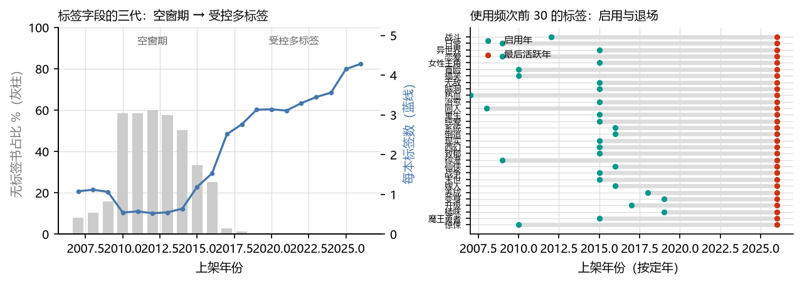
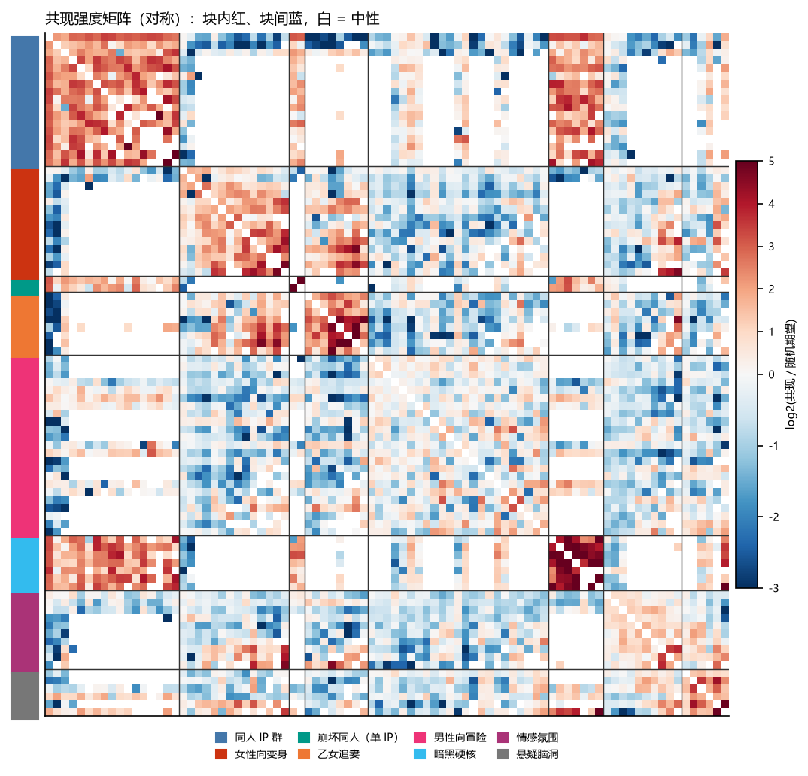
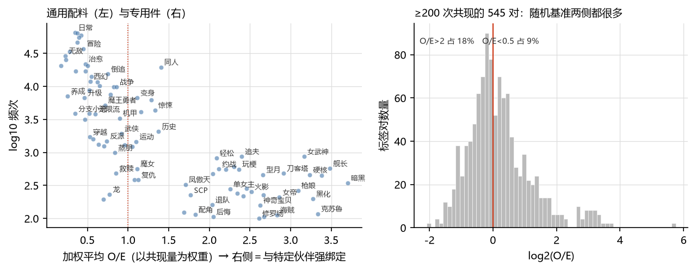
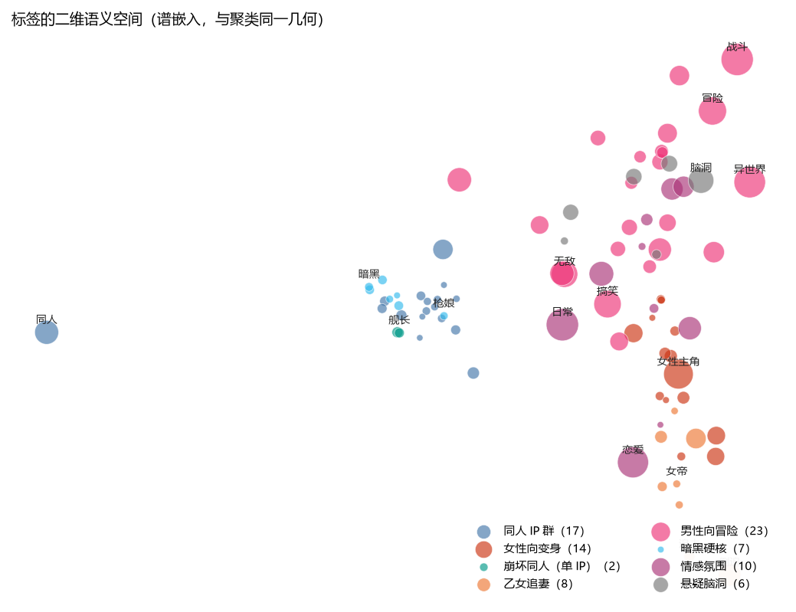
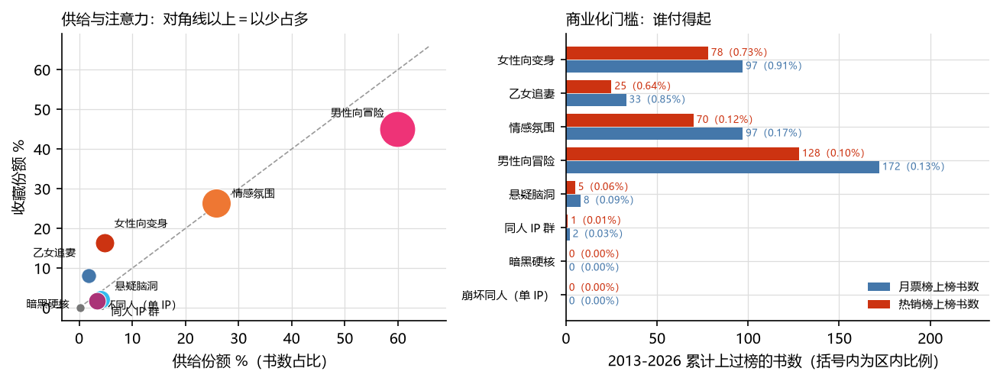

# 09 · 题材语义空间：87 个标签的共现结构

> 口径声明：
> 1. 数据 `analysis/out/novels.csv`（245,779 行，内容上界 2026-05-03，
>    上架年份由 nid 定年，104 锚点，LOO P99 = 50 天，报告 01 §1）。
> 2. `tags` 是**平台受控词表**而非作者自由填写：全库共 99 个不同标签，
>    87 个出现 ≥100 次，构成本报告的标签集。每本 1-5 个标签。
> 3. **`20XX萌神` 7 个标签已剔除**（运营荣誉而非题材，报告 04 §3），不参与共现。
> 4. **共现只用 2017 年及以后的书**（219,808 本）：2010-2014 有 57%
>    的书完全没有标签，2017 年前标签数中位仅 1，跨世代共现不可比。
> 5. 共现基准不是「独立随机」，而是**同标签数分层的随机配对期望**：把标签在同一
>    标签数（1-5 个）的书之间随机重排、保留每个标签的总量。O/E 因此不受「近年
>    标签越选越多」的规则变化影响。
> 6. 聚类仅作统计分组。87 个标签的轮廓系数约 0.04——标签空间是连续谱，
>    没有离散的题材类，簇边界是人为切分。
> 7. 上榜率用 `out/monthly_ranks.jsonl`（月票榜 rank 0、热销榜 rank 3，
>    2013-03 至 2026-11），只统计在库书。

## 0. 结论

1. **标签不是自由词汇，是一份 99 词的小词表**：全库合计 99 个在用标签，
   其中 87 个出现 ≥100 次、构成本报告的标签集。频次最高的「日常」覆盖
   2017 年后新书的 29.6%，词表集中度（基尼）0.74
   ——高度头部化，长尾是只服务几十本书的细分词。
2. **标签字段分三代，跨代比较只有 2017 之后成立**：2007-09 是单标签时代，
   2010-14 反而有 57% 的书完全无标签（空窗期），2015-16 过渡，
   2017 起进入受控多标签（中位 3 个，2025 年 5 个）。而且词表本身不稳定：
   **2022 年 23 个 IP 与亚文化标签被清理**（含这些标签的书 1,665 → 23 本），
   2023-24 一批女性向标签（变身、追夫、橘味、穿越）爆发进场。任何「标签占比
   随年份变化」的结论都必须先问：这是题材在变，还是标签规则在变。
3. **共现结构是「通用配料 + IP 专用件」**：最强关联全部来自同人子标签——
   女武神×舰长（O/E 54）、同人×枪娘（O/E 13）、惊悚×推理（O/E 12）、同人×型月（O/E 11）。
   「同人」不是题材，而是**一个挂载 IP 的命名空间**，其下 19,551 本书共享
   同一套写作范式却各自绑定一个作品。
4. **互斥关系同样清晰**：「同人」与原创向标签系统性互斥——
   搞笑×战争（O/E 0.31）、热血×倒追（O/E 0.31）、同人×纯爱（O/E 0.29）、同人×现实（O/E 0.24）。
   这不是巧合，是**供给模式的分野**：同人书的读者来自已有 IP，不需要（也不该）
   用原创向标签自我介绍。
5. **8 个语义区存在，但边界模糊**（轮廓系数 0.04）：同人 IP 群、
   乙女追妻、女性向变身、崩坏同人（单 IP）、悬疑脑洞、情感氛围、暗黑硬核、男性向冒险 等块的内部关联强、块间几乎为零；
   但全库只有 27.9% 的书全部标签落在同一区——题材在**标签层是分立的**，
   在**书层是混合的**，聚类切分只是统计方便。
6. **供给与注意力错配是结构性的**：「乙女追妻」用 1.8%
   的供给拿到 8.2% 的收藏（4.6 倍）；
   「暗黑硬核」用 0.2% 的供给只拿到
   0.1%（0.23 倍）。付费端的分化更陡：
   「男性向冒险」累计 172 本上过月票榜
   （区内 0.13%），「崩坏同人（单 IP）」仅
   0 本（0.00%）——月票榜十六年只有 694 本书，
   头部题材拿走了几乎全部席位。控制曝光与字数后，混合度对收藏与转化率几乎没有
   影响（同档转化率 1.79% vs 1.84%）——**再多标签也不制造读者**。

---

## 1. 词表：99 个词，三代口径

99 个不同标签里，87 个出现 ≥100 次、46 个
≥1,000 次、最少用的一个只出现过 1 次——**这是一份封闭的受控词表**，不是用户自由标注。
频次前 20：

| 标签 | 书数 | 占全库 % |
|---|---|---|
| 战斗 | 65,633 | 26.7 |
| 日常 | 65,617 | 26.7 |
| 异世界 | 59,572 | 24.2 |
| 恋爱 | 59,061 | 24.0 |
| 女性主角 | 46,421 | 18.9 |
| 冒险 | 39,348 | 16.0 |
| 搞笑 | 34,901 | 14.2 |
| 无敌 | 29,191 | 11.9 |
| 脑洞 | 25,891 | 10.5 |
| 热血 | 25,209 | 10.3 |
| 治愈 | 22,149 | 9.0 |
| 同人 | 21,403 | 8.7 |
| 重生 | 20,526 | 8.4 |
| 纯爱 | 17,218 | 7.0 |
| 系统 | 16,959 | 6.9 |
| 倒追 | 15,466 | 6.3 |
| 现实 | 14,439 | 5.9 |
| 西幻 | 12,267 | 5.0 |
| 致郁 | 11,833 | 4.8 |
| 综漫 | 10,354 | 4.2 |

集中度（基尼系数）0.74。标签数分布的偏斜意味着：共现分析若直接用原始
计数，结果会被头部标签主导；因此 §2 起全部改用 O/E。

标签字段本身经历了三代（图 1 左）：

| 上架年 | 书数 | 无标签 % | 每本标签数（均值） |
|---|---|---|---|
| 2007 | 76 | 8 | 1.08 |
| 2008 | 404 | 10 | 1.12 |
| 2009 | 1,126 | 16 | 1.07 |
| 2010 | 2,947 | 58 | 0.54 |
| 2011 | 3,441 | 59 | 0.57 |
| 2012 | 3,430 | 60 | 0.53 |
| 2013 | 2,680 | 58 | 0.55 |
| 2014 | 2,646 | 50 | 0.64 |
| 2015 | 2,760 | 34 | 1.19 |
| 2016 | 5,493 | 25 | 1.53 |
| 2017 | 12,759 | 3 | 2.52 |
| 2018 | 16,469 | 1 | 2.76 |
| 2019 | 24,263 | 0 | 3.13 |
| 2020 | 30,372 | 0 | 3.14 |
| 2021 | 35,156 | 0 | 3.11 |
| 2022 | 37,088 | 0 | 3.30 |
| 2023 | 26,021 | 0 | 3.45 |
| 2024 | 20,075 | 0 | 3.56 |
| 2025 | 14,552 | 0 | 4.16 |
| 2026 | 4,021 | 0 | 4.29 |

三代的分界很清楚：**2007-09 单标签**（无标签率 <16%、中位 1 个）→ **2010-14 空窗**
（无标签率 57%）→ **2015-16 过渡**（
34% → 25%）→ **2017 起受控多标签**
（无标签率 <3%，中位 3 个，2025 年升至 5 个）。全库合计 12,175 行零标签，
几乎全部落在空窗期。

这解释了一件容易误读的事：**「标签覆盖率上升」不是作者变勤快，而是平台把标签
从可选变成必填**。报告 04 记「标签体系约 2014 上线」，从本表看更准确的说法是
**2015-16 逐步强制、2017 完全强制**。

### 1.1 词表不是稳定的：2022 年断层与 2023-24 换血

图 1 右给出每个标签的活跃区间（年使用 ≥20 次算活跃），其中藏着两个事件：

**其一，2022 年断层**。23 个标签在 2022 年及以前每年使用 ≥20 次、
2023 与 2024 两年同时沉寂：「人生赢家」、「修罗场」、「假面骑士」、「克苏鲁」、「刀客塔」、「单女主」、「型月」、「多女主」、「女武神」、「幻想乡」、「暗黑」、「末日」、「海贼」、「火影」、「爽文」、「玩梗」、「硬核」、「神奇宝贝」、「约战」、「舰娘」、「舰长」、「轻松」、「黑化」。几乎全部是**同人 IP 专属词**（型月、舰娘、
火影、约战、幻想乡、神奇宝贝、海贼、假面骑士、女武神、舰长、刀客塔）与
**亚文化口味词**（爽文、轻松、玩梗、多女主、单女主、黑化、克苏鲁、暗黑、末日、
硬核）——其中「末日」的退场与报告 04 §4「末日标签 2023 年起疑似退出使用」
相互印证。含这些标签的书从 2022 年的 1,665 本骤降到 2023 年的 23 本——
**这不是读者口味消失，而是词表被清理**：同期「同人」本身不降反升（2023 年
3,595 本创峰值），说明同人书还在投，只是不再挂 IP 词。最可能的解释是平台对
词表收紧管理（IP 词的版权风险或词表去重）；2026 年含「死亡」标签的书回升到
523 本，提示部分恢复或批量回填，需要另行核实。

> **口径注记（报告 22）**：这个 3,595 本的峰值同时是**对话/互动小说放量**——
> 2023 年的同人书里 79.3% 为对话/互动形态。标签层面的「同人还在投」
> 成立于产品线层面：投的是对话小说，不是传统同人长篇。同人 genre 峰值在 2021、
> 同人 tag 峰值在 2023，两个峰驱动的不是同一批书。详见报告 22。

**其二，2023-24 换血**。17 个标签在 2022 年沉寂、2024 年重新活跃：
「SCP」、「凤傲天」、「反派」、「复仇」、「大小姐」、「女尊」、「女帝」、「师尊」、「怪谈」、「穿越」、「迪化」、「追夫」、「退队」、「配角」、「魔女」、「魔法少女」、「龙」。同期橘味（2022 年 89 本 → 2024 年 2,894 本）、变身（73 → 2,663）、
追夫（5 → 372）爆发式增长。**退场的几乎全是男性向亚文化词，进场与爆发的
几乎全是女性向词**——报告 04 §2 记录的「女性向转向」，在词表层面是一次
明确的、由运营主导的编辑行为，而非作者自发的渐变。

---

## 2. 共现：IP 微标签、互斥与通用配料

把 87 个标签按簇排序后，O/E 矩阵沿对角线出现 8 个强红的块：**块内共现远超
随机期望，块间明显偏蓝（低于期望）**。标签之间的关联是块状的、且互斥的，不是
弥散的；接近白色的「中性对」反而占少数。左侧色条与图例标出 8 个簇（成员名单见 §3 表）。

### 2.1 最强关联全部是同人 IP

| 标签 A | 标签 B | O/E | 共现书数 |
|---|---|---|---|
| 女武神 | 舰长 | 53.9 | 271 |
| 同人 | 枪娘 | 12.9 | 265 |
| 惊悚 | 推理 | 11.9 | 747 |
| 同人 | 型月 | 10.9 | 459 |
| 同人 | 舰娘 | 10.1 | 282 |
| 同人 | 硬核 | 9.8 | 452 |
| 同人 | 刀客塔 | 9.7 | 473 |
| 倒追 | 追夫 | 9.5 | 553 |
| 同人 | 幻想乡 | 9.2 | 214 |
| 战争 | 历史 | 9.2 | 663 |
| 同人 | 暗黑 | 8.8 | 340 |
| 同人 | 末日 | 8.7 | 443 |

`女武神 × 舰长` 的 O/E 高达 54（271 本）——这两个词
在词表里唯一的作用就是标记「崩坏3 同人」。与之同类的还有型月、舰娘、火影、
幻想乡、约战、刀客塔、假面骑士、神奇宝贝、海贼：**它们不是题材，是 IP**。

（注意：这些 IP 标签已于 2022 年从词表退场（§1.1），因此本表与图 2 中同人块的
共现结构描述的是 **2017-2022 年的词表制度**。）

「同人」与各 IP 标签的关联（O/E）：

| 与「同人」共现的标签 | O/E | 共现书数 |
|---|---|---|
| 枪娘 | 12.9 | 265 |
| 型月 | 10.9 | 459 |
| 神奇宝贝 | 10.2 | 157 |
| 舰娘 | 10.1 | 282 |
| 硬核 | 9.8 | 452 |
| 刀客塔 | 9.7 | 473 |
| 海贼 | 9.6 | 113 |
| 幻想乡 | 9.2 | 214 |
| 暗黑 | 8.8 | 340 |
| 末日 | 8.7 | 443 |

这构成一个两层结构：**`同人` 是命名空间，IP 名是其中的键**。同人小说的读者不是
按题材找书，而是按作品找书——这解释了为什么同人书的收藏中位最高（报告 05）、
活跃率最低（一次性投稿货架）：它的需求端是 IP 流量，供给端是一次性消费。

### 2.2 互斥：同人是另一套供给

| 标签 A | 标签 B | O/E | 共现书数 |
|---|---|---|---|
| 同人 | 变身 | 0.35 | 285 |
| 日常 | 战争 | 0.35 | 758 |
| 同人 | 致郁 | 0.34 | 265 |
| 同人 | 橘味 | 0.34 | 214 |
| 搞笑 | 战争 | 0.31 | 377 |
| 热血 | 倒追 | 0.31 | 363 |
| 同人 | 纯爱 | 0.29 | 379 |
| 同人 | 现实 | 0.24 | 211 |

最弱的 8 对里有 5 对涉及「同人」：`同人 × 现实` O/E 仅 0.24
（211 本），`同人 × 纯爱` 0.29，
`同人 × 致郁`、`同人 × 橘味`、`同人 × 变身` 同样低。另 3 对
（`日常 × 战争`、`搞笑 × 战争`、`热血 × 倒追`）是**语义的自然排斥**，与同人那组
不同类。

两类互斥要分开读：语义排斥（战争 vs 日常）证明标签体系是自洽的；供给模式排斥
（同人 vs 原创向）证明**同人是一条独立的产品线**，而非「魔幻类的一个子类」。

### 2.3 通用配料与专用件

每个标签的「加权平均 O/E」（以共现量为权重）衡量它的共现平均落在随机期望的
多少倍：远大于 1 说明它只在特定组合里出现，接近 1 说明与谁搭配都正常。

| 专用件 | 加权平均 O/E | 频次 |
|---|---|---|
| 暗黑 | 13.01 | 343 |
| 舰长 | 11.20 | 572 |
| 末日 | 10.41 | 451 |
| 克苏鲁 | 10.09 | 118 |
| 黑化 | 9.68 | 197 |
| 硬核 | 9.42 | 457 |

| 通用配料 | 加权平均 O/E | 频次 |
|---|---|---|
| 重生 | 1.13 | 20,413 |
| 无敌 | 1.17 | 28,999 |
| 脑洞 | 1.18 | 25,515 |
| 养成 | 1.19 | 7,079 |
| 搞笑 | 1.22 | 33,584 |
| 日常 | 1.27 | 65,115 |

**通用配料**是高频、低关联的一组（日常 1.27、搞笑 1.22、无敌
1.17）：它们与任何标签搭配都在期望附近，因此**不能作为题材信号**——
一本书挂了「日常」，你仍然不知道它是什么书。

**专用件**是低频、高关联的一组（暗黑 13.01、克苏鲁 10.09、
硬核 9.42）：它们几乎只与固定的少数标签同现，是**口味标记**。这类标签
数量少，却是检索时信息量最大的一批——用它们筛选比用「战斗」「日常」有效得多。

图 3 右的分布：O/E>2 的标签对占 18%、O/E<0.5 的占
9%——共现既不随机也不均匀，而是
**「强关联少数 + 互斥少数 + 大量中性」的三段式**。

---

## 3. 八个语义区：空间是连续的，切分是人造的

把对称条件概率当作相似度做谱嵌入，得到图 4。点的大小是频次，颜色是谱聚类的结果。
轮廓系数只有 **0.04**——这不是聚类失败，而是数据在说：**题材空间是连续谱**。
读者能感到「战斗」和「日常」是两种书，但词表里没有一条清晰的边界。

八个区及其成员：

| 语义区 | 标签数 | 覆盖书数（累计） | 主要标签 |
|---|---|---|---|
| 同人 IP 群 | 17 | 35,472 | 同人、综漫、多女主、轻松、爽文、约战、玩梗、型月… |
| 女性向变身 | 14 | 73,155 | 女性主角、嫁人、变身、橘味、穿越、反派、魔法少女、魔女… |
| 崩坏同人（单 IP） | 2 | 1,436 | 女武神、舰长 |
| 乙女追妻 | 8 | 29,049 | 倒追、仙侠、运动、追夫、女尊、师尊、女帝、退队 |
| 男性向冒险 | 23 | 351,788 | 战斗、异世界、冒险、搞笑、无敌、热血、重生、系统… |
| 暗黑硬核 | 7 | 2,312 | 刀客塔、硬核、末日、暗黑、枪娘、黑化、克苏鲁 |
| 情感氛围 | 10 | 187,408 | 日常、恋爱、治愈、纯爱、现实、致郁、童话、救赎… |
| 悬疑脑洞 | 6 | 38,539 | 脑洞、惊悚、推理、无限流、怪谈、SCP |

几点观察：

- **「男性向冒险」区最大**（23 个标签），
  战斗、异世界、冒险、无敌、系统、升级彼此高度关联，是平台的**默认类型**；
- **「同人 IP 群」独立成区**，与其余各区几乎不共现（§2.2）；
- **「女性向变身」与「乙女追妻」是两个不同的区**：前者是女性主角+橘味+魔法少女
  的**视角**聚类，后者是倒追+追夫+女尊+师尊的**关系**聚类。女性向内部已经分化出
  「谁在看」和「看什么关系」两条轴，这是 2023 年后最明显的结构变化（报告 04 §2）；
- **「悬疑脑洞」「暗黑硬核」是两个小但紧密的区**，成员少、块内 O/E 高，
  是典型的**口味社区**（而非人口学细分）。

按同曝光档（400-1.5k 点击）的转化率排序：最高 女性向变身
（2.48%），最低 乙女追妻
（1.69%）。差距仍在 1.5 倍量级——与报告 08 §4 的结论一致：
**题材解释的方差远小于曝光**。

---

## 4. 供需错配：谁以少占多，谁供过于求

把每个语义区的书按「标签票数最多」归入一区（跨区书归入标签更多的那个区），
再与收藏、榜单、生命周期交叉：

| 语义区 | 书数 | 供给 % | 收藏份额 % | 收藏/供给 | 收藏中位 | 字数中位（万） | 转化率 % | 月票榜（率 %） | 热销榜（率 %） |
|---|---|---|---|---|---|---|---|---|---|
| 乙女追妻 | 3,903 | 1.8 | 8.2 | 4.60 | 40 | 2.0 | 1.69 | 33（0.85） | 25（0.64） |
| 女性向变身 | 10,643 | 4.8 | 16.4 | 3.38 | 62 | 2.2 | 2.48 | 97（0.91） | 78（0.73） |
| 崩坏同人（单 IP） | 321 | 0.1 | 0.2 | 1.07 | 14 | 1.5 | 2.04 | 0（0.00） | 0（0.00） |
| 情感氛围 | 56,727 | 25.8 | 26.4 | 1.02 | 7 | 0.9 | 1.86 | 97（0.17） | 70（0.12） |
| 男性向冒险 | 131,498 | 59.8 | 45.0 | 0.75 | 8 | 1.0 | 1.79 | 172（0.13） | 128（0.10） |
| 悬疑脑洞 | 8,892 | 4.0 | 2.2 | 0.54 | 5 | 0.7 | 1.79 | 8（0.09） | 5（0.06） |
| 同人 IP 群 | 7,344 | 3.3 | 1.7 | 0.51 | 14 | 1.0 | 2.12 | 2（0.03） | 1（0.01） |
| 暗黑硬核 | 477 | 0.2 | 0.1 | 0.23 | 8 | 1.4 | 2.06 | 0（0.00） | 0（0.00） |

| 语义区 | VIP % | 完结率 % | 断更 >1 年 % | 征文参与 % |
|---|---|---|---|---|
| 乙女追妻 | 17 | 18 | 87 | 72 |
| 女性向变身 | 12 | 16 | 71 | 59 |
| 崩坏同人（单 IP） | 1 | 19 | 99 | 47 |
| 情感氛围 | 3 | 20 | 91 | 46 |
| 男性向冒险 | 2 | 18 | 94 | 41 |
| 悬疑脑洞 | 2 | 20 | 94 | 42 |
| 同人 IP 群 | 1 | 18 | 97 | 23 |
| 暗黑硬核 | 1 | 17 | 99 | 31 |

读法：

- **「收藏/供给」比值是本节的中心量**：比值 4.60 的
  「乙女追妻」用 1.8% 的供给拿到
  8.2% 的收藏；比值仅 0.23 的
  「暗黑硬核」用 0.2% 的供给只拿到
  0.1%。**收藏/供给 > 1 的区合计只提供
  71,594 本书（32.6% 的供给），却拿走
  51.1% 的收藏。**
- **注意力错配与付费错配同向，但付费错配更陡**：图 5 右的月票榜与热销榜上榜书数
  在「乙女追妻」（0.85% / 0.64%）与
  「暗黑硬核」（0.00% / 0.00%）
  之间相差一个数量级。月票榜总共只有 694 本书上过（报告 07 §1），所以每个区的
  上榜书都是两位数以内的个例——**这不是「题材决定付费」，而是「少数书撑起一个区」**。
- **两个女性向区是同一种错配的两面**：「女性向变身」字数中位
  2.2 万字、收藏中位 62、断更率
  71%（全表最低）、征文参与率 59%；「乙女追妻」VIP 率
  17%（全表最高）、征文参与率 72%（全表最高）。
  前者是**长线连载**，后者是**赛事驱动**——同一个读者群的两条供给路径。
- **同人区的形态完全相反**：7,344 本、断更率 97%、
  征文参与率 23%（全表最低）、十六年只有 2 本上过月票榜。
  它不参与任何运营机制，也不追求完结，是**纯粹的 IP 消费**。

一个必须写明的限制：每个区都是混合体。区的上榜率高可能是区内极少数书撑起来的，
不能读作「这个题材更容易付费」。本报告只做结构描述。

---

## 5. 混合度：多贴几个标签不制造读者

每本书的标签可能落在不同语义区。按「标签跨几个区」分组：

| 标签跨的区数 | 书数 | 占比 % | 收藏中位（全体） | 收藏中位（同档同字数） | 同档转化率 % |
|---|---|---|---|---|---|
| 1 个 | 61,387 | 27.9 | 5 | 13 | 1.79 |
| 2 个 | 100,864 | 45.9 | 9 | 14 | 1.84 |
| 3 个 | 51,035 | 23.2 | 16 | 14 | 1.91 |
| 4 个 | 6,395 | 2.9 | 22 | 14 | 2.05 |
| 5 个 | 124 | 0.1 | 21 | 14 | 1.80 |

只看「收藏中位（全体）」会得出「跨区越多越受欢迎」（5 → 22），但这是**混杂**：
跨区书几乎都是 2022 年后的多标签书，字数更长、曝光更大。把样本限制在
「同曝光档（400-1.5k 点击）+ 同字数档（5-20 万字）」后，差异收敛到
13 → 14；转化率则几乎不动
（1.79% → 1.91%）。

结论与报告 08 §4 一致：**标签的组合方式对互动几乎没有解释力**。标签的价值在
「检索与匹配」（读者按标签找书），不在「质量信号」。

---

## 6. 口径边界

1. **标签是运营词表，不是作者意图**：同一本书的标签可能由编辑补填或批量调整，
   本报告无法区分「作者选」与「平台配」。
2. **共现 ≠ 因果**：O/E 高只表示两词常被同时使用，不表示其中一个导致另一个。
   IP 微标签与「同人」的关系是**定义性的**（同人书必须挂作品名），不是发现。
3. **2017 年之前不可比**：空窗期的书多数无标签，把它们纳入会系统性低估早期题材
   的多样性；本报告已排除，代价是无法回答「2010-14 的题材结构与现在差别多大」。
   同时 2017-2026 也并非同一制度：2022 年词表断层（§1.1）意味着同人 IP 块的
   共现结构由 2017-22 年贡献，2023 年之后的同人书不再挂 IP 词——若只看
   2023+ 的数据，图 2 的同人块会大面积消失。
4. **定年误差**：low 段（nid < 61,157）月级误差可达 ±50 天，跨年边界处会影响
   年度归属，但不影响共现结构（共现不依赖时间）。
5. **聚类切分是人为的**：k=8 依据可解释性选定，轮廓系数极低意味着任何 k 都不比
   其他 k 更「正确」；换 k 会改变各区的份额，但不改变块状结构本身。
6. **下架删失**：数据集是 2026-05-03 的在册快照，历年下架的书（月票榜侧 2013-14
   占 28-31%，报告 07 §1）不在样本内，早期题材结构因此偏向「活下来的书」。

