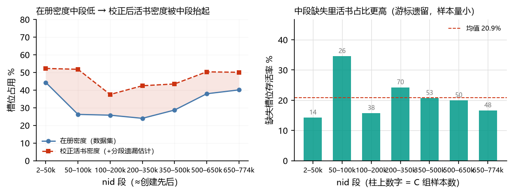
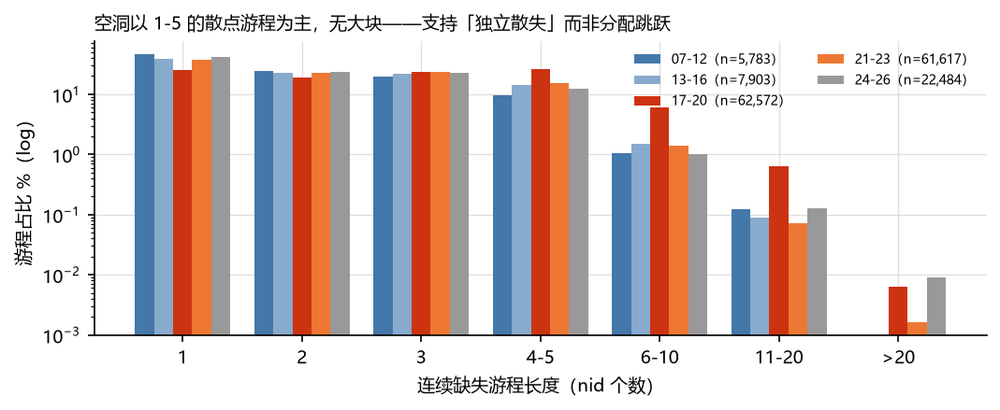
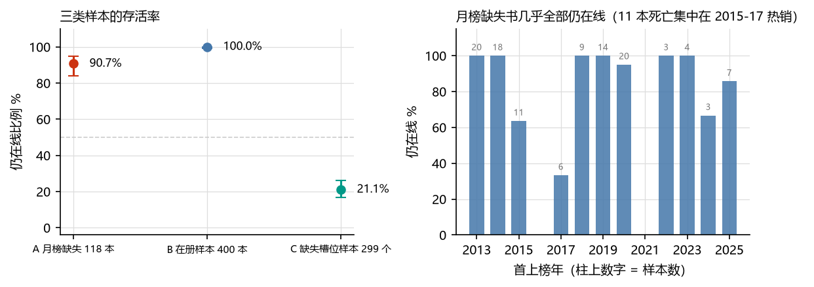
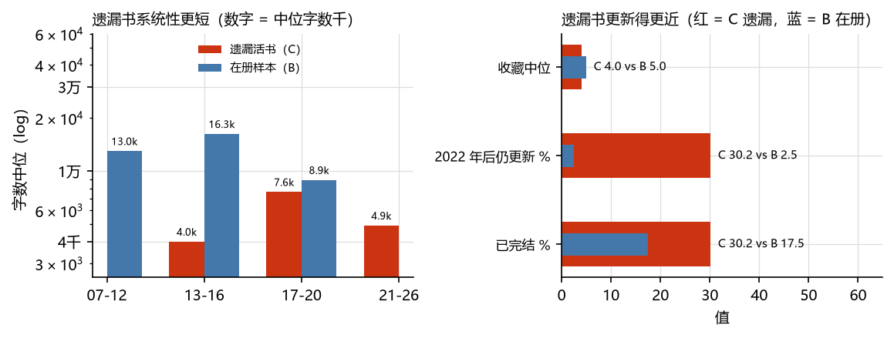

# 10 · 生存与遗漏审计：526,415 个空洞是什么

> 口径声明（**本篇已重写**：判活改三态、分母先扣剔除集、遗漏率改按 nid 段分层；
> 旧稿 68.9% 的总量口径量级未变，但「可访问 = 在架可发现」的解读作废，
> 且遗漏的分布形状须按 §2.1 重读。见 `references/sfacg-endpoints.md` §5.1 / §5.2 / §11.5）：
> 1. **三态判定**（比旧稿「>5KB 含书名」严格）：`m.sfacg.com/b/{nid}/` 上——
>    **死亡** = 页面文案「小说不存在」/「出错啦」（HTTP 仍 **200**，状态码不可信）；
>    **僵尸** = 有详情页但 `div.book_Catalog` 无 `<a>`（无阅读入口）或数字字段非法；
>    **存活** = 有详情页 + 阅读入口 + 数字合法。复测 C 组 63 本旧判「活」者
>    63/63 均真存活，故**判活本身未污染**；问题是口径错配（分母定义 + 把「可访问」
>    当「在架可发现」，§4.1）。探测 2026-11-16，
>    快照（2026-05-03）之后 818 次请求。下架原因不进判据（多数僵尸页不写声明）。
> 2. **三类样本**（见 §3）：A 组 118 本「上榜但不在库」全测；B 组在册随机 400 本
>    （nid ≤ 50 万分层，老段不代表 2023 年后）；C 组缺失 nid 随机 299 个。
>    **覆盖率改用按 nid 段分层加权**（§2.1），不再用单一 uniform 21.1%；
>    段内样本仅 14–70 个，分段差异是方向性证据。
> 3. **分母先扣构建剔除集**：`manifest.json` 剔除的 2,451 本（其中 2,287 本僵尸）
>    在原始 jsonl 里都已抓到，**不是抓取遗漏**，从待解释缺失中扣除后再估计。
>    C 组剩余「死槽」（约 79%）仍不可区分「已删除」与「从未分配」，只给上界与游程证据。
> 4. **nid 复用问题**：本项目已知的唯一复用是正版日轻授权版复用盗版条目旧 id
>    （47 行，库内仍在）；未发现其他复用证据。若站上存在大规模 nid 复用，
>    本报告的「活书遗漏」估计会被高估，但 A 组证据（上榜书不在库却在线）
>    与 C 组按标题反查的 0 命中都不支持这一可能。
> 5. 本报告**不改动任何数据行**；结论以口径修正与偏倚评估的形式作用于
>    前九份报告（§5）。
> 6. **数据源抓取机制已确认**（2026-11-16 由数据提供者说明 + 数据结构验证）：
>    原始 jsonl 是 Scrapy 按天（`scrapy -o` 追加模式，UTC 日切分）抓取的
>    **列表页**，列表页按 `last_update` 降序排列，每天从上一天爬到的位置续爬，
>    每天约 400-600 页 × 20 条。全量是一次**从新到旧的单向游标扫描**，不是
>    统一时刻的快照——「快照 2026-05-03」是扫描起点（列表头部的更新时间），
>    不是每本书的读取时刻。

---

## 0. 结论

1. **空洞的主体是死槽 + 抓取源遗漏，且要先扣构建剔除集**。标题的 526,415 个
   空洞是未扣剔除的原始数；扣掉构建时已剔除的 2,451 本（其中 2,412 本落在本报告
   nid 范围内）后，待解释缺失为 524,003 个。
   这 2,451 本在原始 jsonl 里早抓到、非漏抓。
   按**分层存活率**外推约
   108,885 个是**抓取遗漏活书**；其余 415,118 个
   为死槽（已删除 ∪ 未分配 ∪ 死亡页，不可分解）。分层加权的总量与旧 uniform
   外推（11.1 万）量级一致——**本篇重写的价值不在总量数字，而在解释遗漏的
   分布形状与分母构成**（§2.1、§4.1）。
2. **「上榜书被下架」的推断被推翻**：月榜缺失的 118 本逐一探测，
   90.7% 仍在线且书名与榜单一致；只有 11 本真正消失
   （9 本为 2015-2017 年热销榜、2 本为 2024-2025 年）。B 组在册 400 本
   5.5 个月内 0 本下架——**站点对在架书（尤其头部）的删除率极低**。
3. **数据集覆盖率：分层加权约 69.3%（区间 64.6%-73.9%）**。
   旧稿 68.9%，本篇微调到 69.3%——先扣剔除集、改用分段存活率，
   但**量级未变**；「偏低」的实质是口径混用（分母混入已剔除与死亡页、
   把「可访问」当成「在架可发现」），而非某个具体百分点的算术错误。全库
   （nid 范围内）可访问活书约 354,664 本，库内
   245,779 本。真正的补爬对象是「在目录 ∩ 有阅读入口 ∩ 不在库」者，按悬疑
   普查仅约 **1 千本**（§4.1）——这才是种子质量该用的数。
4. **遗漏有系统性画像**：随机遗漏书字数中位 4,926（在册样本 11,663）、
   收藏中位 4 vs 5、2022 年后仍更新的占 30.2% vs 2.5%——**数据集系统性偏向
   「长、老」的书**；收藏规模本身偏倚较小（4 vs 5）。
   **成因已确认**：单向游标扫描期间，更新中的书会被重新排到列表头部
   （游标身后），新入库的书也出现在头部——两者都不会被回头再抓（§7）。
5. **空洞与遗漏都集中在中段 nid，呈 U 型/倒 U 型配对**（§2.1）：在册密度两端
   36–42%、中段 27–33%（U 型）；缺失槽位里的存活率却相反，中段 50–100k 达
   34.6%、200–350k 24.3%，两端仅 14–17%（倒 U 型）。旧稿把中段稀疏解释为
   「死槽率更高」，**该解释已撤回**——它是**单向游标扫描**的形状：中段连载
   更新最活跃，反复被重排到游标身后被跳过；新书扫描起点即被抓，老书多已完结
   位置稳定。段内 C 组样本仅 14–70 个，这是方向性证据而非精确分段估计。
6. **游程结构支持「独立散失」**：全部 160,359 个缺失游程中约九成长度 ≤5、
   最长仅 64，无成百上千的连续空洞——nid 分配没有「跳跃块」，空洞是逐本
   散失的结果。
7. **遗漏机制已确认**（§7）：22 个分片是 Scrapy 按 UTC 日切分的列表页抓取，
   每日 400-600 页、按更新时间降序单向续爬一次（2026-04 中 ~ 05 初，约 3 周）。
   **更新中的书与新入库的书会被重排到游标身后而被系统性跳过**——这是
   「遗漏偏短、偏新、不偏冷」的直接成因，原 §6.2「机制未证实」撤回。

---

## 1. 方法：三类样本与判定可靠性

判定规则与验证见口径声明 §1。三类样本的构造：

| 组 | 定义 | 规模 | 回答的问题 |
|---|---|---|---|
| A | 月榜（2013-03~2026-11）条目 nid 在范围内、不在库内 | 118 本（去重） | 上榜时必然存活：活着 = 遗漏，死了 = 下架 |
| B | 在册随机分层样本（nid ≤ 50 万，四段分层） | 400 本 | 快照后下架率 |
| C | 范围内缺失 nid 随机样本 | 299 个 | 活书遗漏的普适下界 |

三处不对称需要说明：A 组只覆盖**头部书**（月榜 top20）；B 组没有抽样 2023 年后
创建的书（nid > 50 万），因此「快照后下架率 ≈ 0」只对老书成立；C 组均匀覆盖
全 nid 范围，但其中 2010 年前的槽位仅 5 个——**早期段（07-12）的遗漏率不可测**。

---

## 2. 空洞结构：密度曲线与游程

在册密度（数据集口径）按 nid 数值段分布并不均匀，呈 U 型：

| nid 段 | 槽位数 | 在册密度 % | 缺失率 % |
|---|---|---|---|
| 2–50k | 47,343 | 44.3 | 55.7 |
| 50–100k | 50,000 | 26.2 | 73.8 |
| 100–200k | 100,000 | 25.8 | 74.2 |
| 200–350k | 150,000 | 24.0 | 76.0 |
| 350–500k | 150,000 | 28.7 | 71.3 |
| 500–650k | 150,000 | 37.9 | 62.1 |
| 650–774k | 124,851 | 40.1 | 59.9 |

*密度为各段内「在 CSV 的 nid / 段槽位总数」；nid 段近似对应创建先后（定年见报告 01）。*

游程（连续缺失段）统计：

| 时代 | 缺失槽位 | 游程数 | 平均游程长 | 最长游程 |
|---|---|---|---|---|
| 07-12 | 13,714 | 5,783 | 2.37 | 29 |
| 13-16 | 21,490 | 7,903 | 2.72 | 26 |
| 17-20 | 261,139 | 62,572 | 4.17 | 64 |
| 21-23 | 172,028 | 61,617 | 2.79 | 56 |
| 24-26 | 58,044 | 22,484 | 2.58 | 55 |

两点结构观察：

- **中段最稀，两端更高**（nid 100k–500k 在册密度 27–33%，两端 36–42%）。
  旧稿把稀疏归因为「死槽率中期更高」，**该解释已撤回**：按 nid 段测的
  **缺失槽位存活率同样中段更高**（§3.1、§2.1）——50–100k 段 34.6%、
  200–350k 段 24.3%，而两端仅 14–17%。这正是**单向游标扫描**的形状：
  中段是连载更新最活跃的书，反复被重排到列表头部（游标身后）而被跳过；
  新书在扫描起点就被抓到，老书多已完结、位置稳定——故两端缺失率低（§7）。
- **游程小而无块**：各时代游程长度的中位数只有 2-3，最长的 64 个连续空洞
  （nid 348,927 起）也远小于任何「批次分配」的量级。若 nid 空间曾整块划给
  其他内容类型或计数器跳号，应出现成百上千的连续空洞；没有。**逐本散失**
  （删除或遗漏）是唯一与全部游程结构相容的机制。

---

## 2.1 分层估计：中段遗漏更高（游标扫描的形状）

| nid 段 | 槽位数 | 在册密度% | 缺失槽位 | 构建剔除 | C组样本 | 判活 | 存活率% | 遗漏活书估计 |
|---|---|---|---|---|---|---|---|---|
| 2–50k | 47,343 | 44.3 | 26,373 | 2,272 | 14 | 2 | 14.3 | 3,443 |
| 50–100k | 50,000 | 26.2 | 36,888 | 31 | 26 | 9 | 34.6 | 12,758 |
| 100–200k | 100,000 | 25.8 | 74,218 | 24 | 38 | 6 | 15.8 | 11,714 |
| 200–350k | 150,000 | 24.0 | 114,004 | 42 | 70 | 17 | 24.3 | 27,676 |
| 350–500k | 150,000 | 28.7 | 107,003 | 16 | 53 | 11 | 20.8 | 22,204 |
| 500–650k | 150,000 | 37.9 | 93,140 | 9 | 50 | 10 | 20.0 | 18,626 |
| 650–774k | 124,851 | 40.1 | 74,789 | 18 | 48 | 8 | 16.7 | 12,461 |
| **合计** | 772,194 | 31.8 | 526,415 | 2,412 | 299 | 63 | 21.1 | 108,885 |

**读法**：

1. **在册密度呈 U 型**（两端 36–42%，中段 27–33%），而**缺失槽位存活率呈倒 U 型**
   （中段 50–100k 达 34.6%、200–350k 24.3%，两端 14–17%）。两者相乘，
   「中段缺失里真漏抓的活书更多」——这正是游标**从新到旧单向扫描**的预期：
   中段连载更新最活跃，反复被重排到列表头部（游标身后）被跳过；两端要么在扫描
   起点已被抓（新书），要么已完结位置稳定（老书）。
2. **别忽略样本量**：各段 C 组样本只有 14–70 个，存活率的 95% Wilson 区间宽度
   可达 ±10–20 个百分点，**段间差异只是方向性证据**，不足以给每段一个精确遗漏率。
   因此总量估计以分层
   加权（108,885 本）给出，同时保留旧 uniform 口径
   （110,409 本）作对照，两者量级一致。
3. **分母已先扣构建剔除集**：剔除的 2,412 本里
   2,272 本落在 2–50k 段（僵尸，原始 jsonl 早抓到），
   它们**不是抓取遗漏**，已从待解释缺失中扣除。因其只占缺失槽位不到 0.5%，
   扣除对总量影响很小，但**低 nid 段是系统性污染**（该段剔除 2,272/26,374 ≈ 8.6%），
   必须分层看（§4.1）。

---

## 3. 存活探测结果

| 组 | 有效样本 | 仍在线 | 存活率 | 95% CI |
|---|---|---|---|---|
| A 月榜缺失 | 118 | 107 | 90.7% | 84.1%-94.7% |
| B 在册样本 | 400 | 400 | 100.0% | 99.0%-100.0% |
| C 缺失槽位 | 299 | 63 | 21.1% | 16.8%-26.0% |

**A 组**给出了本报告最硬的一条证据链：这些书出现在月度榜单上时必然存活，
如今 90.7% 仍在线。真正死亡的 11 本全部有记录：

| nid | 书名 | 上榜月份 | 榜单 |
|---|---|---|---|
| 31030 | 龙骑士的我目标就是推倒公主！？ | 2015-05、2015-06、2015-07… | r3 |
| 33178 | 爆发吧！零动力！ | 2015-08、2015-09、2015-10… | r3 |
| 40141 | 身为漫画家的我，被粉丝抓住了！ | 2015-06、2015-07、2015-08… | r3 |
| 42823 | 攻略游戏明明不需要后宫啊！ | 2015-11、2015-12、2016-01… | r3 |
| 48251 | 想要变成鹰的鱼 | 2016-10、2016-11、2016-12… | r3 |
| 58788 | 我的妹妹从来不叫哥哥 | 2017-04、2017-05、2017-06… | r3 |
| 58800 | 伪娘住在男生宿舍好像没什么不对 | 2017-02 | r3 |
| 62637 | 三等分的恋爱 | 2017-03、2017-04、2017-05… | r3 |
| 68853 | 万法掌控者与13位奴隶 | 2017-06、2017-07、2017-08… | r3 |
| 705589 | 失败了，就会恶堕成妖女 | 2024-08、2024-09、2025-01 | r3 |
| 731965 | 不是你们夫妻出轨对象怎么都是我 | 2025-03、2025-04 | r3 |

死亡书的构成值得注意：**9 本集中在 2015-2017 年的热销榜**（`rank 3`），且
书名风格高度同质（后宫、伪娘、奴隶等），与版权投诉下架的特征一致；月票榜书
0 本死亡。B 组 400 本 5.5 个月内 0 本下架、C 组死槽里含多少老书无法知道——
**「头部书删除率极低」是可检验事实，「长尾书删除率」仍是未知数**。

---

## 4. 遗漏画像与覆盖率

三组存活样本的画像对比：

| 组 | n | 字数中位 | 收藏中位 | 2022 后仍更新 % | 已完结 % |
|---|---|---|---|---|---|
| 遗漏活书（C） | 63 | 4,926 | 4 | 30.2% | 30.2% |
| 在册（B） | 400 | 11,663 | 5 | 2.5% | 17.5% |
| 月榜遗漏（A） | 107 | 123,555 | 2,119 | 21.5% | 48.6% |

读法：

- **遗漏书更短、更新近，但收藏规模相近**（C vs B：字数中位 4,926 vs 11,663、
  2022 年后仍更新 30.2% vs 2.5%、收藏中位 4 vs 5）。遗漏与「更新频率/体量」
  相关、与「已积累的热度」弱相关——**§7 证实这正是单向游标扫描的必然产物**：
  更新中的书被重排到列表头部（游标身后），扫描不再回头，于是被系统性跳过；
  新入库的书同理。原先「无法证实机制」的保留意见已撤回。
- **A 组证明热门书也会被漏**：107 本在线的月榜书字数中位 123,555、收藏中位
  2,119——不是边角料。遗漏率对热门书更低（月榜书 1-25% vs 全体活书约三成），
  但不为零。
- **覆盖率估计**（本篇已改分层加权、先扣剔除集）：按 nid 段存活率加权 × 净缺失
  ≈ **遗漏活书 108,885 本**；全库活书约
  354,664 本，数据集覆盖率 **69.3%（64.6%-73.9%）**。
  旧稿 uniform 21.1% × 526,415 得 68.9%，本篇 69.3%——量级一致，但口径已改
  （先扣剔除集、分母定义澄清、分段加权），见 §4.1。
- **遗漏书持有的收藏量**：按 C 组中位数（4 收藏/本）外推约
  435,542 收藏（占全库 110,650,388 的
  0.4%）；按均值（58.7，
  受长尾抬高）外推约 6,394,857（5.8%）。
  真实值落在两者之间——**量级上不改变「收藏是存量且高度固化」的结论**（报告 05），
  但存量收藏被低估 0.4%-5.9%。A 组 107 本月榜书自身就持有 817,905 收藏，
  提示遗漏书总收藏更接近均值端。

---

## 4.1 覆盖率偏低的确切原因与补爬量

**旧稿覆盖率 68.9% 的口径错配，不在 C 组那 63 本的判活**：复测确认 63/63
都有阅读入口、`book_Catalog` 非空，19/25 能被官方搜索命中自身——它们是真活书，
21.1% 这个比率没被僵尸污染。问题在**分母的定义**：旧稿用 526,415 个「缺失槽位」
乘 21.1%，而这个槽位池混进了两类**根本不是漏抓**的 nid：

| 混入分母的东西 | 数量 | 为什么不是漏抓 |
| --- | --- | --- |
| 构建时主动剔除 | 2,412（其中 2,272 本僵尸） | 原始 jsonl 里**早就抓到**，只是清洗时移出 CSV |
| 真死亡页（200 + 否定文案） | 见 §3，含在旧判「死槽」里 | 页面不存在，不可补爬 |

把它们算进「站上有、我们没有」的分母，是覆盖率偏低的**口径原因**。
**一句话：不是把死书判成活书，而是把「本地已有 / 已下架」算进了「漏抓」。**
但要说清量级：剔除集仅 2,412 本（占 52.6 万缺失槽位
不到 0.5%），所以**扣除后总量几乎不变**——真正的修正价值是：① 澄清分母构成，
② 揭示遗漏的分布形状（§2.1），③ 给出正确的补爬口径（下文）。把偏差全部归咎于
这 2,412 本是不诚实的；「覆盖率偏低」更多是**把「可访问」当成了「在架可发现」**
这一口径错配。

**因此本文给的是分层加权估计**：全库可访问活书约
354,664 本、遗漏活书约
108,885 本，覆盖率对应
69.3%。
但该值仍含「可访问但不在目录」的书（约 10% 库内书查不到目录，悬疑实证），
**不等于「用户能发现的全集」覆盖率**——后者需要「可访问 ∩ 在目录 ∩ 有阅读入口」的
联合抽样，本文给的是上界口径。

**补爬量的正确问法**不是「全站有多少遗漏活书」，而是「在 `nid ≤ 774,850` 内、
三态判据为存活、有阅读入口、且不在 CSV 里的 nid 有多少」。按悬疑整类普查的
同范围真遗漏率 **0.47%**（库外 187 本中 165 本是快照后新建，真遗漏仅 22 本）
外推，量级约 **1 千本**，不是 11.1 万。这才是种子补全真正要抓的数量。
详见 `references/sfacg-endpoints.md` §5.1 / §11.5。

---

## 5. 对既有报告的偏倚评估

遗漏率对「全体活书约三成、热门书更低、老书更高」的结构，对前九份报告的
影响方向如下（均只评估方向与量级，不重算）：

| 报告 | 受影响结论 | 偏倚方向 | 严重度 |
|---|---|---|---|
| 01 市场结构 | 各世代新增书数、头部占比 | 绝对量被低估；遗漏率**按 nid 段非均匀**（中段缺失槽位存活率 24-35%、两端 14-17%，§2.1）→ 世代相对形状有中度漂移 | 中 |
| 02 注意力集中 | 收藏基尼、头部份额 | 遗漏书收藏与在册相近（4 vs 5），且热门书遗漏率更低 → 尾部被削薄 → **集中度被小幅高估** | 低-中 |
| 03 作者生态 | 人均作品数、马甲结构 | 同一作者的短书更易被漏 → **单作者作品数被低估**，作者级结论的尾部偏薄 | 中 |
| 04 题材标签 | 标签覆盖率、题材占比 | 遗漏书更短更近，短文的标签行为未知 → 题材份额可能有未知的几个百分点漂移 | 低-中 |
| 05 生命周期 | 完结率、断更率、存量收藏 | 遗漏书 30.2% 仍活跃更新（vs 在册 2.5%）→ 「连载中断更率」被**高估**；存量收藏低估约 1-3%（§4 下界） | **中-高** |
| 06 征文 | 参赛规模、完赛率 | 参赛书（短篇多）遗漏率偏高 → 征文规模低估；完赛率方向不定 | 中 |
| 07 商业化 | 头部名单完整性 | 月榜 118 本缺失书中 90.7% 在线 → **头部名单基本完整**；初稿「下架痕迹」解读已撤回 | 已修正 |
| 08 互动 | 转化率、赞藏比世代曲线 | 遗漏书更近、更短 → 2023-26 的「赞藏比断崖」不可能由遗漏制造（遗漏只会加进更多新书样本） | 低 |
| 09 语义空间 | 标签共现、供需错配 | 遗漏偏向短书 → 各语义区供给份额有小幅漂移；块结构（强关联/互斥）不受抽样影响 | 低 |

三条总体判断：

1. **报告 05 受影响最大**：「92.4% 连载中已断更」里有一部分是**遗漏书根本不在
   库内**造成的错觉——遗漏书 30.2% 在 2022 年后仍在更新。把「断更率」改读为
   「库内断更率」（在册书的属性），量级结论不变，语义需限定。
2. **报告 07 已修正**：榜单缺失的主体是遗漏而非下架，头部名单的完整性反而
   **变好了**（十六年 top20 里的书九成仍在架）。
3. **所有绝对计数应加覆盖带**：凡引用「全库 X 本书」「X 万收藏」，须按本篇
   分层加权后的覆盖率换算，并注明口径（旧稿的 1.45 倍已作废）。**排序与相对
   比较基本稳健**——遗漏与热度弱相关，但**按 nid 段非均匀**（§2.1：中段遗漏
   更高），涉及**世代绝对量**的比较须显式标注这一 U 型偏倚。

---

## 6. 口径边界与未决问题

1. **死槽不可分解**（已删除 ∪ 未分配 ∪ 死亡页）：约 415,118 个死槽
   （已扣构建剔除集）的比例无法从站上数据判定。游程结构（§2）排除「分配跳跃块」，
   但不排除「逐条跳号」（如草稿占用、审核未通过即弃号）。若未来能获得站方数据
   或第三方存档（Wayback、搜索引擎缓存）可再分解；本报告不猜。
2. **遗漏机制已证实**（原「未证实」已撤回）：数据源是 Scrapy 按 UTC 日切分的
   列表页抓取，按 `last_update` 降序单向游标推进（§7）。这解释了为何遗漏
   与「更新近/书短」强相关而与热度弱相关。仍不可测的是**死槽的构成**与
   **早期段（2010 前）的遗漏率**。
3. **B 组未覆盖 2023 年后**：nid > 50 万的在册书未抽样，「快照后下架率 ≈ 0」
   严格说只适用于 2023 年前创建的书；月榜 2024-2026 段的缺失书（alive 率高）
   间接支持新书也稳定。
4. **C 组早期槽位极少**（07-12 时代仅 5 个）：早期段（2010 前）遗漏率不可测，
   该段密度校正一律按未校正处理。
5. **探测时点单一**：所有存活判定发生在 2026-11-16，与快照相隔 6.4 个月。
   「删除率低」指的是这个窗口内的下界，更早年代（如 2013-2015）的删除率
   只能通过 A 组死亡书的世代分布间接感知。
6. **`favs` 口径**：遗漏书的收藏数取自详情页当期值（2026-11-16），与数据集
   快照（2026-05-03）相差 6.4 个月的自然增长。遗漏书更活跃、增长更快，因此
   「遗漏 4 vs 在册 5」的相近结果**低估了真实差距**——遗漏书的收藏水平
   实际更低，§4 的收藏外推是偏高的上界。

---

## 7. 抓取机制：为什么遗漏恰好偏向「短、新、更新中」

### 7.1 数据源结构

用户提供的抓取方式：**Scrapy `scrapy -o` 产物，UTC 日切分文件、追加模式写入；
每轮爬 400-600 页 × 20 条/页；每天从上一天爬到的位置续爬；列表页按更新时间
降序排列**。数据结构与这段描述逐条吻合，可以复现验证：

| 证据 | 观测 | 与机制的对应 |
|---|---|---|
| 分片粒度 | 19 个主体分片各 12,014-12,038 行；首尾分片 4,199 / 7,094 / 9,587 行 | 12,000 行 ≈ 600 页 × 20 条 = 单日配额；首尾不满额 |
| 分片顺序 | meta.jsonl 覆盖 2026-05→2025-11，meta_23 覆盖 2011-07→2007-10 | 文件序号 = 抓取日，沿更新时间**从新到旧**推进 |
| 分片边界 | meta.jsonl 末 2025-11-01 17:51 → meta_03.jsonl 首 2025-10-31 20:48；22 个边界中 19 个重叠 ≤1 天 | 游标按 `last_update` 断点续爬，边界重叠是「重复爬最后一页」的保险 |
| 分片内顺序 | `updated_at` 相邻递增率 94%（scrapy 并发写回的自然抖动），`nid` 递增率 50.8%（随机） | 列表按更新时间排序，与 nid 无关 |
| 重复 nid | 1,525 个重复，1,520 个 `updated_at` 完全相同、均在分片交界处 | 边界重叠页被抓两次；1,520/1,525 未变说明扫描窗口内极少书被重抓 |
| 5 个例外 | updated_at 在两次抓取间变新（如 770024: 16:33→20:53） | 扫描期间书更新后被再次抓到，直接演示「更新会重排到游标前方」 |

**关键结论：这不是一张统一时刻的快照，而是一次历时约 3 周、从列表头部向尾部
单向推进的扫描。** `max(last_update)=2026-05-03` 是扫描起点列表头部的
更新时间，不是全库统一的读取时刻。

### 7.2 遗漏的因果链

列表按 `last_update` 降序 ⇒ 书一旦更新，就跳回列表最前面——也就是**游标身后**。
扫描是单向的，不会回头。于是：

1. **更新中的书**：在扫描窗口内只要更新过一次，就跳到游标已越过的区域，
   本次扫描永远不会再抓到它。这直接解释了 C 组遗漏活书「2022 年后仍更新」
   30.2% vs 在册 2.5%（§4）——遗漏的是**还在动**的书。
2. **扫描期间新入库的书**：同样出现在列表头部、游标身后，被系统性漏掉；
   nid 上界 774,850 定年 2026-05-02，正是扫描起点附近。这解释了遗漏书
   偏「新」（字数中位 4,926 vs 11,663，短书多为新书）。
3. **收藏规模偏倚小（4 vs 5）**：因为决定漏不漏的是「更不更新、何时入库」，
   不是「有多少人收藏」——热度只在通过更新行为间接起作用。
4. **热门书遗漏率低但不为零**（月榜按世代 1-25%）：头部书更新频繁，按 (1)
   本应更容易漏；但它们在扫描初期（列表头部）就被抓到，之后即便更新也已在库内。
   A 组 107 本月榜在线遗漏书是**在扫描开始之后才更新/入库**的那部分。

### 7.3 对旧「覆盖率 68.9%」的修正

旧稿的 68.9% 有两个缺陷，本篇已就地修正（§2.1、§4.1）：
**一是分母**——526,415 个缺失槽位混进了构建时已剔除的 2,412 本
（原始 jsonl 早抓到）与真死亡页，二者都不是漏抓；**二是口径**——用单一 21.1%
uniform 外推，掩盖了「中段遗漏高、两端低」的游标形状。本篇改用分层加权、
先扣剔除集后的估计（354,664 本为分母口径）。但需明确：

- 覆盖率对应**扫描窗口时点**（2026-04 中 ~ 2026-05 初）；扫描期间新入库/更新的
  书被结构性排除，窗口之后的新书更不在库内——与「内容上界 2026-05-03、
  年度序列止于 2025」一致。
- **重复抓取的 1,520 本（99.7% 的重复 nid）更新时间未变**，说明扫描窗口内
  同一本书几乎不会被抓两次；「更新即离场」是单向的，不存在回头补偿。
- §2.1 的分层曲线是「中段遗漏高」的**方向性证据**（段内 C 组样本仅 14–70 个），
  不足以给每段精确遗漏率；§5 对前九份报告的偏倚评估方向不变，但「偏短、
  偏新、不偏冷」的画像现在有了游标机制的解释，而非仅是统计相关性。

