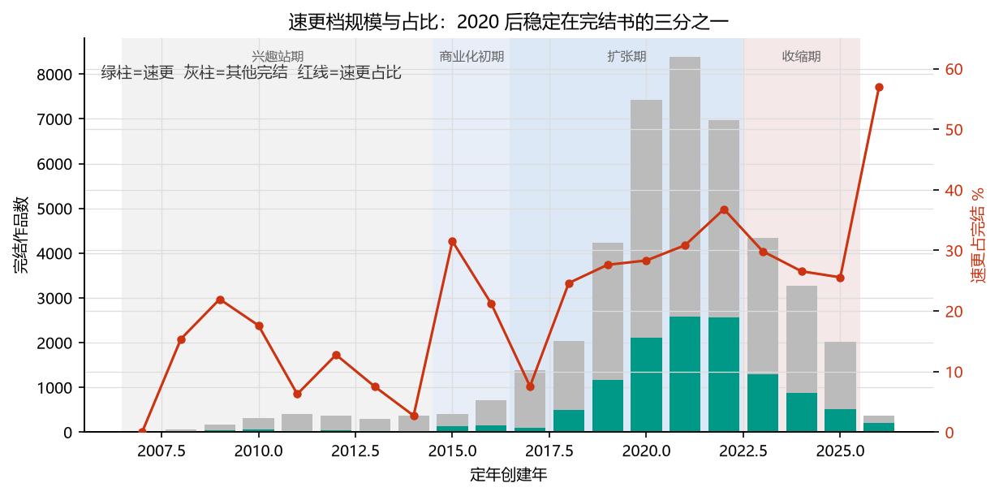
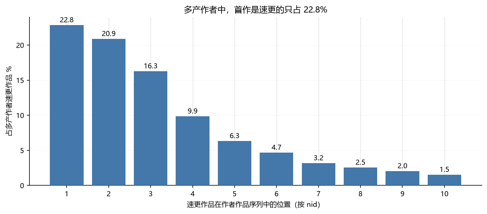
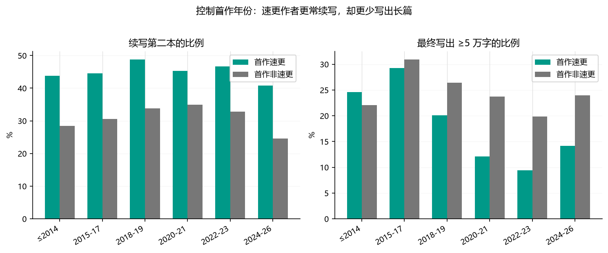
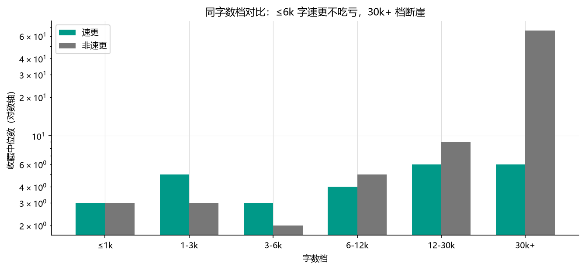

# 11 · 速更短篇：被误读为「完结」的另一半

> 口径声明：
> 1. **速更档** = `status=已完结` 且完结时长 `updated_at − nid 定年创建日`
>    ∈ [0,7] 天，与报告 05 §1 完全一致。定年在 low 段有月级误差，完结时长
>    符号翻转的 6,915 本已完结书单列、不并入。
> 2. **样本是低估**：报告 10 §7 证实抓取是按更新时间降序的单向游标扫描，
>    更新中与新入库的书被系统性跳过；短书被漏得最多。故本报告所有**绝对
>    计数**都是库内下界，面向「速更作者在全部作者中的占比」的结论须加
>    覆盖带。相对比较（速更 vs 非速更、分世代）方向稳健。
> 3. **作者序列按 nid 排序**：nid 单调递增近似创建序；同一作者的重复 nid
>    经 `build_csv.py` 按文件序去重（本数据集未发现大规模 nid 复用）。
>    「首作」指库内可见的首本，若作者更早的书被漏抓，则实为「可观测首作」。
> 4. **续写/长篇口径**：「续写」= 库内在首作之后还有 ≥1 本；「写出长篇」
>    = 该作者库内任一本 `words ≥ 50,000`。两者都是**下界**——长书更不易
>    被漏，故该低估对「速更作者长篇率更低」的结论方向不利（即真实差距
>    可能更小），报告对此保持审慎。
> 5. 所有数字现算自 `out/novels.csv`，年份由 `eras.py` 定年，图表由本
>    生成器产出，勿手改正文。

---

## 0. 结论

1. **速更档是独立品类，不是失败的长篇**：12,417 本，字数中位
   4,147 字、收藏中位 4、点击中位
   146；VIP/签约率仅
   1.1%、
   featured 率 0.00%——平台从未把速更短篇当
   商业产品运营。
2. **速更主要是新手行为**：6,517 位作者的库内首作是速更，
   占全部作者（137,848 位）的 4.7%；
   速更作品中有 52.5% 是作者首部作品；多产作者（≥3 本）的
   速更作品里，首作只占 22.8%。
3. **速更不是弃坑信号，而是高频试水**：首作速更的作者后续再写一本的比例
   比首作非速更者**高 10–15pp**（控制首作年份后各代一致）；但最终写出
   ≥5 万字的比例在 2018 年后**低约一半**。他们更常继续，却更少写长。
4. **40.4% 的速更作者全部作品都是速更**
   （3,847 人），
   即「只写短篇」是一种稳定的作者形态，而非过渡阶段。
5. **征文没有放大速更**：征文作品速更率 5.3% vs 非征文
   4.9%，几乎相同；但速更档里征文占 41.1%，
   与征文在库内的整体占比相当。报告 06「报名≠完赛」的结论不因速更档
   而改变——未完赛与速更完结是两件事。
6. **同字数档下速更不吃亏**：≤6k 字三档中，速更作品的收藏/点击中位数
   均不低于非速更；30k+ 档才出现断崖（收藏 6 vs 66）——那个差异来自
   「认真连载的长篇」与「短篇写完了」的对比，不是速更本身的效率损失。
7. **题材无强选择性**：悬疑 7.0%、
   同人 6.1% 速更率最高，魔幻
   4.0% 最低，极差仅
   3.1pp，远小于作者生涯阶段的差异。

---

## 1. 规模：2020 后稳定占完结书三分之一

43,558 本已完结作品中，速更档 12,417 本
（28.5%）。报告 05 已给出其字数与收藏中位，
这里补上时间结构：

- 2009–2014 年速更占完结
  2.7%–22.0%，波动大且样本小
  （每年 164–398 本）；
- 2018 年后跃升并稳定在 24.6%–36.8%，
  2022 年峰值 36.8%；
- 2026 年 57.0% 是**右删失假象**——当年创建的书只有极少数来得及
  写成 长篇完结，不能读作「速更化加剧」。

速更是**完结结构的内部分化**，不是完结率的驱动因素。把它从「完结率」
里拆出来，是报告 05 的核心结论，本报告继续沿这个口径。

---

## 2. 作者生涯：试水、续写、转长篇

### 2.1 速更发生在生涯的哪一步

9,511 位作者有过速更作品，其中
3,847 人（40.4%）
**全部作品都是速更**。在有多本作品且至少一本速更的作者中：

| 速更作品位置 | 占多产作者的速更作品 |
|---|---|
| 首部作品 | 22.8% |
| 第 2 部 | 20.9% |
| 第 3 部 | 16.3% |
| ≥第 4 部 | 40.0% |

上表按全部速更作品计算，首部作品占 52.5%。
多产作者（库内 ≥3 本）的速更作品里，首作只占 22.8%——**速更集中在
新手期，但并非只在新手期**：老作者也会插入短篇，只是比例低得多。

### 2.2 首作速更之后：续写更多，长篇更少

按首作是否速更拆分作者，再控制首作年份（避免「速更作者首作更晚、
观察窗更短」的混杂）：

| 首作年份 | 首作速更 n | 续写第二本 %（速更 / 非速更） | 写出 ≥5 万字 %（速更 / 非速更） |
|---|---|---|---|
| ≤2014 | 114 | 43.9 / 28.5 | 24.6 / 22.1 |
| 2015-17 | 164 | 44.5 / 30.5 | 29.3 / 31.0 |
| 2018-19 | 348 | 48.9 / 33.8 | 20.1 / 26.5 |
| 2020-21 | 1,881 | 45.3 / 34.9 | 12.1 / 23.7 |
| 2022-23 | 2,510 | 46.7 / 32.8 | 9.4 / 19.9 |
| 2024-26 | 1,500 | 40.9 / 24.6 | 14.1 / 24.0 |

两条方向相反、各代稳定的差异：

- **续写率**：速更作者高 10–15pp。一次短篇完结没有劝退他们，反而比
  那些首作就写长篇（或未完结）的作者更愿意再开一本。
- **长篇率**：2018 年后速更作者低约一半（2020-21 代
  12.1 / 23.7、2022-23 代 9.4 / 19.9，
  格式为「速更 / 非速更」）。他们持续在场，却停留在短篇形态。

全样本口径下：首作速更作者中 45.0%
有第二本（非速更 31.2%），
12.6% 最终写出 ≥5 万字
（非速更 23.5%），
7.0% 写出 ≥10 万字
（非速更 13.6%）。

把门槛抬到 10 万字完结：有速更作品的 9,511 位作者中，
743 人（7.8%）
也写过 ≥10 万字完结作品。**速更与长篇创作不是互斥人格，但转化率有限。**

---

## 3. 题材与征文：没有强选择性

| 分类 | 作品数 | 速更数 | 速更率 |
|---|---|---|---|
| 悬疑 | 5,170 | 364 | 7.0% |
| 同人 | 31,664 | 1,935 | 6.1% |
| 都市 | 23,450 | 1,369 | 5.8% |
| 玄幻 | 29,798 | 1,722 | 5.8% |
| 游戏 | 12,782 | 729 | 5.7% |
| 科幻 | 17,366 | 931 | 5.4% |
| 校园 | 31,595 | 1,573 | 5.0% |
| 古风 | 8,258 | 392 | 4.7% |
| 魔幻 | 85,696 | 3,402 | 4.0% |

分类极差 3pp，谈不上「某类题材更容易写成短篇」。速更档高频标签为
日常(3,838)、战斗(3,289)、异世界(3,005)、恋爱(2,991)、女性主角(1,983)、冒险(1,941)、搞笑(1,858)、无敌(1,590)、脑洞(1,572)、治愈(1,267)、重生(1,187)、系统(1,084)——以通用配料（日常、战斗、异世界、恋爱）为主，
不构成独立题材空间。

征文交叉则给出一个**否定性结论**：征文作品速更率 5.3%，
非征文 4.9%，几乎无差。速更档中征文占
41.1%，与征文在库内整体占比
（38.8%）相当。报告 06 的「报名≠完赛」
指的是大量征文投稿停在极短篇幅、连完结状态都没拿到；本报告统计的
是**已完结的速更**，两者口径不同，不可互证。

---

## 4. 效率：速更短篇是独立品类

| 字数档 | 速更 n | 收藏中位（速更 / 非速更） | 点击中位（速更 / 非速更） |
|---|---|---|---|
| ≤1k | 2,034 | 3 / 3 | 53 / 54 |
| 1-3k | 2,598 | 5 / 3 | 154 / 66 |
| 3-6k | 2,903 | 3 / 2 | 79 / 63 |
| 6-12k | 2,385 | 4 / 5 | 187 / 219 |
| 12-30k | 1,779 | 6 / 9 | 304 / 574 |
| 30k+ | 718 | 6 / 66 | 422 / 6,110 |

在 ≤1k、1-3k、3-6k 三档里，速更作品的收藏与点击中位数
**不低于甚至高于**非速更作品。6-12k 档开始接近，12-30k 与 30k+ 档
非速更作品反超（30k+ 档收藏 66 vs 6，点击 6,110 vs 422）。

这个交叉模式的解释不是「速更损失了效率」，而是：

- 短字数档里，非速更组混入了大量**断更的连载尝试**（写了几天就停，
  状态仍是「连载中」）；速更组反而是**有始有终**的那一批。
- 长字数档里，非速更组是认真连载的长篇，速更组只是「一次性上传了
  较多内容就完结」，二者本就不是同类。

因此「速更短篇质量低」不能从收藏/点击直接推出；能推出的是
**平台从未给这个品类商业出口**：VIP/签约率
1.1%，
featured 率 0.00%——620 本 featured 书里没有一本速更短篇。

---

## 5. 口径边界与未决问题

1. **绝对计数是下界**：报告 10 §7 的游标扫描对短书最不友好，
   12,417 本只是库内可见部分。若遗漏书里短篇比例更高，
   「速更占完结 28.5%」这个比例也可能被低估——但方向无法从库内数据确定。
2. **「写出长篇」的下界性质**：长书更不易被漏，故速更作者的长篇率被
   低估的幅度**小于**非速更作者；这会使 §2.2 的长篇率差距被**高估**。
   控制年份后的方向（速更低一半）稳健，具体幅度须谨慎。
3. **作者同一性**：以作者名字符串匹配，同名不同人/马甲会同时抬高低估
   与高估；报告 03 已讨论马甲结构，本报告不重复修正。
4. **右删失**：2025–2026 创建的书观察窗不足，其「未速更」状态可能是
   「还没写完」；§2 的控制年份表已按首作年份分层，但 2024-26 组仍
   不宜过度解读。
5. **定年误差**：完结时长依赖 nid 定年（LOO P99 = 50 天），0–7 天档
   在 low 段的误差足以把 8–30 天档错分进来；本报告沿用报告 05 的
   口径，不重新标定。
6. **短篇池含对话/互动小说**（报告 22）：本地无品类字段，按形态判据
   速更档里 25.7% 为对话/互动形态。剔除后敏感性对比：
   速更占完结书 28.5% → 26.8%、字数中位
   4,147 → 5,202 字。方向与结论不变
   （对话小说同样每章约 500 字、整本可长，不是本报告定义的「速更短篇」
   的产品替代品），但「短篇」一词在本报告指篇幅，不含产品形态。
