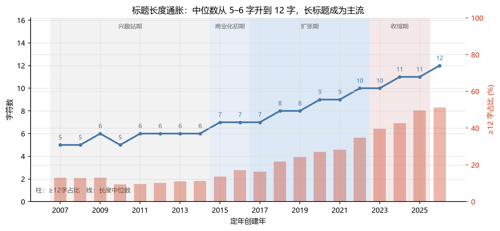
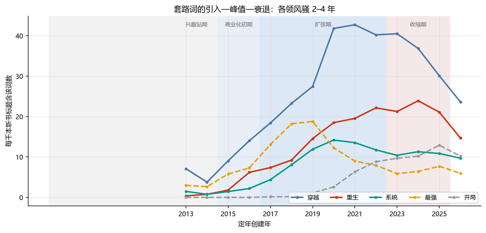
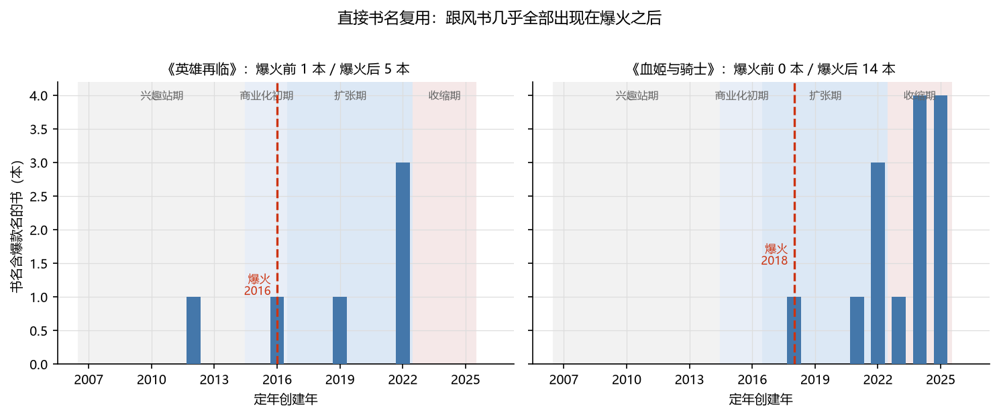
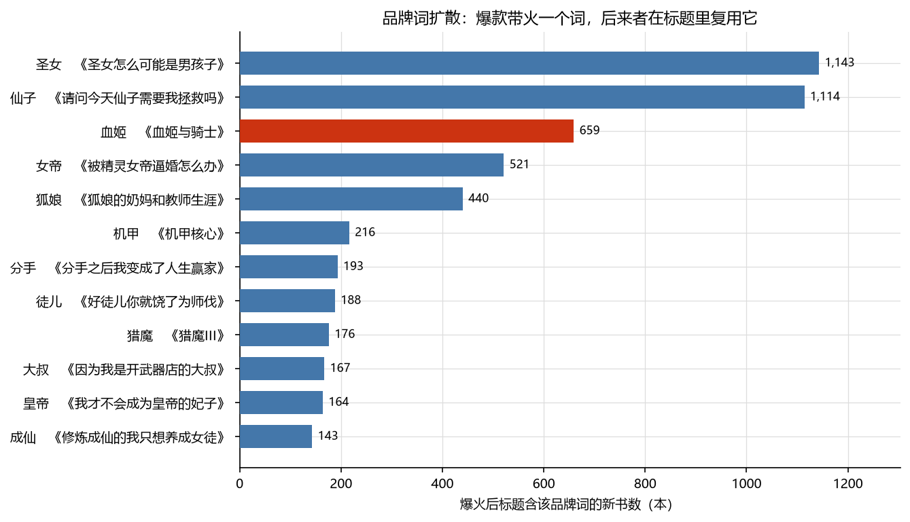
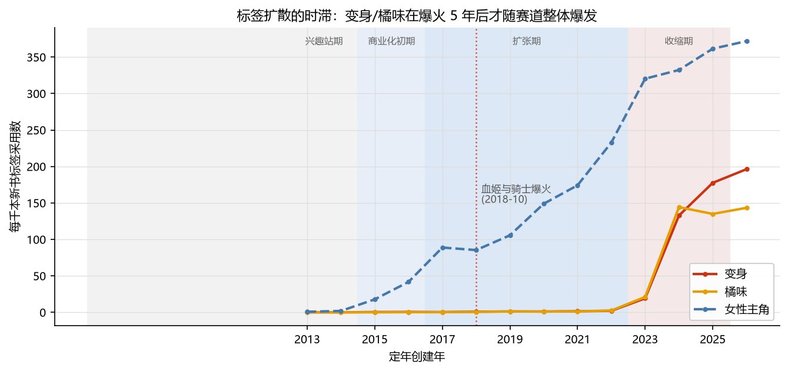

# 报告 12：标题形态与命名史

> 数据口径：245,779 本（已剔除正版日轻），定年来自 `eras.py`。标题按 UTF-8 字符计长；
> 分词用 jieba 精确模式，仅保留 ≥2 字词。爆火事件以「首次上月票榜且月票 ≥100」锚定，
> 月榜数据来自 `out/monthly_ranks.jsonl`。
>
> **跟风证据分三级，不可混用**：① 直接书名复用（硬证据，书名含爆款原名）；
> ② 品牌词扩散（中证据，爆火前近乎不存在、爆火后大量出现在新书标题的词）；
> ③ 通用套路词增长（弱信号，「穿越」「系统」等全行业同步上升，**不能归因给单本爆款**）。
>
> 右删失：2026 年只含年初创建书，趋势末段勿外推。报告 10 已证抓取偏向短/新/更新中的书，
> 跟风短篇因此被系统性漏抓——本报告跟风绝对计数是**下界**。

## 结论

1. **标题持续通胀**：长度中位数从 2007 年的 5 字升到 2026 年的
   12 字（2007–2014 区间中位 6、2024–2026 区间中位 11）；
   ≥12 字占比从 11% 升到 50%。标题从「短语标识」变成「卖点摘要」。
2. **套路词各领风骚 2–4 年**：穿越峰值 2021、
   重生峰值 2024、系统峰值 2020、
   最强峰值 2019、开局峰值 2025——
   生命周期错峰，不存在一个「永远的套路」。
3. **跟风有硬证据**：《血姬与骑士》的 14 本同名书中
   0 本在爆火前、14 本在爆火后
   （100%），收藏中位 124、
   57% 挂「同人」标签——是明确的 IP 借势。
4. **爆款真正带火的是「品牌词」而非通用词**：「血姬」在爆火前几乎不存在，
   爆火起 6 年（2018–2023）在标题中出现 139 次；
   而「英雄」「无敌」「系统」的上升与全行业标题通胀同步（同期「穿越」从
   7‰ 涨到 43‰），**不可归因给《英雄再临》**。
5. **标签扩散有时滞，且更易被赛道混杂**：血姬与骑士 2018 就挂「变身/橘味」，
   但这两个标签到 2023 才随女性向整体爆发（变身 19→178‰），
   更可能是报告 09 记录的词表清理与赛道切换，而非单本爆款所致。
6. **跟风书热度更高，但这是选择效应**：
   「血姬」跟风书收藏中位 51 vs 同期其他 9
   （5.7 倍）——愿意蹭热点的作者本身更认真，
   不能读作「蹭名有效」。

## 1. 标题长度通胀：从标识到卖点摘要

长度增长贯穿整个时间轴，且 2018 后加速。关键点：

- 2007–2014 年中位 6 字、≥12 字仅 11%——标题是**短标识**；
- 2024–2026 年中位 11 字、≥12 字达 50%——近半标题是**长卖点句**；
- 这与报告 09 的「标签体系 2017+ 成熟」同向：平台与作者都转向**前置信息量**。

| 创建年 | 新书数 | 长度中位 | 均值 | ≥12字占比 |
|---|---:|---:|---:|---:|
| 2008 | 404 | 5 | 6.5 | 12.9% |
| 2010 | 2,947 | 5 | 6.4 | 9.4% |
| 2012 | 3,430 | 6 | 6.7 | 10.3% |
| 2014 | 2,646 | 6 | 7.0 | 11.2% |
| 2016 | 5,493 | 7 | 7.8 | 17.2% |
| 2018 | 16,469 | 8 | 8.4 | 21.8% |
| 2020 | 30,372 | 9 | 9.0 | 27.1% |
| 2022 | 37,088 | 10 | 9.7 | 34.8% |
| 2023 | 26,021 | 10 | 10.0 | 39.6% |
| 2024 | 20,075 | 11 | 10.2 | 42.7% |
| 2025 | 14,552 | 11 | 10.7 | 49.6% |
| 2026 | 4,021 | 12 | 10.8 | 51.2% |

## 2. 套路词生命周期：错峰的流行

每千本新书标题含该词的量化曲线（选峰年）：

| 词 | 引入年(≥峰值10%) | 峰值年 | 峰值(‰) |
|---|---:|---:|---:|
| 穿越 | 2013 | 2021 | 43 |
| 重生 | 2016 | 2024 | 24 |
| 系统 | 2013 | 2020 | 14 |
| 最强 | 2013 | 2019 | 19 |
| 无敌 | 2014 | 2020 | 10 |
| 开局 | 2020 | 2025 | 13 |

「穿越」「重生」「系统」在 2020 前后同时冲高，构成网文标题的**黄金套路期**；
「最强」「无敌」更早（2018–2020）见顶并回落；「开局」最晚（2025 年峰值），
是收缩期仍在上涨的少数词。套路词的引入—峰值—衰退更像**题材轮动**，而非单向通胀。

## 3. 跟风传播：三个证据层级

### 3.1 硬证据：直接书名复用

- 《英雄再临》：含书名的书共 6 本，爆火前 1 本、爆火后 5 本（83%），收藏中位 20、字数中位 9,698、50% 含「同人」标签；定年跨度 2012–2022。
- 《血姬与骑士》：含书名的书共 14 本，爆火前 0 本、爆火后 14 本（100%），收藏中位 124、字数中位 29,800、57% 含「同人」标签；定年跨度 2018–2025。

这批书绝大多数是同人/借势作：它们**直接把爆款书名嵌进自己的标题**，是最无歧义的跟风证据。
注意《英雄再临》的 6 本里有 1 本（nid 25022，2012 年）是同名误命中，非跟风。

### 3.2 中证据：品牌词扩散

系统性扫描：对每个首上月票榜且月票 ≥100 的爆款，取其标题中「爆火前 3 年 ≤3 次、
爆火后 6 年 ≥30 次」的题材词（已剔除「怎么办」「需要」等通用词），统计爆火后
标题含该词的新书数。结果（同一词只保留首发最早的爆款）：

| 品牌词 | 源头爆款 | 爆火年 | 爆火后 6 年词频 | 跟风新书数 | 跟风书收藏中位 |
|---|---|---:|---:|---:|---:|
| 圣女 | 圣女怎么可能是男孩子 | 2017 | 486 | 1,143 | 46 |
| 仙子 | 请问今天仙子需要我拯救吗 | 2018 | 728 | 1,114 | 66 |
| 血姬 | 血姬与骑士 | 2018 | 139 | 659 | 51 |
| 女帝 | 被精灵女帝逼婚怎么办 | 2017 | 263 | 521 | 43 |
| 狐娘 | 狐娘的奶妈和教师生涯 | 2016 | 145 | 440 | 64 |
| 机甲 | 机甲核心 | 2016 | 111 | 216 | 13 |
| 分手 | 分手之后我变成了人生赢家 | 2018 | 160 | 193 | 66 |
| 徒儿 | 好徒儿你就饶了为师伐 | 2018 | 149 | 188 | 90 |
| 猎魔 | 猎魔III | 2013 | 39 | 176 | 5 |
| 大叔 | 因为我是开武器店的大叔 | 2015 | 88 | 167 | 9 |
| 皇帝 | 我才不会成为皇帝的妃子 | 2017 | 127 | 164 | 16 |
| 成仙 | 修炼成仙的我只想养成女徒弟 | 2018 | 96 | 143 | 7 |

上表按跟风新书数排序，「圣女」「仙子」「狐娘」「女帝」「血姬」「机甲」是题材词，
「分手」「徒儿」「大叔」则是角色/叙事套路词——
它们共同的特征是被爆款**从生僻打到常用**。
这是跟风的核心形态：后来者不抄书名，而是**复用爆款验证过的关键词**——
既可借势搜索与推荐，也降低了读者的理解成本。

### 3.3 弱信号：通用套路词不能归因单本爆款

《英雄再临》爆火后「英雄」采用率从 3‰ 升到峰值
10‰，但同期「穿越」从 7‰ 涨到
43‰、「系统」从 1‰ 涨到 14‰——
**整个行业标题都在变长、堆词**。此时把「英雄」的上升归给一本书是虚假归因。
本报告因此只在品牌词满足「爆火前近乎不存在」时才认定跟风。

### 3.4 标签扩散：时滞与赛道混杂

血姬与骑士原创标签「变身/橘味」在 2018 爆火时采用率不足 1‰，
到 2023 才分别升至 19‰ / 21‰，
2025 达 178‰ / 135‰。
**五年的时滞说明这不是单本爆款的即时效应**：报告 09 已证 2022 年词表清理、
2023–24 女性向赛道整体爆发，「变身/橘味」是搭上了赛道快车。
本报告不将它读作「血姬带火了标签」，只标注**同向但非因果**。

## 4. 跟风的经济后果：选择效应而非因果

「血姬」跟风书（659 本，2019 后创建）与同期其他新书对比：

| 指标 | 跟风书中位 | 同期其他中位 | 倍数 |
|---|---:|---:|---:|
| 收藏 | 51 | 9 | 5.67× |
| 点击 | 2,785 | 395 | 7.05× |
| 字数 | 21,741 | 9,495 | 2.29× |

跟风书热度显著更高，但**不能解读成「蹭名有效」**：愿意在标题里复用爆款词的作者，
本身更可能认真经营（字数中位也高 2.3 倍），
且这批书以同人为主、享有 IP 流量。这是**选择效应**，不是品牌词带来的因果提升。

## 5. 口径边界与未决

1. **定年误差**：nid 插值的 LOO P99 约 50 天，爆火年与创建年错配最多影响相邻一年；
   本报告的窗口取 3–6 年，足以吸收。
2. **月榜右截断**：月榜每月 top20，爆款定义依赖上榜门槛（月票 ≥100），
   小众爆款可能未入扫描；品牌词扫描因此偏保守。
3. **同名词误命中**：直接复用统计中《英雄再临》含 1 本 2012 年同名作（非跟风），
   《血姬与骑士》的 14 本则全部在爆火后，无误命中。
4. **品牌词过滤的残余风险**： GENERIC 表基于探查剔除明显泛词，
   极少数泛词（如「角色」「回家」）可能漏网，已在 §3.2 手工复核。
5. **标签词表断层**：报告 09 证 2022 年清理 23 个 IP/亚文化标签，
   §3.4 的标签曲线跨断层比较须谨慎（本报告只做同向标注，不做因果断言）。
