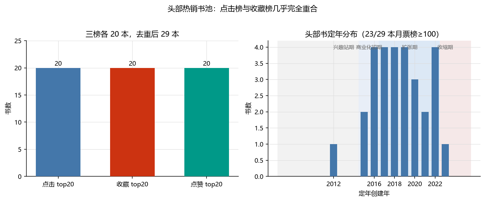
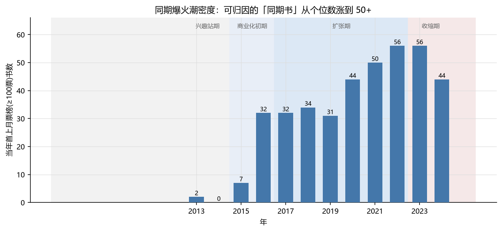
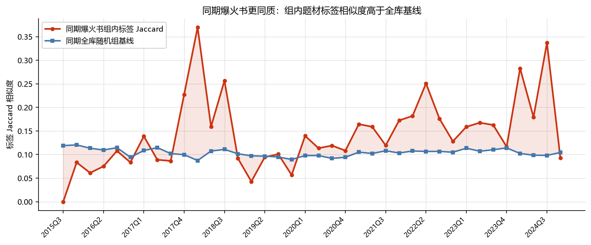
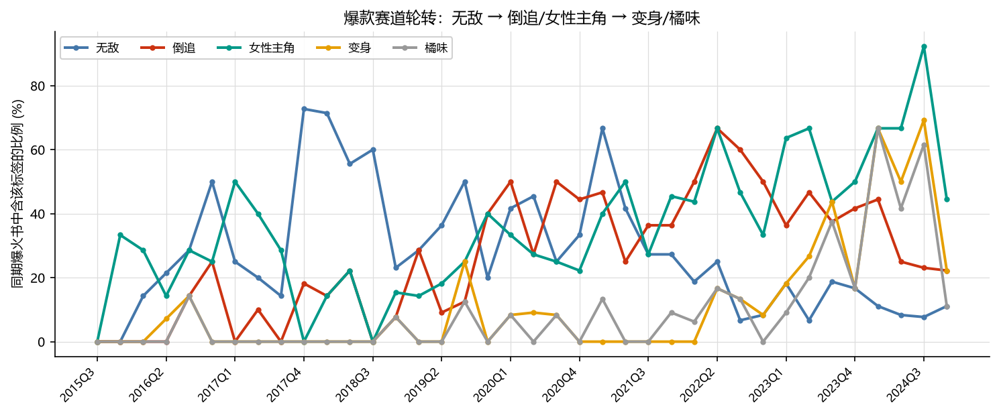
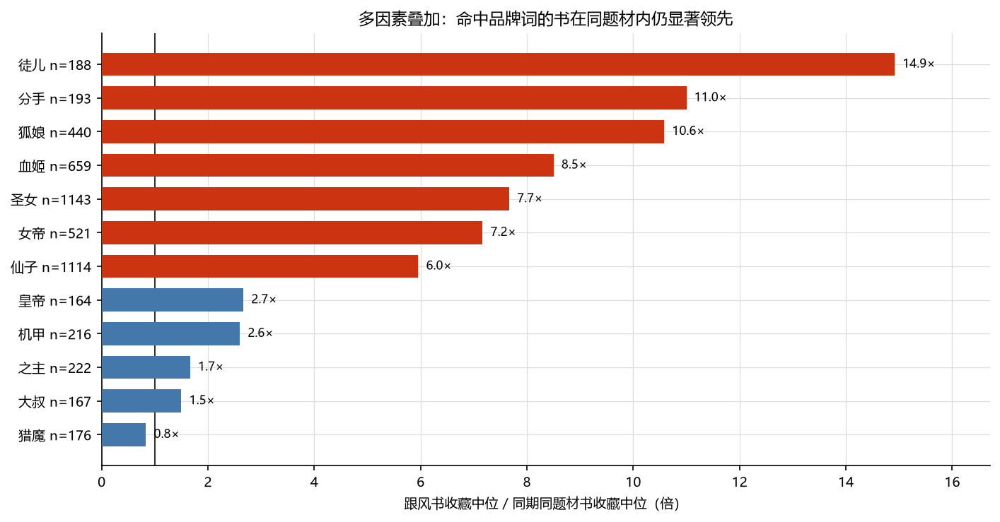

# 报告 13：跟风传播与同期爆火潮

> 数据口径：245,779 本（已剔除正版日轻），定年来自 `eras.py`。
> 头部热销书池 = 点击 / 收藏 / 点赞各 top20 去重（29 本）；
> 爆款定义 = 首次上月票榜且月票 ≥100（月榜原始 494 条，含少量不在定年库中的 nid）。
> 分词用 jieba 精确模式（≥2 字词），品牌词判据 = 爆火前 3 年 ≤3 次、
> 爆火起 6 年 ≥30 次，已剔除泛词表与荣誉标签（萌神）。
> 「同期」按首次上榜季度定义。跟风绝对计数仍受报告 10 游标遗漏影响，是**下界**。

## 结论

1. **头部书很少造词**：三榜去重 29 本头部书全部上过月度榜
   （其中 23 本首上月票榜 ≥100），
   逐本扫描后仅 7 本（24%）能检出
   「从生僻到常用」的品牌词。造词更多是**中等热度爆款**的现象；
   顶级作品靠既有词汇与运营，不靠新词。
2. **点击榜与收藏榜几乎完全重合**：各 20 本里 16 本相同，
   点赞榜另贡献 5 本——
   头部热销是稳定的同一批书，不是三个独立榜单。
3. **跟风常是「潮」不是「单本引爆」**：报告 12 识别的 12 个品牌词里
   5 个在扩散窗口内有 ≥2 本同期爆火书标题含该词——
   「仙子」（2018-04《飞升从养个仙子开始》与 2018-12《请问今天仙子需要我拯救吗》）、
   「狐娘」（3 本）、「圣女」「徒儿」「之主」均是**同期多本共振**，
   归给单一源头书是过度归因；「血姬」「女帝」「机甲」等才是单本驱动。
4. **同期爆火书更同质**：25/38 个季度的组内题材标签 Jaccard 高于同期全库随机组，
   整体比值 1.38×；2018Q1 达 0.370 vs 0.106——
   爆款潮是**赛道共振**，不是独立随机事件。
5. **赛道随时间轮转**：同期爆火书共享标签从 2016 的恋爱/无敌 → 2020–22 的
   倒追/女性主角 → 2023–24 的变身/橘味，与报告 09 的女性向转向同向。
6. **多因素叠加放大效应**：命中品牌词的跟风书相对同期**同题材**书的收藏中位数
   在 0.8–14.9 倍之间
   （9/12 个词超过 2 倍），
   说明「品牌词 × 题材 × 标签」同时命中会放大注意力——但这仍是相关，非因果。

## 1. 头部热销书池：点击榜与收藏榜是同一批书

三榜去重只有 29 本，其中点击与收藏 top20 重合
16 本。头部书全部上过月度榜
（其中 23 本首上月票榜 ≥100），定年集中在 2016–2023。**与报告 12 的中等热度爆款不同，这些顶级作品只有
7/29 产出新品牌词**——它们的标题多用既有词
（「我」「世界」「变成」），跟风扩散主要发生在有明确新概念的中腰部爆款上。

## 2. 同期爆火潮：可归因的同期书从个位数涨到 50+

首上月票榜（≥100 票）的书数从 2013 年的 2 本涨到
2023 年的 56 本。这意味着「同期爆火」在早期是稀疏事件，
2020 后成为常态——**任何一个品牌词的扩散，都更可能是多本书共同的赛道效应**。

## 3. 单本驱动 vs 同期共振：12 个品牌词的归因检验

按「扩散窗口 hy-1~hy+1 内首上月票榜且标题含该词」计数：

| 品牌词 | 源头爆款 | 爆火年 | 同期含该词爆火书 | 爆火后 6 年词频 | 跟风书数 | 判定 |
|---|---|---:|---:|---:|---:|---|
| 圣女 | 圣女怎么可能是男孩子 | 2017 | 2 | 486 | 1,143 | 同期共振 |
| 仙子 | 请问今天仙子需要我拯救吗 | 2018 | 2 | 728 | 1,114 | 同期共振 |
| 血姬 | 血姬与骑士 | 2018 | 1 | 139 | 659 | 单本驱动 |
| 女帝 | 被精灵女帝逼婚怎么办 | 2017 | 1 | 263 | 521 | 单本驱动 |
| 狐娘 | 狐娘的奶妈和教师生涯 | 2016 | 3 | 145 | 440 | 同期共振 |
| 之主 | 吸血鬼之主与恶魔的我 | 2017 | 2 | 141 | 222 | 同期共振 |
| 机甲 | 机甲核心 | 2016 | 1 | 111 | 216 | 单本驱动 |
| 分手 | 分手之后我变成了人生赢家 | 2018 | 1 | 160 | 193 | 单本驱动 |
| 徒儿 | 好徒儿你就饶了为师伐 | 2018 | 2 | 149 | 188 | 同期共振 |
| 猎魔 | 猎魔III | 2013 | 1 | 39 | 176 | 单本驱动 |
| 大叔 | 因为我是开武器店的大叔 | 2015 | 1 | 88 | 167 | 单本驱动 |
| 皇帝 | 我才不会成为皇帝的妃子 | 2017 | 1 | 127 | 164 | 单本驱动 |

5 个词被证实是同期多本共振。这修正了报告 12 §3.2 的单本归因：
「仙子」不是某一本书带火的，而是 2018 年至少两本爆款同时使用该词；
「狐娘」更极端——2016 年《狐娘的奶妈和教师生涯》与《不想当音乐家的狐娘不是好厨子》
同季爆火，2017 年《我变成了游戏宠物？狐娘？！》以 2,448 票接力。
**在这些案例里，词属于赛道，不属于某一本书。**

## 4. 同期爆火书的题材/标签共振

同期爆火书的题材标签 Jaccard 在 25/38 个季度高于同期全库基线，
整体 1.38×。峰值季度（如 2018Q1、2024Q3）达到基线的 3 倍以上——
**爆款不是分散出现的，而是成簇落在同一题材赛道**。

共享标签的构成随时间系统性变化：

- 2016–2018：无敌 / 战斗 / 异世界（男性向升级流）
- 2019–2022：倒追 / 女性主角 / 恋爱（女性向倒追流）
- 2023–2024：变身 / 橘味 / 女性主角（女性向变身流，见报告 09）

这与报告 09 的「2022 词表清理、2023–24 女性向爆发」完全一致：
**跟风的方向由当期赛道决定，爆款只是赛道的可见节点**。

## 5. 多因素叠加：品牌词 × 题材 × 标签

对 12 个品牌词，比较跟风书与同期**同题材**书的收藏中位数
（而非同期全库），以剥离题材红利：

| 品牌词 | 跟风书 n | 跟风收藏中位 | 同期同题材收藏中位 | 叠加倍数 |
|---|---:|---:|---:|---:|
| 徒儿 | 188 | 90 | 6 | 14.92× |
| 分手 | 193 | 66 | 6 | 11.00× |
| 狐娘 | 440 | 64 | 6 | 10.58× |
| 血姬 | 659 | 51 | 6 | 8.50× |
| 圣女 | 1,143 | 46 | 6 | 7.67× |
| 女帝 | 521 | 43 | 6 | 7.17× |
| 仙子 | 1,114 | 66 | 11 | 5.95× |
| 皇帝 | 164 | 16 | 6 | 2.67× |
| 机甲 | 216 | 13 | 5 | 2.60× |
| 之主 | 222 | 10 | 6 | 1.67× |
| 大叔 | 167 | 9 | 6 | 1.50× |
| 猎魔 | 176 | 5 | 6 | 0.83× |

多数品牌词的跟风书在控制题材后仍领先
（0.8–14.9 倍），
说明标题品牌词**叠加在题材之上**还有额外的注意力聚集；
少数词（如猎魔 0.83×）则完全依赖题材红利，剥离后无优势。
但必须强调这是**相关而非因果**：愿意在标题中用爆款词、
且能精确踩中当期赛道的作者，本身就是更敏锐的经营者和更优质的创作者——
跟风行为与作品质量都由「作者能力」这个潜在变量驱动。

## 6. 口径边界与未决

1. **「同期」的操作化**：按首次上榜季度（3 个月）定义。更窄的窗口（月）会让同期共振判定更保守；
   本报告用季度以容忍月榜 top20 的右截断与定年误差（LOO P99 ≈50 天）。
2. **品牌词判据的保守性**：爆火前 ≤3 次、爆火后 ≥30 次的阈值会漏掉
   「已有一定基础、爆款显著放大」的词（如「英雄」），这类词无法通过本判据识别跟风。
3. **荣誉标签剔除**：源书标签中的「2018萌神」等是年度大赛荣誉（报告 09 §7），
   已从题材标签统计中整行剔除，避免污染 Jaccard。
4. **因果不可识别**：报告 10 已证抓取偏短/新；跟风书多为短篇同人，漏抓更严重。
   本报告所有倍数都是从观测样本算得的下界，且**选择效应无法剥离**。
5. **头部书造词率低**：29 本头部书逐本扫描后仅 7 本有品牌词扩散，
   但样本太小，不足以断言「顶级书不造词」是普遍规律，仅为观察。
