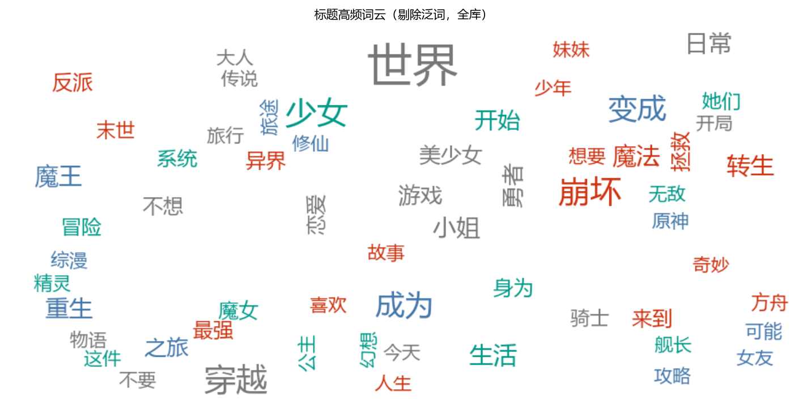
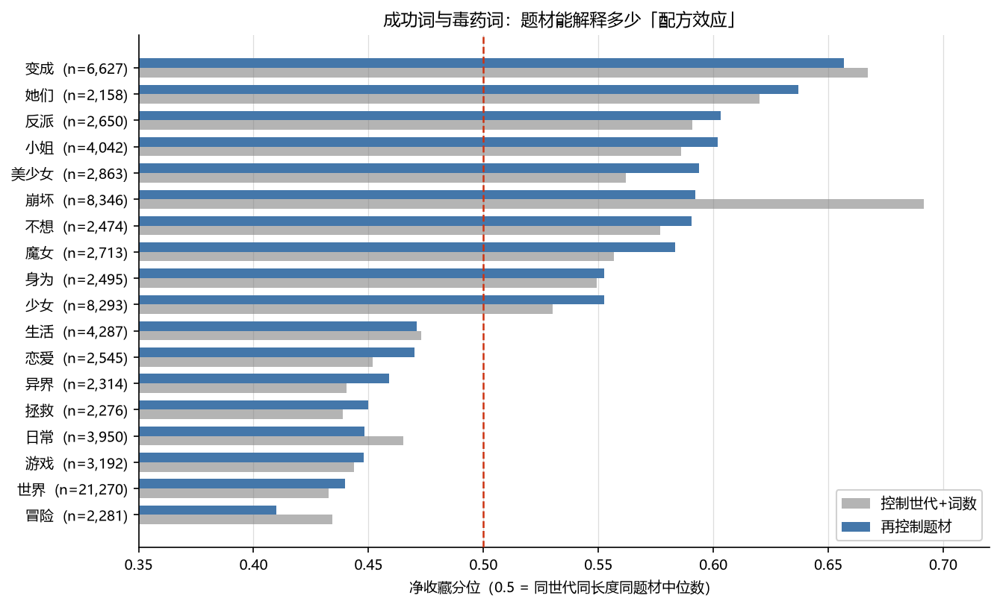
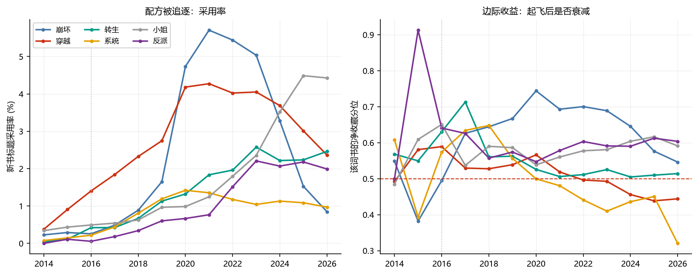
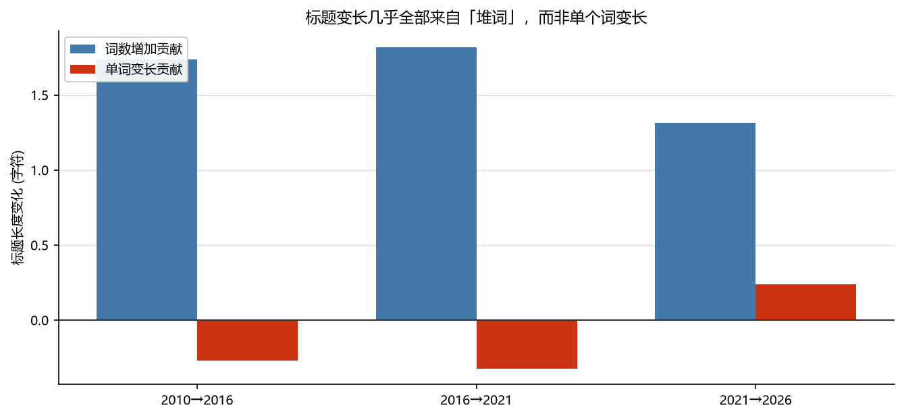
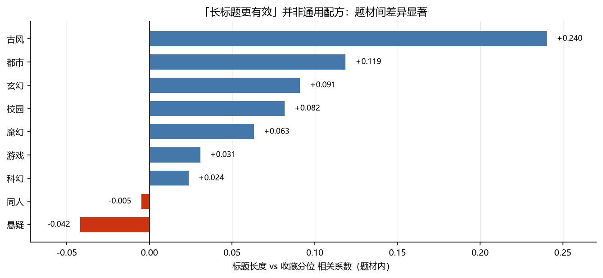
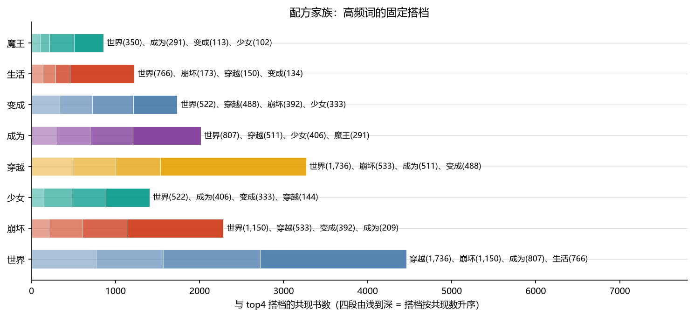

# 标题高频词与成功配方

> **口径声明**
> 1. 数据为 `out/novels.csv`，剔除日轻授权作者（4 家）后 245,779 行；标题经 jieba 精确模式切词，仅保留 ≥2 字，复用报告 12 的切词缓存。
> 2. **成功**以「收藏」为主刻度（比点击更接近真实偏好，见报告 02/08）；累计指标跨世代不可比，因此采用**条件分位**：在同世代、同标题词数（及同题材）组内对收藏排序，0.5 为该组中位数。上榜率作辅助刻度（月票榜 top20 右截断）。
> 3. 「成功配方」是**相关**不是因果：含某词的书收藏高，可能是词吸引了读者，也可能是该词标记了高收藏偏好的题材/受众。报告用「再控制题材」一列显式剥离后者。
> 4. 词表为 jieba 数据驱动，**泛词已剔除**（见生成器 `GENERIC`）；萌神荣誉标签不属于标题词，无需处理。
> 5. 本报告不改动任何数据行；正文数字全部现算。

## 结论

1. **作者的「配方」确实存在，但高度题材特定**：控制世代+词数+题材后，「变成」0.66、「她们」0.64、「反派」0.60、「小姐」0.60 的净收藏分位显著高于 0.5；题材内部「标题越长收藏越高」的相关在古风 +0.240 vs 悬疑 -0.042 之间摆动——**没有通用配方，只有赛道配方**。
2. **标题变长几乎全部来自「堆词」**：三段时期分解中，词数贡献（平均 +1.62 字）远超单词长度贡献（平均 -0.12 字，接近零或为负）。这与「作者累积卖点词」的假说相容，但本报告只能证明**堆词与高收藏相关**，不能证明堆的是「成功词」（词数效应在条件分位设计中按定义为零）。
3. **部分配方有保质期**：2/6 个高频词在采用率突破 1% 后的三年里净收益下滑（「转生」0.63→0.53、「系统」0.62→0.49），与拥挤效应相容；但其余 4/6 个未下行，「跟风必衰减」不成立。
4. **题材是最强的混淆项**：「崩坏」控制题材后净分位从 0.692 降到 0.592——相当一部分「配方效应」其实是同人受众本就收藏高，不是词本身有效。
5. **词表极度分散**：唯一词 83,694 个，top10 仅覆盖 9.8% 的标题词例——成功不是 memorize 一张短词表，而是在长尾里找组合。
6. **作者换配方的证据很弱**：多产作者（≥3 本）首作含高分词 13.0% → 末作 15.8%（+2.8pp），低分词 16.5% → 14.3%——方向符合「试配方」，但幅度太小，不足以说作者在学习。

## 1. 高频词谱：词云与世代

| 世代 | 高频标题词（剔除泛词，前 6） |
|---|---|
| ≤2014 | 世界(712)、少女(371)、物语(279)、魔法(260)、传说(229)、幻想(206) |
| 2015-17 | 世界(1,927)、少女(483)、魔王(451)、勇者(405)、妹妹(379)、日常(360) |
| 2018-20 | 世界(7,411)、穿越(2,337)、少女(2,153)、崩坏(2,006)、成为(1,756)、变成(1,593) |
| 2021-23 | 世界(8,676)、崩坏(5,391)、穿越(4,066)、变成(3,653)、成为(3,238)、少女(3,178) |
| 2024-26 | 世界(2,748)、少女(2,136)、小姐(1,541)、成为(1,400)、穿越(1,285)、魔法(1,263) |

高频词从「世界/少女/魔法」的**意象型**，转向「穿越/崩坏/变成」的**叙事机制型**，再到「小姐/魔女/反派」的**角色身份型**。top10 词仅覆盖 9.8% 词例、top100 覆盖 29.9%——词表极长尾，所谓「配方」从来不是一张短清单。

## 2. 成功词识别：题材能解释多少

| 词 | 书数 | 净收藏分位（控制世代+词数） | 再控制题材 | 题材解释掉的部分 |
|---|---:|---:|---:|---:|
| 变成 | 6,627 | 0.667 | 0.657 | -0.011 |
| 她们 | 2,158 | 0.620 | 0.637 | +0.017 |
| 反派 | 2,650 | 0.591 | 0.603 | +0.012 |
| 小姐 | 4,042 | 0.586 | 0.602 | +0.016 |
| 美少女 | 2,863 | 0.562 | 0.594 | +0.032 |
| 崩坏 | 8,346 | 0.692 | 0.592 | -0.100 |
| 不想 | 2,474 | 0.577 | 0.591 | +0.014 |
| 魔女 | 2,713 | 0.557 | 0.583 | +0.027 |
| 身为 | 2,495 | 0.549 | 0.552 | +0.003 |
| 少女 | 8,293 | 0.530 | 0.552 | +0.022 |

对照——净分位最低的词：

| 词 | 书数 | 控制世代+词数 | 再控制题材 |
|---|---:|---:|---:|
| 冒险 | 2,281 | 0.434 | 0.410 |
| 世界 | 21,270 | 0.433 | 0.440 |
| 游戏 | 3,192 | 0.444 | 0.448 |
| 日常 | 3,950 | 0.465 | 0.448 |
| 拯救 | 2,276 | 0.439 | 0.450 |
| 异界 | 2,314 | 0.441 | 0.459 |
| 恋爱 | 2,545 | 0.452 | 0.470 |
| 生活 | 4,287 | 0.473 | 0.471 |

**关键读法**：灰色柱（控制世代+词数）是「词本身的净关联」，蓝色柱（再控制题材）是「剥离题材受众后的净关联」。「崩坏」的差距最大（-0.100 若在其中）——它标记的同人赛道读者本就收藏更高。多数词的两柱接近，说明题材不是它们的解释。

## 3. 配方的保质期：采用率飙升后收益下滑

| 词 | 起飞年（采用率>1%） | 起飞前 3 年均净分位 | 起飞后 3 年均净分位 | 变化 |
|---|---:|---:|---:|---:|
| 崩坏 | 2019 | 0.588 | 0.701 | +0.113 |
| 穿越 | 2016 | 0.536 | 0.546 | +0.010 |
| 转生 | 2019 | 0.635 | 0.526 | -0.108 |
| 系统 | 2019 | 0.619 | 0.494 | -0.124 |
| 小姐 | 2021 | 0.572 | 0.581 | +0.009 |
| 反派 | 2022 | 0.566 | 0.599 | +0.033 |

2/6 个词在起飞后收益下行。「系统」0.619→0.494、「转生」0.635→0.526 最明显——与**拥挤效应**相容：词被用滥后差异化信号减弱。但多数词（4/6）后段并未下行，「崩坏」反而上行，说明**配方衰竭是部分现象、不是铁律**。

## 4. 标题为什么变长：堆词，而不是单词变长

| 时期 | 标题长度变化 | 词数增加贡献 | 单词变长贡献 |
|---|---:|---:|---:|
| 2010→2016 | +1.47 字 | +1.74 | -0.27 |
| 2016→2021 | +1.50 字 | +1.82 | -0.32 |
| 2021→2026 | +1.55 字 | +1.31 | +0.24 |

三个时期里词数贡献均远超单词长度变化（后者接近零甚至为负）。标题从「短语标识」变成「卖点摘要」，靠的是**往标题里塞更多卖点词**，不是把词写得更花哨。这与「累积卖点词驱动变长」的假说相容；但必须强调：本报告用的是条件分位（词数效应按设计为零），**无法检验「堆的是不是成功词」**——那需要标注每个词的意图，超出了元数据能支撑的范围。

## 5. 配方是题材特定的

题材内「标题长度 vs 收藏」的相关系数从 -0.042（悬疑）到 +0.240（古风）不等。**在同人和悬疑，标题长甚至无效或反向**——那里的读者看重别的信号。所谓「成功配方」只在部分赛道成立，跨题材推广会失效。

## 6. 配方家族：词的固定搭档

共现分析显示词不是孤立使用：「世界」的固定搭档是「穿越/崩坏/成为」；「崩坏」的固定搭档是「世界/穿越/变成」；「少女」的固定搭档是「世界/成为/变成」。标题是**按家族成套组装**的——这解释了为什么词数会稳定增长：一个新词进入家族后，往往与既有词叠加，而不是替换。

## 7. 口径边界

1. **收藏是累计指标**：条件分位控制世代与词数，但同世代内上架时长的差异仍可能残留；上榜率因 top20 右截断只能作辅助。
2. **词表是 jieba 切分结果**：不同切词器会给出不同词表；本报告只保证内部一致，不声称是唯一正确分词。
3. **反向因果未完全排除**：「成功词」可能是成功题材/受众的代理（§2 已量化「崩坏」被题材解释掉的部分），其余词只做到「再控制题材」的稳健性检查。
4. **不推断意图**：本报告说「作者追逐配方」是基于采用率与收益的**宏观统计模式**，不代表能观测到单个作者的决策过程。

## 图表索引

- 图 1 词云：`figures/14_cloud.png`
- 图 2 成功词：`figures/14_wordrank.png`
- 图 3 生命周期：`figures/14_lifecycle.png`
- 图 4 长度归因：`figures/14_lengthdecomp.png`
- 图 5 题材相关：`figures/14_genrecorr.png`
- 图 6 共现家族：`figures/14_cooccur.png`
