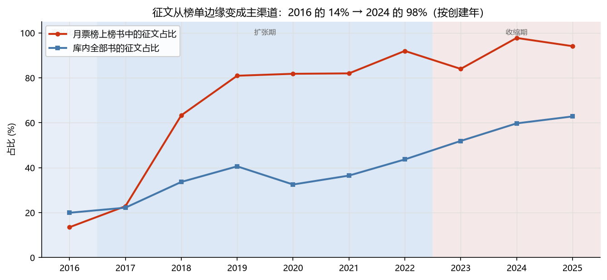
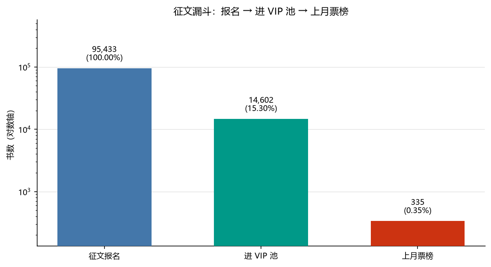
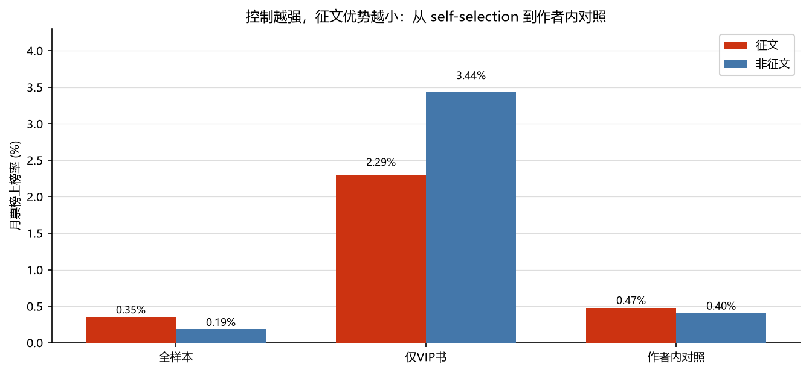
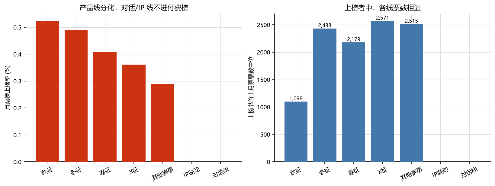
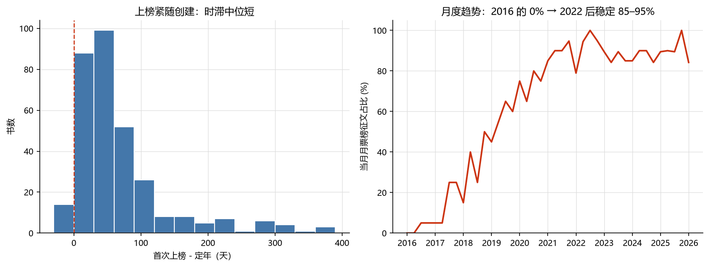

# 征文到商业化路径：人才漏斗，还是作者自选择？

> **口径声明**
> 1. 数据源：`out/novels.csv`（剔除日轻授权作者后 245,779 行，内容上界 2026-05-03，nid 定年）与 `out/monthly_ranks.jsonl`（月票榜，rank=0；2013-03 起，每月 top20 右截断）。
> 2. **`contest` 是报名时点标记**而非创建时间（报告 06 口径）：允许旧书参赛，本报告沿用全样本口径（未强行做主体簇截断），因此早期年份的征文样本含少量旧书；跨年比较以相对趋势为主。
> 3. **上榜 ≠ 商业化成功**，但月票是唯一带量级的公开付费信号（1 票≈0.5 元，见报告 07）；榜单右截断，只观测到头部 20 名，故「上榜率」是顶部渗透率，不代表整体收入。
> 4. **对话线/IP 联动不上月票/热销榜**：这可能反映产品形态差异与榜单机制边界，而非这些书「失败」——对话小说有独立榜单体系（rank=4 对话月票榜，见报告 07），本报告不将其解读为商业化 absence。
> 5. **全部差异为相关非因果**：参赛是作者自选择（有存量/准备的作者更倾向参赛），报告用「仅 VIP」「作者内对照」逐层剥离自选择，但无法完全消除。
> 6. 正文数字全部现算，不写快照。

## 结论

1. **征文作品从榜单边缘变成绝对主力**：按创建年看，月票榜上榜书里的征文占比从 2016 的 13.5% 升到 2024 的 97.8%；按月看，2016 年几乎为 0，2022 后稳定在 85–95%。库内征文占比同期仅从 20.0% 升到 59.7%——**上榜侧的增速远超供给侧**。
2. **但漏斗极窄**：95,433 本征文书里只有 335 本上过月票榜（0.35%），其中 15.3% 进过 VIP 池。绝大多数征文书止步于参赛本身。
3. **征文优势大半是作者自选择，不是参赛的因果效应**：全样本上榜率 征文 0.35% vs 非征文 0.19%（1.9 倍）；控制 VIP 后反转为 2.29% vs 3.44%（0.67 倍）；同一作者内对照缩到 0.47% vs 0.40%（1.18 倍）。**筛选的是人，不是比赛**。
4. **上榜票数差距是年代假象**：全样本看征文首上月票中位 2,355 vs 非征文 50（48 倍），但非征文上榜书近半数首次上榜在 2013–2014（付费体系未成型、票数极低），征文书则多在 2018 后。**按上榜年份逐一看，票数中位数几乎无差异**（同年代比值 0.96–1.48 倍，§4）——这与「参赛本身不带来额外商业化能力」的主线一致。
5. **产品线彻底分化**：X征/冬征/春征/秋征有 0.29%–0.52% 的上榜率，对话线与 IP 联动为 **0%**——它们不在该榜单体系内（口径 4）。
6. **上榜高度紧跟创建**：征文书首次上榜距定年中位 46 天，95.5% 在创建当年上榜——上榜驱动力主要是参赛期的集中曝光，不是长期养成。

## 1. 十年趋势：征文占领榜单

红线上榜占比、蓝线库内占比。2016-2017 征文书在月票榜上几乎缺席，2018 起陡升，2022 后稳定在 85% 以上；库内占比同期仅温和上升。**征文书在榜单中的过度代表是渐进形成的**，与报告 06 的参与规模扩张、平台运营节拍加密同步。

## 2. 漏斗：报名 → VIP → 上榜

95,433 本征文书 → 14,602 本 VIP（15.3%）→ 335 本上月票榜（0.35%）。从报名到 VIP 是第一道筛选，从 VIP 到榜单是第二道。报告 06 已证「报名≠完赛」（主体簇字数仅为 12 万门槛的 15%），这里进一步表明：完赛与上榜之间还有巨大落差。

## 3. 公平对照：优势属于人，还是属于比赛？

三层对照逐层收紧：

| 对照口径 | 征文上榜率 | 非征文上榜率 | 倍数 |
|---|---:|---:|---:|
| 全样本 | 0.35% | 0.19% | 1.88× |
| 仅 VIP 书 | 2.29% | 3.44% | 0.67× |
| 同作者内（既有征文也有非征文） | 0.47% | 0.40% | 1.18× |

全样本差距在控制 VIP 后**反转**（征文更低），因为征文把更多书送进了 VIP 池（15.3% vs 非征文 3.5% 总体 VIP 率）；作者内对照把差距压到 1.18 倍。**征文漏斗的核心价值在于组织化地把作者送进付费轨道，而非让同一作者在参赛后变得更能上榜**——后者才是"人才漏斗"的强因果含义，数据不支持。

## 4. 上榜票数：一个必须拆掉的年代陷阱

全样本看，征文上榜书首上月票中位 2,355、非征文仅 50，似是「征文占据头部」。但非征文上榜书的首次上榜年集中在 2013–2014（付费体系未成型、月票量级极低），征文书则几乎全在 2018 后——**这是年代差异，不是征文效应**。按上榜年份逐一看：

| 首次上榜年 | 征文票数中位（n） | 非征文票数中位（n） | 倍数 |
|---|---:|---:|---:|
| 2017 | 1,066 (8) | 923 (25) | 1.15× |
| 2018 | 2,022 (20) | 2,066 (15) | 0.98× |
| 2019 | 2,994 (20) | 3,002 (12) | 1.00× |
| 2020 | 3,394 (35) | 3,175 (9) | 1.07× |
| 2021 | 3,246 (42) | 3,390 (7) | 0.96× |
| 2022 | 2,869 (49) | 2,976 (6) | 0.96× |
| 2023 | 2,540 (47) | 1,716 (7) | 1.48× |
| 2024 | 1,846 (38) | 1,700 (5) | 1.09× |

同年代下票数比值为 0.96–1.48 倍，**差距基本消失**。全样本的「48 倍」不可读作征文更强，只反映两组的上榜年代不同。这再次印证：参赛没有带来额外的商业化高度。

## 5. 产品线分化

| 产品线 | 书数 | 月票榜上榜率 | 上榜书票数中位 | VIP 率 |
|---|---:|---:|---:|---:|
| X征 | 45,370 | 0.361% | 2,571 | 14.5% |
| 冬征 | 19,156 | 0.491% | 2,433 | 17.5% |
| 对话线 | 11,108 | 0.000% | — | 5.3% |
| 春征 | 8,786 | 0.410% | 2,179 | 20.7% |
| 其他赛事 | 5,170 | 0.290% | 2,515 | 18.6% |
| 秋征 | 4,964 | 0.524% | 1,098 | 25.6% |
| IP联动 | 879 | 0.000% | — | 2.5% |

X征、冬征、春征、秋征构成原创付费主线；对话线（11,108 本）与 IP 联动（879 本）在月票榜上为 0，但这**不是失败**：对话线有独立的对话月票榜（报告 07 观察到 2025-10 后该线收缩），IP 二创本就不进付费体系（报告 04）。不同产品线的"成功"不可放在同一把尺上比较。

## 6. 上榜时滞：曝光驱动，而非长期养成

首次上榜距 nid 定年的天数中位 46、75 分位 88 天，95.5% 在创建当年上榜。上榜高度集中于参赛期前后，符合「征文集中曝光 + 榜单月度清零」的机制；也说明上榜书多为**新书快速起量**，而不是多年积累的老书回榜。

## 7. 口径边界

1. **右截断**：月榜只有 top20，上榜率是顶部渗透率；第 21 名以下不可见，真实商业化书数被低估。
2. **全样本 vs 主体簇**：报告 06 为 cohort 完整性使用 nid 25-75 分位主体簇，本报告为覆盖全部上榜单目使用全样本；早期年份含少量旧书参赛，趋势解读为主。
3. **状态快照**：VIP/完结是 2026-05-03 快照，非上榜时状态（报告 07 §5）；早期「VIP 率」可能低估当时的付费状态。
4. **月票量级随年代剧变**：早年月票榜票数极低，任何跨年代的票数绝对比较都会被年代混杂主导（§4）；本报告凡涉及票数一律按上榜年份控制。
5. **对话线的 0% 是榜单机制边界**，不代表零商业化；跨产品线比较须谨慎。
6. **因果边界**：三层对照只能削弱、不能消除自选择；本报告不作「参赛导致上榜」的因果断言。

## 图表索引

- 图 1 征文占比：`figures/15_share.png`
- 图 2 漏斗：`figures/15_funnel.png`
- 图 3 公平对照：`figures/15_controls.png`
- 图 4 产品线：`figures/15_lines.png`
- 图 5 时滞：`figures/15_lag.png`
