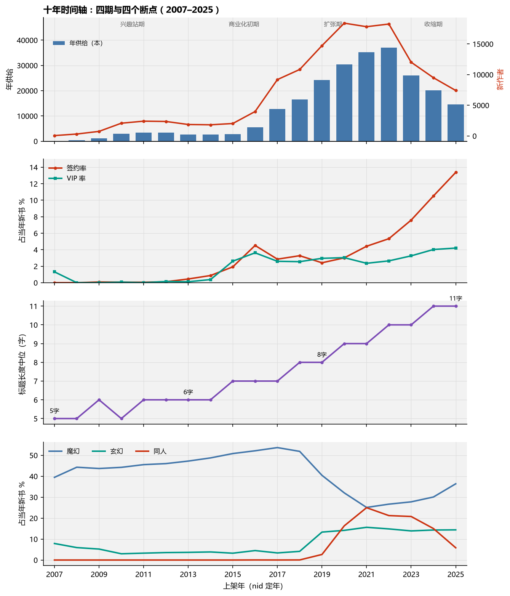
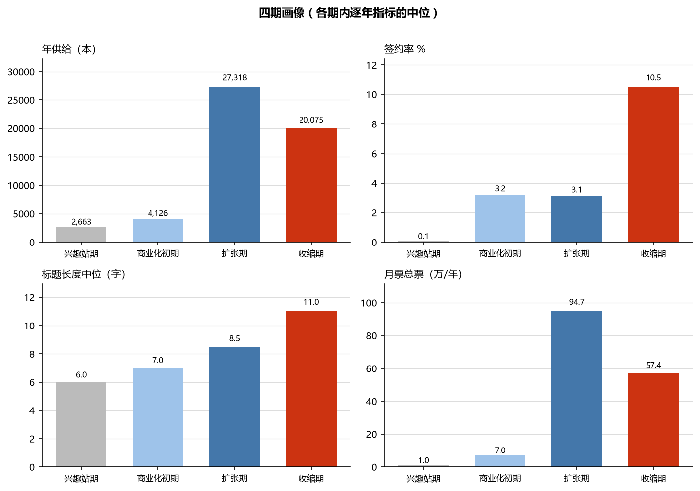
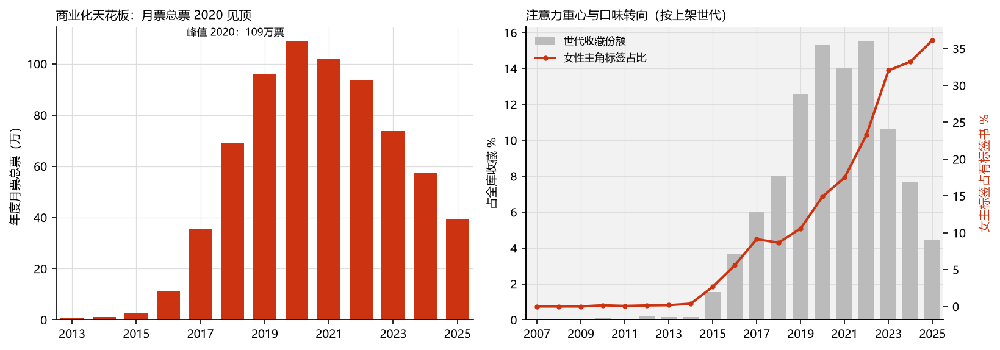
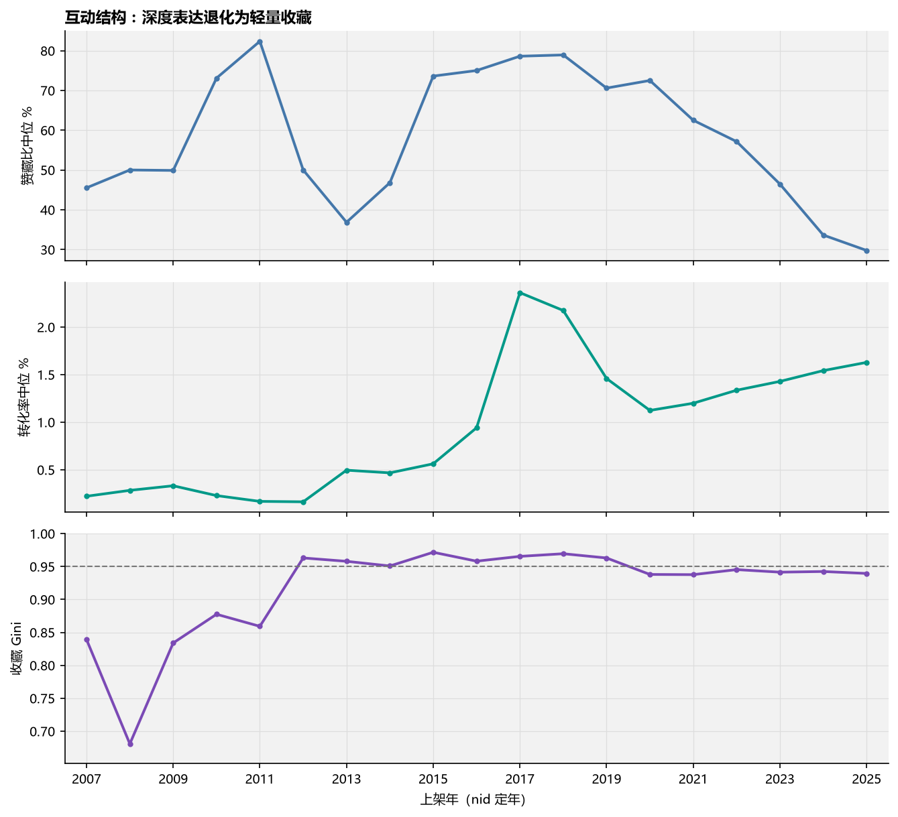

# 报告 16：十年结构变迁——一张时间轴上的十六份报告

> **口径声明**
> 1. 数据 `analysis/out/novels.csv`，剔除正版日轻 4 类作者后 245,779 行；
>    数据内容上界 2026-05-03（原始 jsonl 的 `max(last_update)`，即扫描起点，
>    不是统一读取时刻，见报告 10）。上架年由 nid 定年（104 锚点，LOO P99 = 50 天，报告 01），
>    年度序列止于 2025：内容上界之后创建的新书不在库内。
> 2. **本报告是二次综合**：主体序列（供给、签约、题材、标题长度、收藏份额、Gini、互动、
>    女性向标签、征文占库、月票总票）由本生成器现算；需要独立探测或判定才能得到的
>    派生指标（覆盖率 68.9%、banner 下注/奖励二元、征文上榜对照）标注来源报告，
>    不在本报告重新判定。所有跨报告的"因果"结论均保持各专题的相关/因果边界。
> 3. **累计指标跨时点不可比**：`favs`/`clicks` 随书龄与曝光分母累积（报告 02、08）；
>    世代份额只在"同一存量结构内"读，不作跨世代水平比较。
> 4. **快照状态 ≠ 当期状态**：`status`/`price_type` 是 2026 上界态，跨时点统计生命或
>    商业化状态须按 `updated_at` 重建（报告 07 `attach_done_now()`）。
> 5. **标签字段有代际与词表断层**：标签体系约 2014 上线，跨世代比较仅 2017 后可靠；
>    2022 年 23 个 IP/亚文化标签被清理；`20XX萌神` 7 个为运营荣誉，已剔除（报告 04、09）。
> 6. **数据集是抽样**：对在架书覆盖率约 68.9%（报告 10），抓取为一次从新到旧的单向游标扫描，
>    遗漏偏向"短、新、更新中"而非冷门；凡绝对计数是下界，排序与相对比较稳健。
> 7. 榜单为月度 top20 右截断、每月清零，月票总票是 top20 之和而非全站票量（报告 07）。
> 8. 所有差异为结构描述，不作因果推断；"运营—题材—注意力"的先后不能替代机制证据。

---

## 0. 结论：贯穿十年的六条主线

1. **供给是单峰，且"人"比"书"先见顶**。年供给 2017 年跳至 2.3 倍进入扩张期，
   2022 年达峰 37,088 本，2025 年降至 14,552 本（−61%）；
   但新作者数在 2020 年就已见顶（18,388 人），比供给峰早两年。
   收缩的主体是作者基数流失（−60%），不是人均写得更少（报告 01、03）。

2. **商业化是"门槛加深 + 天花板见顶"的剪刀差**。签约率从扩张期的中位
   3.1% 升到收缩期的
   10.5%，而月票总票在 2020 年见顶
   109 万票后，2025 年只剩 39 万（−64%；
   2026 年前 11 月年化 27 万）。VIP 份额二十年恒定在 3% 上下：
   平台在变少的新书里签了更高比例，却没有更大的付费盘子（报告 01、07）。

3. **注意力集中是结构常数，但重心在迁移**。全书收藏 Gini 约 0.95，
   各世代稳定在 0.68–0.97，不随平台规模、题材结构、商业化程度变化；
   45% 的收藏落在 2020–2022 三个世代（现算，与报告 02 的 45% 一致）。
   集中是平台的稳态，
   变化的是注意力"落在谁身上"——不是"是否集中"。

4. **口味转向是运营与自选择的合力，不是读者口味的自然演化**。
   魔幻份额从兴趣站期中位 45% 降到
   扩张期 36%，同人 2019 年上线、
   2021 年占 25% 后回落；女性主角标签占有标签书从
   2017 年 9.1% 升到 2025 年 36.1%。
   但标签是受控词表、2022 年经历清理（报告 04、09），这些"转向"里有相当一部分是
   编辑动作与词表规则，而非纯粹的需求侧变化。

5. **平台识别的是作者能力，不是单本爆款**。banner 授予对代表作收藏分位 <90% 的作者
   精确为 0（报告 17）；征文的上榜优势在控制 VIP 后反转、作者内对照只剩 1.18 倍（报告 15）；
   跟风书的高热度是"愿蹭者本身更认真"的选择效应（报告 12、13）。
   三类看似因果的优势，逐层对照后都收敛到"筛选的是人"。

6. **这份图景有一面有盲区的镜子**。数据集对在架书覆盖约 68.9%（报告 10），
   抓取遗漏偏向短、新、更新中的书；快照状态不等于当期状态；发生在内容上界之后的新书
   完全不在库内。因此所有绝对计数是下界、所有跨时点水平比较都要先问口径——
   这正是前十五份报告反复在做的同一件事：**先拆混杂，再谈差异**。

---

## 1. 统一时间轴：四期与四个断点

四期划分沿用系列报告的既有分期（兴趣站期 / 商业化初期 / 扩张期 / 收缩期），
不是外生给定的行业分期，而是从供给曲线的拐点读出的结构段。四个关键断点：

| 断点 | 年 | 在数据里的表现 | 对应专题 |
|---|---:|---|---|
| 商业化启动 | 2015 | 签约率 1.9%→4.5%，APP 上线（外部事实） | 01、07 |
| 供给跃迁 | 2017 | 年供给 5,493→12,759（2.3×） | 01、03 |
| 同人上线 / 注意力峰 | 2019–2022 | 同人 2019 年 2.7% 起量；收藏峰值世代 | 04、09、02 |
| 供给收缩 | 2023 | 供给连续三年回落，签约率反升，赞藏比下行 | 01、05、08 |

四期画像（各期内逐年指标的中位）:

| 分期 | 年供给 | 签约% | VIP% | 标题字数 | 魔幻% | 同人% | 征文% |
|---:|---:|---:|---:|---:|---:|---:|---:|
| 2007–2014 | 2,663 | 0.1 | 0.1 | 6 | 44.9 | 0.0 | 0.0 |
| 2015–2016 | 4,126 | 3.2 | 3.1 | 7 | 51.5 | 0.0 | 10.0 |
| 2017–2022 | 27,318 | 3.1 | 2.6 | 8 | 36.2 | 9.5 | 35.1 |
| 2023–2025 | 20,075 | 10.5 | 4.0 | 11 | 30.1 | 15.0 | 59.7 |

> 分期中位是对"期内典型状态"的概括，会抹平期内的峰值（如 2022 供给峰），
> 断点处请回到时间轴原图读数。月票面板因榜单 2013 年才启动，兴趣站期只有
> 2013–2014 两年有值，不能读作该期整体付费水平。

---

## 2. 供给侧：单峰、作者先见顶、收缩是"人"在走

供给曲线是教科书式单峰：扩张期六年贡献全库 65%，
2022 年 37,088 本见顶后三年回落 61%。
但把"书"换成"人"，转折提前两年——新作者数 2020 年达峰
18,388 人，2025 年剩 7,409 人（−60%），
而同期人均新书只降约 11%（报告 03）。**总量下滑主要来自新作者流入减少，
不是留下的人写得更多或更少。**

这一层区分决定了"平台是否在变冷"的答案：如果看累计在册， Library 仍在膨胀；
如果看新增供给与新增作者，扩张期结束得很明确。二者不矛盾，是存量与流量的差别。
需要记住的偏置：抓取遗漏偏向短、新书（报告 10），因此近年新增与速更短篇的
绝对数是下界，收缩幅度可能被高估。

---

## 3. 题材与内容形态：三足、女性向、标题通胀

题材结构经历两次位移。第一次是魔幻（日式奇幻）份额的长期退潮：
兴趣站期中位 45% →
扩张期 36%；
第二次是玄幻与同人的补位——玄幻从兴趣站期
3.8% 升至
13.8%，同人 2019 年作为一个独立分类上线，
2021 年占 25.0%。同人是平台为二创单开的免费货架：
2008–2021 世代同人 VIP 率 0.0%、中位字数仅 6,637、完结率却最高（报告 04）。
它不是题材，而是"挂载 IP 的命名空间"（报告 09）。

口味侧最稳定的单一变化是女性向标签扩张：女性主角从 2017 年
9.1% 到 2025 年 36.1%（占有标签书分母），
变身、橘味在 2023 后同步爆发（2025 年分别 17.8%、
13.5%）。但必须叠加一条警告：2022 年有 23 个 IP/亚文化标签被清理，
词表本身换过血。"某标签占比上升"必须同时回答是题材在变还是词表在变。

内容形态上，标题长度中位从 2007 年 5 字升到 2025 年 11 字，
变长几乎全靠"堆词"而非单词变长（报告 14）；高频词从"世界/少女/魔法"的意象型，
转向"穿越/崩坏/变成"的叙事机制型，再到"小姐/魔女/反派"的角色身份型。
但"成功配方"高度题材特定，且报告 14 用条件分位证明：堆词与高收藏相关，
却无法证明堆的是"成功词"。

---

## 4. 商业化与付费刻度：门槛加深，天花板见顶

商业化的两条刻度在报告 07 里被拆开：热销榜量当期订阅额（点券消耗），
月票榜量充值返还票的再分配（1 票≈0.5 元，可投免费书）。
可量级的月票总票 2020 年见顶 109 万，2025 年
39 万（−64%），末位票数比榜首保留得更少——
收缩以长尾付费者流失为主。

与付费盘子收缩同时发生的是商业化门槛加深：签约率在收缩期升到
10.5%（扩张期
3.1%），但 VIP 份额二十年恒定约 3%。
征文把更多书送进 VIP 池（15.3%），也把自己在月票榜的占比从 2016 年 13.5%
推到 2024 年 97.8%（报告 15）——**平台在更少的供给里，更组织化地筛选和运营付费作者**，
而不是把付费蛋糕做大。

需要区分"上榜"与"商业化成功"：四榜并集仅占在册 0.73%（报告 07），
征文漏斗从 95,433 本报名到 335 本上榜（0.35%，报告 15）。
榜单是顶部结构，不是整体收入的刻度。

---

## 5. 注意力与互动：恒定的集中，迁移的重心，退化的表达

注意力集中是这十年最顽固的结构常数：全书收藏 Gini 0.95，
top 1% 的书占 58.1% 收藏（报告 02）；按世代看 Gini 稳定在 0.94–0.97，
不随规模、题材、商业化变化。45% 的收藏落在 2020–2022 世代——
若收藏只随书龄累积应向早期倾斜，事实相反，说明注意力跟随平台周期移动。

互动的三个计数器不是嵌套漏斗（报告 08），只用两个比值读：
转化率（favs/clicks）与赞藏比（praises/favs）。按上架年现算，
赞藏比从 2017 年峰 79% 降到 2025 年 30%，
而转化率同期从 2.36% 变为 1.63%——**收藏还在，点赞撤了**。
但这一断崖不能区分是读者行为变化还是点赞计数口径变化；且在固定曝光档后，
题材之间的差异只有 1.5 倍，远小于曝光的 3.6 倍分母效应。
**互动效率的方差主要来自"谁点开了你"，不是"你写了什么"。**

运营位是分母效应的极端案例：620 本 featured 书点击中位 749.8 万（其余书目的
18,377 倍），转化率却只有其余书的 0.38 倍（报告 08）。流量买得到，效率买不到。

---

## 6. 运营如何塑造供给：征文、banner 与数据盲区

征文是平台的核心节拍：官方核实日期显示秋征 9-30、冬征 12 月上旬、
春征 3 月初、X 征 5 月 4 日首尾相接，上一届截止到下一届启动只差 0–1 天（报告 06）。
征文占库比重从 2016 年 20.0% 升到 2025 年 62.8%，
但它筛选的是"有准备、有体量、倾向商业化"的作者——字数中位 15,558 vs 8,477、
VIP 率 6.1% vs 1.2%（报告 06），且上榜优势大半来自作者自选择（报告 15）。
报名到完赛之间还有巨大落差：X 征长篇主体簇字数中位仅为 12 万门槛的 14.9%。

banner 是平台真金白银的下注（约 1,000 元/张、画师原创，用户口述）。
报告 17 的判定给出二元机制：约 35.5% 是"下注型"（作者的 banner 书之前已有
高收藏代表作，平台押的是作者能力），64.5% 是"奖励型"（本书爆火才得奖）。
但授予有硬门槛——代表作收藏分位 <90% 的 122,383 位作者获 banner 率为精确 0。
**平台识别作者，而非抽奖选中单本。**

最后是不能忘记的盲区：数据集对在架书覆盖约 68.9%，缺失槽位中约 21.1% 是
活书遗漏（≈11.1 万本），其余是已删除 ∪ 未分配的死槽（不可分解）；
抓取是一次单向游标扫描，更新中的书被重排到游标身后不再回头抓（报告 10）。
这解释了为什么遗漏偏"短、新、更新中"——也提醒本报告所有绝对计数都是下界。

---

## 7. 方法论收束：六个被对照剥离的"因果"

汇总十六份报告，最一致的收获不是某个数字，而是一套方法：**先问对照，再谈差异**。

| 看似因果的说法 | 初读 | 逐层控制后 | 专题 |
|---|---|---|---|
| "征文作者更能上榜" | 1.88× | 控制 VIP 反转 0.67×；作者内 1.18× | 15 |
| "征文上榜票数高 48 倍" | 2,355 vs 50 | 按上榜年份逐一看 0.96–1.48×，年代假象 | 15 |
| "完结书霸占热销榜" | 快照态 60–78% | 当期重建 ≤0.4%，状态滞后假象 | 07 |
| "上榜书被下架" | 月榜缺失 118 本 | 90.7% 仍在线，真下架 11 本 | 10 |
| "banner 命中率 99.8%" | 收藏分位 | 机械结果，授予本就按热度 | 17 |
| "蹭爆款名字有效" | 跟风书收藏 5.7× | 愿蹭者本身更认真的选择效应 | 12、13 |

六个例子指向同一件事：累计指标跨时点不可比、快照状态不等于当期、
自选择与曝光分母是第一解释变量。这也是为什么本报告坚持"结构描述、相关非因果"——
不是谨慎辞令，而是十六份报告反复被数据教育出来的结果。

---

## 8. 数据边界：这份图景看不到什么

1. **总量边界**：内容上界之后的书完全不在库；对在架书覆盖约 68.9%，绝对计数是下界。
2. **时间边界**：`updated_at` 只能当"时长"（断更），不能当时间轴；年份来自 nid 定年，
   low 段（2007–2015）有月级误差，6,913 本完结书因此无法分时长档。
3. **状态边界**：`status`/`price_type` 是上界态；断更已并入"连载中"，
   状态字段不含活跃度，活跃度只能用断更时长重切。
4. **题材边界**：标签字段有上线时间、有 2022 词表断层、有运营荣誉标签，
   跨代比较只在 2017 后、且剔除荣誉标签后成立。
5. **机制边界**：无营收、付费人数、订阅量、章节与用户事件数据；
   月票是唯一带量级的公开付费刻度，且含运营加成。
6. **因果边界**：观察性快照，运营位、榜单、题材、热度互为因果；
   本报告全部结论为结构描述。

---

## 9. 报告索引

| # | 报告 | 一句话 |
|---|---|---|
| 01 | 市场结构 | 定年体系、单峰供给、商业化门槛加深 |
| 02 | 注意力集中度 | Gini 0.95 是结构常数，重心随周期迁移 |
| 03 | 作者生态 | 新作者 2020 先见顶，收缩是基数流失 |
| 04 | 题材与标签 | 三足结构、女性向标签扩张、词表受控 |
| 05 | 生命周期与存量 | 完结二元结构、92.8% 断更书持有 80.7% 收藏 |
| 06 | 征文 | 日历首尾相接、报名≠完赛 |
| 07 | 商业化 | 月票与热销两条刻度、付费 2020 见顶 |
| 08 | 互动漏斗 | 曝光分母效应、赞藏比断崖 |
| 09 | 题材语义空间 | 99 词受控词表、同人=IP 命名空间 |
| 10 | 生存与遗漏 | 覆盖率 68.9%、游标扫描、下架推断被推翻 |
| 11 | 速更短篇 | 独立品类、新手高频试水、非弃坑 |
| 12 | 标题形态与命名史 | 标题通胀、跟风证据三级 |
| 13 | 跟风传播 | 头部少造词、爆款潮是赛道共振 |
| 14 | 标题成功配方 | 条件分位剥离题材、配方题材特定 |
| 15 | 征文到商业化 | 优势属于人不属于比赛 |
| 16 | 十年结构变迁（本篇） | 一张时间轴、六条主线、对照先于因果 |
| 17 | banner 投入 | 作者筛选、下注/奖励二元 |

---

*生成：`analysis/report_timeline.py`；正文数字现算，少数派生指标标注来源报告。*
