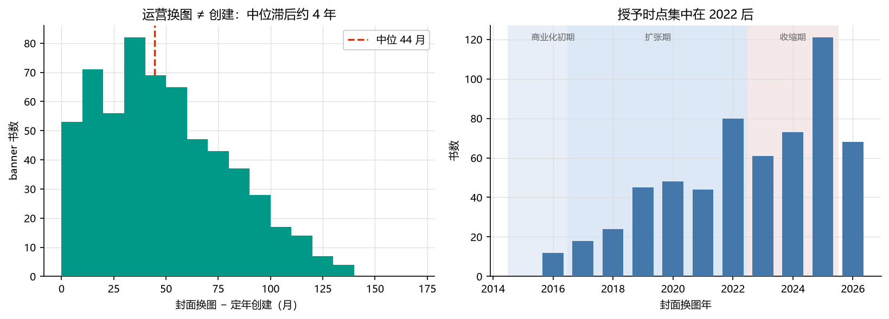
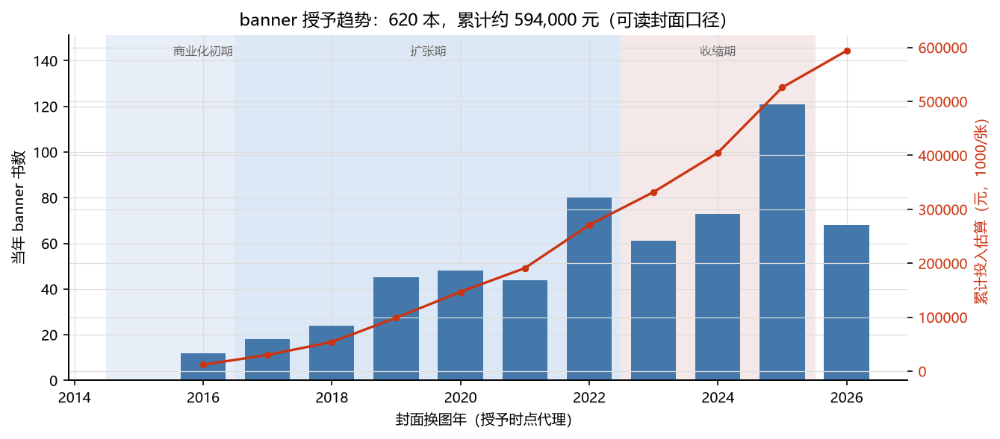
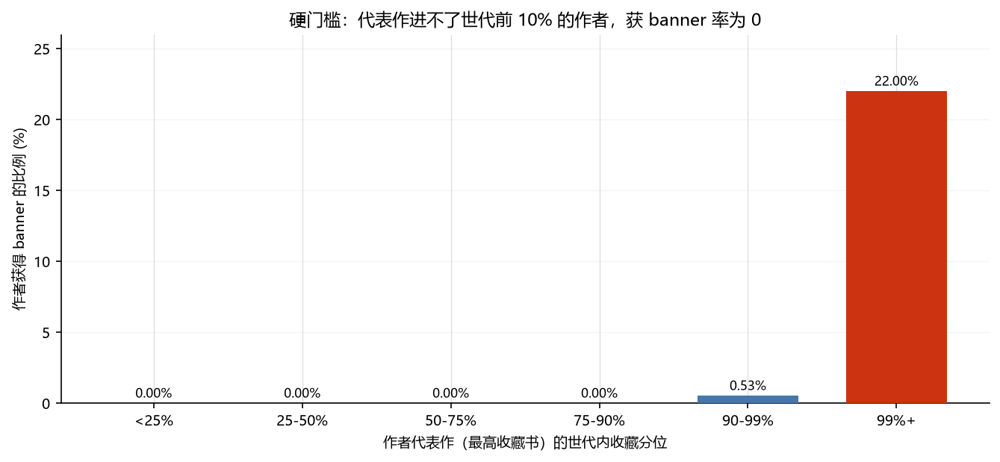
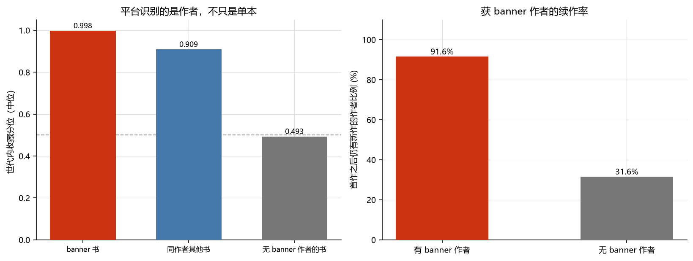
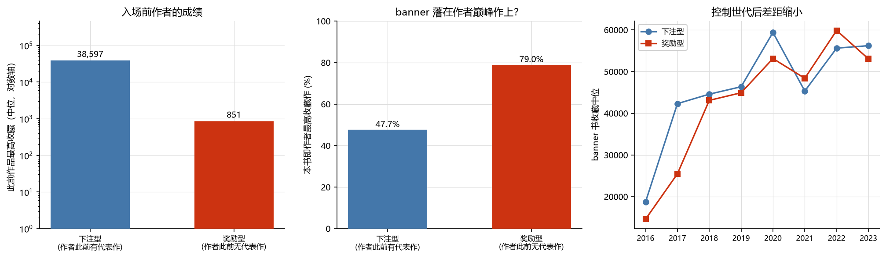
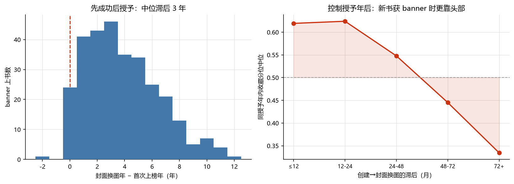
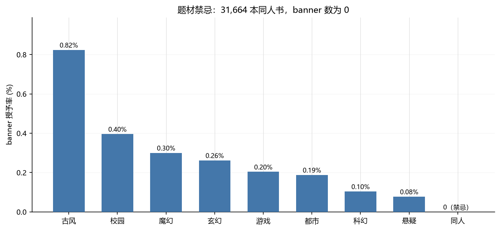

# 报告 17：banner 投入与平台押注

> **口径声明**
> 1. 数据上界：内容 `max(last_update)=2026-05-03`，nid 上界 774,850（现算）。
>    年度序列止于 2025 即因内容上界之后的新书不在库内。
> 2. **banner 字段**：原始 jsonl 的 `banner` 布尔位，CSV 中映射为 `featured`（620 本，
>    已剔除日轻 4 类作者）。banner 画师原创、约
>    1,000 RMB/张（用户口述），是平台真金白银的投入，非免费运营装饰。
> 3. **封面时间戳 ≠ 授予时点**：原始数据集的 cover 选择器写错，导致多本书挂同一封面；
>    数据清洗将共用组内非属主的封面判为错误、置为空值，因此 CSV 中 banner 书封面
>    大面积缺失（620 本中仅 71 本非空）。
>    本报告改从原始 jsonl 恢复 594 个带年月封面。该年月是平台换运营封面的时间
>    （MEMORY §9：相对定年偏差中位 +338 天），**只是授予时点的弱代理**：
>    换图可能滞后于授予、也可能多次换图。凡涉及时序一律标注为「封面换图年」。
> 4. **收藏分位是机械结果**：banner 本就按热度授予，书均处世代顶部，
>    因此「banner 书收藏分位 0.998」不构成命中率证据；
>    命中率须看授予后作者/作品的持续表现（§3–§4）。
> 5. 累计指标跨时点不可比；月榜 top20 右截断、每月清零，只作结构描述。
> 6. 本报告**不改动任何数据行**；结论以口径修正与机制识别形式作用于前序报告。

## 结论

1. **banner 是「作者筛选」而非「单书抽奖」**：440 位获 banner 作者中
   112 位有 ≥2 本 banner（最多 合雪丶 10 本），
   但关键在门槛——**代表作收藏分位 <90% 的 122,383 位作者，获 banner 率为
   0.0%（精确为 0）**；99%+ 档为 22.0%。用户口述的
   「优质代表作作者更容易获 banner」得到硬门槛级验证。
2. **平台识别的是作者能力，不只是单本爆款**：banner 书收藏分位中位
   0.998，同作者的其他书仍有 0.909（无 banner 作者
   0.493）；获 banner 作者首作后仍有新作的占 91.6%，
   无 banner 作者仅 31.6%。
3. **banner 是「下注」与「奖励」二元机制**（作者内代表作判定）：
   **下注型 220 本（35.5%）**——作者获 banner 前已有
   高收藏代表作（此前最高收藏中位 38,597），平台押的是作者能力，
   本书仅 47.7% 是作者巅峰作；**奖励型 400 本（64.5%）**
   ——作者此前几乎无成绩（此前最高收藏中位 851），本书爆火才得奖，
   79.0% 直接成为作者巅峰。这解释了为何部分 banner 书绝对数字不高：
   下注型押的是作者而非这本书。
4. **时序上以追认居多、但非全部**：309 本上过月票榜的 banner 书中，
   275 本首次上榜早于封面换图年、24 本同年、
   1 本换图早于上榜；中位滞后 3 年。
   封面换图晚于上榜不等于授予晚于爆火（换图可滞后多年），故不作「全部追认」断言。
5. **硬门槛 + 题材禁忌**：同人 31,664 本、banner 0 本（0）；
   魔幻/校园/玄幻占 banner 绝对数主体（古风授予率最高）。
   悬疑 4 本
   （授予率 0.08%），近乎不获 banner。
6. **授予时点集中在 2022 后**：可读封面的 594 张中，
   403 张（68%）在 2022 年后，
   按 1,000 RMB/张估算累计约 594,000 元（全 620 本口径约 620,000 元）。
7. **集中度温和**：top10 作者占 banner 9.0%，Gini 0.238——
   平台没有把资源锁死在少数头部作者手里。

## 1. 授予规模与趋势

620 本 banner 书（占库 0.25%），440 位作者。
定年创建集中在 2015–2019，但**封面换图集中在 2022 年后**——两者相差
中位 44 个月，说明平台多在作品运行数年后才授予 banner。

| 封面换图年 | banner 书数 | 估算投入（元） |
|---|---|---|
| 2016 | 12 | 12,000 |
| 2017 | 18 | 18,000 |
| 2018 | 24 | 24,000 |
| 2019 | 45 | 45,000 |
| 2020 | 48 | 48,000 |
| 2021 | 44 | 44,000 |
| 2022 | 80 | 80,000 |
| 2023 | 61 | 61,000 |
| 2024 | 73 | 73,000 |
| 2025 | 121 | 121,000 |
| 2026 | 68 | 68,000 |

> 投入为 1,000 RMB/张 × 可读封面数的**粗略估算**，非平台披露数字。

## 2. 硬门槛：代表作决定入场资格

把作者按「最高收藏书」的世代内收藏分位分档，获 banner 率呈悬崖式跃迁：

| 代表作分位档 | 作者数 | 获 banner 率 |
|---|---|---|
| <25% / 25-50% / 50-75% / 75-90% | 122,383 | 0.0% |
| 90-99% | 13,795 | 0.53% |
| 99%+ | 1,668 | 22.0% |

**代表作进不了世代前 10% 的作者，没有一个拿到 banner。** 控制作品数后门槛依旧：
1 本作品的作者中，代表作≥90% 分位者获 banner 0.8%、其余 0.0%；
10 本以上者分别为 8.0% / 0.0%。**优质代表作是必要条件，多产是加成**——
这正是用户口述的机制。

## 3. 平台识别的是作者，不只是单本

banner 书在作者内收藏排名=1 的占 67.9%、前 3 的占 93.5%，
40.0% 是作者首部作品——banner 往往落在作者的**代表作**上。
更关键的是同作者的其他书：收藏分位中位 0.909，远高于无 banner 作者的
0.493。作者层面，获 banner 后仍有新作的占 91.6%，
无 banner 作者 31.6%——banner 作者是持续在场的高产群体。

## 4. 下注型 vs 奖励型：banner 的二元机制

上节证明平台按作者能力筛选，但**获 banner 的原因并不单一**。按 banner 书创建时
（nid 时间序）作者此前是否已有高收藏代表作（门槛 10,000 收藏），可切成两类：

| | 下注型 | 奖励型 |
|---|---|---|
| 判定 | 作者此前已有代表作 | 作者此前无代表作 |
| 本数 | 220（35.5%） | 400（64.5%） |
| 此前作品最高收藏（中位） | 38,597 | 851 |
| 本书收藏中位 | 47,044 | 29,589 |
| 本书是作者巅峰作 | 47.7% | 79.0% |
| 上月票榜比例 | 62.7% | 42.8% |

**下注型**：作者在拿到 banner 前已证明过自己（此前代表作中位 38,597 收藏），
平台押的是**作者能力**，而非这本书——本书仅 47.7% 是作者收藏最高的作品，
超过一半的 banner 落在作者的非巅峰作上。**奖励型**：作者此前几乎无成绩
（此前最高收藏中位仅 851），是这本书爆火后才获得 banner，
79.0% 直接成为作者巅峰。

这解释了「**有 banner 但点击/收藏数字不高**」的现象：下注型把 banner 押在作者身上，
书本身未必是流量顶点。库内作品 ≥5 本的作者中下注型占 46.6%，
高于全体的 35.5%（单本作者按定义只能是奖励型，
占 0.0%）——**作者履历越厚，banner 越可能是下注而非对单本的奖励**。

需要诚实标注一处反直觉：控制世代后，下注型的最终收藏中位并不低
（右 panel 两线接近，2018–2019 基本重合），且整体上下注型反而略高
（47,044 vs 29,589）——因为下注型作者本就持续产出高收藏书。
**两类真正的分野是「本书相对作者在作者内的位置」，不是绝对数字**：
下注型 47.7% vs 奖励型 79.0% 是作者巅峰，差距 31.3 个百分点。

## 5. 时序证据：以追认居多，但非全部

309 本 banner 书曾上月票榜，其中 275 本首次上榜早于封面换图年、
24 本同年、1 本换图早于上榜，中位滞后 3 年。
从封面换图看，多数 banner 出现在作品上榜之后——但这**不能直接读作「先成功后授予」**：
封面可在 banner 授予后数年才更换（§4 的下注型尤其如此），换图晚不等于授予晚。

但控制授予年后出现一个细结构：换图滞后越短的书，在同授予年内的收藏分位越高
（≤12 月档 0.619 vs 72+ 月档 0.334，
相关 -0.293）。这指向**授予标准随作品年龄分化**：新书要在同年里更靠头部
才拿到 banner，老书则可能在成功多年后才获表彰。结合 §4 的二元机制，
时序差异更多反映「奖励老书 vs 下注新作」的混合，而非单一的追认或下注。

## 6. 题材禁忌与集中度

同人 31,664 本（库内最大题材之一）banner 数为 0——**零**。
这与其 IP 命名空间属性（报告 09）一致：平台不对同人投放原创画师 banner。
注意**绝对数与授予率是两回事**：魔幻 257 本、
校园 125 本因盘子大而占 banner 绝对数主体，
但按授予率古风最高（0.82%）、
魔幻仅 0.30%。

112 位作者获多本 banner，最多 合雪丶 10 本；
top10 作者占 9.0%，Gini 0.238——资源分散在数百位作者间，
不是少数人的终身成就奖。

## 7. 口径边界

1. **封面时间戳的弱代理性**：换图年可能晚于授予年（运营维护、多次换封面），
   §1/§5 的时序统计（275/309 先上榜后换图）只说明
   「换图多在上榜后」，不能推断授予时点；「中位滞后 3 年」是**上界**。
2. **右删失**：2024–2026 创建的书还在积累，其收藏分位被低估；
   「新书获 banner 时更靠头部」的结论已控制授予年，但绝对幅度须保留。
3. **封面缺失的根因**：原始数据集 cover 选择器写错导致多书共用封面，清洗时
   非属主的封面被置空——这是数据源缺陷，非平台无封面。本报告从 jsonl 恢复，
   594/620 本可读；26 本占位符无法恢复，相关统计以其余为样本。
4. **二元判定依赖单一快照**：下注/奖励按「banner 书创建时作者此前最高收藏
   ≥10,000」判定，是**作者履历的代理**，非平台内部标签。作者早期作品若在
   抓取窗口外或已下架（报告 10 覆盖率约 68.9%），会把下注型误判为奖励型；
   两类边界是连续的，851 vs 38,597 的门槛差带人为性。
5. **命中率不可直接读**：banner 书收藏分位 0.998、题材内
   0.997 均为机械结果（授予标准本身即热度）。本报告用
   「授予后作者续作率」「同作者其他书水平」「本书是否作者巅峰」替代，
   但这些仍是相关，不能证明 banner **导致**作者成功（反向因果：成功在先）。
6. **同人 0 banner 不等于零商业化**：同人有独立 IP 生态，
   此处只说明平台不为其投放原创 banner。
7. **投入为估算**：1,000 RMB/张系用户口述，非平台披露；且 26 本封面为占位符
   无法确定换图年，累计投入是下界估计。
8. **样本遗漏**：报告 10 证实数据集对在架书覆盖率约 68.9%，banner 书均为头部、
   遗漏率低，但绝对计数仍应视为下界。
