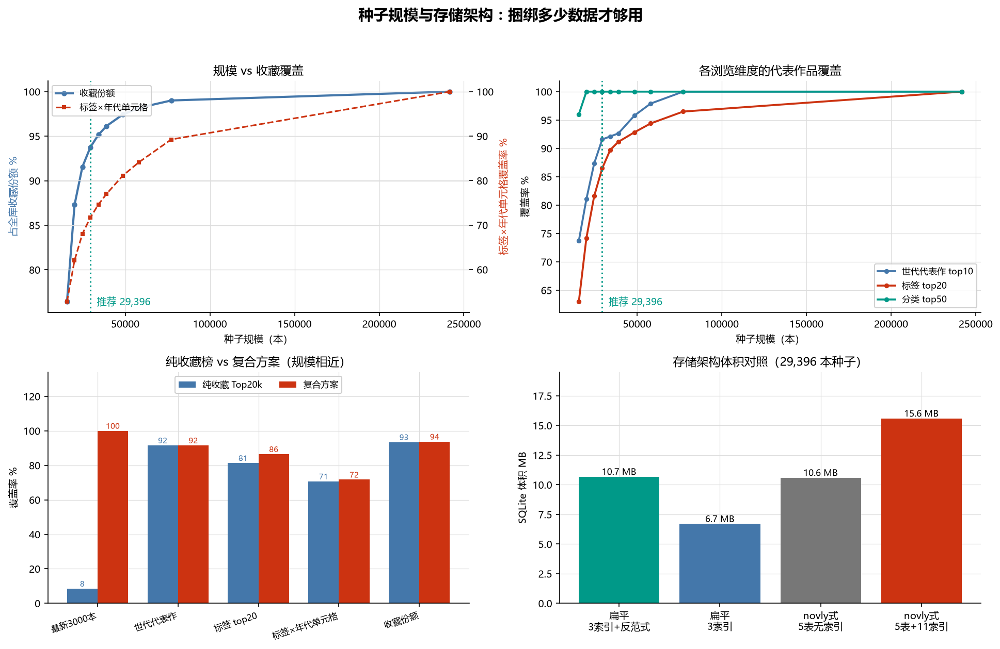

# 报告 18：种子规模决策——捆绑多少数据才让用户"感觉够用"

## 0. 结论

**推荐种子规模：29,396 本**（推荐方案 S3：收藏榜 Top20,000 ∪ 近 1 年上架 ∪ 近 90 天仍更新 ∪ 月榜归档 ∪ banner 全集）。

体积代价：**SQLite 10.7 MB，gzip 后 4.2 MB**（扁平单表 + 3 索引 + 一张反范式标签表）。
每本约 381 字节。

三条支撑结论：

1. **"搜特定书"根本不是种子的问题。** 本地未命中时官方搜索 API 兜底会自动收录，
   端到端可达率在任何规模下都是 100%。种子的真实价值在**探索发现**——
   用户不知道书名、只知道"想看魔幻 2018 年的好文"时，能逛到什么。
2. **纯收藏榜会系统性漏掉当下正在更新的书。** 规模相近（20,048 vs 29,396）时，
   纯收藏榜对最新 3000 本的覆盖仅 8.5%，复合方案 100.0%；
   标签×年代单元格覆盖 70.7% vs 71.7%。
   原因很直白：收藏是累计量，新书天然收藏少。
3. **膨胀源是索引，不是表数量。** novly 式 5 表 + 11 索引在同规模下 15.6 MB，
   去掉索引后仅 10.6 MB——**索引占 32%**。
   同为 novly 式，去索引只省 178 字节/本；真正的对照是
   novly 式全库 109 MB vs 扁平单表全库 78 MB，
   差 29%——**多表本身只占小头**。
4. **本方案是"通用底座"，短篇品类需专项补入**：本方案只按收藏/新鲜度/榜单选种，
   对**短篇**系统性失效——短篇书收藏天花板极低，永远进不了收藏 Top20,000。
   报告 19 实测：当前种子只覆盖短篇的 5.4%、只覆盖短篇口碑层（favs≥200）的 44.9%，
   补入短篇双组分位 Top2,000（+1,398 本 / +0.51 MB）后口碑层覆盖升至 65.2%。
   **种子 v2 = 本方案 + 短篇补入**，详见报告 19 §6。

---

## 1. 口径声明

1. **数据源**：analysis/out/novels.csv，241,758 行（已剔除正版日轻）。
   内容上界 **2026-05-03**（原始 jsonl 的 `max(last_update)`，即游标扫描起点，非统一读取时刻）。
2. **定年**：`eras.estimate()`，log(nid) 分段线性，104 锚点，LOO P99 = 50 天。
   本报告只用 `est_year` 做分层，**不用 `updated_at` 做时间轴**。
3. **分位在全库算**（报告 03 已定）：种子的分位值继承自全库分组排名，不在候选池内重算。
4. **收藏（`favs`）是偏好强度，不含书龄**：`favs` 是存量，与 `clicks` 受曝光分母混杂不同（报告 02、08）。
   本报告用收藏份额衡量"种子承载了多少用户偏好"，**不作为成绩排名依据**。
5. **月榜归档**：1,802 个去重 nid（1,555 个在库内），
   来自 165 个月 × 4 个 rank。热销榜 `ticketNum` 恒 0，只能作名次结构描述（报告 07）。
6. **体积为实测**：用 Python `sqlite3` 真实建库、真实 gzip 后测得，非估算。
7. **性能为实测**：全库 241,758 行库上跑 20 次取中位数。

---

## 2. "够用"的可测量化

「用户感觉数据够用」不是主观感受，可以拆成四个可测判据：

| 判据 | 度量方式 | 决定性吗 |
| --- | --- | --- |
| **搜得到** | 用户输入标题/作者前缀，目标书是否在本地可搜到 | 否——官方 API 兜底后可达率恒 100% |
| **逛得到** | 各浏览维度（世代/分类/标签/标签×年代）的代表作品是否在种子里 | **是**——这是种子唯一不可替代的价值 |
| **跟得上** | 最近上架的书有多少在种子里 | **是**——决定 App 是否显得"活" |
| **装得下** | 体积占包体多少 | 是——硬约束 |

关键认知：**搜特定书不需要种子**。本地未命中 → 官方搜索 → 自动收录 → 二次可搜到，
这条闭环（技术栈文档 §4.5）让可达率与种子规模无关。
所以种子规模的判据只剩后两条：**探索覆盖**与**新鲜度覆盖**。

### 2.1 目标书的收藏分位决定搜索体验

按全库收藏分位分五档，抽样的标题前缀命中率：

| 目标书分位 | 种子 5,528 本 | 种子 10,334 本 | 种子 20,184 本 | 种子 40,095 本 |
| --- | --- | --- | --- | --- |
| top 0.1% | 100% | 100% | 100% | 100% |
| top 1% | 100% | 100% | 100% | 100% |
| top 5% | 46% | 84% | 100% | 100% |
| top 5–20% | 23% | 25% | 45% | 85% |
| 后 80% | 22% | 24% | 26% | 30% |

本地命中率随规模线性上升，但**每一档的目标书都可以通过官方 API 找到**，
所以这张表的意义不在"能不能找到"，而在**首次命中速度与结果质量**——
本地命中是零延迟的，官方兜底要走网络。

---

## 3. 规模曲线：拐点在哪里

复合方案（收藏 TopN ∪ 近 1 年上架 ∪ 近 90 天仍更新 ∪ 月榜 ∪ banner）下：

| 规模 | 收藏份额 | 世代 top10 | 分类 top50 | 标签 top20 | 标签×年代单元格 | 最新 3000 本 | 标签熵 |
| --- | --- | --- | --- | --- | --- | --- | --- |
| 15,590 | 76.4% | 73.7% | 96.0% | 63.0% | 52.8% | 100.0% | 0.751 |
| 20,048 | 87.3% | 81.1% | 100.0% | 74.2% | 62.1% | 100.0% | 0.746 |
| 24,681 | 91.5% | 87.4% | 100.0% | 81.6% | 68.0% | 100.0% | 0.742 |
| 29,396 | 93.8% | 91.6% | 100.0% | 86.5% | 71.7% | 100.0% | 0.738 |
| 34,145 | 95.2% | 92.1% | 100.0% | 89.7% | 74.6% | 100.0% | 0.734 |
| 38,909 | 96.1% | 92.6% | 100.0% | 91.1% | 77.0% | 100.0% | 0.732 |
| 48,455 | 97.4% | 95.8% | 100.0% | 92.8% | 81.1% | 100.0% | 0.730 |
| 57,992 | 98.2% | 97.9% | 100.0% | 94.4% | 84.1% | 100.0% | 0.728 |
| 77,195 | 99.0% | 100.0% | 100.0% | 96.5% | 89.3% | 100.0% | 0.728 |
| 241,758 | 100.0% | 100.0% | 100.0% | 100.0% | 100.0% | 100.0% | 0.728 |

**边际收益在 3 万本后陡降**：收藏份额从 87.3%（20,048 本）
升到 93.8%（29,396 本）只用了 9,348 本，
再往上堆到 48,455 本（1.6 倍）要多花 19,059 本，
而**标签×年代单元格覆盖只从 71.7% 涨到 81.1%**。

推荐规模 **29,396 本**的取值理由：
- 收藏份额 93.8%——用户偏好绝大部分在册
- 标签×年代单元格 71.7%——超过 2/3 的"标签×年代"组合能逛到代表作
- 标签 top20 86.5%——绝大多数标签都有可展示的头部
- 最新 3000 本 100%——新书全部在册，App 显得"活"
- 体积 4.2 MB（gz）——包体可接受

再往上堆到 48,455 本，只多覆盖 9.4 个百分点的
单元格，代价是多 19,059 本、多约 7 MB——
性价比不划算。

---

## 4. 来源构成：种子不是一个列表

| 来源 | 自身规模 | 新增 | 累计 | 为什么必须有 |
| --- | --- | --- | --- | --- |
| 收藏榜头部 | 20,000 | 20,000 | 20,000 | 承载用户偏好主体（收藏份额） |
| 近 1 年上架 | 9,470 | 8,701 | 28,701 | 新书收藏少，纯收藏榜会漏掉 |
| 近 90 天仍更新 | 2,021 | 536 | 29,237 | 当下连载中的书，是「活」的信号 |
| 月榜归档 | 1,555 | 159 | 29,396 | 唯一有官方背书的付费/热销刻度 |
| banner 全集 | 620 | 0 | 29,396 | 平台押注位，是运营信号 |

四个来源的**互补性**是这张表的价值所在：
- 月榜归档 1,555 本与收藏 Top20,000 只重叠
  1371 本——**月榜捞出了收藏榜漏掉的书**。
- banner 620 本**全部**落在收藏 Top20,000 内
  （差集为 0）——banner 不是独立信号，它是收藏头部的一个子集。
- 近 1 年上架 9,470 本与收藏榜头部几乎不重叠（重叠
  769 本）——**这是纯收藏榜最大的盲区**。

---



*图 18-1｜四图总览。（左上）种子规模 vs 收藏份额与标签×年代单元格覆盖率，绿线为推荐规模
29,396 本——曲线在此处已基本饱和，是规模拐点；（右上）世代/标签/分类三类代表作品的覆盖率
随规模上升的轨迹，可读出各维度的饱和点不同；（左下）规模相近时纯收藏 Top20k 与复合方案
在五个判据上的对照，差异集中在"最新 3000 本"一项；（右下）四种存储架构在同规模种子下的
SQLite 体积对照，柱上数字为实测值。*

## 5. 存储架构：多表 vs 单表的真实成本

### 5.1 体积拆解（实测，29,396 本种子）

| 架构 | SQLite | gzip | 每本 | 相对基准 |
| --- | --- | --- | --- | --- |
| 扁平单表 + 3 索引 + 反范式标签表 | 10.68 MB | 4.18 MB | 381 B | 1.59× |
| 扁平单表 + 3 索引（标签存管道串） | 6.70 MB | 2.79 MB | 239 B | 1.00× |
| novly 式 5 表，无索引 | 10.59 MB | 4.66 MB | 378 B | 1.58× |
| novly 式 5 表 + 11 索引 | 15.59 MB | 6.49 MB | 556 B | 2.33× |

**结论一：索引是膨胀主因，不是表数量。**
novly 式 5 表 + 11 索引 15.6 MB，去掉索引后 10.6 MB——
**索引占了 32%**。而"5 表 vs 1 表"本身的差异只有 178 字节/本，
因为小说表才是主体，维度表（tags/authors/contests）相对很小。

**结论二：novly 的 90 MB 有两个独立来源，必须分开归因。**

| 口径 | SQLite | gzip |
| --- | --- | --- |
| 全库 241,758 本 · novly 式 5 表 + 11 索引 | 109.3 MB | 45.1 MB |
| 全库 · novly 式 5 表，**无索引** | 72.2 MB | 32.2 MB |
| 全库 · 扁平单表 + 3 索引 + 反范式表 | 77.9 MB | 30.1 MB |

同数据同 schema 下 novly 式全库是 109 MB，
与 novly 实际内置的 ~90 MB 同量级——**它的体积主要来自"全库 24 万本 × 11 个索引"，
而不是"用了 5 张表"**。这个区分很重要：把锅甩给多表，会得出"所以我们该单表"，
但真正能省 37 MB 的是砍索引。

**结论三：索引要不要留，取决于查询是否走它。**
建索引不是免费的——novly 的 11 个索引让同规模种子多了 178 字节/本。
所以索引集应当**由实际查询决定，而不是照抄 novly**。

### 5.2 性能实测：扁平单表够不够快

全库 241,758 行，扁平单表 + 3 索引，20 次取中位数：

| 查询 | 耗时 | 判定 |
| --- | --- | --- |
| 收藏>1万 Top20 | 0.05 ms | 走索引，快 |
| 分类×年代 Top20 | 4.35 ms | 走 idx_year 过滤，可接受 |
| 标题包含关键词 | 0.54 ms | 全表扫描但可接受 |
| 作者精确匹配 | 0.04 ms | 走 idx_author，快 |
| 标签×年代（管道串 LIKE） | 9.46 ms | **慢** |
| 标签×年代（反范式表 JOIN） | 0.27 ms | **反范式表快 35×** |

**两处性能悬崖，都指向同一个结论：索引要按查询加，不是按字段加。**

1. **标签查询**：管道串 `LIKE '%|穿越|%'` 需要 9.5 ms
   （无法走索引，全表扫描），换成反范式 `book_tags` 表 + `(tag,nid)` 索引后
   只需 0.27 ms，**快 35 倍**。
   这张表增加 142 字节/本（6.7 MB → 10.7 MB）——**值的**。
2. **作者查询**：不建 `idx_author` 时退化为全表扫描，耗时可达数十毫秒。
   本方案已把 `idx_author` 计入索引集，实测代价 21 字节/本
   （全库 77.9 MB → 73.0 MB，去掉它可省这点体积）。

结论：**索引必须由实际查询反推，而不是照抄别人的字段清单**。
novly 建 11 个索引，我们只建 4 个——不是更省事，是因为我们的查询集合更小。
把 novly 的索引集照抄过来，能多背 175 字节/本
（10.7 MB → 15.6 MB），却换不来任何一条我们需要的查询加速。

**这就是存储架构的最终答案**：

| 组件 | 形态 | 理由 |
| --- | --- | --- |
| `books` | 单表扁平 | 主体数据，不拆 |
| `book_tags` | 反范式关联表 + `(tag,nid)` 索引 | 唯一需要 JOIN 的维度，且是标签浏览的主路径 |
| 索引集 | **按查询裁剪**，不照抄 novly 的 11 个 | 每个索引都直接换算成包体 |
| `tags` / `authors` / `contests` 维度表 | **不建** | 维度基数小（106 标签 / 9 分类），值直接存主表，用 `DISTINCT` 或内存映射即可 |

nuance：标签名与分类名是低基数枚举，拆成带自增 id 的维度表纯粹是"教科书范式"，
在这个规模下**只增加 JOIN 成本和体积、不增加查询能力**。novly 拆了，是因为它的
`authors` 表要存预计算的代表作统计——那是它的产品需求（作者页要展示代表作），
不是拆表的必然性。我们若要做作者页，同样可以只在 `authors` 表放统计，不放标签。

---

## 6. 推荐方案

### 6.1 种子构成

```
seed = 收藏 Top 20,000
     ∪ 近 1 年上架（est_date ≥ 2025-05-04）  9,470 本
     ∪ 近 90 天仍更新（updated_at ≥ 2026-02-03）  2,021 本
     ∪ 月榜归档（在库部分）  1,555 本
     ∪ banner 全集  620 本
     = 29,396 本
```

### 6.2 存储形态

| 项 | 值 |
| --- | --- |
| 表 | `books`（单表扁平，20 列）+ `book_tags`（反范式） |
| 索引 | `idx_favs(favs DESC)`、`idx_year(est_year)`、`idx_author(author)`、`idx_bt(tag,nid)` |
| SQLite | 10.68 MB |
| gzip 后 | 4.18 MB |
| 每本 | 381 B |
| 含分位实值（三列 REAL） | 10.78 MB / gzip 4.24 MB（+3 B/本） |

**分位列的代价已实测**：`books` 表预留了 `fav_pctl / click_pctl / praise_pctl` 三列。
上表的体积是这三列为 NULL 时的值（NULL 只占位图，几乎不占空间）；
填入真实分位值后每本增加 3 字节，整库 gzip 增加
0.06 MB。**代价可忽略——分位应当随种子携带**，
这样端上做分位榜不需要任何计算，也不受"种子池内重算会改分母"的陷阱（§3.2）。
分位值在构建期按**全库 × 世代**算好后写入，端上只读。

### 6.3 覆盖实测

| 判据 | 数值 |
| --- | --- |
| 最新3000本 | 100.0% |
| 世代代表作 | 91.6% |
| 标签 top20 | 86.5% |
| 标签×年代单元格 | 71.7% |
| 收藏份额 | 93.8% |

标签分布熵 0.738（满熵 = 1.0），说明种子在标签空间上**没有塌缩**。

---

## 7. 这个规模的盲区

诚实列出推荐方案仍覆盖不到的部分：

1. **长尾冷门书不在册**。全库 24 万本里约 212,362 本不在种子中，
   用户若只搜冷门书会走官方 API 兜底——**首次要联网**。
2. **标签×年代单元格还有 28% 缺代表作**。
   缺的那类组合（既冷门又小众）用户主动去逛的概率极低。
3. **数据停在 2026-05-03**。种子永远落后，这是设计前提而非缺陷——
   端上爬虫的增量更新（技术栈文档 §3）负责补齐，而它从"进入详情页"开始生效。
4. **覆盖率上限受源数据限制**。数据集本身对在架书覆盖约 68.9%（报告 10），
   种子的天花板不是 100%——**全库 24 万本里约有三分之一本就没被爬到过**。

---

## 8. 待决

1. **种子书单是否与在线官方榜共用候选池**——离线榜标注"精选池内"，在线榜标注"全站当月"，
   不可混排（报告 03 已定）。
2. **`est_year` 在种子里的置信度展示**——定年有 LOO P99 = 50 天的误差，
   UI 展示年代时应给区间还是直接给年份？
3. **是否随种子附带分位值——已可定案：携带。** `fav_pctl/click_pctl/praise_pctl` 三列
   在构建期按全库 × 世代算好写入，实测代价 3 B/本、
   gzip 增加 0.06 MB（§6.2）。
   携带后端上分位榜零计算，且规避"在种子池内重算会改分母"的陷阱。
4. **月榜归档是否全部内置**——1,802 个 nid 的上榜历史是"离线历史月榜"的唯一数据源，
   但只覆盖 2013-03 起的 1,555 本在库书。

---

## 附录：与 novly 存储设计的对照

| 维度 | novly | 本方案 | 依据 |
| --- | --- | --- | --- |
| 主表 | `novels` 17 列 | `books` 20 列（+3 分位列） | 我们多 est_year / 分位 |
| 标签 | `tags` + `novel_tags` 双表（范式） | `book_tags` 单表（反范式） | 低基数枚举，拆表只增 JOIN |
| 作者 | `authors` 表 + 预计算代表作 | 同（若做作者页） | 其预计算统计确有产品价值 |
| 赛事 | `contests` 表 | 值直接存主表 | 低基数 |
| 索引 | 11 个（照全字段建） | 4 个（按实际查询裁剪） | 索引占 novly 全库体积 34% |
| 分片 | hot + cold_1/2/3（作者哈希） | 单文件 | 种子规模 29,396 本无需分片 |
| 全库体积 | ~90 MB | 78 MB（同样全库、同样索引策略） | 差在索引数量 |
