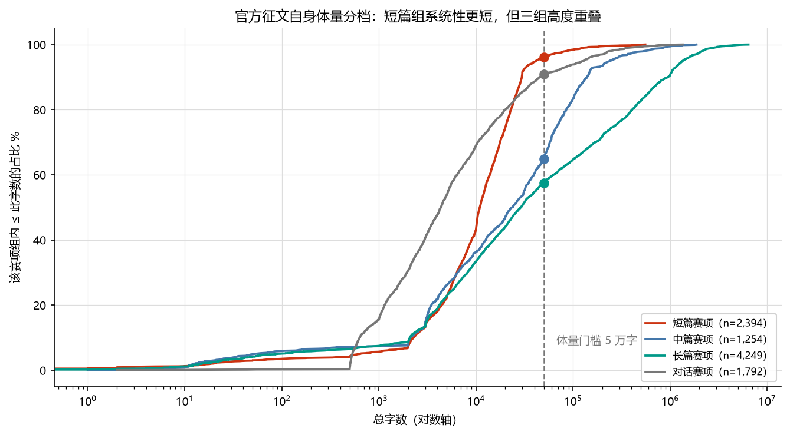
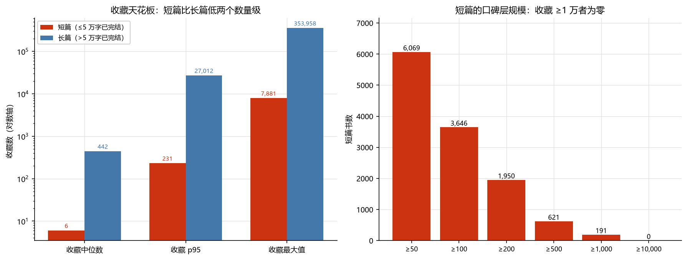
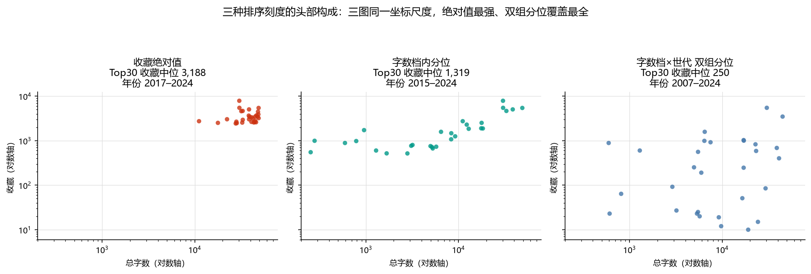
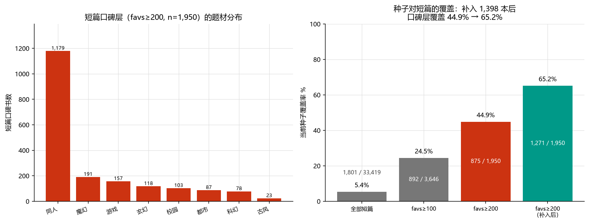

# 报告 19：短篇生态——定义、口碑与推荐刻度

## 0. 结论

1. **短篇 = 总字数 ≤ 50,000 字且已完结**，全库 33,419 本（13.8%）。
   阈值由官方征文自身的体量分档反推：官方「短篇」组已完结书有
   96.2% 落在 50,000 字内（p75=20,283、p95=41,558）。
   **必须与「已完结」组合**——纯字数门槛 ≤1 万字就占全库 48.9%，没有区分度。
2. **官方「短篇」标签不是质量信号**：同字数档内，官方短篇赛项书的收藏中位比非赛项低 40–60%；
   短篇口碑层（favs≥200）中只有 2.8% 来自官方短篇赛项。
   官方标签只作**附加维度**（"该书投过短篇赛项"），不可用于排序。
3. **官方短篇推荐质量低的三个数据根因**：
   ① **收藏天花板**——短篇收藏上限 7,881，收藏过万者 **0 本**（长篇 1,332 本），
      短篇永远进不了收藏榜，官方无口碑榜可选，只能退回「新书」与「征文获奖」；
   ② **官方标签与口碑脱节**（见上）；③ **好短篇是老书**——字数档内分位 Top30 全部落在 2015–2024 年。
4. **可用刻度：收藏绝对值（在 ≤50,000 字集合内）+ 字数档×世代双组分位**。
   短篇内书龄对收藏的影响弱（各代收藏中位 2–10，无单调趋势；长篇则是
   442→27,012 的量级差），故集合内绝对值可比。
5. **两个必须排除的刻度**（否定结论）：
   **赞藏比在短篇里方向是反的**（同字数档+同完结时长档内，pr-top5% 收藏中位
   2.1 vs pr-bot5% 22.1）——
   比值型指标在低曝光样本上失效，报告 08 的赞藏比断崖在短篇上变成反向指标；
   **收藏转化率是低曝光伪信号**（cvr-top5% 的 clicks 中位仅 50，
   远低于 bot5% 的 979，其收藏绝对量也仅 4.8）。
6. **短篇口碑层是同人品类**：favs≥200 的 1,950 本里同人 1,179 本
   （60.5%），题材高度集中；
   **速更在口碑层只有 6.3%**（短篇整体 35.6%）——好短篇几乎不是速更。
7. **种子缺口**：当前种子含短篇 1,801 本（占种子 6.1%），
   覆盖全部短篇 5.4%、覆盖口碑层 44.9%——
   **六成好短篇不在包内**。补入短篇双组分位 Top2,000（需补 1,398 本，
   体积 +0.51 MB）后，口碑层覆盖升至 65.2%。

---

## 1. 口径声明

1. **数据源**：`analysis/out/novels.csv`，241,758 行（= CSV 全量 245,779 行中 `est_year ∈ 2007–2025`；
   正版日轻已在 `build_csv.py` 阶段剔除，CSV 内无该四个作者）。
   内容上界 **2026-05-03**（原始 jsonl 的 `max(last_update)`，即游标扫描起点，非统一读取时刻）。
2. **定年**：`eras.estimate()`，log(nid) 分段线性，104 锚点，LOO P99 = 50 天。
   本报告用 `est_year` 做分层，**不用 `updated_at` 做时间轴**。
3. **短篇口径**：`words ≤ 50,000` 且 `status=已完结`。阈值与 Top2,000 补入量为
   2026-11-16 产品决策，**不是数据自然分界**——见 §2.2 的取舍说明。
4. **速更口径**沿用报告 11：`status=已完结` 且完结时长 `updated_at − nid 定年创建日` ∈ [0,7] 天。
   本报告只用它作**对照组**，不参与短篇定义。
5. **收藏（`favs`）是偏好强度，不含书龄**（报告 02、08）。本报告在 ≤50,000 字集合内使用收藏绝对值，
   前提是该集合内书龄对收藏的影响已被实测为弱（§4.1）。
6. **收藏转化率** `favs/clicks` 与**赞藏比** `praises/favs` 均为比值型指标，
   其分母/分子的绝对量级决定了可比性——本报告在 §4.3–4.4 给出反例，故不予采用。
7. **样本是低估**：报告 10 §7 证实抓取是按更新时间降序的单向游标扫描，短书被漏得最多，
   本报告所有**绝对计数**都是库内下界；相对比较方向稳健。
8. **体积与覆盖均为实测**：种子体积由报告 18 的建库实测得出（381 B/本，扁平单表 + 3 索引 + 反范式标签表）。
9. **短篇池含对话/互动小说**（报告 22）：短篇集合里 26.4% 为对话/互动形态
   （同人 + 未签约 + 整本 ≤2 万字判据）。剔除后敏感性对比：短篇 33,419 → 24,586 本、
   收藏中位 6 → 5、
   口碑层 1,950 → 1,181 本。结论 6「口碑层是同人品类」
   主体是对话小说产品线，不是传统同人短篇；剔除后排序结论方向不变。
10. **所有数字现算**自 `out/novels.csv`，图表由本生成器产出，勿手改正文。

---

## 2. 定义：什么算短篇

### 2.1 官方自己是怎么分的

平台征文把作品分成四个体量组别，赛项名里直接写着：**短篇 / 中篇 / 长篇 / 对话小说**。
全库 99 个赛项中，含这四个词的有 17 个短篇赛项、13 个中篇赛项、17 个长篇赛项、9 个对话赛项。



*图 19-1｜官方各体量赛项的字数累积分布（对数轴）。红点标出 50,000 字门槛处该组的占比：
短篇组 96.2%、中篇组 64.9%、
长篇组 57.5%、对话组 90.9%。
曲线明显左移但**高度重叠**——官方分档是「参赛组别」，不是篇幅约束。*

这张图给出两个事实：

- **官方「短篇」意图确实对应更小的篇幅**（该组 96.2% 落在门槛内，
  而长篇组只有 57.5%），因此 50,000 字是一个有官方依据的近似上界。
- **但官方分档不是硬约束**：中篇组有 64.9%、长篇组有 57.5%
  的作品也落在门槛内。换言之，**「短篇」在官方那里是作者自我申报的参赛组别，不是数据的客观属性**。

### 2.2 阈值取 3 万还是 5 万

| 口径 | 已完结本数 | 官方短篇组落其内 | 官方中篇组落其内 | 官方长篇组落其内 |
| --- | --- | --- | --- | --- |
| 10,000 字 | 21,411 | 43.1% | 36.2% | 33.4% |
| 30,000 字 | 30,542 | 91.5% | 53.5% | 50.6% |
| 50,000 字 | 33,419 | 96.2% | 64.9% | 57.5% |

**选定 50,000 字**，代价与收益都要说清楚：

- **收益**：官方短篇组覆盖率从 3 万字口径的 91.5% 升到 96.2%；
  短篇集合从 30,774 本扩到 33,419 本，多出的 2,918 本是「短中篇」——
  官方短篇赛项里有 26% 落在 1–3 万字区间，这部分在 3 万字口径下会被漏掉。
- **代价**：官方**中篇**组有 64.9% 落进来、**长篇**组有 57.5% 落进来。
  在 ≤50,000 字集合内，官方标为「长篇」的作品有 2,444 本
  （7.3%），官方「中篇」有 814 本
  （2.4%）。**「短篇」在本口径下是一个体量标签，不是官方组别的复制。**
- **一致性检查**：本口径下短篇占总库 13.8%、速更占 35.6%，
  与官方短篇赛项书速更率（报告 11）方向一致，不矛盾。

### 2.3 定案口径

```
短篇（产品标签）= words ≤ 50,000 且 status = 已完结      → 33,419 本

叠加维度（互不替代）：
  官方组别   = contest ∈ 17 个含「短篇」的赛项               → 2,303 本在短篇集合内
  一次性写完 = 速更档（完结 ≤7 天，报告 11 口径）              → 35.6% 的短篇
```

**速更不能当短篇的同义词**：短篇里速更占 35.6%，速更档里也有 30k+ 字的长稿
（报告 11 §0）。速更是**创作形态**（写完得多快），短篇是**体量**（写得多长），两者正交。

---

## 3. 官方短篇推荐为什么质量不高

### 3.1 收藏天花板：短篇永远进不了任何收藏榜



*图 19-2｜左：短篇与长篇的收藏数分位（对数轴）。右：短篇集合内按收藏门槛的累计书数。*

| 指标 | 短篇（≤50,000 字已完结） | 长篇（>50,000 字已完结） |
| --- | --- | --- |
| 收藏非零占比 | 87.3% | 99.5% |
| 收藏中位数 | 6 | 442 |
| 收藏 p95 | 231 | 27,012 |
| 收藏最大值 | 7,881 | 353,958 |
| 收藏 ≥ 10,000 的书 | **0 本** | 1,332 本 |

这是整份报告最关键的一张表。短篇的收藏上限是 7,881，
**收藏过万的一本都没有**——短篇书在数值上永远无法进入全站收藏榜、
月票榜或任何以收藏绝对数为刻度的榜单。

**官方因此没有任何「短篇口碑榜」可选**：能用的信号只剩「新」与「征文获奖」，
而这两者都不是偏好信号。这不是官方做得不够好，而是**数据结构里缺一个可用的刻度**。

### 3.2 官方标签与读者偏好脱节

| 字数档 | 官方短篇赛项 n | 赛项收藏中位 | 同档非赛项 n | 非赛项收藏中位 | 收藏中位比 |
| --- | --- | --- | --- | --- | --- |
| ≤3k | 319 | 3 | 9,528 | 4 | 0.75 |
| 3-6k | 356 | 2 | 6,478 | 4 | 0.50 |
| 6-10k | 356 | 3 | 4,374 | 7 | 0.43 |
| 10-20k | 752 | 6 | 5,366 | 11 | 0.55 |
| 20-50k | 520 | 10 | 5,370 | 21 | 0.48 |

「官方短篇组」的书在**每一个字数档**里收藏中位都低于同档非赛项书——
获奖与入围是**运营信号**（活动奖励、编辑推荐位），不是读者偏好信号。

更强的证据在短篇口碑层：favs≥200 的 1,950 本里，
只有 2.8% 来自官方短篇赛项。
**用「征文获奖」筛短篇，会漏掉 97.2% 的好短篇。**

### 3.3 好短篇是老书

「字数档内分位」Top30 的年份全部落在 2015–2024；
「收藏绝对值」Top30 落在 2017–2024。
官方只推新书，**必然漏掉全部 2015–2022 年的短篇头部**。

---

## 4. 排序刻度：什么能用，什么不能用



*图 19-3｜三种候选刻度各自选出的 Top30 在「字数–收藏」平面上的分布（双对数轴）。*

### 4.1 可用：集合内的收藏绝对值

短篇内**书龄对收藏的影响很弱**——各代收藏中位只有 2–10 的量级且无单调趋势
（长篇则是 442 → 27,012 的量级差）。
因此**在 ≤50,000 字集合内部**，收藏绝对值是有效的偏好刻度。

「收藏绝对值」Top30 的收藏中位 3,188，
是三种刻度里最高的；代价是年份集中在 2017–2024，
早期短篇被屏蔽。

### 4.2 可用：字数档 × 世代 双组分位

沿用报告 03 / 18 已确立的原则——分位是**组内相对位置**，跨组不可加。
在短篇里用「字数档内」+「世代内」双组分位，可以同时解决篇幅差异与书龄差异。

「字数档×世代 双组分位」Top30 年份跨度 2007–2024
（覆盖全部世代），但收藏中位只有 250。

**结论：主键用收藏绝对值（集合内），并排展示双组分位**——
用户既能立刻看到当下最热门的短篇，也能切到「每个年代/篇幅里的好短篇」。

### 4.3 不可用：赞藏比（在短篇里方向是反的）

在「字数档 × 完结时长档」的 22 个格子里，各取赞藏比 top5% 与 bottom5%：

| 刻度 | top5% 收藏中位 | bottom5% 收藏中位 | top5% 点击中位 | bottom5% 点击中位 |
| --- | --- | --- | --- | --- |
| 赞藏比 pr | 2.1 | 22.1 | 171 | 1,450 |

**pr 高的书收藏更少、点击更少**。机制有二：
① 比值型指标的分母小时天然虚高——短篇里大量书的 favs 只有个位数，`praises/favs` 极易爆表；
② 「有收藏没点赞」是**老书慢更**的典型形态（曝光少→没人点赞→收藏在多年间缓慢累积），
   它们的 pr 接近 0，却恰是收藏最高的书。

报告 08 说的「赞藏比断崖」在长篇上表现为低分段不可信，**在短篇上直接翻转成反向指标**。
必须显式排除。

### 4.4 不可用：收藏转化率（低曝光伪信号）

| 刻度 | top5% 收藏中位 | bottom5% 收藏中位 | top5% 点击中位 | bottom5% 点击中位 |
| --- | --- | --- | --- | --- |
| 收藏转化率 cvr | 4.8 | 1.3 | 50 | 979 |

cvr 高的组收藏确实更高（4.8 vs 1.3），
但它的点击中位只有 50——**这些书几乎没有曝光**。
转化率榜排出来的是「没人看但被极少数人收藏的书」，收藏绝对量仅 4.8，
根本撑不起一个榜。这是报告 08「曝光分母效应」在短篇上的极端形态。

clicks 本身同样不可用：短篇 clicks 中位 302 vs 长篇 55,458。

---

## 5. 短篇生态画像

### 5.1 题材：口碑层是同人品类



*图 19-4｜左：短篇口碑层（favs≥200）的题材分布。右：当前种子对短篇的覆盖率与补入后的改善。*

| 题材 | 口碑层书数 | 占比 |
| --- | --- | --- |
| 同人 | 1,179 | 60.5% |
| 魔幻 | 191 | 9.8% |
| 游戏 | 157 | 8.1% |
| 玄幻 | 118 | 6.1% |
| 校园 | 103 | 5.3% |
| 都市 | 87 | 4.5% |
| 科幻 | 78 | 4.0% |
| 古风 | 23 | 1.2% |

同人占 60.5%（1,179 / 1,950），
头部集中在**转生 / 变身 / 系统**流——《成为符华圣痕的黑符》《关于我变成希儿在约战这件事》
这类书是短篇口碑的真正主力。题材分布高度集中，短篇与长篇的题材生态**完全不同**，
不能共用一套题材榜（报告 09 的语义空间结论在短篇上要重算）。

### 5.2 速更在口碑层只占 6.3%

短篇整体速更率 35.6%，但口碑层只有 6.3%，
长篇口碑层更是 0.2%。
**「一次性写完」不是好短篇的必要条件**，反而可能是「写完就没了、无人追更」的表现。
这与报告 11 §0 的「速更档是独立品类」不矛盾：速更是**新手的高频试水形态**，
而口碑短篇多是**认真写完并被长期连载周期托住**的作品。

完结时长分布上，口碑层的重心明显偏后：91–365 天占
34.0%、>365 天占 15.3%，
而 0–7 天（速更）仅 6.3%。

### 5.3 世代趋势

短篇在 2019–2022 达峰（2021 年 6,981 本），
2023 后绝对数回落，但这是**右删失**（2023 后创建的书尚未有足够观察窗）与
内容上界（2026-05-03）的共同作用，**不可读作「短篇在衰退」**。
同世代短篇占比在 2021 年见顶 18.4%，2025 年 8.5% 同理受右删失影响。

---

## 6. 种子 v2：补入短篇

### 6.1 当前缺口

| 口径 | 全库 | 当前种子 | 覆盖率 |
| --- | --- | --- | --- |
| 全部短篇 | 33,419 | 1,801 | **5.4%** |
| 口碑层 favs ≥ 100 | 3,646 | 892 | **24.5%** |
| 口碑层 favs ≥ 200 | 1,950 | 875 | **44.9%** |
| 口碑层 favs ≥ 500 | 621 | 621 | **100.0%** |

### 6.2 补入方案

选法：短篇集合内按**字数档 × 世代双组分位**取 Top2,000，
与已在种子内的部分去重后补入。

| 项 | 值 |
| --- | --- |
| 已在种子 | 602 本 |
| 需补 | **1,398 本** |
| 体积代价 | +0.51 MB（按 381 B/本，报告 18 实测） |
| 补后口碑层 favs≥200 覆盖 | 44.9% → **65.2%** |

种子规模从 29,433 增至约 30,831 本，
体积从 10.68 MB 增至约 11.2 MB（gzip 约 4.4 MB）。

**这是整份分析里性价比最高的一笔投入**：0.51 MB 换取
口碑层覆盖 +20.3 个百分点。
对比报告 18「加 19,059 本才换 9.4 个百分点的单元格覆盖」——**短篇这块是明显的洼地**。

### 6.3 对短篇榜的连带影响

补入后种子内的短篇规模升到 3,199 本，其中口碑层 1,271 本。
按报告 03 的原则，A 类离线榜的候选池是**精选种子池**，分位以**全库**为参照系计算——
短篇榜的分位同样在全库 ≤50,000 字集合内算好随种子携带（代价 1,398 × 3 B ≈ 0.01 MB）。

---

## 7. 边界与未决

1. **阈值的敏感性**：50,000 字是产品决策而非数据自然分界。若改回 3 万字，
   短篇集合缩小到 30,774 本、口碑层 1,351 本、种子需补 1,399 本——
   **代价是漏掉官方短篇赛项里 26% 的 1–3 万字作品**。
2. **绝对计数是下界**：报告 10 §7 的游标扫描对短书最不友好，
   33,419 本只是库内可见部分，真实短篇数量更高。
3. **「同人占 60%」的稳定性**：短篇口碑层的题材集中度
   高于长篇，但同人 IP 会随时间迁移（报告 09 的命名空间结论），
   该结论的**有效期取决于具体 IP 的存续**，不宜写死。
4. **端上观测的补充价值**：短篇的收藏绝对值天花板低，且书龄影响弱，
   这恰好让**端上观测榜（收藏涨幅）**在短篇品类上比长篇更有意义——
   因为长篇的存量收藏已被书龄主导，短篇的存量几乎全是「最近才发生」的。
   这是 C 类榜（报告 03 §3）在短篇上的独特位置，值得在 02 文档里单列。
5. **未决**：短篇是否需要独立的小分类体系（长篇的 9 分类在短篇上分布完全不同），
   留待 02 文档一并决定。

---

*本报告与报告 11（速更短篇）口径正交：报告 11 讲创作形态，本报告讲体量与推荐刻度。
报告 18 的种子结论在 §6 基础上升级为「种子 v2」。*
