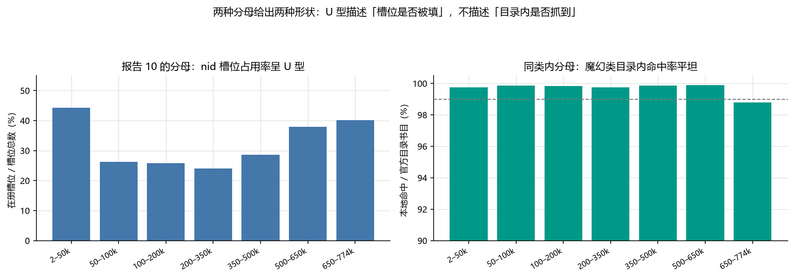
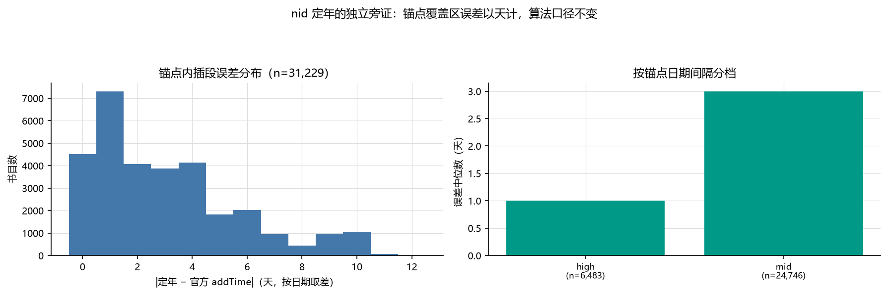

# 20 · 官方 App API 的离线复核：报告 10 与 nid 定年

> **补充报告，不是修订。** 本报告不修改报告 10，不修改 `lib/eras.py` 的 `log(nid)` 定年，也不修改任何 App 设计。报告 10 的单向游标扫描推测、U 型 / 倒 U 型结论、69.3% 覆盖口径与「补爬对象约 1 千本」保持原样；App 的种子、分位、书架、观测与 watchlist 口径亦不变。

> 全部数字来自已存在的本地产物，**本报告不发起网络请求**；App API 的 `addTime` 只作独立旁证，不进入定年。

## 0. 数据来源与边界

| 来源 | 规模 | 用途与限制 |
|---|---|---|
| 本地数据集 | `out/novels.csv`，245,779 行 | 2026-05-03 内容上界，由 `eras.snapshot_bounds()` 现算复核 |
| 官方书目枚举 | `out/app_api_novels.jsonl`，114,381 条（nid 去重） | 部分枚举；**只有魔幻类 tid=21 翻到空页**，同类内比较仅用它 |
| 定年旁证 | `out/external_dates_full.jsonl`，31,229 条 | 第三方站转述的 `addTime`，与锚点同字段语义 |

内容上界现算为 **2026-05-03**，数据集内最新 nid 定年 2026-05-02。枚举文件不入库、可重建；因枚举不完整，本报告**不给出全库覆盖率**，只做「同类内、同分段」的语义核验。

## 1. 「在册密度 U 型」是两个分母中的哪一个

报告 10 的 U 型分母是 **nid 槽位**（772,194 个位置，其中大量 id 从未对应作品）。用一个已完整枚举的分类，把分母换成**官方目录里真实存在的书**（魔幻类 85,852 本），形状完全不同。

| nid 档 | 槽位在册数 | 槽位占用率 | 目录书目 | 本地命中 | 目录内命中率 | 库外 |
|---|---|---|---|---|---|---|
| 2–50k | 20,970 | 44.3% | 9,900 | 9,876 | 99.76% | 24 |
| 50–100k | 13,112 | 26.2% | 6,997 | 6,988 | 99.87% | 9 |
| 100–200k | 25,782 | 25.8% | 13,030 | 13,010 | 99.85% | 20 |
| 200–350k | 35,996 | 24.0% | 13,112 | 13,079 | 99.75% | 33 |
| 350–500k | 42,997 | 28.7% | 11,379 | 11,364 | 99.87% | 15 |
| 500–650k | 56,860 | 37.9% | 15,282 | 15,264 | 99.88% | 18 |
| 650–774k | 50,062 | 40.1% | 16,152 | 15,956 | 98.79% | 196 |



槽位占用率从两端 44.3% / 40.1% 降到中段 24.0%，U 型成立；但魔幻类目录内命中率七档为 98.79%–99.88%，整体 99.63%，**没有 U 型**。

> 结论：两个陈述并不冲突。U 型描述「nid 槽位是否被填」（受 id 空洞与老书短命影响），目录内命中率描述「已存在的书是否被抓到」（接近满分）。报告 10 把两者分开处理是正确的；本报告只是把该区分用独立目录数据实测出来。

## 2. 遗漏画像的同类内抽查（方向性，不替代报告 10）

在同一分类内，快照前已存在却未入库的书 315 本（占该分类目录 0.37%）。与在册书对比：

| 指标 | 库外（快照前） | 在册 |
|---|---|---|
| 字数中位数 | 37,042 | 13,804 |
| ≤1 万字占比 | 27.0% | 42.0% |
| 2022 年后上架占比 | 67.3% | 35.0% |

同类内样本里，库外书**更长、更新近**，与报告 10 全库口径的「偏短、新、更新中」只在「新」上同向。差异有两个明确来源：① 库外高度集中在 650–774k 最新档（196/315），该档本身字数分布不同；② 本报告只覆盖魔幻一类，报告 10 的画像跨全部分类与更早世代。因此该结果**只作方向性注记，不改报告 10 的遗漏画像**。

## 3. nid 定年的独立旁证

锚点 104 条，nid 范围 2,242–777,879。外部日期全部落在内插段（31,229 条），与 `eras.estimate()` 预测的创建日按**日期**取绝对差：

| 指标 | 值 | 指标 | 值 |
|---|---|---|---|
| 中位 | 2 | P90 | 7 |
| P99 | 10 | 最大 | 11 |
| ≤30 天 | 100.0% | 绝对误差均值 | 3.04 天 |

| 置信度 | 样本 | 误差中位（天） | P99（天） | 最大（天） |
|---|---|---|---|---|
| high | 6,483 | 1 | 2 | 2 |
| mid | 24,746 | 3 | 10 | 11 |



误差以天计、100% ≤30 天，说明报告 01/10 采用的 `log(nid)` 分段线性定年在锚点覆盖区是可用的；外推段（nid 超过锚点上限）不在此结论范围内。**定年算法与锚点均不因本报告改动**，App API 的秒级 `addTime` 继续只作旁证。

## 4. 与报告 10 / App 设计的关系

| 对象 | 处置 | 说明 |
|---|---|---|
| 报告 10 的 U 型 / 倒 U 型 | 保持 | 本报告确认其分母是 nid 槽位，非目录内命中率 |
| 覆盖率 69.3% 与三态判据 | 保持 | 本报告不重算覆盖率，也不改三态判据 |
| 补爬对象约 1 千本 | 保持 | 魔幻类目录内库外 315 本，与该量级不冲突 |
| `eras.py` 定年与 104 锚点 | 保持 | 31,229 条旁证误差中位 2 天、P99 10 天 |
| App 种子 / 分位 / 书架 / 观测 / watchlist | 保持 | 本报告不产生任何下发字段 |

## 5. 复现与局限

```bash
cd analysis
uv run python generators/report_20_app_api_crosscheck.py
```

- 依赖 `out/app_api_novels.jsonl` 与 `out/external_dates_full.jsonl`；两者是可重建的派生资产，缺失时生成器直接报错，不会替你联网补采。
- 枚举仅魔幻类完整（85,852 本），其余分类不可用于目录内比较；不给出全库漏抓率或新覆盖率。
- 误差按日期取差（非秒级），第三方站是 App `addTime` 的转述而非独立采集，其价值是校验转述忠实度与定年量级，不是新增数据源。
- 所有发现为结构描述；相关不等于因果。
