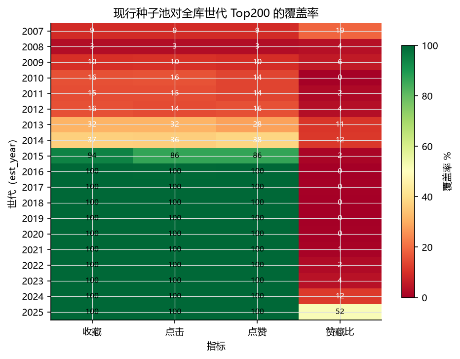
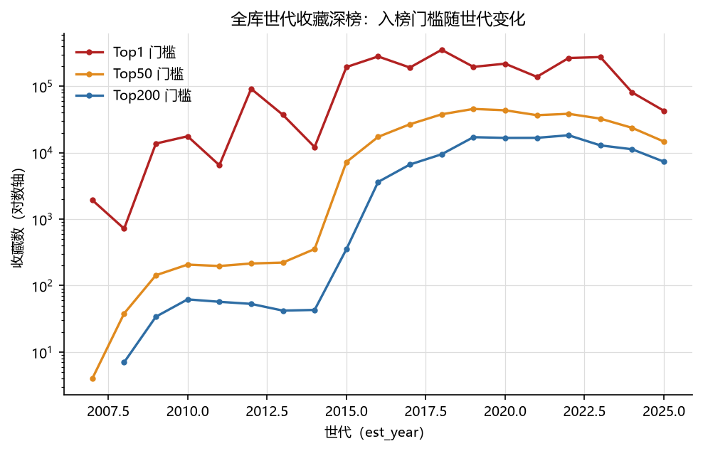

# 报告 21：全库世代内 Top200 深榜（D2）

> **定位**：新增分析，不是修订。报告 10、`lib/eras.py` 定年体系、30,878 本种子书单与 24 列结构、App 01–08 设计文档均未改动。实现决定见 `app/docs/09-seed-refresh-proposal.md` 附录 A（D2），落地契约见 `app/docs/10-deep-ranks.md`。

> **口径**：统计宇宙 = `out/novels.csv` 剔除正版日轻且 `est_year∈2007–2025` 共 241,758 行；世代 = `est_year`，逐年独立成榜；四指标（收藏/点击/点赞/赞藏比）各取 Top200；赞藏比沿用 `favs ≥ 10` 门槛。**榜单参照系是全库，不是种子池**。全程零网络请求。

## 1. 为什么现有 limit=200 端点不等于深榜

引擎 `/rankings/favs` 的 `parseLimit` 已允许 `limit=200`，但该端点只查种子池 `seed.books`。早期世代在种子里只有个位数到几十本，把 limit 调到 200 并不会凭空补出书。下表是现算覆盖率：

| 世代 | 种子内本数 | 深榜命中/深度 | 四指标平均覆盖 |
|---|---|---|---|
| 2007 | 7 | 7/76 | 11.6% |
| 2008 | 6 | 6/200 | 3.2% |
| 2009 | 20 | 20/200 | 8.9% |
| 2010 | 31 | 31/200 | 11.4% |
| 2011 | 30 | 30/200 | 11.4% |
| 2012 | 31 | 31/200 | 12.2% |
| 2013 | 63 | 63/200 | 25.6% |
| 2014 | 74 | 74/200 | 30.8% |
| 2015 | 189 | 189/200 | 67.2% |
| 2016 | 200 | 200/200 | 74.9% |
| 2017 | 200 | 200/200 | 75.1% |
| 2018 | 200 | 200/200 | 75.0% |
| 2019 | 200 | 200/200 | 75.0% |
| 2020 | 200 | 200/200 | 75.1% |
| 2021 | 200 | 200/200 | 75.2% |
| 2022 | 200 | 200/200 | 75.6% |
| 2023 | 200 | 200/200 | 76.0% |
| 2024 | 200 | 200/200 | 78.0% |
| 2025 | 200 | 200/200 | 87.9% |



四指标合计 14,626 个榜位，种子池只覆盖 7,534 个（51.5%）；2007–2014 八个世代合计命中 853 / 5,826。因此深榜必须建立在全库上，不能靠放宽端点 limit 实现。

## 2. 深榜的形状

每个世代 × 每个指标 = 一张独立榜，实际深度 = `min(200, 合格书目数)`：2015 以后各世代凑满 200 名，2007 世代全库只有 76 本，赞藏比榜还受 `favs ≥ 10` 门槛进一步收窄。本次共落库 14,626 行、76 张榜。入榜门槛随世代显著变化，说明跨世代比绝对值没有意义：

| 世代 | 第 1 名收藏 | 第 50 名收藏 | 第 200 名收藏 |
|---|---|---|---|
| 2007 | 1,932 | 4 | — |
| 2010 | 17,677 | 207 | 62 |
| 2013 | 37,163 | 222 | 42 |
| 2016 | 281,034 | 17,304 | 3,629 |
| 2019 | 196,016 | 45,603 | 17,135 |
| 2022 | 266,218 | 38,502 | 18,305 |
| 2025 | 42,791 | 14,719 | 7,327 |



点击与点赞的门槛跨度更大（累计量口径），赞藏比则受 `favs ≥ 10` 限制：早期世代合格样本少，榜单实际深度可能不足 200。生成时对不足 200 的世代按实际合格数落库，**不补凑数条目**。

## 3. 与官方榜的差异

| 维度 | 官方 | D2 深榜 |
|---|---|---|
| 深度 | web 榜 top20；App 无全局日/周/月榜端点 | 每世代每指标最多 top200（受合格书目数限制） |
| 时间基准 | 当期 / 每月清零 | 内容上界快照（2026-05-03，定年不外推） |
| 参照系 | 全站当期 | 全库历史快照，按世代分层 |
| 数值 | 多数榜只给名次或量化值 | 给原值 + 全库世代内分位 |
| 可切分 | 固定榜位 | 世代 × 指标 × 题材（题材由端上按 genre 过滤） |

官方没有「按世代回看」的榜——这是报告 02/03 的分位论证在产品上的直接延伸。D2 解决的不是「谁最新」，而是「每个年代的代表作是谁」，这正是绝对榜会系统性屏蔽的部分。

## 4. 边界与红线

- **分位不是排名**：每世代冠军的分位都是 1.0，但绝对收藏可能差一个量级；UI 必须同时给原值与分位，且不提供跨世代加总。

- **点击榜须分曝光档**：累计点击受书龄与曝光分母混杂（报告 08），D2 的点击榜按世代给出，仍不等于曝光分档后的转化率；不做跨书点击涨幅。

- **赞藏比门槛**：`favs < 10` 不入 `pr` 榜；短篇禁用比率类指标（报告 19），本榜不替代短篇榜。

- **快照态**：`status` 是 2026-05-03 的快照，不是当期状态；`updated_at` 只作时长，不作时间轴。

- **定年不动**：世代仍由 `log(nid)` 分段线性定年给出，App API 的 `addTime` 不进定年；报告 10 的覆盖与 U 型结论不受影响。

- **数据新鲜度**：D2 依赖内容上界快照，2026-05-03 后新书不在榜内；维持新鲜需后续按既定增强通路重采，本报告不发起请求。

## 5. 复现

```bash
cd analysis
uv run python generators/report_21_deep_ranks.py
```

- 依赖 `out/novels.csv`、`anchors/`、`app/assets/seed.db.gz`；均为本地产物，缺失即报错。
- 榜单落库由 `app/tools/seedbuild/build_seed.py` 完成，本报告的深榜计算与构建器共用 `app/tools/seedbuild/deep_ranks.py`，避免口径漂移。
- 所有发现为结构描述；相关不等于因果。
