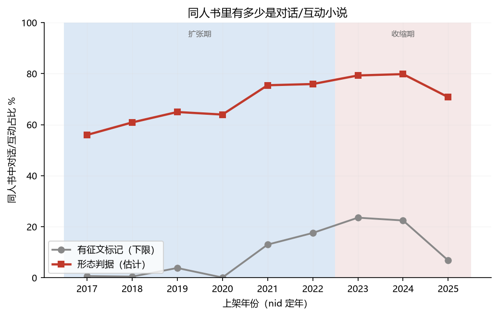
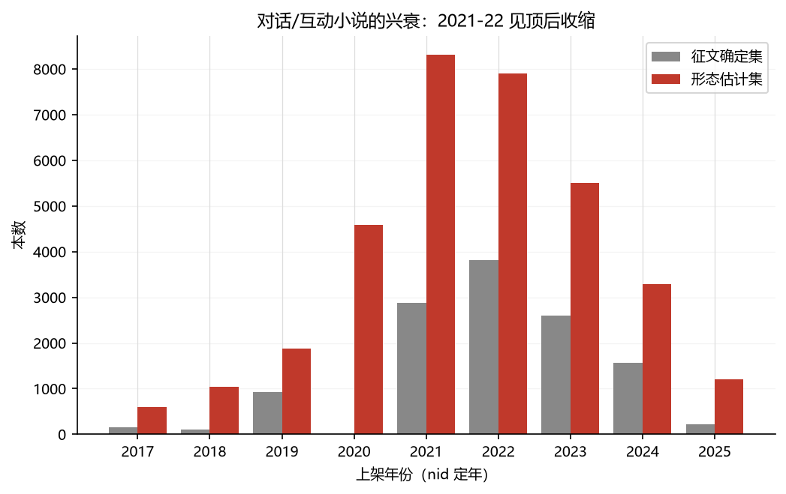

# 22 · 对话/互动小说：被误读为「同人激增」的产品线

> 口径声明：
> 1. 数据 `analysis/out/novels.csv`（245,779 行，内容上界 2026-05-03，
>    在册存活口径），年份由 nid 定年（104 锚点，报告 01 §1），年度序列止于 2025。
> 2. **本报告是新增分析**，不改 `lib/eras.py` 的 log(nid) 定年体系与种子。
>    它给报告 04/09/11/19 提的口径注记已于 2026-11-18 写入各自生成器
>    （04/09 加注不改数字；11/19 加剔除对话形态后的敏感性对比），
>    判据统一在 `lib/dialogue_form.py`。
> 3. **本地数据没有「对话/互动小说」品类的直接字段**（无 typeId/categoryId，
>    `genre` 只有同人/魔幻等题材标签）。三条判据都是**推断**，不是官方品类标记：
>    ① `contest` 含「对话/点鸭」= 对话小说（用户核实，确定性）；
>    ② 同人 + 未签约 + 整本 ≤2 万字 = 对话/互动形态（估计，见 §2 边界）；
>    ③ 标题含米哈游等 IP 词 = 同人对话小说的强特征（辅助）。
> 4. 对话小说的形态是「每章约 500 字、整本可连载很长」，故**单本字数不能判形态**；
>    用户给定锚点 570712（对话小说）本地 88 万字即为反例。判据②的字数上界只
>    用于群体占比，不判单本。
> 5. 互动小说近年中国（用户核实）：是对话小说的子集、近年独立；本地**无法单独
>    识别**（锚点 691941 的 contest 空、genre=古风），本报告把它并入「对话/互动」
>    合并口径，不拆分。

## 0. 结论

1. **「同人激增」的主体是对话/互动小说，不是传统同人长篇**。全库 49,206 本
   同人书（genre 或 tag 含同人）中，按形态判据有 35,552 本 = **72.3%**
   是对话/互动形态；其中 30,773 本（62.5%）**没有任何征文标记**，
   这正是只数征文永远看不到「大部分」的原因。用户核实：同人挂常规长篇=商业死刑，
   故同人标签/类目高度集中在不走 VIP 的对话/互动产品线。
2. **对话小说确实以同人为主**：征文确定集 12,286 本里同人占 49.3%，
   头部代表作标题几乎全是米哈游 IP 同人（芙宁娜、钟离、琪亚娜、雷电将军…），
   与用户判据「成功的对话小说大部分是同人」一致。
3. **兴衰曲线与平台叙事吻合**：对话小说征文数 2022 见顶、形态估计 2021 见顶，此后收缩；报告 07 独立记录
   「对话月票榜 2025-10 断崖（-77%）、席位数填不满」，即对话小说付费侧在 2025 秋
   停止运转。用户叙事「平台倾斜互动小说 → 对话流量被抽走 → 互动商业失败 → 对话区
   沦陷」中，本地数据能证明**对话下滑**与**付费停转**；「互动接棒」这一段本地无法
   识别，需 DOM 文案或互动榜时序外部证据。
4. **受影响的报告口径**：报告 04「同人 genre 兴起」、报告 09「同人 tag 2023 峰值」
   需加注记说明主体是对话产品线；报告 11/19 的短篇池含对话小说，需口径声明。
   见 §5 修订建议。

## 1. 识别判据与征文命名约定

### 1.1 三条判据（用户核实 + App 目验，2026-11-18）

| 判据 | 内容 | 性质 | 本地可实现 |
|---|---|---|---|
| ① 征文标记 | contest 含「对话」或「点鸭」= 对话小说；另用户 App 目验判 T 的 7 个征文 | 确定性（用户核实） | 是 |
| ② 形态判据 | 同人（genre 或 tag）+ 未签约 + 整本 ≤20,000 字 | 估计（群体口径） | 是 |
| ③ 标题 IP | 标题含米哈游等 IP 词 = 同人对话小说强特征 | 辅助 | 是 |

判据① 的征文确定集 12,286 本（A 类含对话/点鸭 + 用户目验 7 个）；
判据② 的形态估计集 35,552 本；两者差集 30,773 本是无征文标记的隐藏对话/互动。

### 1.2 征文命名约定（用户核实，2026-11-18）

- 征文名含「短篇」= 短篇小说；含「中篇」= 中篇小说；含「长篇」= 长篇小说。
- 「X 征」即夏征（如七征、八征…十三征）；春夏秋冬四季征文默认是长篇小说，
  部分含中短篇赛事（如「X 征短篇」「X 征中篇」）。
- 官方合作征文须单独识别，不属于常规赛道：如「楚楚动仁（楚楚动人）同人征文」
  是咪咕阅读 × SFACG 合作；崩坏3/少女前线/龙之谷征文是游戏联动；
  「失业魔王」「英雄再临」同人征文是站内成功 IP 衍生。
- 这些命名约定用于修正报告 06 的届次→年份映射与报告 04/11/19 的篇幅口径。

## 2. 「同人里有多少来自对话」的逐年核算

| 年份 | 在册书 | 征文对话 | 同人书 | 同人∩征文 | 征文% | 同人∩形态 | 同人里形态% | 隐藏对话 |
|---|---|---|---|---|---|---|---|---|
| 2017 | 12,759 | 160 | 1,056 | 7 | 0.7% | 591 | 56.0% | 585 |
| 2018 | 16,469 | 104 | 1,720 | 8 | 0.5% | 1,047 | 60.9% | 1,042 |
| 2019 | 24,263 | 920 | 2,902 | 111 | 3.8% | 1,885 | 65.0% | 1,797 |
| 2020 | 30,372 | 13 | 7,179 | 7 | 0.1% | 4,592 | 64.0% | 4,588 |
| 2021 | 35,156 | 2,886 | 11,009 | 1,431 | 13.0% | 8,306 | 75.4% | 7,180 |
| 2022 | 37,088 | 3,808 | 10,407 | 1,827 | 17.6% | 7,901 | 75.9% | 6,446 |
| 2023 | 26,021 | 2,602 | 6,936 | 1,633 | 23.5% | 5,499 | 79.3% | 4,221 |
| 2024 | 20,075 | 1,570 | 4,111 | 923 | 22.5% | 3,281 | 79.8% | 2,542 |
| 2025 | 14,552 | 223 | 1,694 | 115 | 6.8% | 1,199 | 70.8% | 1,121 |

关键读法：同人书里形态判据占比从 2017-18 约 6 成升到 2023-24 约 8 成，
2023 年 5,499 / 6,936（79.3%）
为对话形态。报告 09 的「2023 同人 tag 峰值 3,595」正落在这一段——
它是对话小说放量，不是传统同人长篇复兴。

**边界（须诚实标注）**：形态判据是上界还是下界取决于未签约同人短篇里
常规轻小说短篇的占比。本报告用「同人 + 未签约 + ≤2 万字」ceil 了一个较宽
集合，用户已认可该口径；但其中可能混入少量走免费路线的传统同人短篇。
征文确定集（无此污染）给出的占比是下界，两者构成区间。

## 3. 对话小说的兴衰曲线

征文确定集在 2022 见顶后腰斩（用户叙事：平台资源转向互动小说）；形态估计集
峰值在 2021（8,306 本），随后同步收缩。两者共同点是 2022 后掉头向下。

**与报告 07 商业侧的交叉**：对话月票榜与主站月票榜零重叠（626 本独立书），
是独立付费赛道；2024 年对话月票总票 40,657，约主站 1/14；2025-10 月票 82
（-77%）、席位填不满，付费侧停转。数量收缩（本节）与付费停转（报告 07 §8）
是同一件事的两端，而非因果。

## 4. 标题 IP 特征的辅助验证

标题含米哈游等 IP 词的书：同人书里占 22.9%，
隐藏对话集里占 21.0%，征文确定集里占 21.1%。
标题 IP 词是对话小说同人属性的强特征，但它只覆盖头部（成功作），
长尾对话小说标题未必含 IP 词，故只作辅助，不用于规模估计。

## 5. 对既有报告的修订（已实施，2026-11-18）

| 报告 | 原表述 | 已写入的修订 | 数字 |
|---|---|---|---|
| 04 题材标签 | 同人 genre 2019 上线、份额升至 17.5% | 注记：主体是对话/互动产品线（同人 genre 里 78.2% 为对话形态） | 原序列不改 |
| 09 标签空间 | tags 同人 2023 峰值 3,595=同人书仍在投 | 注记：2023 同人书里 79.3% 为对话形态；genre 峰值 2021 与 tag 峰值 2023 驱动不同 | 原序列不改 |
| 11 短篇形态 | 短篇池统计 | 口径声明 + 剔除对话形态的敏感性对比（§5 第 6 条） | 新增对比 |
| 19 短小说 | ≤5 万字且完结 | 口径声明 + 剔除对话形态的敏感性对比（§1 第 9 条） | 新增对比 |

上表四项均已落在各报告的生成器里：04 §1、09 §1.1 为注记（数字现算，
不改变原有序列）；11 §5、19 §1 为口径声明 + 剔除对话形态后的敏感性对比。
判据实现见 `analysis/lib/dialogue_form.py`，04/09/11/19 与本报告共用同一份。

## 6. 可复现与局限

- 生成器 `analysis/generators/report_22_dialogue_fiction.py`，全部数字现算，
  无硬编码结论；征文标注表 `references/dialogue-contest-manual-check.md` 记录用户目验结果。
- 局限：① 本地无对话/互动品类字段，三判据均为推断；② 互动小说无法单独识别；
  ③ 「互动接棒导致对话下滑」的因果链本地只能支持对话下滑与付费停转两端；
  ④ 形态判据可能混入少量免费传统同人短篇，征文确定集给出下界。
