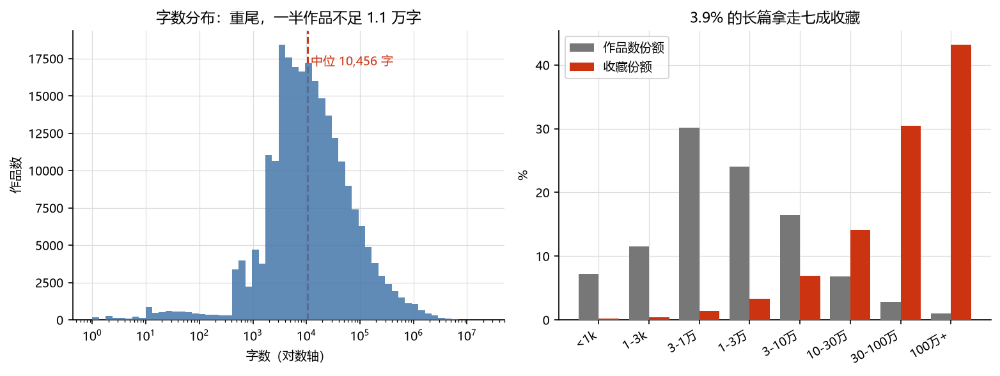
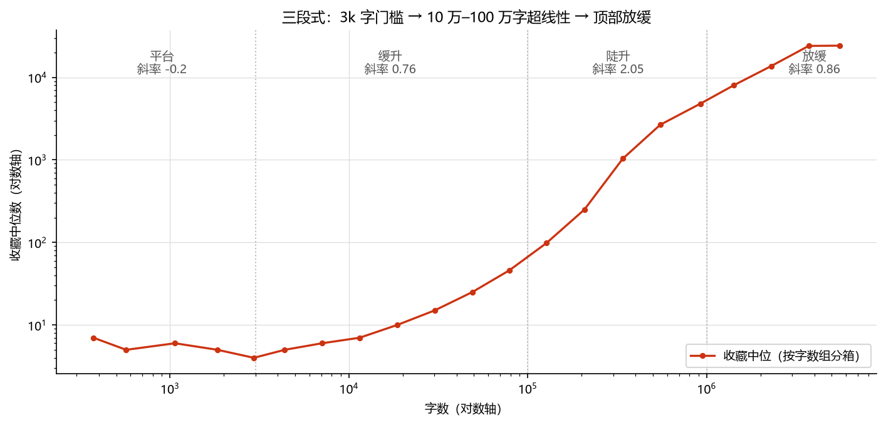
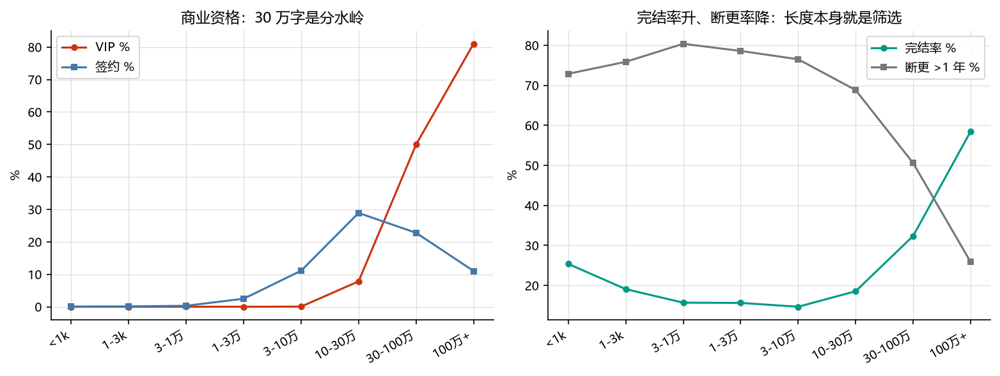
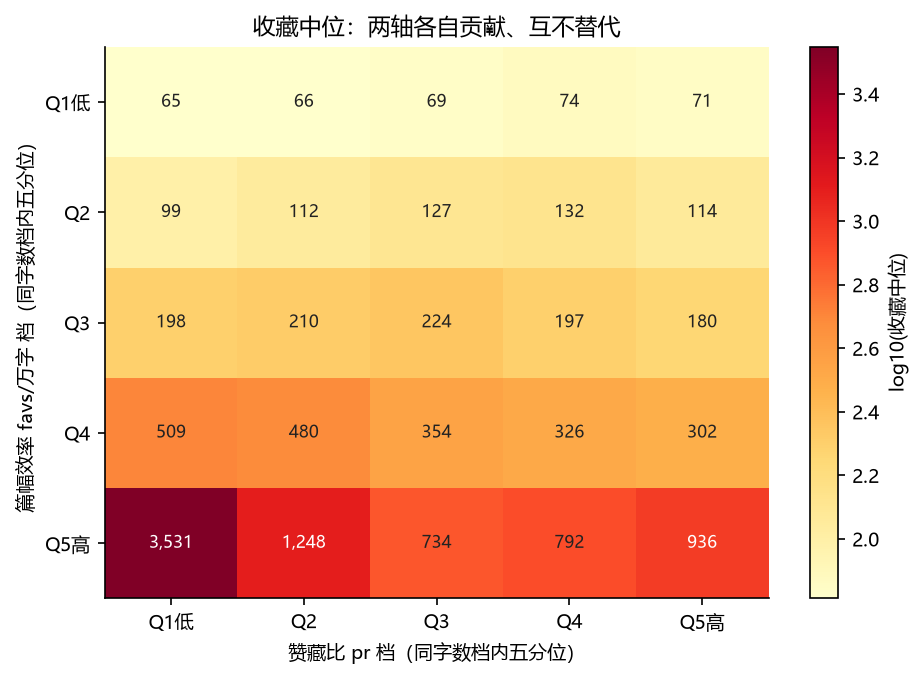

# 23 · 篇幅经济学：字数作为筛选器，以及「字数 × 其它」的组合指标

> 口径声明：
> 1. **样本**：`out/novels.csv` 245,779 行（数据内容上界 2026-05-03，在册存活口径；
>    正版日轻 47 行构建期已剔除）。字数缺失/为 0 的 495 行不参与
>    任何对数与比值计算，但仍计入分档计数。
> 2. **横截面，不是面板**：所有指标是快照累计值。字数既是**作品属性**也是**结果**
>    （写得久自然更长、曝光也更多），本报告只能说「字数与收藏同向」，不能声称
>    「加字数必然涨收藏」。§2 用同一个点击数档内的比较来剥离曝光。
> 3. **存活偏置**：抓取是按更新时间降序的单向游标扫描（报告 10 §7），
>    早期弃坑的短书被漏得最多。故近年世代（尤其 2024-26）的**字数中位偏上**，
>    §1.2 只报到 2025 并显式标注；跨世代字数比较因此偏保守。
> 4. **断更口径**：`连载中` 且 `updated_at` 距内容上界 > 365 天。这是**下界**——
>    真正的停更可能更晚被发现，且 `status` 是快照当期值。
> 5. **比值型指标的分母**：转化率要求 `clicks ≥ 100`、篇幅效率要求 `words ≥ 1000`、
>    pr 要求 `favs > 0`；组合指标一节另加 `favs ≥ 50` 与 `clicks ≥ 200`，
>    使分位标准化不被零值主导（报表内已声明样本量）。
> 6. 所有数字现算，图表由本生成器产出，勿手改正文。

---

## 0. 结论

1. **字数分布是重尾的**：中位 10,456 字，P75 33,752、
   P90 107,661、P99 1,006,935——一半作品不足 1.1 万字，
   而 P99 已过百万。讨论「平台作品长度」时，中位与均值（60,700 字）
   描述的几乎是两个不同的市场。
2. **字数是最强的注意力分层，且强得不正常**：收藏中位从
   3 升到 9,167
   （3056 倍）；
   3.9% 的作品（30 万字以上）拿走
   73.6% 的收藏；
   收藏 Top1000 里 98.5% 是 30 万字以上。
3. **读者是按字数筛的，而且筛在点击之前**：点击数中位从
   54 升到 1,357,000，
   跨档近 25130 倍；
   而**每本书的转化率（收藏/点击）反而从 2.3% 单调降到
   0.6%**（1-3k → 100万+）。短书不是「读不下去」，
   而是**很少被点开**；一旦点开，读完并收藏的比例更高。
4. **字数与收藏是三段式，不是一条幂律**：3k 字以下是**平台**（收藏中位
   4–7，分段斜率 -0.2）——低于门槛的字数不提供任何信号，短书之间
   无法靠字数区分；3k–10 万缓升（0.76）；**10 万–100 万是超线性区间**
   （2.05，字数翻倍收藏约 4 倍）；100 万以上放缓
   （0.86）。全库平均弹性 0.88 只是三段的平均，掩盖了门槛与
   黄金区间。
5. **字数是商业分级线，不是连续变量**：VIP 占比从 1 万字以下的
   0.00% 跳到 30-100 万档的 50.0%、
   100 万以上的 81.0%；签约率峰值在
   10-30 万档（28.9%）。完结率与断更率也同步分层
   （完结 25.4% → 58.5%，
   断更 72.9% → 25.9%）。
6. **比值型「质量」指标大多是字数的负函数**：转化率与 log 字数的秩相关
   -0.29、篇幅效率 -0.25，而 pr 只有
   0.03（严格样本 -0.19，仍是三者中最弱）。
   **pr 是唯一接近长度中性的现成指标**；直接把「每万字收藏」
   当质量榜，等于奖励短篇、惩罚长篇。
7. **但「篇幅效率」在同档标准化后确实是新维度**：在字数档内标准化后，
   它与 pr 的秩相关仅 -0.30，两者 top5% 的交集
   Jaccard 只有 0.01——几乎是两个正交信号（§4.3）。用法：
   **同字数档内分位、且必须与 pr 并列**，不可单独当质量分。

---

## 1. 分布：一半作品不足 1.1 万字

### 1.1 分档全景

| 字数档 | 作品数 | 作品% | 字数中位 | 收藏中位 | 收藏份额% | VIP% | 签约% | 完结率% | 断更>1年% |
|---|---|---|---|---|---|---|---|---|---|
| <1k | 17,715 | 7.2 | 506 | 3 | 0.2 | 0.0 | 0.1 | 25.4 | 72.9 |
| 1-3k | 28,289 | 11.5 | 2,066 | 3 | 0.4 | 0.0 | 0.1 | 19.1 | 75.9 |
| 3-1万 | 74,127 | 30.2 | 5,299 | 3 | 1.5 | 0.0 | 0.3 | 15.7 | 80.4 |
| 1-3万 | 59,038 | 24.0 | 16,612 | 8 | 3.3 | 0.0 | 2.5 | 15.6 | 78.6 |
| 3-10万 | 40,371 | 16.4 | 49,654 | 25 | 6.9 | 0.0 | 11.1 | 14.7 | 76.5 |
| 10-30万 | 16,655 | 6.8 | 151,397 | 143 | 14.2 | 7.8 | 28.9 | 18.6 | 68.8 |
| 30-100万 | 7,041 | 2.9 | 469,493 | 2,128 | 30.4 | 50.0 | 22.8 | 32.4 | 50.6 |
| 100万+ | 2,543 | 1.0 | 1,454,024 | 9,167 | 43.2 | 81.0 | 11.0 | 58.5 | 25.9 |

三个台阶清晰可见：1 万字以下（48.9% 的作品）
只占 2.0% 的收藏；
30 万字以上（3.9%）占
73.6%。

### 1.2 世代：近年变短，但近年档有存活偏置

| 世代 | 作品数 | P25 | 中位 | P90 |
|---|---|---|---|---|
| 2007-14 | 16,750 | 4,830 | 12,895 | 91,237 |
| 2015-16 | 8,253 | 7,256 | 19,185 | 180,319 |
| 2017-19 | 53,491 | 4,636 | 12,041 | 110,482 |
| 2020-22 | 102,616 | 3,101 | 8,617 | 92,733 |
| 2023-25 | 60,648 | 3,223 | 10,309 | 121,554 |

2015-16 代是字数的峰值（中位 19,185 字），
2020-22 代跌到 8,617 字——与报告 11 的速更化、报告 22 的
对话/互动产品线放量同向。**2023-25 代的回升（中位
10,309 字）不可直接读作「又变长了」**：
这一段正是游标扫描遗漏最严重、新书存活偏置最强的地方，短书被系统性漏掉，
留下的更接近「活下来的那批」。2026 年创建的书右删失，本表不列。

### 1.3 题材：古风最长，同人最短

| 分类 | 作品数 | 字数中位 | 字数 P90 | ≥30 万字% |
|---|---|---|---|---|
| 魔幻 | 85,696 | 13,804 | 133,077 | 4.8 |
| 同人 | 31,664 | 5,398 | 44,938 | 0.5 |
| 校园 | 31,595 | 10,872 | 122,233 | 4.7 |
| 玄幻 | 29,798 | 9,968 | 108,072 | 4.1 |
| 都市 | 23,450 | 9,412 | 107,217 | 4.1 |
| 科幻 | 17,366 | 10,670 | 92,548 | 3.1 |
| 游戏 | 12,782 | 8,596 | 84,797 | 2.9 |
| 古风 | 8,258 | 11,957 | 228,425 | 7.9 |
| 悬疑 | 5,170 | 8,452 | 70,001 | 1.9 |

古风与魔幻的长篇浓度最高（≥30 万字占比 7.9% /
4.8%），同人只有 0.5%——
后者正是报告 22 的对话/互动产品线：**同人不走长篇，不是因为没人写，
而是那条产品线不按篇幅计价**。因此任何「按字数分层」的分析都必须先剔除同人，
否则会把产品线差异误读成题材差异（报告 22 §5 的敏感性对比已给出剔除后的幅度）。

---

## 2. 选书的第一道筛子：字数 → 曝光 → 收藏

### 2.1 三段式：门槛、黄金区间、顶部放缓

按字数组分箱（每箱 ≥60 本）取收藏中位，双对数下**不是一条直线**，而是三段：

- **3k 字以下是平台**：收藏中位 4–7，分段斜率 -0.2——在门槛之下，
  字数不再提供任何区分度，「写了 500 字」和「写了 2,900 字」的书一样冷。
  这就是读者关系的第一条规律：**字数太短时，读者不是偏好低，而是根本无法
  把它当作品来评估**（点开成本≈0，但预期收益也被判为 0）；
- **3k–10 万缓升**（斜率 0.76）：进入正常连载区间后字数开始定价，
  但回报低于线性；
- **10 万–100 万是超线性黄金区间**（斜率 2.05）：字数翻倍、收藏约
  4 倍——这段正好覆盖 VIP/签约资格线（§3），
  「能写到这里」本身完成了对作者毅力与作品完成度的筛选；
- **100 万以上放缓**（斜率 0.86）：回报仍为正，但边际递减，
  且该段样本小（>500 万字仅 71 本），尾部读数要谨慎。

全库平均弹性 0.88（`words ≥ 1 千`、`favs > 0`，
201,647 本；
分世代 2007-14 0.61、2015-16 1.10、2017-19 1.04、2020-22 0.88、2023-25 0.91）只是三段的平均值，**用单一弹性描述「字数的价值」会同时
高估短篇、低估中长篇**。

这不是因果结论（§0 口径 2），但可以排除「只是曝光」这一条：固定点击数档后，
收藏中位仍随字数上升——1k–1 万次点击档内从 23
（<1k）升到 65（100万+）；
10 万次点击以上的档内从 149（<1k）升到
10,720（100万+）。**同样的曝光量，长篇拿到更多收藏**；
曝光越大的档，字数带来的差距越大（点击越大，长篇的「点开即走」被吸收得越干净）。

### 2.2 转化率反向下降：读者在点击前就筛完了

| 字数档 | 样本 | 转化率中位% | 赞藏比中位 | 篇幅效率(收藏/万字) |
|---|---|---|---|---|
| 1-3k | 12,601 | 2.32 | 0.51 | 84 |
| 3-1万 | 35,559 | 1.51 | 0.61 | 24 |
| 1-3万 | 45,152 | 1.39 | 0.75 | 9 |
| 3-10万 | 37,456 | 1.20 | 0.92 | 6 |
| 10-30万 | 16,460 | 0.98 | 0.67 | 10 |
| 30-100万 | 7,038 | 0.84 | 0.27 | 42 |
| 100万+ | 2,543 | 0.64 | 0.23 | 60 |

「转化率」= 收藏/点击（样本 `favs > 0`、`clicks ≥ 100`，各档样本量见上表），
它**随字数单调下降**：1-3k 档 2.32%，
100万+ 档 0.64%，相差
3.6 倍。`<1k` 档不在本表样本内（受 `words ≥ 1k`
约束；其中满足 `clicks ≥ 100` 且 `favs > 0` 的仅
6,552 本）。两个机制同时存在：

- 短书点开即读完，读者更容易顺手收藏（读完率高）；
- 长篇的点击数被「试读即走」的读者灌大（分母膨胀），转化率被压下去。

合起来就是：**字数决定有多少人点开（曝光），读完率反而随字数下降**。
把它读成「短书更好」会得出与收藏总量完全相反的结论——这正是报告 08 §4
那个「弱 U 形」的来源，两边并不矛盾：08 比的是同曝光档内的转化，
本报告比的是全库转化，分母结构不同。

---

## 3. 商业与完结：字数是产品分级线

| 字数档 | 作品数 | 作品% | 字数中位 | 收藏中位 | 收藏份额% | VIP% | 签约% | 完结率% | 断更>1年% |
|---|---|---|---|---|---|---|---|---|---|
| <1k | 17,715 | 7.2 | 506 | 3 | 0.2 | 0.0 | 0.1 | 25.4 | 72.9 |
| 1-3k | 28,289 | 11.5 | 2,066 | 3 | 0.4 | 0.0 | 0.1 | 19.1 | 75.9 |
| 3-1万 | 74,127 | 30.2 | 5,299 | 3 | 1.5 | 0.0 | 0.3 | 15.7 | 80.4 |
| 1-3万 | 59,038 | 24.0 | 16,612 | 8 | 3.3 | 0.0 | 2.5 | 15.6 | 78.6 |
| 3-10万 | 40,371 | 16.4 | 49,654 | 25 | 6.9 | 0.0 | 11.1 | 14.7 | 76.5 |
| 10-30万 | 16,655 | 6.8 | 151,397 | 143 | 14.2 | 7.8 | 28.9 | 18.6 | 68.8 |
| 30-100万 | 7,041 | 2.9 | 469,493 | 2,128 | 30.4 | 50.0 | 22.8 | 32.4 | 50.6 |
| 100万+ | 2,543 | 1.0 | 1,454,024 | 9,167 | 43.2 | 81.0 | 11.0 | 58.5 | 25.9 |

- **VIP 是长篇的专属出口**：1 万字以下 0.00%、
  10-30 万 7.8%、30-100 万
  50.0%、100 万以上 81.0%。
  没有长度就没有付费通道，这是「同人挂长篇=商业死刑」（报告 22）的另一面。
- **签约在 10-30 万达到峰值**（28.9%），
  之后在 100 万以上回落到 11.0%——签约是「有潜力」的
  中期标记，超长篇里反而更多是已签约后自然长成、不再重复计。
- **完结率与断更率是同一枚硬币**：完结率从
  25.4% 升到 58.5%，
  断更率从 72.9% 降到
  25.9%。**长度不是「写得多」的结果，
  而是「没停下」的结果**——短书里混着大量刚开始就消失的尝试。

---

## 4. 字数 × 其它：哪些组合能当质量信号

### 4.1 三个候选比值，两个是字数的伪装

| 指标 | 定义 | 秩相关（宽样本） | 秩相关（严格样本） | 读法 |
|---|---|---|---|---|
| `conv` 转化率 | 收藏/点击 | **-0.29** | -0.29 | 随字数下降，受读完率与试读分母双重影响 |
| `dens` 篇幅效率 | 收藏/万字 ×1 万 | **-0.25** | -0.47 | 随字数下降，天然奖励短篇 |
| `pr` 赞藏比 | 赞/收藏 | **0.03** | -0.19 | 长度中性，报告 08 已确立的质量代理 |

宽样本 = `favs > 0`、`clicks ≥ 100`、`words ≥ 1k`（156,828 本）；
严格样本 = 再要求 `favs ≥ 50`、`clicks ≥ 200`（58,261 本，§4.2 用这一份）。
`pr` 在宽样本上与字数几乎无关（0.03），在严格样本里略负
（-0.19）——高质量大样本的赞藏比天生偏低（点赞数被
关注基数稀释），但**敏感度仍是三者中最小的**，可视为长度中性。

结论很直接：**凡是「除以字数」或「除以点击」的指标，都是字数的负函数**，
不作标准化就直接排行，排行榜会变成「最短的书」或「最冷门的书」。
报告 19 §4.3 在短篇里看到的 pr 方向反转，也是同一个机制的另一面
（低曝光样本上比值失真），不是 pr 本身失效。

### 4.2 同档标准化后，篇幅效率与 pr 是两个正交维度

在**每个字数档内部**分别把 `dens` 与 `pr` 转成百分位，再交叉分档
（样本 58,261 本，`favs ≥ 50`、`words ≥ 1k`、`clicks ≥ 200`）：

| 篇幅效率档 | Q1低 | Q2 | Q3 | Q4 | Q5高 |
|---|---|---|---|---|---|
| Q1低 | 65 | 66 | 69 | 74 | 71 |
| Q2 | 99 | 112 | 127 | 132 | 114 |
| Q3 | 198 | 210 | 224 | 197 | 180 |
| Q4 | 509 | 480 | 354 | 326 | 302 |
| Q5高 | 3,531 | 1,248 | 734 | 792 | 936 |

行方向（篇幅效率）主导**规模**：从 Q1 到 Q5，收藏中位跨两个数量级；
列方向（pr）在同一行内几乎不改变规模，却改变**读者表达强度**。
两层含义：

1. **它们不可互相替代**：同档内秩相关
   pr–dens = -0.30、pr–conv = -0.21、
   conv–dens = -0.19；top5% 交集 Jaccard 仅 0.01。
   「高收藏密度但低赞藏比」与「低密度但高赞藏比」是两类不同的书，
   前者是**高效的沉默消费**，后者是**小圈子高共鸣**。
2. **组合起来才接近「质量」**：单看密度的 top 榜会被「短而爆」的书占满，
   单看 pr 的 top 榜会被「小众高分」占满（报告 19 已示）。双轴分位后，
   两个方向的极端都能被识别，且都不再被字数左右。

### 4.3 落到产品上的三条约束

1. **篇幅效率只能作同档分位**：`(字数档 × 世代)` 双组分位（同报告 19 的
   推荐刻度口径），禁止用绝对 `favs/万字` 排名；
2. **与 pr 并列而非连乘**：两者秩相关接近 0，连乘会把两个正交信号压成一个
   噪声乘积（与报告 08「三个计数器不是漏斗」同一条纪律）；
3. **不进推荐打分，先做展示锚点**：本报告只证明它**有区分度**，
   没有验证它**可预测**（无时间序列，无法做前瞻检验）。在拿到
   App 端观测曲线（`observations` 时序）并做过前瞻验证之前，
   篇幅效率只作详情页/榜单的展示标签，不进推荐白名单。

---

## 5. 口径边界与未决

1. **因果方向不可判**：字数与收藏同向，既可能是读者偏好长篇，也可能是长篇
   连载久、曝光多、被搜索到的机会大。§2.1 的同曝光档比较排除了「纯曝光」，
   但没有排除「曝光质量不同」（长篇的点击更多来自深链与追更，短书的点击更多
   来自信息流）。
2. **存活偏置随世代加重**：2024-26 世代的字数中位偏高，任何「近年变短/变长」
   的结论都要先扣掉这层偏置。本报告只报到 2025，且不建议跨 2023 前后直接比。
3. **对话/互动小说的字数不可比**：每章约 500 字、整本可长（报告 22），
   字数维度对这条产品线没有解释力；§1.3 的同人低长占比已体现，
   但未做全量剔除后的重算——剔除幅度见报告 22 §5。
4. **`fireMoney` 不在本表**：`out/novels.csv` 15 列不含它，付费分析只能用
   `price_type`（VIP/签约）三态，无法计算「每万字定价 × 收藏」这类交叉。
   若需要，须回到 jsonl 重跑 `build_csv.py` 扩列。
5. **断更率是下界**：`status` 是快照值，`updated_at` 只反映最后一次更新；
   真正停更可能比 365 天更晚被发现。
6. **没有时间维度**：本报告全部是横截面。字数对收藏的**因果弹性**、
   篇幅效率的**前瞻有效性**都需要 `observations` 时序，属下一阶段（06 U5）。
