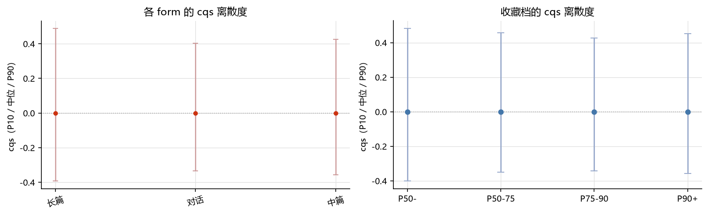
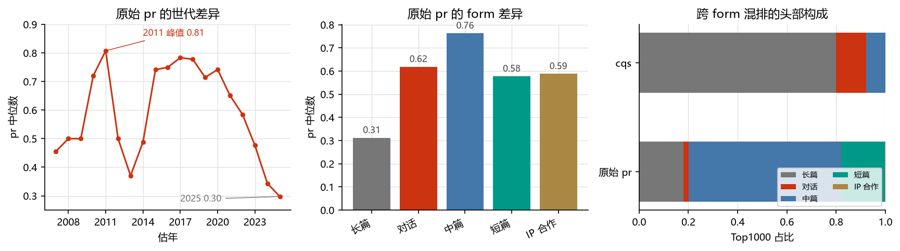
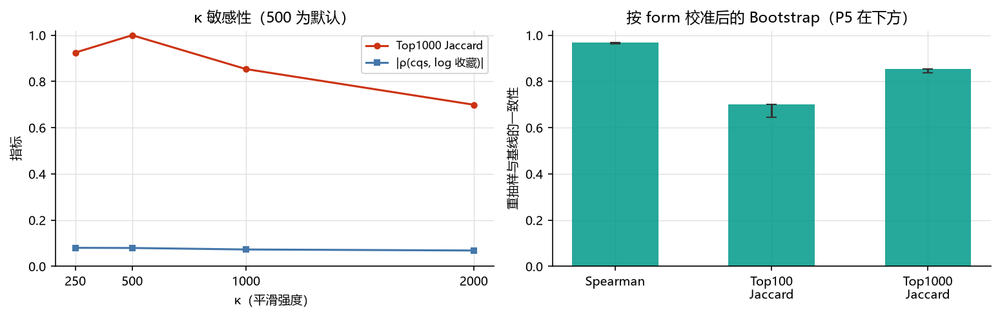

# 24 运行时量化指标：按 form 隔离的中层发现，而不是第二个总榜

> 口径边界
> 1. **数据**：`analysis/out/novels.csv` 的 245,887 行，经 `lib/eras.py` 定年、
>    限 `est_year 2007–2025` 并去掉 `invalid` / `words < 2,000` 后为
>    **213,658 本**。
> 2. **form 是第一隔离轴**：用 `lib/forms.py` 给全库判 `form`，再做
>    `form × 年 × 题材 × 收藏档` 校准；app 运行时使用 seed 的 DOM 验证 `form`，
>    绝不在不同 `form` 之间混排。库外 form 是估计值，只影响全库校准。
> 3. **指标**：cqs 是同一 `form`、同一年、同一题材、同一收藏档内的口碑分；
>    cps 是同一 `form`、同一年、同一篇幅档、同一题材内的位置分，只做筛选。
> 4. **证据门槛**：cqs 需 `favs ≥ 1,000`，每格 5 本起评，
>    20 本以上为 stable；**不回退**。cps 需 `favs ≥ 10`，
>    每格 20 本起评。
> 5. **不做**：跨 form 总榜、cps 总榜、0.5/0.5 综合分；每张榜只在单一 form 内有意义。
> 6. **clx 是可选视图**：字数偏好 K 交给用户、默认 0；app 存 `cqs + len_norm`
>    运行时重排，不预排静态榜、不写死 K（§2.5）。
> 7. 所有数字、表格和图形均由本脚本重算。

---

## 0. 结论：form 必须先切开

上一版把不同 `form` 混在一个中层表里，结果头部几乎全是对话/同人；这不是“对话书更好”，
而是不同 `form` 的收藏分布、篇幅分布和赞/收藏关系完全不同，混排后哪个 `form`
的样本多、方差大，哪个就占头部。

按 `form` 切开后：

- **长篇、对话**有足够稳定的 cqs 证据；**中篇**的 cps 覆盖为
  98.2%，但 cqs 稳定覆盖只有 16.0%，
  只能做“探索层”。
- **短篇、IP 合作**在 `favs ≥ 1,000` 下没有稳定的 cqs 格；不发布 cqs 榜。
- 长篇和对话的 cqs 头部仍然是各自 form 的书，不再互相挤占。
- **收藏档改成年内分位**（§2.4）：旧绝对档下长篇 cqs Top100 的年内收藏分位
  中位只有 0.343，头部是中等偏下的书；修复后 Top50 提到
  长篇 0.733 / 对话 0.891 /
  中篇 0.830。
- 旧回退反例：nid 221,819 是 长篇、232 收藏、556 赞、907,200 字；`favs < 1,000`，不在 cqs 池。

**产品结论**：app 的所有榜单先按 `form` 过滤；每个 form 内部才允许 cqs/cps 排序。
跨 form 的“总榜”不成立，也不应存在。cqs 只发布年内收藏 P50 以上的书。
字数偏好作为展示层的可选重排（clx）提供，权重交用户，默认不加权（§2.5）。

---

## 1. 为什么 form 不是可选的

`form` 不是题材标签，而是产品形态：长篇、对话、中篇、短篇、IP 合作。不同 form 的
数据生成机制不同：

- 对话书按“话”连载，收藏和赞的积累方式与正文长篇不同；
- 短篇/中篇的完读和曝光周期更短；
- IP 合作书的读者来源和平台推荐位不同；
- 同一本 15 万字书，在长篇和对话里不是同一种“同篇幅比较”。

所以 `form` 不能只作为显示过滤；它必须是**校准格的第一维**。本报告的公式在
`form` 内计算，app 也只在 `form` 内返回榜单。

---

## 2. 两个指标

### 2.1 cqs：form 内的口碑分（不含篇幅）

```text
pr_s = (praises + κ × μ0) / (favs + κ)
cqs  = log(pr_s) - median[ log(pr_s) | form, est_year, genre, 收藏档 ]
```

- `κ = 500`，`μ0 = 0.232`（cqs 池的 `praises/favs` 中位数）。
- **收藏档是 `form × 年` 内的收藏分位档**，不是绝对收藏数：`['P50-', 'P50-75', 'P75-90', 'P90+']`。
  分位边界在 cqs 池内按年计算，所以“中等水平”随年份漂移——2025 年的
  P75 与 2015 年的 P75 不是同一个收藏数，但在各自年内都是“中上”。
  绝对档（1k/2k/1万）会把"2015 年的 1 万"和"2025 年的 1 万"当成同类，
  让低年份的低分位书靠档内高赞藏比冲上头部。
- **只发布 `P50-75, P75-90, P90+` 档**：年内 P50 以下的书仍进入校准
  （贡献基线中位数），但不参与 cqs 榜排序。它们占池子一半，是“头部是中等偏下书”
  的主要来源；把它们挡在候选外，等价于先过滤再加分，不会移动基线、扭曲分母。
- 校准格：`form × est_year × genre × 分位收藏档`；每格至少 5 本。
- 5–19 本为 `low_confidence`；20 本以上为 stable。
- **cqs 不含篇幅**：篇幅只用于 app 的 form 隔离和经典篇幅榜，不作为 cqs 的分层。
- cqs 不是“绝对质量”，而是“在相同 form、年份、题材、收藏档里，赞/收藏是否偏高”。

### 2.2 cps：form 内的位置分（只做筛选）

```text
cps = log1p(favs) - median[ log1p(favs) | form, est_year, 篇幅档, genre ]
```

- 校准格：`form × est_year × 篇幅档 × genre`；每格至少 20 本。
- cps 保留篇幅，因为它的任务是回答“这本在相同 form、年份、篇幅、题材里收藏位置如何”。
- cps **不发布榜单**；它只用于取每个 form 的中层带
  （20–80 分位），再由 cqs 排序。
- 去掉篇幅的 cps 会退化成收藏/字数榜，不能当中层筛选器。

### 2.3 为什么不用 clicks

`clicks` 是累计曝光，受上架时间、推荐位、站外流量和抓取时点共同影响；
`discovered` 也没有可靠的点击训练信号。点击只能做“发现流”的排序信号，
不能进入 cqs/cps 的质量公式。

### 2.4 为什么收藏档用年内分位，而不是抬高基线中位数

上一版用绝对收藏档（`1k / 2k / 1万`）且基线取格内中位数，诊断发现
**长篇 cqs Top100 的年内收藏分位中位只有 0.343**——头部书在同年同 form 里
收藏只排 34 分位，是中等偏下的书。原因是绝对档跨年不可比：同样是 1 万收藏，
在 2015 年是头部、在 2025 年只是中层；低年份的低分位书被塞进高档，
靠档内高赞藏比冲上榜首。

一个直觉修正是"把基线中位数抬到 P75"，但**同一校准格内减去任何分位数都是
常数平移，格内排序完全不变**，只有跨格比较会动，且方向不可控。真正有效的
是两件事，本版都做了：

1. **收藏档改成 `form × 年` 内的分位档**，让"中等"随年份漂移；
2. **年内 P50 以下的书不发布 cqs**（仍进校准做基线），先过滤噪声再加分，
   不改变格内分母。

修复后各 form cqs Top50 的年内收藏分位中位：长篇 **0.733**、
对话 **0.891**、中篇 **0.830**，
头部已落在各自年份的中等或中等偏上。

### 2.5 clx：cqs 的运行时篇幅偏好视图（不是固定第四指标）

字数影响读者是否点开，但**偏好因人而异**——有人爱厚书、有人只想要短平快。
所以字数权重 `K` 不写死，clx 是 cqs 上的一个**用户可调视图**，由 app 在运行时现算：

```text
len_f = log(clip(words, LO_f, HI_f) / LO_f) / log(HI_f / LO_f)   # 超出封顶，∈[0,1]
clx   = cqs × (1 − K + K × len_f)          # K 由用户选，默认 0（即纯 cqs）
```

- **锚点 `10–90` 分位按 form 在可发布 cqs 池内现算**，不是绝对值：
  全库对话字数中位只有 8k，但能进 cqs 池的对话中位约 96k，用全库锚点会让对话
  `len_norm` 几乎全为 1、失去区分度。锚点表随校准表发布，库外书按同一锚点定档。
- **乘性 + 下界 `1−K`**：字数最多左右 K 倍的分数，低口碑书无法靠字数翻盘；
  `K=0` 退化为纯 cqs。字数项是**读者投入意愿先验**，不是质量证据——cqs 已用
  分位档消掉“长书赞藏比天然低”的机械偏差，这里不再补偿。
- **不预排静态榜**：app 只需存 `cqs + len_norm` 两列，用户选档后运行时重排。
  这与 cex（周期种子驱动、可预排）不同；文案叫“篇幅偏好”，不叫“排名”。

字数锚点（随校准表发布，见 §10）：

| form | 可发布 cqs | LO (P10) | HI (P90) |
|---|---|---|---|
| 对话 | 1,047 | 33,379 | 306,847 |
| 长篇 | 4,082 | 263,561 | 2,128,618 |
| 中篇 | 407 | 69,453 | 142,170 |

默认“偏厚”档 `K=0.25` 的区分度（Top200 与纯 cqs 榜对比，全现算）：

| form | K | Top200 换位 | 字数中位(纯cqs) | 字数中位(clx) |
|---|---|---|---|---|
| 对话 | 0.25 | 5 | 175,278 | 183,859 |
| 长篇 | 0.25 | 31 | 1,026,576 | 1,404,826 |
| 中篇 | 0.25 | 0 | 111,324 | 111,324 |

中篇锚点跨度小（字数集中），K 再大也几乎不换位——这不是 bug，是中篇读者本就不按字数选书；
clx 主要服务长篇/对话。**clx 不进入 cqs/cps 的分层或校准**，也不合成总分，
只是同一批 cqs 分数在展示层的可选重排。

---

## 3. form 覆盖与证据强度

`cqs` 池只包含 `favs ≥ 1,000` 且 form 非 invalid 的书；
`cps` 池包含 `favs ≥ 10` 的书。

| form | cqs 池 | cqs 可评 | 覆盖率 | stable | stable 覆盖 | 中层候选 | 低置信 |
|---|---|---|---|---|---|---|---|
| 长篇 | 8,516 | 8,272 | 97.1% | 7,195 | 84.5% | 2,448 | 483 |
| 对话 | 2,335 | 2,170 | 92.9% | 1,884 | 80.7% | 610 | 70 |
| 中篇 | 1,381 | 1,031 | 74.7% | 221 | 16.0% | 243 | 243 |
| 短篇 | 85 | 0 | 0.0% | 0 | 0.0% | 0 | 0 |
| IP 合作 | 23 | 0 | 0.0% | 0 | 0.0% | 0 | 0 |

- **长篇**：cqs 覆盖 97.1%，stable 覆盖 84.5%；
  可以发布稳定的长篇 cqs 榜。
- **对话**：cqs 覆盖
  92.9%，stable 覆盖
  80.7%；可以发布对话 cqs 榜，但只在对话 tab 内。
- **中篇**：cqs 可评但 stable 覆盖只有 16.0%，
  且中层候选里低置信比例高；只能做实验层，
  不应把低置信格当稳定结论。年内分位档把中篇样本砍掉约四分之一
  （绝对档时 stable 覆盖曾为 34%），这是"先保证头部不是中等偏下"的代价：
  中篇当前发不出稳定 cqs 榜，只保留 cps/经典榜。
- **短篇、IP 合作**：`favs ≥ 1,000` 的池太小，没有稳定 cqs 格；
  只保留 cps/经典榜，不发布 cqs。

### 3.1 cqs 的残余相关

cqs 在 form 内校准后：

- `est_year` Spearman：**+0.019**
- `log(words)`：**+0.134**
- `log(favs)`：**-0.079**

年份和收藏已经被压到接近 0；字数仍有正残余（+0.134），
因为 cqs 故意不按篇幅校准。这不是 bug：cqs 回答“口碑”，不回答“同篇幅谁更好”；
篇幅比较交给经典篇幅榜和 cps 的筛选。

### 3.2 cps 的残余相关

cps 在 form 内校准后：

- `est_year`：-0.024
- `log(words)`：+0.107
- `log(favs)`：**+0.690**

cps 与收藏高度相关是定义使然；它只是位置分，不是质量分。



---

## 4. 跨 form 混排为什么会给出不同答案

| 头部集合 | 长篇 | 对话 | 中篇 | 短篇 | IP 合作 |
|---|---|---|---|---|---|
| 原始 pr | 18.0% | 2.2% | 61.8% | 17.7% | 0.3% |
| cqs | 80.0% | 12.2% | 7.8% | 0.0% | 0.0% |
| cps | 36.2% | 16.0% | 33.7% | 14.0% | 0.1% |

- **原始 pr** Top1000 由 中篇 主导
  （61.8%），收藏中位数只有 23；
  这是小样本/低收藏噪声。
- **cqs** Top1000 由 长篇 主导
  （80.0%），收藏中位数 2,702；
  跨 form 时仍然是 long 的池子更大。
- **cps** Top1000 由 长篇 主导
  （36.2%），收藏中位数 4,186；
  这更证明 cps 不能当质量榜。
- 上一版把不同 form 混排后，中层表头部几乎全是对话/同人；同一批书在长篇榜里
  根本不该出现。**跨 form 的头部不是“最好的书”，只是“这个池子的形状”。**



---

## 5. 各 form 的中层 Top5

取数顺序：

1. 在该 form 内算 cps，保留 20–80 分位；
2. 只保留有 stable cqs 的书；
3. 每个 form 按 cqs 取 Top5，不跨 form 合并。

| form | 中层候选 | stable | 低置信 | 低置信占比 | 收藏中位 | 字数中位 |
|---|---|---|---|---|---|---|
| 长篇 | 2,448 | 1,965 | 483 | 19.7% | 11,318 | 668,306 |
| 对话 | 610 | 540 | 70 | 11.5% | 4,278 | 110,180 |
| 中篇 | 243 | 0 | 243 | 100.0% | 2,282 | 110,480 |

低置信不是“淘汰”，而是“证据不足”：app 可以显示 `low_confidence` 标签，
但不应把它和 stable 书放在同一个“稳定推荐”层。当前中层候选中
796 本（24.1%）处于 5–19 本的格。

| form | nid | 书名 | 估年 | 题材 | 篇幅 | 收藏 | 赞 | 格内n | cps | cqs |
|---|---|---|---|---|---|---|---|---|---|---|
| 长篇 | 642,730 | 苍蓝之境 | 2023 | 魔幻 | 长篇 | 6,092 | 3,354 | 78 | +1.48 | +1.248 |
| 长篇 | 179,171 | 当只小鸡丶从入门到精通 | 2019 | 魔幻 | 长篇 | 7,993 | 5,904 | 95 | +1.83 | +1.231 |
| 长篇 | 491,599 | 绝世仙子从不在意罪孽缠身 | 2021 | 玄幻 | 长篇 | 6,875 | 2,944 | 53 | +1.45 | +1.105 |
| 长篇 | 309,977 | 让人哭笑不得的青春恋爱喜剧 | 2020 | 校园 | 长篇 | 15,821 | 7,182 | 37 | +1.72 | +1.052 |
| 长篇 | 540,257 | 公爵千金要把国王吊路灯 | 2022 | 魔幻 | 长篇 | 6,952 | 3,691 | 92 | +2.12 | +1.049 |
| 对话 | 617,557 | 舰长我啊女朋友很多哦 | 2023 | 同人 | 长篇 | 5,623 | 11,493 | 26 | +1.29 | +0.924 |
| 对话 | 435,788 | 重生为真琪想要被拯救重置版 | 2021 | 同人 | 长篇 | 4,911 | 10,705 | 73 | +0.69 | +0.882 |
| 对话 | 622,224 | 成为终末鸟穿梭各个世界寻找怪物 | 2023 | 同人 | 中篇 | 3,709 | 6,451 | 42 | +1.05 | +0.876 |
| 对话 | 480,646 | 我舰长乃医术最强 | 2021 | 同人 | 长篇 | 12,712 | 32,166 | 50 | +1.64 | +0.871 |
| 对话 | 620,266 | 我千律，势必要刀哭律三家！ | 2023 | 同人 | 长篇 | 12,010 | 21,323 | 26 | +2.05 | +0.823 |

- 长篇和对话各 5 本，头部都是各自 form 的书，收藏都在各自年份的中位数以上。
- 中篇在分位档下没有 stable 格进入中层带（243 本全是 5–19 本的小格），
  表里没有中篇行——这是证据不足，不是"中篇没有好书"。
- 短篇/IP 合作没有 stable cqs，表中不出现。

### 5.1 扇天机反例

nid 221,819 是 长篇、232 收藏、556 赞、907,200 字；`favs < 1,000`，不在 cqs 池。

旧版在“同篇幅 + 同题材 + 收藏档”小格只有几本时回退到更大池子，制造了假高分；
新版不满足 5 本就不评，不用回退来“补”头部。

---

## 6. cps 的 form 内覆盖

| form | cps 池 | cps 可评 | 覆盖率 |
|---|---|---|---|
| 长篇 | 16,264 | 15,830 | 97.3% |
| 对话 | 31,645 | 30,952 | 97.8% |
| 中篇 | 19,954 | 19,596 | 98.2% |
| 短篇 | 36,140 | 35,856 | 99.2% |
| IP 合作 | 383 | 225 | 58.7% |

cps 覆盖整体 **98.2%**，但它只用于中层筛选：

- 长篇、对话、中篇、短篇的 cps 覆盖都接近满格；
- IP 合作的 cps 覆盖只有
  58.7%，
  不适合单独发布；
- cps 的 20–80 分位必须在 form 内取；跨 form 的 20–80 分位会被池子大小带偏。

---

## 7. 稳定性

### 7.1 κ 敏感性

| κ | ρ(cqs, log 收藏) | Top1000 Jaccard | Top1000 收藏中位 |
|---|---|---|---|
| 250 | -0.080 | 0.925 | 2,461 |
| 500 | -0.079 | 1.000 | 2,702 |
| 1000 | -0.073 | 0.854 | 3,388 |
| 2000 | -0.069 | 0.699 | 4,534 |

κ=500 与 κ=1000 的 Top1000 Jaccard 约
0.85；κ 太小会让低收藏书占头部，
κ 太大会把高分压回收藏。默认 **κ=500**，250–2000 可调。

### 7.2 覆盖率与 Bootstrap

| 指标 | 可评 | 可评格 | 稳定格 | 覆盖率 | 稳定覆盖 |
|---|---|---|---|---|---|
| cqs | 11,473 | 392 | 168 | 93.0% | 75.4% |
| cps | 102,459 | 391 | 391 | 98.2% | 98.2% |

按 form 校准后，cqs 整体覆盖 93.0%、稳定覆盖
75.4%；中篇和短篇/IP 的稳定覆盖是主要短板。

Bootstrap（20% 评测、80% 校准、30 次重抽样）：

- Spearman 中位 **0.967**（P5 0.964）
- Top100 Jaccard 中位 **0.702**（P5 0.645）
- Top1000 Jaccard 中位 **0.854**（P5 0.838）
- 绝对分数偏移中位 **0.037**



头部 Top100 仍有约 30% 的换位；产品应标“中层/证据强度”，
不要用精确名次或“第 37 名 vs 第 38 名”的叙事。

---

## 8. app 运行时怎么接

### 8.1 form 是硬前置

1. `seed.books.form` 是 DOM 验证值；所有榜单查询先 `WHERE form = ?`。
2. `discovered` 必须先拿到 form（详情页刷新或 `forms.classify`），
   form 未知时**不进入任何榜单**，可以只进搜索/详情。
3. cqs/cps 的校准键都带 form；跨 form 查询直接拒绝或返回空，不做“回退到全库”。
4. 经典榜也按 form 隔离；form 不是榜单内的排序字段。

### 8.2 分位边界表必须随校准表一起发布

收藏档是 `form × 年` 内的分位档，app 需要一张 **form×年的收藏阈值表**
（P50/P75/P90 三列，从 cqs 池算得）才能给库外书定档。这张表和 cqs 校准格
一起作为 `calibration_version` 的一部分发布；缺了它，库外书无法判档，
只能降级到经典榜。阈值表很小（5 form × 19 年 × 3 = 285 个数），由本生成器
导出到 `analysis/out/report24_fav_bounds.csv`（`form, est_year, p50, p75, p90`），
随报告一起重算。

定档规则：用书的 `favs` 与同 form 同年的三档阈值比较，落在 P50 以下的
**不发布 cqs**（但种子书若已有旧版 cqs 字段，按新规则重算）。

篇幅偏好视图还需一张 **form × 字数锚点表**（P10/P90 两列，从可发布 cqs 池算得），
由本生成器导出到 `analysis/out/report24_len_anchors.csv`（`form, lo, hi`）。
它与收藏阈值表同批发布：app 存每本书的 `cqs + len_norm`，用户选 K 后运行时
算 `clx = cqs × (1-K+K×len_norm)` 并重排；K 默认 0。**不预排、不写死 K**。

### 8.3 指标接入顺序

1. 写入 `discovered`：`nid/title/author/genre/words/favs`（有 `praises` 才写 cqs）。
2. `est_year = eras.Estimate(nid)`；`band` 由 `words` 切。
3. 查 8.2 的阈值表给书定分位收藏档；P50 以下直接不算 cqs。
4. 先算 **cps**（`favs ≥ 10`），只在同 form 的中层带出现。
5. 抓到详情页后再算 **cqs**（`favs ≥ 1,000`）；没有 `praises` 不显示 cqs。
6. cqs 书按字数锚点表算 `len_norm` 并存下；用户选“篇幅偏好”档后运行时算 **clx**
   重排（默认档 K=0 即不加权）。三档预设 K=`0.00, 0.25, 0.60`，
   高级滑杆可连续调；clx 只在单一 form 内重排。
7. 2026 年书用 2025 年阈值与基线，标 `provisional / low_evidence`；不进入稳定 cqs 榜。

### 8.4 与旧字段的关系

- `cps` 不是 `fav_pctl` 的替代；它只回答“同 form 的位置”。
- `cqs` 不是 `pr`/`lqs` 的替代；它只回答“同 form、同代、同题材、同收藏档的口碑”。
- `clx` 不是第四个分数，是 cqs 的用户可调展示视图；不与 cqs/cps 合成总分，
  也不进入校准。已有的 `lqs` 用旧 pr 且只对长篇，两者不合并、分数不可比。
- 经典榜继续用原始 `favs/clicks/praises`，不受影响。
- 旧 `fav_pctl/click_pctl/praise_pctl/pr/lqs` 是构建期快照；新增书不能靠它们。

---

## 9. 边界与不承诺

1. **cqs 不是“绝对好书”**：它只说同 form、同代、同题材、同收藏档里赞/收藏偏高。
2. **form 是估计值**：全库用 `forms.classify`，seed 用 DOM 验证；库外 form 误差会进入
   全库覆盖率，但不改变 app 的 form 隔离规则。
3. **中篇证据弱**：stable 覆盖低，低置信比例高；不应把中篇 cqs 与长篇/对话同等对待。
4. **短篇/IP 没有 cqs**：`favs ≥ 1,000` 的池太小，不发布 cqs。
5. **cps 不是榜单**：只做 20–80 分位筛选；不写 cps 总榜/全库榜。
6. **头部不稳定**：Bootstrap Top100 Jaccard 0.70；产品文案不要说精确名次。
7. **年内 P50 以下不发布 cqs**：这是"头部不能是中等偏下书"的必要过滤，
   代价是中篇 stable 覆盖降到 16.0%、发不出稳定榜；
   短篇/IP 本就没有 cqs。这些 form 的发现需求交给 cps + 经典榜。
8. **2026 年不校准**：沿用 2025 年阈值与基线，UI 标 provisional。
9. **clx 不是质量提升**：它只按用户偏好重排 cqs，字数不进校准；中篇锚点跨度小、
   几乎不换位；文案用“篇幅偏好”而非“排名”，避免用户调档后误以为名次出错。
10. **数据截止**：校准表基于 2026-05-03 快照；每次重建写 `calibration_version`。

---

## 10. 复现

```powershell
cd analysis
uv run python generators/report_24_runtime_metrics.py
```

生成 `reports/24_runtime_metrics.md`、`reports/figures/24_bias.png`、
`reports/figures/24_calibration.png`、`reports/figures/24_stability.png`，
以及 app 定档用的 `out/report24_fav_bounds.csv`（收藏分位阈值）与
`out/report24_len_anchors.csv`（clx 字数锚点）。
