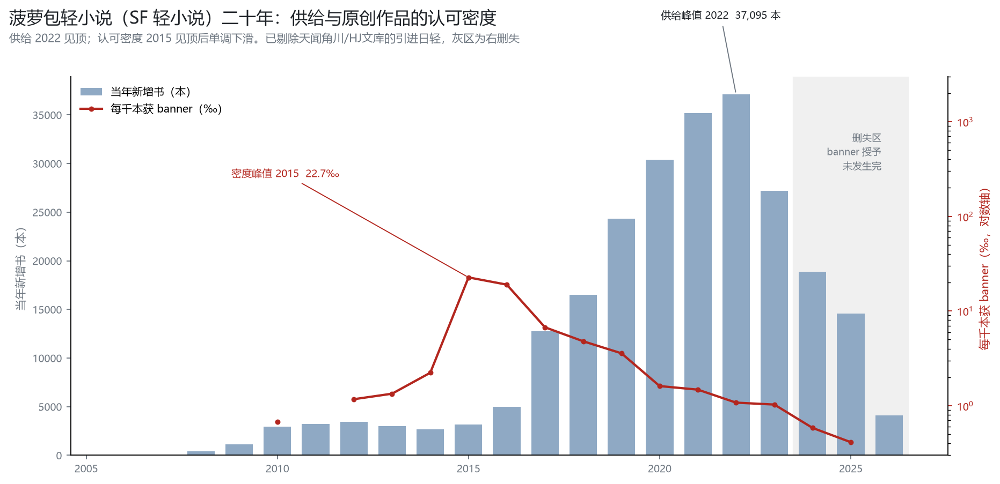

# 00 · 时间轴：这个站点是怎么起来的，又是什么时候开始退的

> 口径声明：
> 1. 所有年份均由 `nid` 定年（`quarry.era`），不是 `last_update`。
> 2. **已剔除引进日轻**（天闻角川 / 天闻角川2号机 / HJ文库，共 46 本）。
>    这批书由版权方账号整批上架，banner 也由版权方提供，不代表 SFACG 对原创作品的认可。
>    年表里被剔除的量记在 `import_books` / `import_banners` 两列，一个没丢。
> 3. 数据集版本 `v1`，快照末日 **2026-06-13**（最大 nid 777,879 的真实 `addTime`）。

---

## 0. 一句话结论

**「黄金五年 2015–2020」成立，但三件事不在同一年发生，而且先起来的不是规模，是认可。**

| 维度 | 峰值年 | 峰值 | 2025 值 | 变化 |
|---|---|---|---|---|
| 原创作品的认可密度（每千本新书获 banner） | **2015** | 22.7 ‰ | 0.41 ‰ | **−98.2%** |
| 认可绝对量（当年创建的书里最终获 banner 的数量） | **2016** | 95 本 | 6 本 | −94% |
| 单本爆发力（当年新书人气 P99） | **2019** | 272 万 | 89 万 | −67% |
| 供给规模（当年新增书） | **2022** | 37,095 | 14,574 | −61% |

顺序是：**2015 认可先起 → 2019 爆款能力见顶 → 2022 规模才见顶**。供给一路涨到 2022 的同时，认可密度从 22.7‰ 跌到 1.08‰，跌了 95%。这不是"平台变差"，而是**它在用同一套 banner 名额面对 11 倍的供给量**。



（图由 `uv run python -m quarry.report_timeline` 生成，两处标注的峰值都由 `era_stats` 现算，不写死。）

---

## 1. 定年模型：为什么可以用 nid 当时间轴

`novels.id` 是站点全局自增主键，严格单调。91 个锚点（API 实测 `addTime`）验证：**0 次真逆序**。

**插值方式选了 `log(nid)` 而不是线性**。原因是 nid 消耗速率本身在变：

| 区间 | nid/天 |
|---|---|
| 2006–2008 | 1.8 |
| 2019 | 约 250 |
| 2025–2026 | 72 |

180 倍的变化下，线性插值会系统性高估早期速度。留一法对比：

| 方法 | 中位误差 | 平均绝对误差 | 最大误差 |
|---|---|---|---|
| 线性 | 0 天 | 6.6 天 | 356 天 |
| **log** | **0 天** | **3.8 天** | **237 天** |

**误差分布（log）**：92% 的锚点误差 ≤ 1 天；只有 6 个 > 1 天，全部落在 2006–2010 的锚点稀疏区（最大 237 天，nid=3485）。**2011 年之后定年精度 ≤ 1 天**。

> 留一法有个坑：锚点是「每个分位点抓 2 本相邻 nid」，两者 `addTime` 常完全相同。
> 若只去掉一个，另一个就成了答案泄漏，误差恒为 0。所以留出单元必须是**整组时间戳**。
> 同理，尾部外推不能用"最后两个锚点"算斜率——761711/761712 同一天，斜率会被算成 0，
> 把 2026 年全部 6,150 本书压到 2025-10-30。这个 bug 已修。

### 1.1 定年质量：2017 年是可信度分水岭

锚点按全库 nid 的 2.5% 分位采样，所以**书多的年份锚点密、书少的年份锚点稀**。按两侧锚点的日期间隔分档（≤90 天 high / ≤365 天 mid / 否则 low）：

| 年份段 | low 占比 | 说明 |
|---|---|---|
| 2007–2008 | 100% | 锚点隔 1–2 年，只能定到"某年" |
| 2009–2010 | 45–71% | |
| 2011–2015 | 100% | 每段锚点跨 1–2 年 |
| 2016 | 91% | |
| **2017–2026** | **0%** | 锚点密集，插值精度 ≤ 几天 |

全库：**57.5% high / 33.1% mid / 9.4% low**。

**这不是缺陷，是采样设计的直接后果**：读 2016 年及以前的年度数字时，年份归属有 ±数周误差；2017 年起的数字可信到天。

### 1.2 用 `last_update` 给误差做独立测量

`last_update` 是硬上界——书在最后更新那天必定已经存在。所以凡是 `est_date > last_update` 的书，晚出来的天数就是**误差的下界**。

实测：**30,662 本（12.5%）违约，违约幅度中位 5 天**，且集中在锚点稀疏的早年（2011 年样本普遍偏晚 67 天）。这与留一法的误差分布完全一致，两个独立方法互相印证。

---

## 2. 引进日轻：为什么必须排除，以及口径是怎么定的

这一节放在年表前面，因为**它改变了 2006–2009 年的全部数字**。

### 2.1 判定依据：出版方账号，不是标题、不是年份

| 候选口径 | 为什么不能用 |
|---|---|
| **按标题匹配** | 标题含「刀剑神域」的有 87 本，其中 **86 本是中国人写的同人**（「刀剑神域之假面骑士玩家」）。同人是原创作品，不能排除。 |
| **按年份** | 2008–2013 的出版社全是中文网名（魂之重奏、逆鳞.散落、胧月笼），是业余原创；盗版期整本搬运的日轻**没有留下可识别痕迹**。 |
| **按 `typeId`** | 无效。奇诺之旅（日轻）和 2020 年原创《在充满怪谈的世界里成为魔女》的 `typeId` 都是 21。 |
| **按出版方账号** | **有效**。引进日轻由版权方以出版方账号上传，账号名直接暴露身份。 |

实测三个账号：`天闻角川` 37 本、`天闻角川2号机` 1 本、`HJ文库` 9 本，**46 本里 46 本带 banner（100%）**。

100% 不是巧合——这正是「banner 由版权方提供」的机制证据：出版方整批上架，banner 跟着图一起进站，与作品在站内的实际表现无关。

### 2.2 排除后的影响：2006–2009 年原创 banner 归零

| 年 | banner（全量） | 引进 | **原创** |
|---|---|---|---|
| 2006 | 3 | 3 | **0** |
| 2007 | 3 | 3 | **0** |
| 2008 | 1 | 1 | **0** |
| 2009 | 2 | 2 | **0** |
| 2010 | 7 | 5 | **2** |
| 2011 | 2 | 2 | **0** |
| 2012 | 6 | 2 | 4 |
| 2013 | 7 | 3 | 4 |

**这给了「引进期」一个硬定义**：2006–2009 这四整年里，站点没有对任何一部原创作品授予过 banner。2010 年才出现第一批（2 本：《妹妹大人魔女Sama》《blaster守护者》）。

同时也说明：**早期的高人气书（SAO 2,378 万、魔禁 1,895 万、夏娜 627 万）不是站内读者捧起来的，是引进 IP 自带的**。用它们解释"当年的读者口味"会得出完全错误的结论。

### 2.3 一个无法消除的残留

盗版期（2006–2014）由用户上传的日轻整本，无法与业余原创区分——它们没有出版方账号痕迹。这部分推测规模不大且不带 banner（banner 功能 2015 年才成形），对**认可机制**分析无影响；但它会让 2006–2014 的**供给计数**偏高。这一点无法在本数据集内校正，只能记住。

---

## 3. 年表（已排除引进日轻）

`books_new` 是当年新增原创书数；`grant_per_1k` 是每千本新书里最终拿到 banner 的数量（cohort 口径，不是当年授予量）。

| 年 | 新增书 | 新作者 | banner | grant‰ | 中位人气 | P99 人气 | 中位字数 | VIP% |
|---|---|---|---|---|---|---|---|---|
| 2006 | 0 | 0 | 0 | — | — | — | — | — |
| 2007 | 76 | 76 | 0 | 0.00 | 3,440 | 43 万 | 12,428 | 1.3 |
| 2008 | 406 | 395 | 0 | 0.00 | 2,226 | 8 万 | 10,420 | 0.0 |
| 2009 | 1,127 | 1,037 | 0 | 0.00 | 1,904 | 16 万 | 12,695 | 0.0 |
| 2010 | 2,951 | 2,714 | 2 | 0.68 | 1,561 | 16 万 | 9,961 | 0.1 |
| 2011 | 3,201 | 2,858 | 0 | 0.00 | 1,403 | 13 万 | 12,152 | 0.0 |
| 2012 | 3,414 | 2,927 | 4 | 1.17 | 1,277 | 15 万 | 16,102 | 0.1 |
| 2013 | 2,984 | 2,521 | 4 | 1.34 | 457 | 11 万 | 12,459 | 0.1 |
| 2014 | 2,691 | 2,255 | 6 | 2.23 | 427 | 18 万 | 13,508 | 0.4 |
| **2015** | 3,177 | 2,769 | **72** | **22.66** | 783 | 254 万 | 19,387 | 2.8 |
| **2016** | 4,997 | 4,386 | **95** | **19.01** | 741 | 216 万 | 19,090 | 3.7 |
| 2017 | 12,763 | 11,415 | 86 | 6.74 | 174 | 141 万 | 14,843 | 2.6 |
| 2018 | 16,477 | 13,654 | 79 | 4.79 | 136 | 189 万 | 12,436 | 2.5 |
| 2019 | 24,304 | 19,428 | 87 | 3.58 | 262 | **272 万** | 10,538 | 3.0 |
| 2020 | 30,386 | 24,480 | 49 | 1.61 | 574 | 233 万 | 10,820 | 3.0 |
| 2021 | 35,161 | 25,410 | 52 | 1.48 | 597 | 174 万 | 7,858 | 2.4 |
| 2022 | **37,095** | 25,934 | 40 | 1.08 | 468 | 162 万 | 7,776 | 2.6 |
| 2023 | 27,215 | 17,236 | 28 | 1.03 | 382 | 135 万 | 8,370 | 3.3 |
| 2024 ⚠ | 18,877 | 11,787 | 11 | 0.58 | 296 | 119 万 | 9,880 | 4.0 |
| 2025 ⚠ | 14,574 | 9,433 | 6 | 0.41 | 243 | 89 万 | 16,746 | 4.2 |
| 2026 ⚠ | 4,123 | 2,558 | 0 | 0.00 | 144 | 35 万 | 21,057 | 3.7 |

⚠ = 落在删失窗口内（见 §5）。`2006` 行为 0 是因为当年 3 本书全是引进书。

---

## 4. 四个阶段

### 4.1 引进期：2006–2009

4 年、1,609 本原创书、**0 个 banner**。这个阶段站点的事实形态是"日轻资源站 + 业余练笔区"：
读者来这里看的是角川的引进书，原创区没有进入任何官方认可体系。

### 4.2 兴趣站期：2010–2014

| 年 | 新增书 | 原创 banner |
|---|---|---|
| 2010 | 2,951 | 2 |
| 2012 | 3,414 | 4 |
| 2013 | 2,984 | 4 |
| 2014 | 2,691 | 6 |

五年间原创 banner 从 2 涨到 6，grant 从 0.68‰ 到 2.23‰。**这是 banner 作为"原创作品认可"真正开始工作的阶段**，但规模极小——每年个位数。

作者人数从 2,714 涨到 2,927 后开始回落，供给在 3,000 本/年上下波动，是一个稳定的社区规模。

### 4.3 扩张期：2015–2022

外部年表：APP 2015 上线、2016 做漫画与有声、2018 A 轮 3000 万、2022 B 站 B 轮。数据侧同步：

- **2015：认可先跳。** banner 从 6 跳到 **72**（**12 倍**），密度 22.66‰ 是历史峰值。Q4 占 41/72（57%）——功能在年内起量，所以这一年的密度是"半年强度 ÷ 全年分母"，真值只会更高。
- **2016：绝对量见顶。** 95 个 banner（历史最多），密度 19.01‰ 次高。
- **2017：供给跳。** 新书 12,763（**+155%**），整条曲线最陡的一年。同时中位人气从 741 掉到 **174**——涌入的大部分是没人看的书。
- **2019：爆款能力见顶。** P99 人气 272 万，banner 87 个。
- **2022：供给见顶。** 37,095 本，但 banner 只剩 40，密度 1.08‰。

**七年里供给涨 11.7 倍，banner 绝对量从 72 降到 40，密度从 22.66‰ 跌到 1.08‰（−95%）。**

### 4.4 收缩期：2023–2025

| 年 | 新增书 | 同比 |
|---|---|---|
| 2022 | 37,095 | — |
| 2023 | 27,215 | **−26.6%** |
| 2024 | 18,877 | **−30.7%** |
| 2025 | 14,574 | **−22.8%** |

**三年跌 61%。** 这个数字不需要删失校正——书创建了就是创建了。所以"站点在收缩"是本文最硬的结论。

同期 `vip_pct` 从 2.6% 升到 4.2%（历史最高）。两种解释：签约门槛提高，或免费书减少。数据分不出哪一个。

---

## 5. 删失警告：2024–2026 的 banner 数不可当实况读

原创 banner 书的**创作跨度**（创建 → 最后更新）：

| 分位 | 年 |
|---|---|
| P25 | 1.4 |
| **中位** | **2.5** |
| P75 | 4.4 |
| P90 | 6.4 |

只有 **13%** 在 1 年内完成，**60%** 需要 ≥2 年，**42%** 需要 ≥3 年。banner 书字数中位 **169 万字**（非 banner 1.04 万字，差 163 倍），完结+断更占 95.3%（连载中仅 29 本）。

**这意味着**：2024 年创建的书到快照日只观测了 2 年，2025 年的 1.5 年，2026 年的不足半年。它们的 banner 授予还没发生完。

所以 2024 年 11 个、2025 年 6 个、2026 年 0 个，**是下界，不是实况**。

**可信区间**：2022 年及以前（已过 4 年）可横向比；2023 年是边界；2024 之后只记录不断言。

这限定了"塌陷"结论的强度：**2016 的 95 掉到 2022 的 40（−58%）是真实的**，但"2025 只剩 6 个"不能说成"官方停止认可"。

---

## 6. 对「黄金五年 15–20」的检验

| 口径 | 定义 | 区间 |
|---|---|---|
| **单本获奖概率** | grant_per_1k ≥ 3‰ | **2015–2019**（2020 跌到 1.61‰） |
| **名额总供给** | banner ≥ 50 个/年 | **2015–2021**（2022 跌到 40） |
| **规模 + 密度兼顾** | 新增书增长 且 grant ≥ 1‰ | **2016–2020** |

三个口径的交集是 **2015–2019**，与判断吻合。两处要修正：

1. **2020 是拐点年，不是黄金期成员。** 密度从 3.58 腰斩到 1.61，banner 从 87 跌到 49（−44%）。它仍在"名额 ≥50"内，但已掉出"概率 ≥3‰"。
2. **2015 是认可元年，不是规模元年。** 供给只涨 18%，但 banner 涨 12 倍——**这一年变的是站方的行为，不是用户的行为**。

**分期表**：

| 阶段 | 年份 | 特征 |
|---|---|---|
| 引进期 | 2006–2009 | 原创 0 banner，站点靠日轻 |
| 兴趣站 | 2010–2014 | 原创 banner 首次出现，每年 ≤6 个 |
| **元年** | **2015** | APP 上线，banner 涨 12 倍，密度 22.66‰ 见顶 |
| **巅峰** | **2016** | 95 个 banner，绝对量历史最多 |
| 稀释 | 2017–2019 | 供给涨 4.9 倍，banner 持平，密度跌到 3.58‰ |
| **拐点** | **2020** | banner −44%，密度腰斩 |
| 下行 | 2021–2022 | 供给仍涨到峰值，密度 1.08‰ |
| 收缩 | 2023–2025 | 供给 −61%，VIP 升至 4.2% |

**一句话**：*2015 年站方开始大规模认可原创，2016 年发到最多，此后名额基本冻住，而供给翻了 11 倍——所以「黄金期」的本质是**名额没被稀释的那几年**。*

---

## 7. 这一轮推翻/修正的结论

| 旧说法 | 实测 | 处理 |
|---|---|---|
| 认可密度 2016 见顶（19.4‰） | **2015 是 22.66‰，一直比 2016 高**。旧报告的表述把"绝对量峰值"当成了"密度峰值" | 已改：密度峰值 2015，绝对量峰值 2016 |
| 2006–2009 有 banner 授予 | 那 12 个全是引进日轻，**原创为 0** | 已改，并写成断言 |
| 「引进期」只是印象 | 现在是硬定义：四整年原创 banner 为 0 | 已改 |
| banner 功能 2015-09 上线 | 2015 年 1 月就有 banner 书，9 月起量级翻倍；且这是书的创建月，不是授予月 | 表述改为"2015 年规模化" |
| 授予量 92→7 塌陷 | 2016–2022 的 95→40 真实；2024 之后的 11/6 受右删失压低 | 结论强度下调 |
| 定年用线性插值 | log 更优（最大误差 237 vs 356 天） | 已切到 log |

**新增待查项**：nid 区间填充率全库只有 **31.7%**（775,638 个 nid 宽度里 246,045 本书）。若 nid 只发给小说，这意味着 68% 已下架；但更像 nid 被非小说对象共用（平均 3.15 个 nid 才 1 本）。**确认 nid 分配规则前，此数不能当存活率用。**

---

## 8. 复现

```bash
cd quarry
uv run pytest -q                            # 26 项断言，含引进日轻口径与定年精度
uv run python -m quarry.report_timeline     # 重出本报告的图
```

产物：`datasets/v1/strata-v1.duckdb` 内的 `novels_era`（246,045 行）与 `era_stats`（21 行）。
排除的 46 本引进书在 `novels.flg_import`，同时计入 `era_stats.import_books` / `import_banners`。
